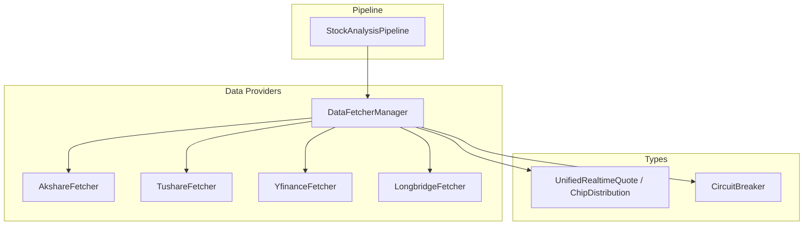
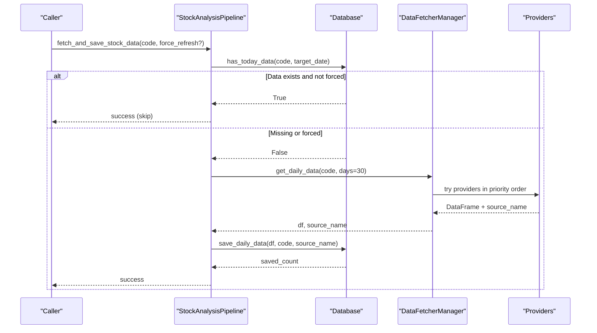
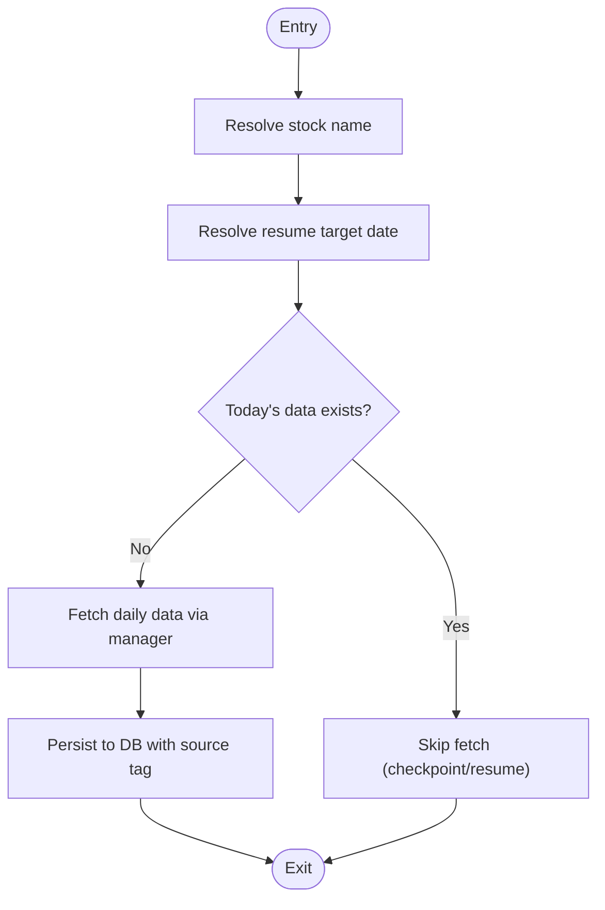
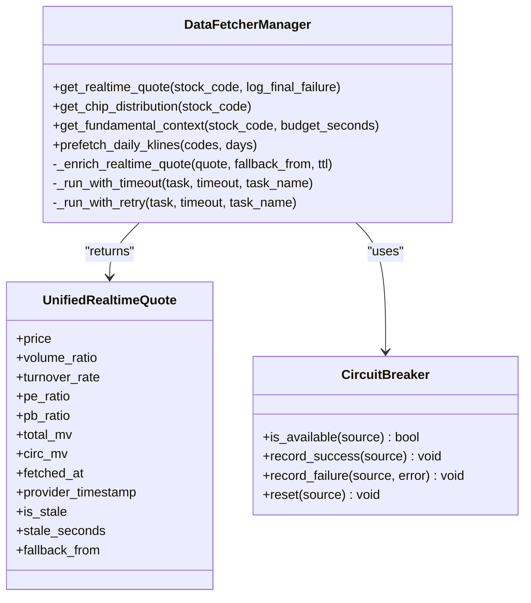
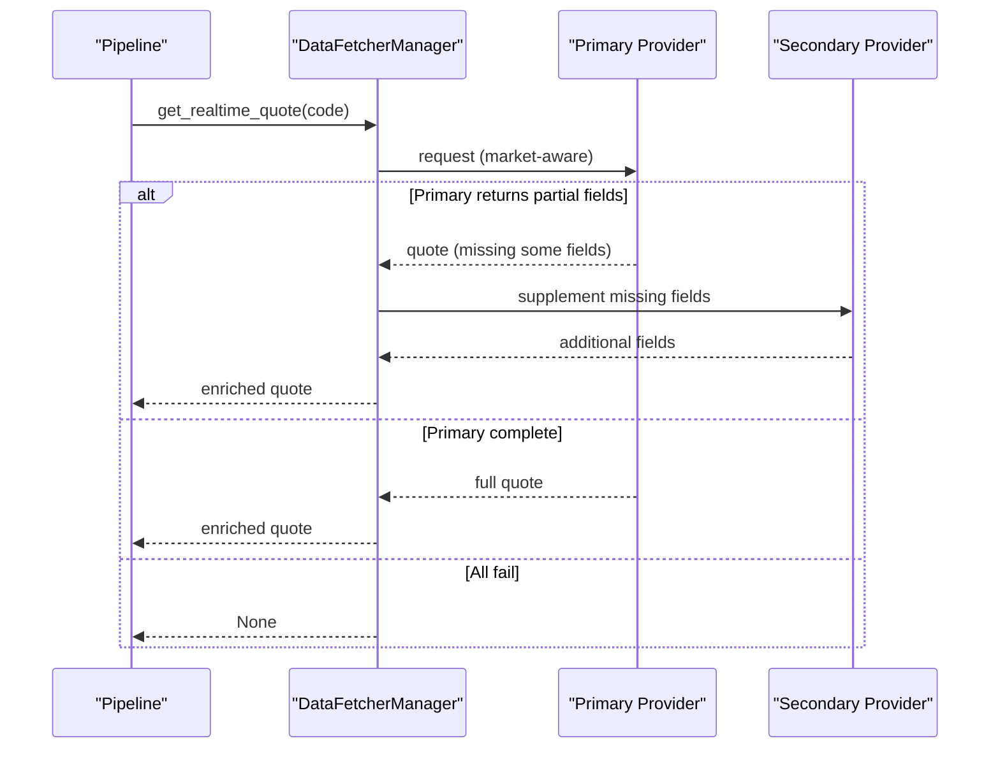
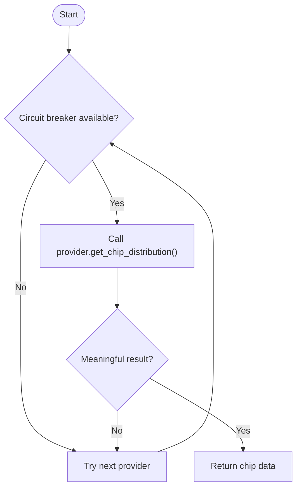
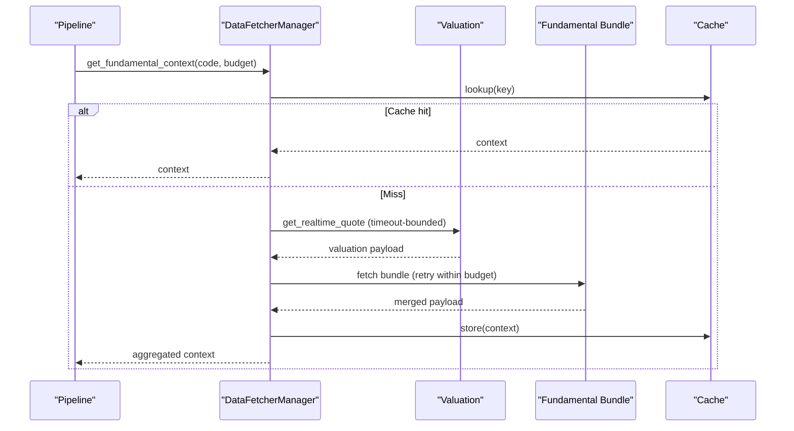
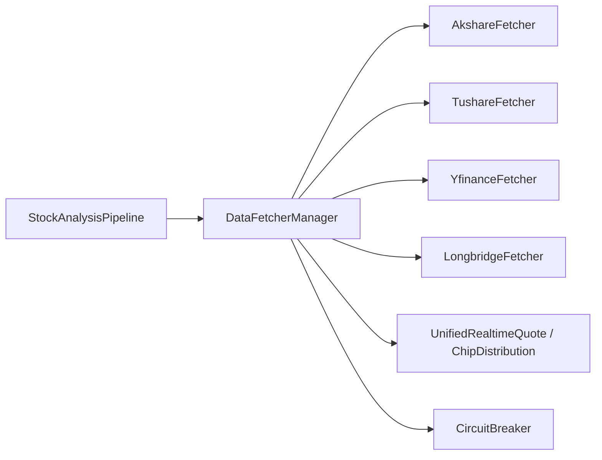

# Data Collection & Fetching

<cite>
**Referenced Files in This Document**
- [pipeline.py](file://src/core/pipeline.py)
- [base.py](file://data_provider/base.py)
- [realtime_types.py](file://data_provider/realtime_types.py)
- [__init__.py](file://data_provider/__init__.py)
- [akshare_fetcher.py](file://data_provider/akshare_fetcher.py)
- [tushare_fetcher.py](file://data_provider/tushare_fetcher.py)
- [data_tools.py](file://src/agent/tools/data_tools.py)
</cite>

## Table of Contents
1. [Introduction](#introduction)
2. [Project Structure](#project-structure)
3. [Core Components](#core-components)
4. [Architecture Overview](#architecture-overview)
5. [Detailed Component Analysis](#detailed-component-analysis)
6. [Dependency Analysis](#dependency-analysis)
7. [Performance Considerations](#performance-considerations)
8. [Troubleshooting Guide](#troubleshooting-guide)
9. [Conclusion](#conclusion)
10. [Appendices](#appendices)

## Introduction
This document explains the data collection and fetching mechanisms used by the StockAnalysisPipeline. It focuses on:
- Intelligent daily data retrieval with checkpoint/resume, automatic fallback between providers, and caching strategies.
- The role of DataFetcherManager in coordinating multiple data providers (AkShare, YFinance, Tushare, Longbridge, etc.), error handling, retry logic, and market-specific routing.
- Real-time quote acquisition including volume ratio and turnover rate, chip distribution retrieval with circuit breaker protection, and fundamental context aggregation.
- Practical configuration examples for source priorities, network failure handling, and refresh optimization.
- How data collection stages feed into subsequent analysis phases.

## Project Structure
The data pipeline is centered around:
- Pipeline orchestration in src/core/pipeline.py that coordinates fetching, storage, and analysis.
- A unified provider abstraction and manager in data_provider/base.py that implements strategy-based routing, retries, and fallbacks.
- Shared types and resilience primitives in data_provider/realtime_types.py (unified quote model, chip distribution model, circuit breakers).
- Provider implementations such as AkShare and Tushare in data_provider/*.py.
- Agent tooling that exposes fetch capabilities via src/agent/tools/data_tools.py.

**Diagram sources**
- [pipeline.py:209-318](file://src/core/pipeline.py#L209-L318)
- [base.py:2137-2469](file://data_provider/base.py#L2137-L2469)
- [realtime_types.py:110-194](file://data_provider/realtime_types.py#L110-L194)
- [realtime_types.py:285-465](file://data_provider/realtime_types.py#L285-L465)

**Section sources**
- [pipeline.py:209-318](file://src/core/pipeline.py#L209-L318)
- [__init__.py:1-67](file://data_provider/__init__.py#L1-L67)

## Core Components
- StockAnalysisPipeline.fetch_and_save_stock_data: Implements checkpoint/resume for daily history, delegates to DataFetcherManager for provider selection, and persists results to the database.
- DataFetcherManager: Orchestrates multi-provider calls, market-specific routing, field supplementation, retries, timeouts, and circuit breaking. Exposes get_realtime_quote, get_chip_distribution, get_fundamental_context, and daily history helpers.
- Unified types: UnifiedRealtimeQuote and ChipDistribution standardize outputs across providers; CircuitBreaker protects unstable endpoints.

Key responsibilities:
- Daily history: Checkpoint/resume using database presence checks, then fetch via manager and persist.
- Real-time quotes: Route by market (A-share, HK, US, JP/KR/TW), supplement missing fields from secondary sources, enrich with timestamps and staleness metadata.
- Chip distribution: Use circuit breaker, skip placeholder responses, fall back across providers.
- Fundamental context: Aggregate valuation, growth, earnings, institutional flows, boards; cache and timeout-guarded; fail-open.

**Section sources**
- [pipeline.py:358-413](file://src/core/pipeline.py#L358-L413)
- [base.py:2137-2469](file://data_provider/base.py#L2137-L2469)
- [realtime_types.py:110-194](file://data_provider/realtime_types.py#L110-L194)
- [realtime_types.py:285-465](file://data_provider/realtime_types.py#L285-L465)

## Architecture Overview
The pipeline orchestrates a staged flow:
1. Resolve target date and check local DB for today’s data (checkpoint/resume).
2. If needed, fetch daily history via DataFetcherManager (automatic provider fallback).
3. During analysis, fetch real-time quotes with market-aware routing and field supplementation.
4. Fetch chip distribution with circuit breaker protection and provider fallback.
5. Aggregate fundamental context with budgeted timeouts and caching.
6. Enrich analysis context with realtime, chip, trend, fundamentals, and market phase context.
7. Run AI analysis and produce reports.

**Diagram sources**
- [pipeline.py:358-413](file://src/core/pipeline.py#L358-L413)
- [base.py:2137-2469](file://data_provider/base.py#L2137-L2469)

**Section sources**
- [pipeline.py:358-413](file://src/core/pipeline.py#L358-L413)

## Detailed Component Analysis

### fetch_and_save_stock_data: Checkpoint/Resume and Fallback
- Resolves stock name and target trading date.
- Skips network I/O if today’s data already exists and force_refresh is false.
- Delegates to DataFetcherManager.get_daily_data for provider selection and fallback.
- Persists returned DataFrame and source name to the database.

**Diagram sources**
- [pipeline.py:358-413](file://src/core/pipeline.py#L358-L413)

**Section sources**
- [pipeline.py:358-413](file://src/core/pipeline.py#L358-L413)

### DataFetcherManager: Multi-Provider Coordination and Routing
- Market-aware routing:
  - US stocks/indexes: prefer Longbridge when configured, otherwise YFinance; supplement with Finnhub/AlphaVantage where applicable.
  - HK stocks: configurable priority chain (e.g., Futu, Longbridge, AkShare HK, YFinance); supports field supplementation from later sources.
  - Japan/Korea/Taiwan: YFinance route.
  - A-shares: ordered list from configuration (e.g., Efinance, AkShare EM/Sina/Tencent, Tushare, TickFlow).
- Field supplementation: After primary success, attempts to fill missing key fields (volume_ratio, turnover_rate, PE/PB, market caps) from subsequent sources.
- Error handling and retries:
  - Per-attempt timing and provider run recording.
  - Timeout-bounded tasks for fundamental blocks.
  - Retry loops with remaining budget for fundamental bundle fetching.
- Caching:
  - Fundamental context cached with TTL and max entries.
  - Realtime quote enrichment includes fetched_at/provider_timestamp/staleness flags.

**Diagram sources**
- [base.py:2137-2469](file://data_provider/base.py#L2137-L2469)
- [base.py:3061-3140](file://data_provider/base.py#L3061-L3140)
- [base.py:3908-4000](file://data_provider/base.py#L3908-L4000)
- [realtime_types.py:110-194](file://data_provider/realtime_types.py#L110-L194)
- [realtime_types.py:285-465](file://data_provider/realtime_types.py#L285-L465)

**Section sources**
- [base.py:2137-2469](file://data_provider/base.py#L2137-L2469)
- [base.py:3061-3140](file://data_provider/base.py#L3061-L3140)
- [base.py:3908-4000](file://data_provider/base.py#L3908-L4000)

### Real-Time Quote Acquisition: Volume Ratio and Turnover Rate
- Pipeline requests real-time quotes only when enabled; falls back gracefully to historical close if unavailable.
- Manager routes by market and configures priority chains; supplements missing fields like volume_ratio and turnover_rate from later sources.
- Returns UnifiedRealtimeQuote enriched with fetched_at, provider_timestamp, staleness flags, and fallback_from.

**Diagram sources**
- [pipeline.py:474-494](file://src/core/pipeline.py#L474-L494)
- [base.py:2137-2469](file://data_provider/base.py#L2137-L2469)

**Section sources**
- [pipeline.py:474-494](file://src/core/pipeline.py#L474-L494)
- [base.py:2137-2469](file://data_provider/base.py#L2137-L2469)

### Chip Distribution Retrieval with Circuit Breaker Protection
- Uses a dedicated circuit breaker with stricter thresholds to avoid repeated failures on unstable endpoints.
- Skips placeholder or empty chip responses and tries next provider.
- Records diagnostics and provider runs for observability.

**Diagram sources**
- [base.py:2637-2668](file://data_provider/base.py#L2637-L2668)
- [realtime_types.py:285-465](file://data_provider/realtime_types.py#L285-L465)

**Section sources**
- [base.py:2637-2668](file://data_provider/base.py#L2637-L2668)
- [realtime_types.py:285-465](file://data_provider/realtime_types.py#L285-L465)

### Fundamental Context Aggregation
- Aggregates valuation, growth, earnings, institutional flows, and board membership.
- For offshore markets (HK/US/JP/KR/TW), uses a bundle approach (Futu when available, otherwise YFinance) with field-level merging to preserve coverage.
- Applies stage-level timeouts, per-fetch timeouts, retries within budget, and TTL-based caching.
- Fail-open: partial or failed blocks do not block downstream analysis.

**Diagram sources**
- [base.py:3908-4000](file://data_provider/base.py#L3908-L4000)
- [base.py:3569-3876](file://data_provider/base.py#L3569-L3876)
- [base.py:3061-3140](file://data_provider/base.py#L3061-L3140)

**Section sources**
- [base.py:3908-4000](file://data_provider/base.py#L3908-L4000)
- [base.py:3569-3876](file://data_provider/base.py#L3569-L3876)

### Relationship to Subsequent Analysis Phases
- Pipeline enhances analysis context with:
  - Real-time quote fields (price, volume_ratio, turnover_rate, valuation metrics).
  - Chip distribution (profit ratio, average cost, concentration).
  - Trend analysis results from historical bars augmented with real-time data.
  - Fundamental context blocks (valuation/growth/earnings/institution/boards).
  - Market phase and daily market context.
- These inputs are passed to the analyzer/agent to produce decisions and reports.

**Section sources**
- [pipeline.py:704-750](file://src/core/pipeline.py#L704-L750)

## Dependency Analysis
- Pipeline depends on DataFetcherManager for all data acquisition paths.
- DataFetcherManager composes multiple fetchers based on market detection and configuration.
- Types in realtime_types.py provide consistent contracts and resilience primitives.
- Provider implementations encapsulate API specifics and internal rate limiting/retries.

**Diagram sources**
- [pipeline.py:209-318](file://src/core/pipeline.py#L209-L318)
- [base.py:2137-2469](file://data_provider/base.py#L2137-L2469)
- [realtime_types.py:110-194](file://data_provider/realtime_types.py#L110-L194)
- [realtime_types.py:285-465](file://data_provider/realtime_types.py#L285-L465)

**Section sources**
- [pipeline.py:209-318](file://src/core/pipeline.py#L209-L318)
- [base.py:2137-2469](file://data_provider/base.py#L2137-L2469)

## Performance Considerations
- Prefer checkpoint/resume to avoid redundant network calls when daily data already exists for the target date.
- Configure realtime_source_priority to place faster/more reliable sources first; allow field supplementation to reduce latency while improving completeness.
- Use fundamental_cache_ttl_seconds to reuse recent fundamental contexts; tune fundamental_stage_timeout_seconds and fundamental_fetch_timeout_seconds to balance freshness and responsiveness.
- Leverage prefetch utilities for batch scenarios to warm caches before heavy analysis runs.
- Monitor circuit breaker states for chip distribution to avoid cascading failures during provider instability.

[No sources needed since this section provides general guidance]

## Troubleshooting Guide
Common issues and remedies:
- All realtime sources fail:
  - Verify enable_realtime_quote and realtime_source_priority configuration.
  - Inspect logs for provider errors and fallback_from metadata to identify which source succeeded last.
  - Confirm market detection (US/HK/A-share) aligns with expected routing.
- Chip distribution unavailable:
  - Check enable_chip_distribution and circuit breaker cooldowns; temporary unavailability may be expected.
  - Validate provider availability and rate limits; consider switching order or disabling problematic sources temporarily.
- Fundamental context incomplete:
  - Review coverage and source_chain in the returned context to see which blocks succeeded/failed.
  - Adjust fundamental_stage_timeout_seconds and fundamental_fetch_timeout_seconds to allow more time for slower providers.
  - Ensure cache TTL is appropriate for your use case.

**Section sources**
- [pipeline.py:474-494](file://src/core/pipeline.py#L474-L494)
- [base.py:2137-2469](file://data_provider/base.py#L2137-L2469)
- [base.py:3908-4000](file://data_provider/base.py#L3908-L4000)

## Conclusion
The StockAnalysisPipeline integrates robust, multi-source data collection with intelligent routing, fallback, and resilience. By combining checkpoint/resume for daily history, market-aware real-time quoting with field supplementation, protected chip distribution retrieval, and budgeted fundamental aggregation, it ensures timely and reliable inputs for downstream analysis and reporting. Proper configuration of source priorities, timeouts, and caches enables optimal performance and reliability under varying network conditions.

[No sources needed since this section summarizes without analyzing specific files]

## Appendices

### Configuration Examples
- Set realtime source priority:
  - realtime_source_priority="efinance,akshare_em,akshare_sina,tencent,tushare"
  - For HK: futu_hk_realtime_source_priority="futu,longbridge,akshare,yfinance"
- Enable features:
  - enable_realtime_quote=true
  - enable_chip_distribution=true
  - enable_fundamental_pipeline=true
- Tune timeouts and caching:
  - fundamental_stage_timeout_seconds=10
  - fundamental_fetch_timeout_seconds=5
  - fundamental_cache_ttl_seconds=300
  - realtime_cache_ttl=600

[No sources needed since this section provides general guidance]

### Provider-Specific Notes
- AkShare:
  - Includes rate limiting and jitter; supports multiple sources (EM, Sina, Tencent).
  - Market stats fallback path documented within provider.
- Tushare:
  - Chip distribution requires trade calendar and daily price; supports rate-limited calls.

**Section sources**
- [akshare_fetcher.py:446-466](file://data_provider/akshare_fetcher.py#L446-L466)
- [akshare_fetcher.py:2008-2040](file://data_provider/akshare_fetcher.py#L2008-L2040)
- [tushare_fetcher.py:1170-1206](file://data_provider/tushare_fetcher.py#L1170-L1206)

### Agent Tool Exposure
- Chip distribution can be accessed via agent tools, which delegate to DataFetcherManager and return standardized structures.

**Section sources**
- [data_tools.py:399-419](file://src/agent/tools/data_tools.py#L399-L419)