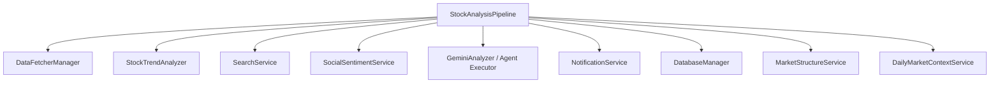
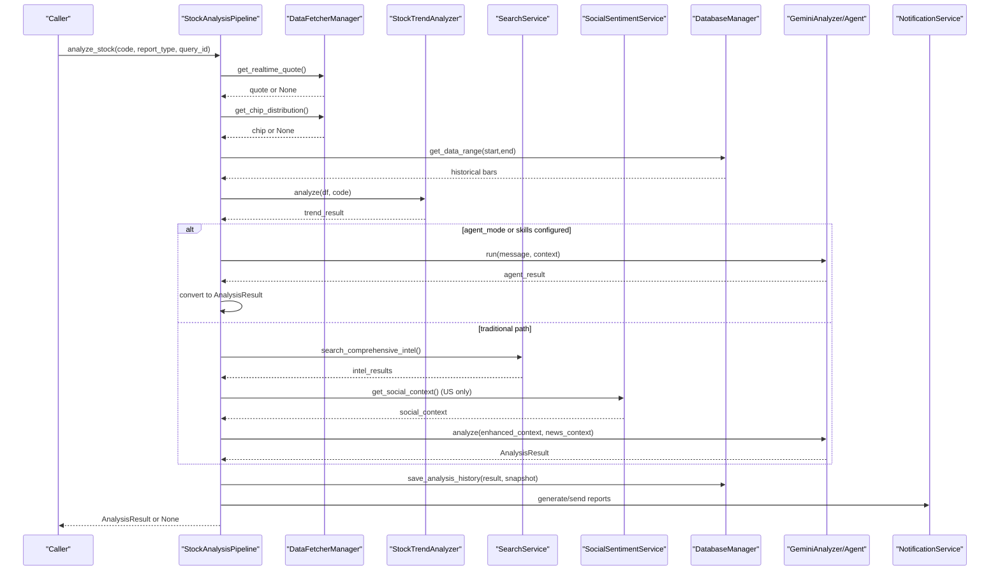
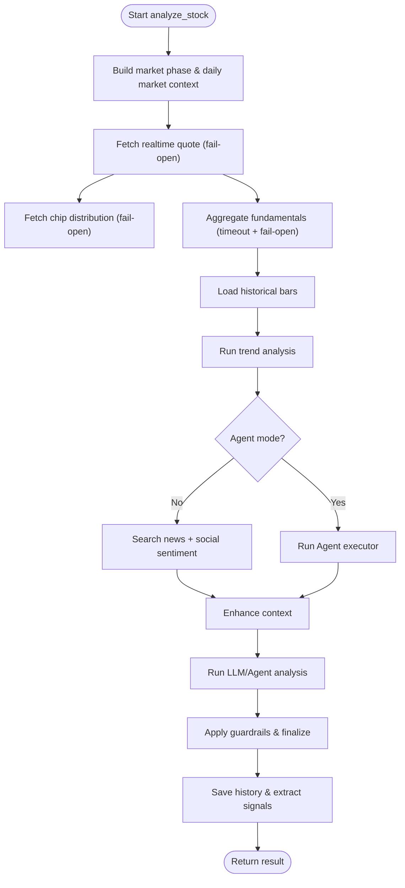
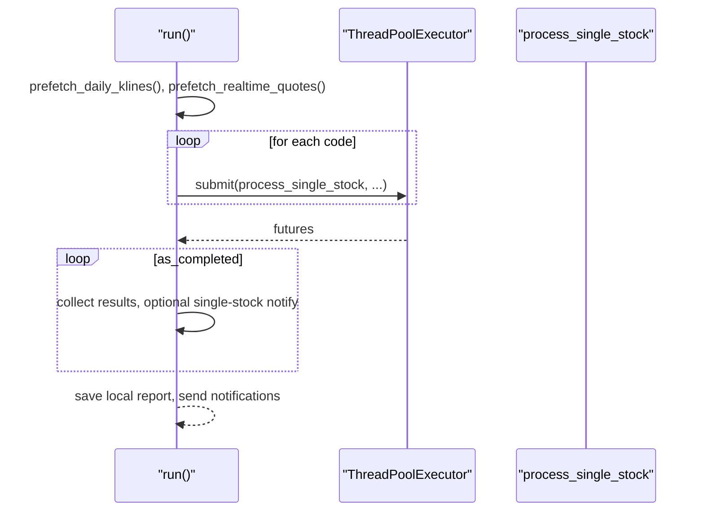
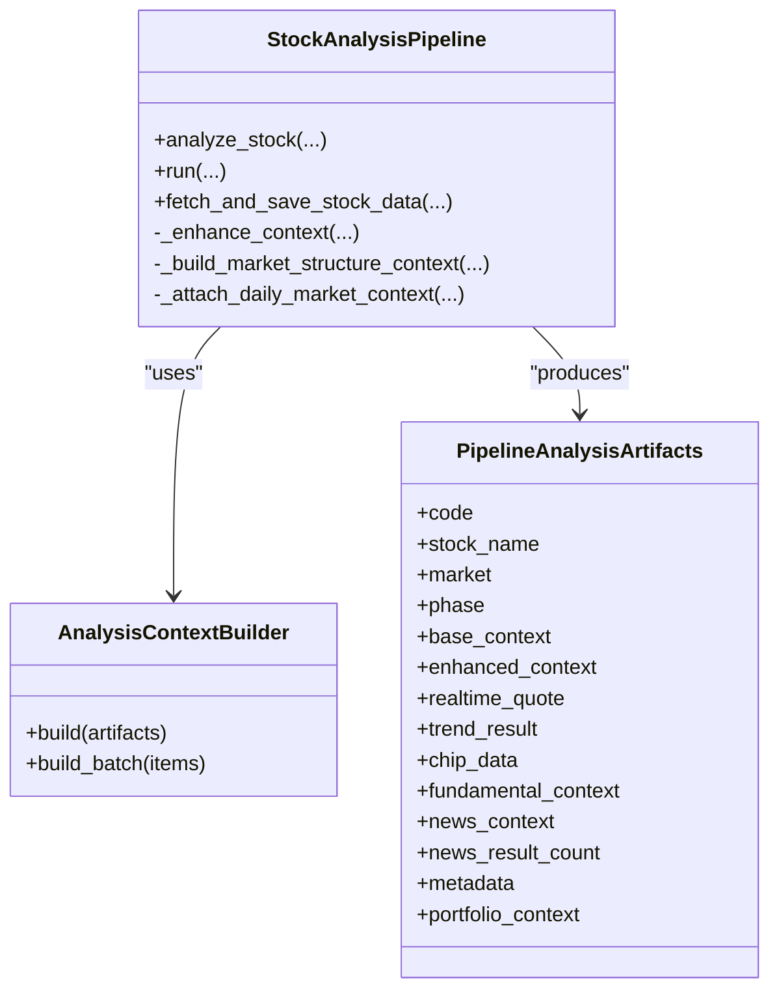
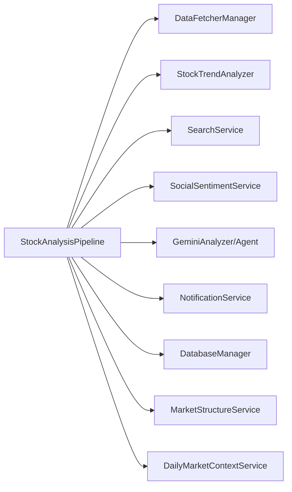

# Pipeline Processing Engine

<cite>
**Referenced Files in This Document**
- [pipeline.py](file://src/core/pipeline.py)
- [analysis_context_builder.py](file://src/services/analysis_context_builder.py)
- [config.py](file://src/config.py)
- [task_queue.py](file://src/services/task_queue.py)
- [batch.py](file://bot/commands/batch.py)
</cite>

## Table of Contents
1. [Introduction](#introduction)
2. [Project Structure](#project-structure)
3. [Core Components](#core-components)
4. [Architecture Overview](#architecture-overview)
5. [Detailed Component Analysis](#detailed-component-analysis)
6. [Dependency Analysis](#dependency-analysis)
7. [Performance Considerations](#performance-considerations)
8. [Troubleshooting Guide](#troubleshooting-guide)
9. [Conclusion](#conclusion)
10. [Appendices](#appendices)

## Introduction
This document explains the StockAnalysisPipeline class as the main orchestrator for stock analysis workflows. It covers the multi-stage process from data fetching and trend analysis to intelligence gathering, AI-powered analysis (including an Agent mode), and result aggregation. It also documents concurrent processing with ThreadPoolExecutor, error handling and fallbacks, progress tracking, checkpoint/resume behavior, configuration options, and how to extend or customize pipeline stages and data sources.

## Project Structure
The pipeline lives under src/core/pipeline.py and coordinates multiple services:
- Data fetching via DataFetcherManager (realtime quotes, chip distribution, fundamentals, daily bars)
- Trend analysis via StockTrendAnalyzer
- Intelligence gathering via SearchService and optional SocialSentimentService
- AI analysis via GeminiAnalyzer or an Agent executor
- Result finalization, history persistence, decision signal extraction, and notifications

**Diagram sources**
- [pipeline.py:219-334](file://src/core/pipeline.py#L219-L334)
- [pipeline.py:414-918](file://src/core/pipeline.py#L414-L918)
- [pipeline.py:1339-1599](file://src/core/pipeline.py#L1339-L1599)

**Section sources**
- [pipeline.py:219-334](file://src/core/pipeline.py#L219-L334)
- [pipeline.py:414-918](file://src/core/pipeline.py#L414-L918)

## Core Components
- StockAnalysisPipeline: Orchestrates end-to-end analysis per stock and batch runs; manages concurrency, progress, and resilience.
- AnalysisContextBuilder: Builds a structured AnalysisContextPack from pipeline artifacts for downstream consumers and reporting.
- Services: DataFetcherManager, SearchService, SocialSentimentService, MarketStructureService, DailyMarketContextService, NotificationService, DatabaseManager.
- Analyzers: StockTrendAnalyzer for technical signals; GeminiAnalyzer or Agent executor for AI-driven synthesis.

Key responsibilities:
- Build market phase context and daily market context
- Fetch realtime quotes and chip distribution with fail-open behavior
- Aggregate fundamentals with timeout and failure packaging
- Compute trend analysis on historical bars augmented by realtime when available
- Gather news/intelligence and social sentiment (US-only)
- Enhance context, build analysis context pack, run LLM/Agent, finalize results
- Persist history, extract decision signals, and send notifications

**Section sources**
- [pipeline.py:219-334](file://src/core/pipeline.py#L219-L334)
- [pipeline.py:414-918](file://src/core/pipeline.py#L414-L918)
- [analysis_context_builder.py:57-116](file://src/services/analysis_context_builder.py#L57-L116)

## Architecture Overview
The pipeline executes a deterministic sequence of stages with robust fallbacks and streaming progress updates.

**Diagram sources**
- [pipeline.py:414-918](file://src/core/pipeline.py#L414-L918)
- [pipeline.py:1339-1599](file://src/core/pipeline.py#L1339-L1599)

## Detailed Component Analysis

### Single-stock analysis flow (analyze_stock)
- Market phase and daily market context are built early to align timing across markets.
- Realtime quote and chip distribution are fetched with fail-open behavior; missing data degrades gracefully.
- Fundamentals are aggregated with a configurable timeout; failures produce a not_supported/failed payload that does not block the rest of the pipeline.
- Trend analysis runs on historical bars; if realtime is available, intraday MA overlays augment today’s bar.
- Intelligence gathering:
  - News via SearchService (multi-dimension searches up to 5 queries).
  - Social sentiment via SocialSentimentService for US stocks.
  - Persisted intelligence evidence is appended.
- Context enhancement merges realtime, chip, trend, fundamentals, portfolio, and market structure into enhanced_context.
- LLM/Agent execution:
  - Traditional path uses GeminiAnalyzer with enhanced_context and news_context.
  - Agent path builds initial context, ensures deep history, injects social sentiment and persisted intelligence, then runs an Agent executor.
- Post-processing normalizes chip availability, fills price position, applies guardrails (phase and daily market context), refreshes decision actions, and attaches metadata.
- History persistence and decision signal extraction occur after successful analysis.

**Diagram sources**
- [pipeline.py:414-918](file://src/core/pipeline.py#L414-L918)
- [pipeline.py:1339-1599](file://src/core/pipeline.py#L1339-L1599)

**Section sources**
- [pipeline.py:414-918](file://src/core/pipeline.py#L414-L918)
- [pipeline.py:1339-1599](file://src/core/pipeline.py#L1339-L1599)

### Batch processing and concurrency
- The run method supports analyzing multiple stocks concurrently using ThreadPoolExecutor.
- Before submission, it can prefetch daily K-lines and realtime quotes for all codes to reduce repeated network calls.
- Results are collected as futures complete; optional per-stock notification can be enabled.
- Dry-run mode skips full analysis but validates data availability.

**Diagram sources**
- [pipeline.py:3200-3350](file://src/core/pipeline.py#L3200-L3350)

**Section sources**
- [pipeline.py:3200-3350](file://src/core/pipeline.py#L3200-L3350)

### Progress tracking and streaming
- _emit_progress bridges stage progress to upstream SSE or UI consumers.
- During LLM streaming, a dynamic progress callback maps received characters to percentage updates.
- In batch mode, per-stock notifications can be sent immediately upon completion when enabled.

**Section sources**
- [pipeline.py:336-356](file://src/core/pipeline.py#L336-L356)
- [pipeline.py:751-776](file://src/core/pipeline.py#L751-L776)
- [pipeline.py:3253-3290](file://src/core/pipeline.py#L3253-L3290)

### Checkpoint/resume and data reuse
- fetch_and_save_stock_data implements resume logic:
  - Determines target date based on current_time or effective trading date.
  - Skips fetching if today’s reusable data already exists in the database.
  - Otherwise fetches daily data and persists it.
- Batch run uses a frozen reference time to ensure consistent target dates across stocks.

**Section sources**
- [pipeline.py:358-412](file://src/core/pipeline.py#L358-L412)
- [pipeline.py:3216-3238](file://src/core/pipeline.py#L3216-L3238)

### Error handling and fallback mechanisms
- Realtime quote and chip distribution fetches wrap exceptions and log warnings; analysis continues without them.
- Fundamentals aggregation catches exceptions and returns a failed context payload; write-only snapshots are recorded even on failure.
- Market structure and hotspot services are initialized lazily and fail-open; missing services do not block analysis.
- LLM/Agent runs record diagnostics and errors; non-critical storage failures are logged and do not abort the pipeline.

**Section sources**
- [pipeline.py:474-510](file://src/core/pipeline.py#L474-L510)
- [pipeline.py:531-571](file://src/core/pipeline.py#L531-L571)
- [pipeline.py:1282-1317](file://src/core/pipeline.py#L1282-L1317)
- [pipeline.py:867-916](file://src/core/pipeline.py#L867-L916)

### Configuration options
Key pipeline-related configuration fields include:
- max_workers: Controls ThreadPoolExecutor size for batch runs.
- enable_realtime_quote: Enables realtime quote usage; falls back to historical close otherwise.
- realtime_source_priority: Order of realtime providers used by DataFetcherManager.
- enable_chip_distribution: Enables chip distribution analysis.
- fundamental_stage_timeout_seconds: Timeout for fundamentals aggregation.
- agent_mode: Opt-in to Agent-based analysis.
- agent_skills / analysis_skills: Trigger Agent mode when specific skills are requested or configured.
- report_type: Controls output format (simple, brief, full).
- analysis_delay: Adds delay between individual stock analyses in batch mode.
- single_stock_notify: Sends per-stock notifications during batch runs.
- save_context_snapshot: Whether to persist context snapshots with analysis history.
- daily_market_context_enabled / daily_market_context_allow_generate: Control daily market context inclusion and generation.

These are read from the Config object and influence pipeline behavior at runtime.

**Section sources**
- [pipeline.py:219-334](file://src/core/pipeline.py#L219-L334)
- [pipeline.py:3240-3251](file://src/core/pipeline.py#L3240-L3251)
- [config.py:181-188](file://src/config.py#L181-L188)

### Customizing pipeline behavior
- Override progress_callback to integrate custom progress reporting.
- Pass analysis_skills to auto-enable Agent mode and tailor analysis depth.
- Use dry_run to validate data availability without full analysis.
- Provide portfolio_context to enrich analysis with holdings information.
- Set analysis_phase to control market phase context selection.

**Section sources**
- [pipeline.py:219-260](file://src/core/pipeline.py#L219-L260)
- [pipeline.py:512-527](file://src/core/pipeline.py#L512-L527)
- [pipeline.py:3200-3251](file://src/core/pipeline.py#L3200-L3251)

### Extending analysis stages
- Add new data sources through DataFetcherManager to integrate additional realtime or fundamental feeds.
- Extend trend analysis by subclassing or wrapping StockTrendAnalyzer logic.
- Integrate additional intelligence sources via SearchService or SocialSentimentService.
- Hook into post-processing by extending decision action refresh and guardrail application points.

**Section sources**
- [pipeline.py:262-334](file://src/core/pipeline.py#L262-L334)
- [pipeline.py:573-591](file://src/core/pipeline.py#L573-L591)
- [pipeline.py:612-684](file://src/core/pipeline.py#L612-L684)

### Integrating custom data sources
- Implement adapters compatible with DataFetcherManager interfaces for realtime quotes, chip distribution, and fundamentals.
- Ensure responses conform to expected structures so enhancement and context building proceed without modification.
- Register or configure provider priorities to control fallback order.

**Section sources**
- [pipeline.py:474-510](file://src/core/pipeline.py#L474-L510)
- [pipeline.py:531-571](file://src/core/pipeline.py#L531-L571)

### Relationship between pipeline stages and data flow
- Context building:
  - Base context loaded from storage includes today/yesterday bars and metadata.
  - Enhanced context adds realtime, chip, trend, fundamentals, portfolio, and market structure.
- Enhancement:
  - Merges realtime overlays into today’s bar when intraday MA is available.
  - Attaches daily market context and market phase summary.
- Finalization:
  - Normalizes chip availability and price position.
  - Applies phase and daily market guardrails to stabilize decisions.
  - Extracts decision signals and persists history.

**Diagram sources**
- [pipeline.py:925-1138](file://src/core/pipeline.py#L925-L1138)
- [analysis_context_builder.py:57-116](file://src/services/analysis_context_builder.py#L57-L116)

**Section sources**
- [pipeline.py:925-1138](file://src/core/pipeline.py#L925-L1138)
- [analysis_context_builder.py:57-116](file://src/services/analysis_context_builder.py#L57-L116)

## Dependency Analysis
- StockAnalysisPipeline depends on:
  - DataFetcherManager for unified data access (realtime, chip, fundamentals, daily bars).
  - StockTrendAnalyzer for technical signals.
  - SearchService and SocialSentimentService for intelligence and sentiment.
  - GeminiAnalyzer or Agent executor for AI synthesis.
  - NotificationService for report delivery.
  - DatabaseManager for persistence and resume checks.
  - MarketStructureService and DailyMarketContextService for contextual enrichment.

**Diagram sources**
- [pipeline.py:219-334](file://src/core/pipeline.py#L219-L334)
- [pipeline.py:414-918](file://src/core/pipeline.py#L414-L918)

**Section sources**
- [pipeline.py:219-334](file://src/core/pipeline.py#L219-L334)
- [pipeline.py:414-918](file://src/core/pipeline.py#L414-L918)

## Performance Considerations
- Concurrency:
  - ThreadPoolExecutor controls parallelism; tune max_workers to balance throughput and rate limits.
  - Prefetching daily K-lines and realtime quotes reduces per-stock network overhead in batch runs.
- Timeouts:
  - Fundamental stage timeout prevents long-running blocks; adjust via configuration.
- Resource limits:
  - Limit search queries and avoid unnecessary realtime lookups in dry-run mode.
- Streaming:
  - LLM streaming progress updates improve responsiveness without blocking.

[No sources needed since this section provides general guidance]

## Troubleshooting Guide
Common issues and resolutions:
- Realtime quote unavailable:
  - Pipeline falls back to historical close; check enable_realtime_quote and provider priority.
- Chip distribution missing:
  - Optional; analysis continues without it; verify enable_chip_distribution and source availability.
- Fundamentals failure:
  - Returns failed/not_supported payload; review timeout and provider keys; logs indicate source chain and coverage.
- Search service unavailable:
  - Intelligence gathering skipped; ensure API keys and availability; pipeline proceeds without news.
- LLM/Agent errors:
  - Diagnostics recorded; check model configuration, timeouts, and environment; retry or switch backend if supported.
- History save failures:
  - Non-fatal; logs capture errors; investigate database connectivity and permissions.

**Section sources**
- [pipeline.py:474-510](file://src/core/pipeline.py#L474-L510)
- [pipeline.py:531-571](file://src/core/pipeline.py#L531-L571)
- [pipeline.py:612-684](file://src/core/pipeline.py#L612-L684)
- [pipeline.py:867-916](file://src/core/pipeline.py#L867-L916)

## Conclusion
StockAnalysisPipeline provides a resilient, extensible orchestration layer for stock analysis. It integrates data fetching, trend analysis, intelligence gathering, and AI-powered synthesis with strong fallbacks, progress tracking, and checkpoint/resume support. Configuration options allow tuning depth, concurrency, and resource usage. Extensions can be added via DataFetcherManager, SearchService, and analyzer hooks to adapt to new data sources and analytical techniques.

[No sources needed since this section summarizes without analyzing specific files]

## Appendices

### Batch integration examples
- Bot command triggers batch analysis using StockAnalysisPipeline.run with configurable report types and notifications.
- Task queue enqueues tasks, deduplicates, and submits to executors for background processing.

**Section sources**
- [batch.py:99-126](file://bot/commands/batch.py#L99-L126)
- [task_queue.py:397-429](file://src/services/task_queue.py#L397-L429)