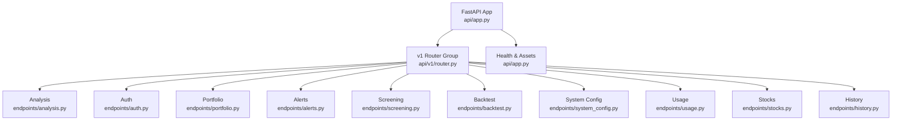
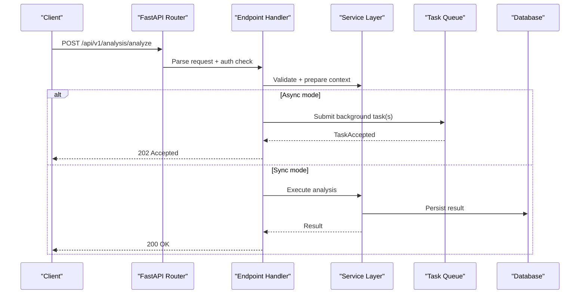
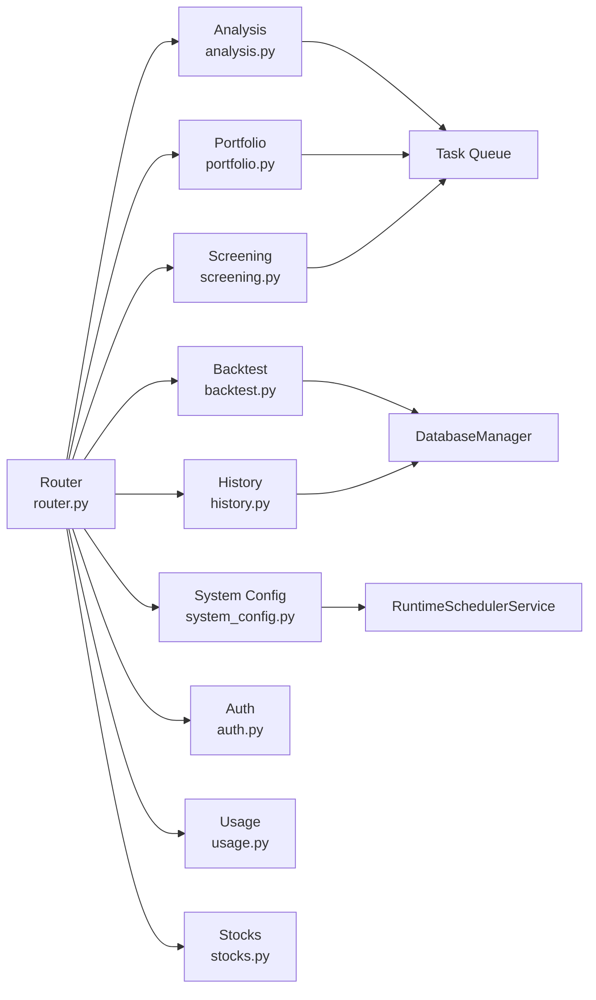

# API Endpoints

<cite>
**Referenced Files in This Document**
- [app.py](file://api/app.py)
- [router.py](file://api/v1/router.py)
- [analysis.py](file://api/v1/endpoints/analysis.py)
- [auth.py](file://api/v1/endpoints/auth.py)
- [portfolio.py](file://api/v1/endpoints/portfolio.py)
- [alerts.py](file://api/v1/endpoints/alerts.py)
- [screening.py](file://api/v1/endpoints/screening.py)
- [backtest.py](file://api/v1/endpoints/backtest.py)
- [system_config.py](file://api/v1/endpoints/system_config.py)
- [usage.py](file://api/v1/endpoints/usage.py)
- [stocks.py](file://api/v1/endpoints/stocks.py)
- [history.py](file://api/v1/endpoints/history.py)
- [common.py](file://api/v1/schemas/common.py)
</cite>

## Table of Contents
1. [Introduction](#introduction)
2. [Project Structure](#project-structure)
3. [Core Components](#core-components)
4. [Architecture Overview](#architecture-overview)
5. [Detailed Component Analysis](#detailed-component-analysis)
6. [Dependency Analysis](#dependency-analysis)
7. [Performance Considerations](#performance-considerations)
8. [Troubleshooting Guide](#troubleshooting-guide)
9. [Conclusion](#conclusion)
10. [Appendices](#appendices)

## Introduction
This document provides comprehensive API documentation for the Daily Stock Analysis system’s REST endpoints under /api/v1. It covers HTTP methods, URL patterns, request/response schemas, authentication requirements, error handling, pagination, filtering, sorting, rate limiting, and client integration guidelines. The API supports analysis, authentication, portfolio management, alerts, screening, backtesting, usage tracking, stock data, history, and system configuration.

## Project Structure
The FastAPI application is created in a central app factory, mounts CORS, registers the v1 router group, and exposes health and static assets. Each feature area is implemented as an endpoint module with Pydantic schemas defining request/response contracts.

**Diagram sources**
- [app.py:313-384](file://api/app.py#L313-L384)
- [router.py:31-117](file://api/v1/router.py#L31-L117)

**Section sources**
- [app.py:313-384](file://api/app.py#L313-L384)
- [router.py:31-117](file://api/v1/router.py#L31-L117)

## Core Components
- Authentication: Session-based admin login/logout, status, settings update, password change. Rate-limited login and sensitive operations.
- Analysis: Trigger single or batch analysis (sync or async), task list, SSE stream, market review trigger.
- Portfolio: Accounts, trades, cash ledger, corporate actions, snapshot, risk report, CSV import, FX refresh, position analysis.
- Alerts: Rules CRUD, enable/disable, test, triggers and notifications listing.
- Screening: Strategy discovery, hotspots, background screen tasks, history.
- Backtest: Run backtests, results listing, performance summaries.
- System Configuration: Read/update/validate/import/export config, scheduler controls, backend previews and tests.
- Usage: Token usage summary and dashboard.
- Stocks: Image extraction, import parsing, watchlist, quote, history.
- History: List/detail/delete records, diagnostics, run flow, news.

Authentication behavior:
- When ADMIN_AUTH_ENABLED is true, most /api/v1/* endpoints require a valid admin session cookie; certain endpoints are explicitly exempted by design (e.g., health).
- Auth endpoints themselves manage session cookies and rate limits.

Error responses use a consistent structure defined in common schema.

**Section sources**
- [auth.py:185-483](file://api/v1/endpoints/auth.py#L185-L483)
- [analysis.py:263-730](file://api/v1/endpoints/analysis.py#L263-L730)
- [portfolio.py:76-677](file://api/v1/endpoints/portfolio.py#L76-L677)
- [alerts.py:56-263](file://api/v1/endpoints/alerts.py#L56-L263)
- [screening.py:76-251](file://api/v1/endpoints/screening.py#L76-L251)
- [backtest.py:45-242](file://api/v1/endpoints/backtest.py#L45-L242)
- [system_config.py:51-729](file://api/v1/endpoints/system_config.py#L51-L729)
- [usage.py:67-101](file://api/v1/endpoints/usage.py#L67-L101)
- [stocks.py:121-556](file://api/v1/endpoints/stocks.py#L121-L556)
- [history.py:206-800](file://api/v1/endpoints/history.py#L206-L800)
- [common.py:31-75](file://api/v1/schemas/common.py#L31-L75)

## Architecture Overview
The API follows a layered architecture:
- Request routing via FastAPI routers grouped under /api/v1.
- Endpoint handlers validate inputs using Pydantic models and delegate to services.
- Services interact with databases, external providers, and task queues.
- Background tasks and SSE streams provide asynchronous processing and real-time updates.

**Diagram sources**
- [analysis.py:263-351](file://api/v1/endpoints/analysis.py#L263-L351)
- [analysis.py:354-451](file://api/v1/endpoints/analysis.py#L354-L451)
- [analysis.py:454-516](file://api/v1/endpoints/analysis.py#L454-L516)

**Section sources**
- [router.py:31-117](file://api/v1/router.py#L31-L117)
- [analysis.py:263-730](file://api/v1/endpoints/analysis.py#L263-L730)

## Detailed Component Analysis

### Authentication
- GET /api/v1/auth/status
  - Purpose: Check if auth is enabled and whether current request is logged in.
  - Auth: None required.
  - Response: { authEnabled, loggedIn, passwordSet, passwordChangeable, setupState }
  - Errors: None expected.

- POST /api/v1/auth/settings
  - Purpose: Enable/disable admin auth; set initial password when enabling without existing password; requires currentPassword when disabling or re-enabling with stored password.
  - Auth: None required (but may require session depending on state transitions).
  - Request: { authEnabled, password, passwordConfirm, currentPassword }
  - Responses:
    - 200: Updated status with loggedIn flag when enabling.
    - 400: Validation errors (password mismatch, missing fields).
    - 401: Invalid current password when required.
    - 429: Rate limited during sensitive changes.
    - 500: Internal error.

- POST /api/v1/auth/login
  - Purpose: Login or set initial password; sets session cookie on success.
  - Auth: None required.
  - Request: { password, passwordConfirm? }
  - Responses:
    - 200: { ok: true } with Set-Cookie.
    - 400: Missing or invalid fields.
    - 401: Invalid password.
    - 429: Rate limited.
    - 500: Internal error.

- POST /api/v1/auth/change-password
  - Purpose: Change password; requires valid session.
  - Auth: Required (session cookie).
  - Request: { currentPassword, newPassword, newPasswordConfirm }
  - Responses:
    - 204: Success.
    - 400: Validation errors.
    - 500: Internal error.

- POST /api/v1/auth/logout
  - Purpose: Clear session cookie.
  - Auth: Required (session cookie).
  - Responses:
    - 204: Success.
    - 500: Internal error.

Rate limiting:
- Login and sensitive settings endpoints enforce per-IP rate limits; returns 429 when exceeded.

**Section sources**
- [auth.py:185-483](file://api/v1/endpoints/auth.py#L185-L483)

### Analysis
- POST /api/v1/analysis/analyze
  - Purpose: Trigger AI analysis for one or multiple stocks. Supports sync and async modes.
  - Auth: Depends on global auth setting.
  - Request: { stock_code?, stock_codes?, async_mode?, report_type?, force_refresh?, notify?, skills?, analysis_phase?, report_language?, original_query?, selection_source?, stock_name? }
  - Responses:
    - 200: AnalysisResultResponse (sync mode).
    - 202: TaskAccepted or BatchTaskAcceptedResponse (async mode).
    - 400: Validation errors (missing codes, too many stocks, unsupported mode).
    - 409: Duplicate task (stock already being analyzed).
    - 500: Internal error.

- GET /api/v1/analysis/tasks
  - Purpose: List analysis tasks with optional status filter and limit.
  - Query params: status (comma-separated), limit (1..100).
  - Response: TaskListResponse with stats and tasks.

- GET /api/v1/analysis/tasks/stream
  - Purpose: Server-Sent Events stream for task lifecycle events (connected, task_created, task_started, task_progress, task_completed, task_failed, heartbeat every ~30s).

- POST /api/v1/analysis/market-review
  - Purpose: Trigger background market review; returns accepted immediately.
  - Request: { region?, send_notification?, report_language? }
  - Responses:
    - 202: MarketReviewAccepted.
    - 409: Already running.
    - 500: Internal error.

- GET /api/v1/analysis/tasks/{task_id}/flow
  - Purpose: Retrieve run-flow snapshot for a task (active or completed).

SSE event types and payload details are handled by the endpoint implementation.

**Section sources**
- [analysis.py:263-730](file://api/v1/endpoints/analysis.py#L263-L730)

### Portfolio Management
- Accounts
  - POST /api/v1/portfolio/accounts
  - GET /api/v1/portfolio/accounts
  - PUT /api/v1/portfolio/accounts/{account_id}
  - DELETE /api/v1/portfolio/accounts/{account_id}

- Trades
  - POST /api/v1/portfolio/trades
  - GET /api/v1/portfolio/trades (filters: account_id, date_from, date_to, symbol, side; pagination: page, page_size)
  - DELETE /api/v1/portfolio/trades/{trade_id}

- Cash Ledger
  - POST /api/v1/portfolio/cash-ledger
  - GET /api/v1/portfolio/cash-ledger (filters: account_id, date_from, date_to, direction; pagination: page, page_size)
  - DELETE /api/v1/portfolio/cash-ledger/{entry_id}

- Corporate Actions
  - POST /api/v1/portfolio/corporate-actions
  - GET /api/v1/portfolio/corporate-actions (filters: account_id, date_from, date_to, symbol, action_type; pagination: page, page_size)
  - DELETE /api/v1/portfolio/corporate-actions/{action_id}

- Snapshot and Risk
  - GET /api/v1/portfolio/snapshot (params: account_id?, as_of?, cost_method=fifo|avg, include_realtime=true)
  - GET /api/v1/portfolio/risk (params: account_id?, as_of?, cost_method=fifo|avg, include_realtime=true)

- Position Analysis
  - POST /api/v1/portfolio/positions/{symbol}/analysis
  - Request: { account_id?, analysis_phase?, force? }
  - Responses: 202 TaskAccepted or 409 duplicate.

- Import and FX
  - POST /api/v1/portfolio/imports/csv/parse (multipart: broker, file)
  - GET /api/v1/portfolio/imports/csv/brokers
  - POST /api/v1/portfolio/imports/csv/commit (multipart: account_id, broker, dry_run=false, file)
  - POST /api/v1/portfolio/fx/refresh (params: account_id?, as_of?)

Common errors:
- 400 validation_error
- 404 not_found
- 409 conflict (busy, oversell, duplicate)
- 500 internal_error

**Section sources**
- [portfolio.py:76-677](file://api/v1/endpoints/portfolio.py#L76-L677)

### Alerts
- Rules
  - POST /api/v1/alerts/rules
  - GET /api/v1/alerts/rules (filters: enabled?, alert_type?, target_scope?, target?, source?; pagination: page, page_size)
  - GET /api/v1/alerts/rules/{rule_id}
  - PATCH /api/v1/alerts/rules/{rule_id}
  - DELETE /api/v1/alerts/rules/{rule_id}
  - POST /api/v1/alerts/rules/{rule_id}/enable
  - POST /api/v1/alerts/rules/{rule_id}/disable
  - POST /api/v1/alerts/rules/{rule_id}/test

- Triggers and Notifications
  - GET /api/v1/alerts/triggers (filters: rule_id?, target?, status?; pagination: page, page_size)
  - GET /api/v1/alerts/notifications (filters: trigger_id?, channel?, success?; pagination: page, page_size)

Errors:
- 400 validation_error or specific alert type errors
- 404 not_found
- 500 internal_error

**Section sources**
- [alerts.py:56-263](file://api/v1/endpoints/alerts.py#L56-L263)

### Screening
- Status and Strategies
  - GET /api/v1/screening/status
  - GET /api/v1/screening/strategies

- Hotspots
  - GET /api/v1/screening/hotspots (provider?, top=12, refresh=false, include_details=false)
  - GET /api/v1/screening/hotspots/{topic} (provider?, refresh=false, include_search=false)

- Screen Tasks
  - POST /api/v1/screening/screen/tasks (request: market, strategy, max_results, variant_seed) -> 202 ScreeningScreenAccepted
  - GET /api/v1/screening/screen/tasks/{task_id} -> ScreeningScreenTaskStatus

- Synchronous Screen
  - POST /api/v1/screening/screen (same request body)

- History
  - GET /api/v1/screening/history (limit, strategy, market)
  - GET /api/v1/screening/history/{run_id}
  - GET /api/v1/screening/source-history (limit)

**Section sources**
- [screening.py:76-251](file://api/v1/endpoints/screening.py#L76-L251)

### Backtesting
- Run
  - POST /api/v1/backtest/run
  - Request: { code, force?, eval_window_days?, min_age_days?, analysis_date_from?, analysis_date_to?, limit? }
  - Responses: 200 BacktestRunResponse, 400 invalid_params, 500 internal_error

- Results
  - GET /api/v1/backtest/results (filters: code?, eval_window_days?, analysis_date_from?, analysis_date_to?, analysis_phase?; pagination: page, limit)

- Performance
  - GET /api/v1/backtest/performance (filters: eval_window_days?, analysis_date_from?, analysis_date_to?, analysis_phase?)
  - GET /api/v1/backtest/performance/{code} (same filters)

Validation:
- analysis_date_from cannot be after analysis_date_to.

**Section sources**
- [backtest.py:45-242](file://api/v1/endpoints/backtest.py#L45-L242)

### System Configuration
- Scheduler
  - GET /api/v1/system/scheduler/status
  - POST /api/v1/system/scheduler/run-now (409 if busy)

- Config
  - GET /api/v1/system/config (include_schema?)
  - PUT /api/v1/system/config (UpdateSystemConfigRequest with items, mask_token, reload_now)
  - GET /api/v1/system/config/schema
  - GET /api/v1/system/config/setup/status

- Export/Import
  - GET /api/v1/system/config/export (requires secure access)
  - POST /api/v1/system/config/import (requires secure access)

- Backend Previews and Tests
  - GET /api/v1/system/config/generation-backends/status
  - POST /api/v1/system/config/generation-backends/status/preview
  - POST /api/v1/system/config/generation-backends/smoke-test
  - GET /api/v1/system/config/agent-backends/status
  - POST /api/v1/system/config/agent-backends/status/preview

- Channel Testing and Discovery
  - POST /api/v1/system/config/llm/test-channel
  - POST /api/v1/system/config/notification/test-channel
  - POST /api/v1/system/config/llm/discover-models

- Validation
  - POST /api/v1/system/config/validate

Access control:
- Export/Import endpoints enforce secure access (desktop mode or authenticated session).

**Section sources**
- [system_config.py:51-729](file://api/v1/endpoints/system_config.py#L51-L729)

### Usage Tracking
- GET /api/v1/usage/summary (period=today|month|all)
- GET /api/v1/usage/dashboard (period=today|month|all, limit=50)

Returns token usage totals and recent calls.

**Section sources**
- [usage.py:67-101](file://api/v1/endpoints/usage.py#L67-L101)

### Stocks
- Image Extraction
  - POST /api/v1/stocks/extract-from-image (multipart: file; query: include_raw=false)
  - Limits: Allowed MIME types and size enforced.

- Import Parsing
  - POST /api/v1/stocks/parse-import
  - Supports multipart/form-data with file or application/json with { text }.

- Watchlist
  - GET /api/v1/stocks/watchlist
  - POST /api/v1/stocks/watchlist/add (body: stock_code)
  - POST /api/v1/stocks/watchlist/remove (body: stock_code)

- Quote and History
  - GET /api/v1/stocks/{stock_code}/quote
  - GET /api/v1/stocks/{stock_code}/history (period=daily|weekly|monthly; days=30)

Validation:
- Stock codes validated against supported formats; normalized before use.

**Section sources**
- [stocks.py:121-556](file://api/v1/endpoints/stocks.py#L121-L556)

### History
- List
  - GET /api/v1/history (filters: stock_code?, report_type?, start_date?, end_date?; pagination: page, limit)

- Delete
  - DELETE /api/v1/history/by-code/{stock_code}
  - DELETE /api/v1/history (body: record_ids[])

- Detail
  - GET /api/v1/history/{record_id}
  - GET /api/v1/history/{record_id}/diagnostics
  - GET /api/v1/history/{record_id}/flow
  - GET /api/v1/history/{record_id}/news (limit)

- Stock Bar
  - GET /api/v1/history/stocks (filters: start_date?, end_date?; limit)

**Section sources**
- [history.py:206-800](file://api/v1/endpoints/history.py#L206-L800)

## Dependency Analysis
- Routing: All v1 endpoints are mounted under /api/v1 via router.py.
- Middleware: CORS configured in app.py; optional auth middleware applied globally.
- Dependencies:
  - Analysis depends on task queue, services, and storage.
  - Portfolio depends on service layer and task queue for background analysis.
  - Screening uses task queue for long-running jobs.
  - Backtest and History rely on database manager.
  - System config interacts with runtime scheduler and config service.

**Diagram sources**
- [router.py:31-117](file://api/v1/router.py#L31-L117)
- [analysis.py:263-730](file://api/v1/endpoints/analysis.py#L263-L730)
- [portfolio.py:76-677](file://api/v1/endpoints/portfolio.py#L76-L677)
- [screening.py:76-251](file://api/v1/endpoints/screening.py#L76-L251)
- [backtest.py:45-242](file://api/v1/endpoints/backtest.py#L45-L242)
- [history.py:206-800](file://api/v1/endpoints/history.py#L206-L800)
- [system_config.py:51-729](file://api/v1/endpoints/system_config.py#L51-L729)

**Section sources**
- [router.py:31-117](file://api/v1/router.py#L31-L117)

## Performance Considerations
- Asynchronous processing:
  - Analysis and screening support async mode to avoid blocking requests; clients should poll task status or subscribe to SSE.
  - Background tasks update progress and can be queried by task_id.
- Pagination and limits:
  - Many list endpoints accept page/page_size or limit parameters to control response size.
  - Enforced bounds (e.g., limit 1..100 or 1..200) prevent large payloads.
- Filtering and sorting:
  - Query parameters allow filtering by dates, symbols, statuses, and other attributes.
  - Sorting is typically implicit (e.g., newest first); explicit sort parameters are not present in these endpoints.
- Rate limiting:
  - Authentication endpoints implement per-IP rate limiting to mitigate brute-force attempts.
- SSE streaming:
  - Use keep-alive connections and handle heartbeats for robustness.

[No sources needed since this section provides general guidance]

## Troubleshooting Guide
Common issues and resolutions:
- 400 validation_error:
  - Ensure required fields are provided and correctly formatted (e.g., stock codes, dates).
  - For image imports, verify MIME type and size limits.
- 401 unauthorized:
  - When ADMIN_AUTH_ENABLED is true, ensure a valid session cookie is sent for protected endpoints.
  - For sensitive operations (e.g., disable auth), currentPassword may be required.
- 404 not_found:
  - Verify resource IDs (e.g., rule_id, trade_id, record_id) exist.
  - Some endpoints return 404 when no data matches filters.
- 409 conflict:
  - Duplicate tasks (analysis or screening) or portfolio conflicts (busy, oversell).
  - Retry after completion or adjust request parameters.
- 429 rate limited:
  - Too many failed login or sensitive operation attempts; wait and retry.
- 500 internal_error:
  - Check server logs for stack traces; often indicates service or database failures.

Error response shape:
- { error, message, detail? }

**Section sources**
- [common.py:31-75](file://api/v1/schemas/common.py#L31-L75)
- [auth.py:185-483](file://api/v1/endpoints/auth.py#L185-L483)
- [portfolio.py:76-677](file://api/v1/endpoints/portfolio.py#L76-L677)
- [alerts.py:56-263](file://api/v1/endpoints/alerts.py#L56-L263)
- [screening.py:76-251](file://api/v1/endpoints/screening.py#L76-L251)
- [backtest.py:45-242](file://api/v1/endpoints/backtest.py#L45-L242)
- [system_config.py:51-729](file://api/v1/endpoints/system_config.py#L51-L729)
- [stocks.py:121-556](file://api/v1/endpoints/stocks.py#L121-L556)
- [history.py:206-800](file://api/v1/endpoints/history.py#L206-L800)

## Conclusion
The Daily Stock Analysis API offers a comprehensive set of endpoints for analysis, portfolio management, alerts, screening, backtesting, usage tracking, stock data, history, and system configuration. It emphasizes asynchronous processing, robust error handling, and clear schemas. Clients should respect rate limits, use pagination, and leverage SSE for real-time updates where applicable.

[No sources needed since this section summarizes without analyzing specific files]

## Appendices

### Health and Root
- GET /health and GET /api/health return HealthResponse with status and timestamp.

**Section sources**
- [app.py:435-454](file://api/app.py#L435-L454)
- [common.py:31-43](file://api/v1/schemas/common.py#L31-L43)