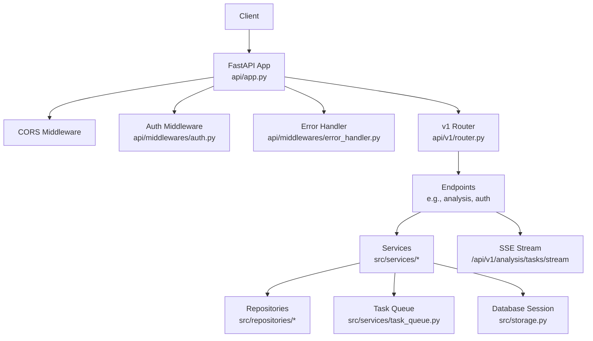
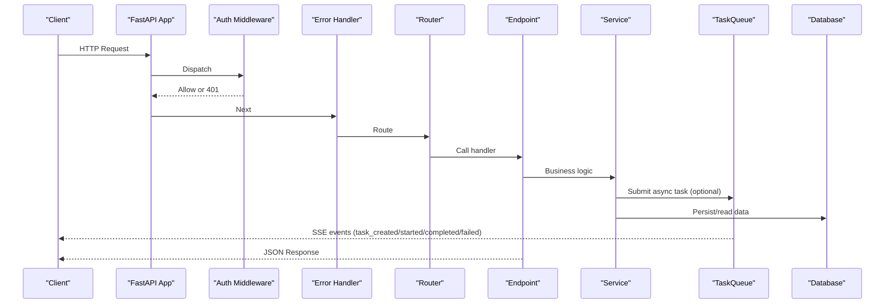
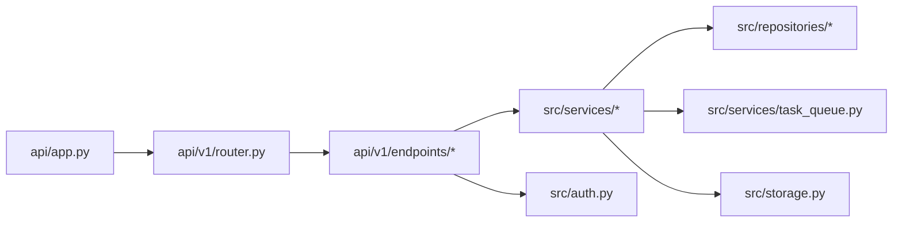

# Service Layer Architecture

<cite>
**Referenced Files in This Document**
- [api/app.py](file://api/app.py)
- [api/v1/router.py](file://api/v1/router.py)
- [api/deps.py](file://api/deps.py)
- [api/middlewares/auth.py](file://api/middlewares/auth.py)
- [api/middlewares/error_handler.py](file://api/middlewares/error_handler.py)
- [api/v1/endpoints/auth.py](file://api/v1/endpoints/auth.py)
- [api/v1/endpoints/analysis.py](file://api/v1/endpoints/analysis.py)
- [src/auth.py](file://src/auth.py)
- [src/services/analysis_service.py](file://src/services/analysis_service.py)
- [src/services/task_queue.py](file://src/services/task_queue.py)
- [src/storage.py](file://src/storage.py)
</cite>

## Table of Contents
1. [Introduction](#introduction)
2. [Project Structure](#project-structure)
3. [Core Components](#core-components)
4. [Architecture Overview](#architecture-overview)
5. [Detailed Component Analysis](#detailed-component-analysis)
6. [Dependency Analysis](#dependency-analysis)
7. [Performance Considerations](#performance-considerations)
8. [Troubleshooting Guide](#troubleshooting-guide)
9. [Conclusion](#conclusion)
10. [Appendices](#appendices)

## Introduction
This document explains the service layer architecture that abstracts business logic over core components and exposes a versioned REST API. It covers request/response handling, middleware stack (authentication, error handling, CORS), service composition and dependency injection, transaction management, real-time updates via Server-Sent Events, background task processing, event-driven patterns, authentication and authorization flows, rate limiting, and API versioning. It also provides practical guidance for adding new endpoints, implementing custom middleware, and extending services.

## Project Structure
The API is organized around FastAPI with a clear separation between application bootstrap, routing, middlewares, dependencies, and versioned endpoints. The service layer lives under src/services and encapsulates domain logic, while repositories handle persistence. Background tasks and real-time events are coordinated by an in-process task queue and SSE stream.

**Diagram sources**
- [api/app.py:313-384](file://api/app.py#L313-L384)
- [api/v1/router.py:31-117](file://api/v1/router.py#L31-L117)
- [api/middlewares/auth.py:37-76](file://api/middlewares/auth.py#L37-L76)
- [api/middlewares/error_handler.py:70-129](file://api/middlewares/error_handler.py#L70-L129)
- [api/v1/endpoints/analysis.py:263-730](file://api/v1/endpoints/analysis.py#L263-L730)
- [src/services/task_queue.py:156-207](file://src/services/task_queue.py#L156-L207)
- [src/storage.py:2276-2303](file://src/storage.py#L2276-L2303)

**Section sources**
- [api/app.py:313-384](file://api/app.py#L313-L384)
- [api/v1/router.py:31-117](file://api/v1/router.py#L31-L117)

## Core Components
- Application factory and lifecycle: creates FastAPI app, configures CORS, registers routes, mounts health endpoints, serves static assets, and initializes runtime scheduler and system configuration services.
- Versioned router: aggregates v1 endpoints under /api/v1 with tags for grouping.
- Dependency injection: provides database sessions, configuration, and shared services to endpoints.
- Middlewares:
  - Authentication: enforces session cookie validation on /api/v1/* when enabled, with exemptions for login/status/health/docs.
  - Error handling: normalizes HTTP and validation exceptions into consistent JSON responses.
- Services:
  - AnalysisService orchestrates stock analysis using pipelines and persists results.
  - TaskQueue manages asynchronous analysis tasks, deduplication, progress updates, and SSE broadcasting.
- Real-time updates: SSE endpoint streams task lifecycle events to clients.
- Transaction management: uses SQLAlchemy sessions scoped per request; background tasks use their own sessions via repository calls.

**Section sources**
- [api/app.py:313-384](file://api/app.py#L313-L384)
- [api/v1/router.py:31-117](file://api/v1/router.py#L31-L117)
- [api/deps.py:25-88](file://api/deps.py#L25-L88)
- [api/middlewares/auth.py:37-76](file://api/middlewares/auth.py#L37-L76)
- [api/middlewares/error_handler.py:70-129](file://api/middlewares/error_handler.py#L70-L129)
- [src/services/analysis_service.py:39-152](file://src/services/analysis_service.py#L39-L152)
- [src/services/task_queue.py:156-207](file://src/services/task_queue.py#L156-L207)

## Architecture Overview
The request flow passes through CORS, optional authentication, and error handling before reaching versioned endpoints. Endpoints validate inputs, delegate to services, and may enqueue background tasks. Services coordinate pipelines, repositories, and background workers. Real-time updates are delivered via SSE from the task queue.

**Diagram sources**
- [api/app.py:313-384](file://api/app.py#L313-L384)
- [api/middlewares/auth.py:37-76](file://api/middlewares/auth.py#L37-L76)
- [api/middlewares/error_handler.py:70-129](file://api/middlewares/error_handler.py#L70-L129)
- [api/v1/router.py:31-117](file://api/v1/router.py#L31-L117)
- [api/v1/endpoints/analysis.py:263-730](file://api/v1/endpoints/analysis.py#L263-L730)
- [src/services/task_queue.py:668-795](file://src/services/task_queue.py#L668-L795)

## Detailed Component Analysis

### REST API Endpoint Structure
- Base path: /api/v1
- Aggregated routers include:
  - /auth: status, settings, login, change-password, logout
  - /agent, /analysis, /history, /stocks, /backtest, /system, /usage, /portfolio, /alerts, /decision-signals, /screening, /intelligence, /health
- Health endpoints at /health and /api/health return a simple status object.

Versioning approach:
- All business APIs are under /api/v1. New versions can be added by creating a new router prefix (e.g., /api/v2) and mounting it similarly to v1.

Request/response handling:
- Pydantic models define request bodies and response schemas.
- Endpoints raise HTTPException or use a helper to produce consistent error objects.
- StreamingResponse is used for SSE to push task events.

Examples of key endpoints:
- POST /api/v1/analysis/analyze: triggers single or batch analysis (sync or async).
- GET /api/v1/analysis/tasks: lists tasks with filtering and pagination.
- GET /api/v1/analysis/tasks/stream: SSE stream for real-time task updates.
- POST /api/v1/auth/login: authenticates admin and sets session cookie.

**Section sources**
- [api/v1/router.py:31-117](file://api/v1/router.py#L31-L117)
- [api/v1/endpoints/analysis.py:263-730](file://api/v1/endpoints/analysis.py#L263-L730)
- [api/v1/endpoints/auth.py:185-483](file://api/v1/endpoints/auth.py#L185-L483)

### Middleware Stack
- CORS:
  - Configured with allow_origins derived from environment and defaults.
  - Credentials disabled when allowing all origins; warns if auth is disabled with open CORS.
- Authentication:
  - Enforced for /api/v1/* when ADMIN_AUTH_ENABLED is true.
  - Exempts login, status, health, docs, and OpenAPI paths.
  - Validates session cookie and returns 401 if missing or invalid.
- Error Handling:
  - Normalizes HTTPException and RequestValidationError into consistent JSON.
  - Catches unhandled exceptions and logs detailed traces in debug mode.

Adding custom middleware:
- Create a Starlette BaseHTTPMiddleware subclass and register via app.add_middleware in the app factory.
- Place reusable logic such as logging, metrics, or feature flags there.

**Section sources**
- [api/app.py:346-377](file://api/app.py#L346-L377)
- [api/middlewares/auth.py:37-76](file://api/middlewares/auth.py#L37-L76)
- [api/middlewares/error_handler.py:70-129](file://api/middlewares/error_handler.py#L70-L129)

### Service Composition and Dependency Injection
- Dependencies:
  - Database sessions via get_db() ensure per-request scope and automatic cleanup.
  - Configuration via get_config_dep().
  - Shared services like SystemConfigService and RuntimeSchedulerService are stored in app.state and retrieved via request-scoped getters.
- Service instantiation:
  - Endpoints construct service instances (e.g., AnalysisService) and call methods.
  - Services depend on repositories and external modules (pipelines, schedulers).

Extending services:
- Add new methods to existing services or create new service classes under src/services.
- Use dependency injection to pass configuration and shared services where needed.

**Section sources**
- [api/deps.py:25-88](file://api/deps.py#L25-L88)
- [src/services/analysis_service.py:39-152](file://src/services/analysis_service.py#L39-L152)

### Transaction Management
- Per-request transactions:
  - get_db() yields a SQLAlchemy session that is closed after each request.
  - Use context managers or try/finally to commit or rollback as needed.
- Background tasks:
  - Use their own sessions via repository calls; do not share request-scoped sessions.
  - Ensure proper session lifecycle within background execution contexts.

Best practices:
- Keep unit-of-work boundaries small and explicit.
- Avoid long-running operations inside transactions.

**Section sources**
- [api/deps.py:25-45](file://api/deps.py#L25-L45)
- [src/storage.py:2276-2303](file://src/storage.py#L2276-L2303)

### WebSocket and Real-Time Updates
- Implementation:
  - Server-Sent Events (SSE) endpoint at /api/v1/analysis/tasks/stream pushes task lifecycle events.
  - Clients connect with EventSource and subscribe to events like connected, task_created, task_started, task_progress, task_completed, task_failed, heartbeat.
- Background task processing:
  - TaskQueue runs analysis tasks in a thread pool, updates progress, and broadcasts events.
  - Supports batch submissions, duplicate detection, and cancellation states.

Event-driven architecture:
- TaskQueue acts as an event bus for task-related events.
- Services emit progress updates via callbacks, which are broadcast to subscribers.

Note: No WebSocket implementation was found in the analyzed files; SSE is used for real-time updates.

**Section sources**
- [api/v1/endpoints/analysis.py:666-730](file://api/v1/endpoints/analysis.py#L666-L730)
- [src/services/task_queue.py:156-207](file://src/services/task_queue.py#L156-L207)
- [src/services/task_queue.py:668-795](file://src/services/task_queue.py#L668-L795)

### Authentication and Authorization Flow
- Admin authentication:
  - Toggleable via ADMIN_AUTH_ENABLED.
  - Login sets a signed session cookie; middleware validates it for protected routes.
  - Password storage uses PBKDF2 hashing with salt; session secret rotation invalidates active sessions.
- Rate limiting:
  - In-memory rate limiter tracks failed attempts per IP within a time window.
  - Protects login and sensitive settings changes.

Flow overview:
- Client sends credentials to /api/v1/auth/login.
- Server verifies password, creates session, sets cookie.
- Subsequent requests to /api/v1/* include cookie; middleware validates session.

Security considerations:
- Cookie attributes (httponly, samesite, secure) are set based on request scheme and proxy headers.
- Disabling auth requires re-authentication with current password to prevent CSRF/session hijacking.

**Section sources**
- [api/v1/endpoints/auth.py:185-483](file://api/v1/endpoints/auth.py#L185-L483)
- [src/auth.py:197-422](file://src/auth.py#L197-L422)
- [api/middlewares/auth.py:37-76](file://api/middlewares/auth.py#L37-L76)

### Adding New API Endpoints
Steps:
1. Define request/response schemas in api/v1/schemas.
2. Implement endpoint logic in a new file under api/v1/endpoints.
3. Register the router in api/v1/router.py with a prefix and tag.
4. If needed, add dependencies in api/deps.py.
5. Ensure error handling and validation are consistent with existing endpoints.

Example pattern:
- Use Depends(get_config_dep()) for configuration.
- Raise api_error for validation failures.
- Return Pydantic models for responses.

**Section sources**
- [api/v1/router.py:31-117](file://api/v1/router.py#L31-L117)
- [api/v1/endpoints/analysis.py:263-352](file://api/v1/endpoints/analysis.py#L263-L352)

### Implementing Custom Middleware
Pattern:
- Create a class inheriting from BaseHTTPMiddleware.
- Implement dispatch(request, call_next) to wrap request processing.
- Register via app.add_middleware in the app factory.

Use cases:
- Logging, metrics, feature flags, request tracing, or additional security checks.

**Section sources**
- [api/middlewares/auth.py:37-76](file://api/middlewares/auth.py#L37-L76)
- [api/middlewares/error_handler.py:70-129](file://api/middlewares/error_handler.py#L70-L129)

### Extending Service Capabilities
Approach:
- Add new methods to existing services or create new service classes.
- Compose services by injecting dependencies (config, repositories, schedulers).
- Use background tasks for long-running operations and report progress via TaskQueue.

Example extension:
- Introduce a new analysis type by adding parameters to AnalyzeRequest and handling in trigger_analysis.
- Emit SSE events for new phases by updating TaskQueue flow events.

**Section sources**
- [src/services/analysis_service.py:39-152](file://src/services/analysis_service.py#L39-L152)
- [src/services/task_queue.py:542-570](file://src/services/task_queue.py#L542-L570)

## Dependency Analysis
Key relationships:
- api/app.py depends on api/v1/router.py and middlewares.
- api/v1/endpoints depend on src/services and src/auth.
- src/services depend on repositories and core modules.
- TaskQueue coordinates background tasks and SSE events.

**Diagram sources**
- [api/app.py:313-384](file://api/app.py#L313-L384)
- [api/v1/router.py:31-117](file://api/v1/router.py#L31-L117)
- [api/v1/endpoints/analysis.py:263-730](file://api/v1/endpoints/analysis.py#L263-L730)
- [src/services/task_queue.py:156-207](file://src/services/task_queue.py#L156-L207)
- [src/storage.py:2276-2303](file://src/storage.py#L2276-L2303)

**Section sources**
- [api/app.py:313-384](file://api/app.py#L313-L384)
- [api/v1/router.py:31-117](file://api/v1/router.py#L31-L117)

## Performance Considerations
- Concurrency:
  - TaskQueue uses a ThreadPoolExecutor with configurable max_workers; supports dynamic adjustment.
  - Batch analysis limits request size to prevent DoS.
- SSE:
  - Heartbeat every 30 seconds ensures connection liveness.
  - Nginx buffering disabled for streaming responses.
- Database:
  - WAL mode and busy timeout configured for SQLite; sessions scoped per request.
- Caching:
  - Stock index cache refreshed in background; warmup on startup reduces cold start latency.

[No sources needed since this section provides general guidance]

## Troubleshooting Guide
Common issues and resolutions:
- 401 Unauthorized:
  - Ensure ADMIN_AUTH_ENABLED is correctly set and session cookie is present.
  - Check rate limiting on login attempts.
- 422 Validation Error:
  - Validate request body against Pydantic schemas.
- 500 Internal Error:
  - Review error handler logs for stack traces in debug mode.
- SSE disconnections:
  - Verify client reconnect logic and server heartbeat.
- Frontend asset mismatches:
  - Startup checks log inconsistencies; rebuild frontend bundle if needed.

**Section sources**
- [api/middlewares/error_handler.py:70-129](file://api/middlewares/error_handler.py#L70-L129)
- [api/app.py:390-434](file://api/app.py#L390-L434)

## Conclusion
The service layer provides a robust, versioned REST API with strong authentication, consistent error handling, and real-time updates via SSE. Background tasks enable non-blocking operations, while dependency injection and transaction management ensure maintainability and reliability. The modular design facilitates adding new endpoints, middleware, and services with minimal friction.

[No sources needed since this section summarizes without analyzing specific files]

## Appendices

### API Versioning Approach
- Current version: /api/v1
- To add a new version:
  - Create a new router module (e.g., api/v2/router.py).
  - Mount it in api/app.py with a new prefix (/api/v2).
  - Maintain backward compatibility for v1 during transition.

**Section sources**
- [api/v1/router.py:31-117](file://api/v1/router.py#L31-L117)
- [api/app.py:383-384](file://api/app.py#L383-L384)

### Rate Limiting Strategies
- In-memory rate limiter protects login and sensitive endpoints.
- Window-based counting per IP with configurable thresholds.
- Clear rate limit on successful login to avoid blocking legitimate users.

**Section sources**
- [src/auth.py:387-422](file://src/auth.py#L387-L422)
- [api/v1/endpoints/auth.py:382-418](file://api/v1/endpoints/auth.py#L382-L418)

### Background Task Processing and Event-Driven Patterns
- TaskQueue manages task lifecycle, deduplication, and progress updates.
- Services emit events via callbacks, which are broadcast to SSE subscribers.
- Background tasks run independently and persist results via repositories.

**Section sources**
- [src/services/task_queue.py:156-207](file://src/services/task_queue.py#L156-L207)
- [src/services/task_queue.py:668-795](file://src/services/task_queue.py#L668-L795)