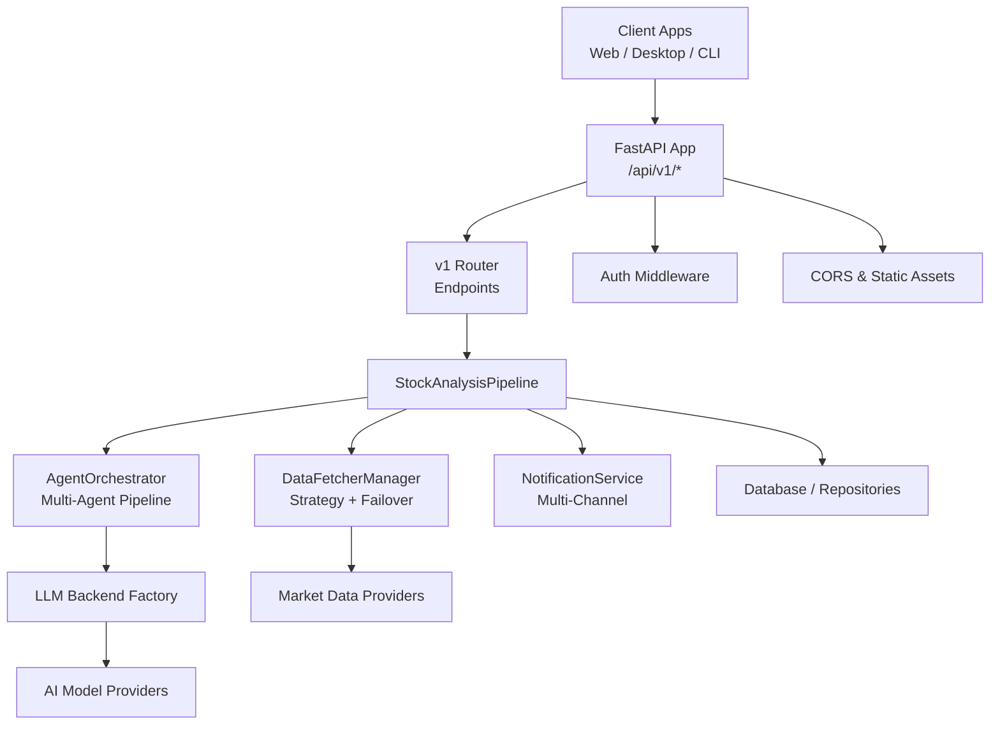
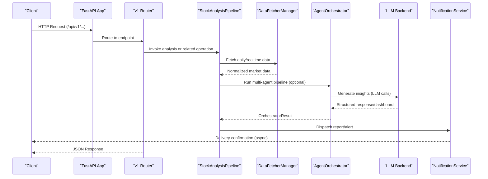
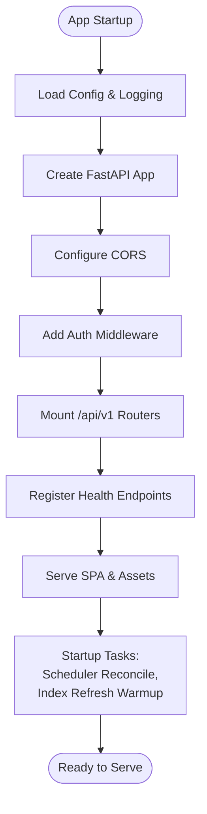
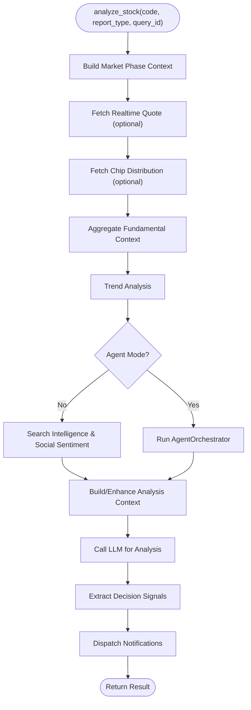
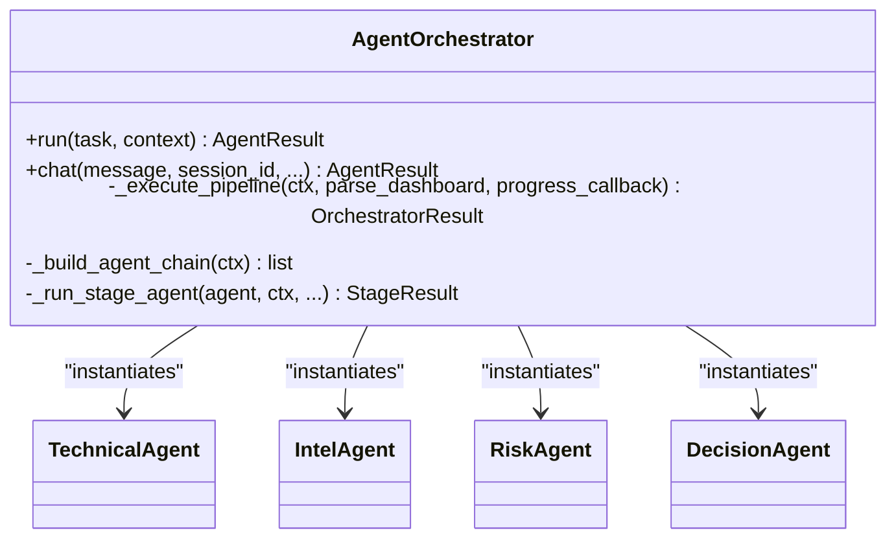
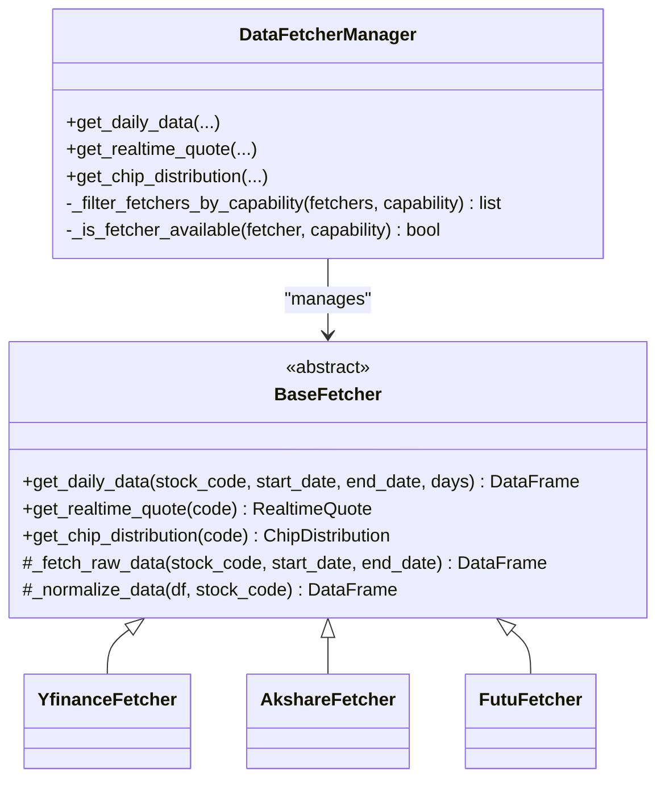
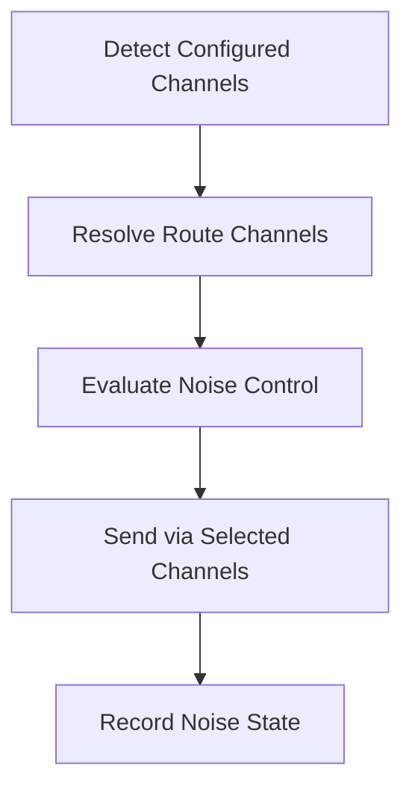
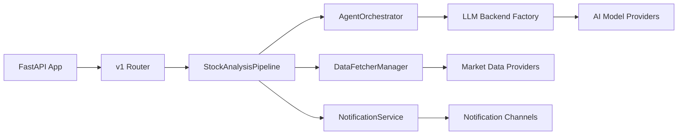

# System Architecture Overview

<cite>
**Referenced Files in This Document**
- [main.py](file://main.py)
- [server.py](file://server.py)
- [api/app.py](file://api/app.py)
- [api/v1/router.py](file://api/v1/router.py)
- [src/core/pipeline.py](file://src/core/pipeline.py)
- [src/agent/orchestrator.py](file://src/agent/orchestrator.py)
- [data_provider/base.py](file://data_provider/base.py)
- [src/notification.py](file://src/notification.py)
- [src/auth.py](file://src/auth.py)
- [src/llm/backend_factory.py](file://src/llm/backend_factory.py)
</cite>

## Table of Contents
1. Introduction
2. Project Structure
3. Core Components
4. Architecture Overview
5. Detailed Component Analysis
6. Dependency Analysis
7. Performance Considerations
8. Troubleshooting Guide
9. Conclusion

## Introduction
This document describes the system architecture of DailyStockAnalysis with a focus on high-level design patterns and component interactions. It explains how the FastAPI REST API layer, core analysis pipeline, multi-agent orchestration, and data providers collaborate to transform external market data into actionable insights and notifications. It also documents the plugin architecture for data providers, notification channels, and analysis strategies, separation of concerns across presentation, business logic, and data access layers, integration points with third-party services (AI models and market data providers), scalability considerations, and cross-cutting concerns such as authentication, error handling, logging, and monitoring.

## Project Structure
The system is organized into clear layers:
- Presentation layer: FastAPI application serving REST endpoints and optionally hosting the web UI assets.
- Business logic layer: Analysis pipeline and multi-agent orchestrator that coordinate data fetching, analysis, strategy evaluation, and reporting.
- Data access and provider layer: Pluggable market data fetchers and storage abstractions.
- Notification layer: Multi-channel delivery of reports and alerts.
- Cross-cutting: Authentication, configuration, logging, scheduling, and LLM backend selection.

**Diagram sources**
- [api/app.py:313-384](file://api/app.py#L313-L384)
- [api/v1/router.py:35-117](file://api/v1/router.py#L35-L117)
- [src/core/pipeline.py:209-319](file://src/core/pipeline.py#L209-L319)
- [data_provider/base.py:604-683](file://data_provider/base.py#L604-L683)
- [src/agent/orchestrator.py:107-136](file://src/agent/orchestrator.py#L107-L136)
- [src/llm/backend_factory.py:14-47](file://src/llm/backend_factory.py#L14-L47)
- [src/notification.py:257-343](file://src/notification.py#L257-L343)

**Section sources**
- [server.py:1-55](file://server.py#L1-L55)
- [api/app.py:313-384](file://api/app.py#L313-L384)
- [api/v1/router.py:35-117](file://api/v1/router.py#L35-L117)

## Core Components
- FastAPI Application: Creates the app, configures CORS, mounts v1 routers, serves static assets, and integrates lifecycle tasks like background stock index refresh and runtime scheduler reconciliation.
- StockAnalysisPipeline: Orchestrates per-stock analysis including data retrieval, trend analysis, optional agent mode, news/social intelligence gathering, context enrichment, LLM-based analysis, decision signal extraction, and notification dispatch.
- AgentOrchestrator: Coordinates specialized agents (technical, intel, risk, specialist, decision) with modes (quick, standard, full, specialist), budget/timeouts, and fallbacks.
- DataFetcherManager: Strategy-managed collection of market data providers with capability filtering, availability probing, failover, circuit breaking, and caching.
- NotificationService: Aggregates results into Markdown or dashboard payloads and dispatches via multiple configured channels with noise control and routing.
- Authentication: Optional admin auth with session cookies, password management, rate limiting, and warnings when exposing APIs publicly without auth.
- LLM Backend Factory: Selects between LiteLLM and local CLI backends based on configuration.

**Section sources**
- [api/app.py:237-311](file://api/app.py#L237-L311)
- [src/core/pipeline.py:209-319](file://src/core/pipeline.py#L209-L319)
- [src/agent/orchestrator.py:107-136](file://src/agent/orchestrator.py#L107-L136)
- [data_provider/base.py:604-683](file://data_provider/base.py#L604-L683)
- [src/notification.py:257-343](file://src/notification.py#L257-L343)
- [src/auth.py:197-227](file://src/auth.py#L197-L227)
- [src/llm/backend_factory.py:14-47](file://src/llm/backend_factory.py#L14-L47)

## Architecture Overview
The system follows a layered architecture with clear separation of concerns:
- Presentation Layer: FastAPI endpoints under /api/v1, optional SPA hosting, health checks, and asset serving.
- Business Logic Layer: Pipeline and orchestrator implement domain workflows; services encapsulate specific capabilities (screening, portfolio, alerts).
- Data Access Layer: DataFetcherManager abstracts multiple market data providers; repositories persist analysis artifacts, decisions, and history.
- Integration Layer: LLM backend factory connects to AI model providers; notification service integrates with messaging platforms.

**Diagram sources**
- [api/app.py:313-384](file://api/app.py#L313-L384)
- [api/v1/router.py:35-117](file://api/v1/router.py#L35-L117)
- [src/core/pipeline.py:414-800](file://src/core/pipeline.py#L414-L800)
- [data_provider/base.py:604-683](file://data_provider/base.py#L604-L683)
- [src/agent/orchestrator.py:479-766](file://src/agent/orchestrator.py#L479-L766)
- [src/notification.py:257-343](file://src/notification.py#L257-L343)

## Detailed Component Analysis

### FastAPI REST API Layer
- Responsibilities: Create and configure the FastAPI app, register CORS, mount v1 routers, serve SPA assets, provide health endpoints, and manage lifecycle tasks (runtime scheduler, stock index refresh).
- Security: Optional admin authentication middleware; warns if CORS allows all origins without auth enabled.
- Extensibility: Endpoints are grouped by feature (agent, analysis, history, stocks, backtest, system_config, usage, portfolio, alerts, decision_signals, screening, intelligence).

**Diagram sources**
- [api/app.py:313-384](file://api/app.py#L313-L384)
- [api/app.py:237-311](file://api/app.py#L237-L311)
- [api/v1/router.py:35-117](file://api/v1/router.py#L35-L117)

**Section sources**
- [api/app.py:313-384](file://api/app.py#L313-L384)
- [api/v1/router.py:35-117](file://api/v1/router.py#L35-L117)
- [api/app.py:157-169](file://api/app.py#L157-L169)

### Core Analysis Pipeline
- Responsibilities: Orchestrate per-stock analysis including data fetching, trend analysis, optional agent mode, intelligence gathering, context enrichment, LLM analysis, decision signals, and notifications.
- Concurrency and resilience: Uses thread pools, fail-open for optional services, progress callbacks, and diagnostic recording.
- Context awareness: Integrates market phase summaries, daily market context, and portfolio context; supports query-scoped reuse of market review context.

**Diagram sources**
- [src/core/pipeline.py:414-800](file://src/core/pipeline.py#L414-L800)

**Section sources**
- [src/core/pipeline.py:209-319](file://src/core/pipeline.py#L209-L319)
- [src/core/pipeline.py:414-800](file://src/core/pipeline.py#L414-L800)

### Multi-Agent Orchestration System
- Responsibilities: Coordinate specialized agents (technical, intel, risk, specialist, decision) through configurable modes and budgets; produce unified dashboard/text outputs; handle timeouts, budget guards, and non-critical stage failures gracefully.
- Extensibility: Supports skill-based specialist evaluation and strategy engine integration before decision.

**Diagram sources**
- [src/agent/orchestrator.py:107-136](file://src/agent/orchestrator.py#L107-L136)
- [src/agent/orchestrator.py:772-800](file://src/agent/orchestrator.py#L772-L800)
- [src/agent/orchestrator.py:479-766](file://src/agent/orchestrator.py#L479-L766)

**Section sources**
- [src/agent/orchestrator.py:107-136](file://src/agent/orchestrator.py#L107-L136)
- [src/agent/orchestrator.py:479-766](file://src/agent/orchestrator.py#L479-L766)
- [src/agent/orchestrator.py:772-800](file://src/agent/orchestrator.py#L772-L800)

### Plugin Architecture: Data Providers
- Pattern: Strategy pattern with BaseFetcher defining a uniform interface; DataFetcherManager manages multiple fetchers, capability filtering, availability probes, failover, and circuit breaking.
- Markets: Supports CN, HK, US, JP, KR, TW with normalized code handling and market tagging.
- Extensibility: New providers implement _fetch_raw_data and _normalize_data; manager auto-selects based on priority and capability.

**Diagram sources**
- [data_provider/base.py:331-529](file://data_provider/base.py#L331-L529)
- [data_provider/base.py:604-683](file://data_provider/base.py#L604-L683)

**Section sources**
- [data_provider/base.py:331-529](file://data_provider/base.py#L331-L529)
- [data_provider/base.py:604-683](file://data_provider/base.py#L604-L683)

### Plugin Architecture: Notification Channels
- Pattern: Multiple sender classes mixed into NotificationService; channel detection from configuration; route-based channel selection; noise control and deduplication.
- Channels: WeChat, DingTalk, Feishu, Telegram, Email, Pushover, ntfy, Gotify, PushPlus, Serverchan3, Custom Webhook, Discord, Slack, Astrbot.
- Extensibility: Add new sender class and detect it via configuration attributes.

**Diagram sources**
- [src/notification.py:257-343](file://src/notification.py#L257-L343)
- [src/notification.py:480-551](file://src/notification.py#L480-L551)
- [src/notification.py:570-604](file://src/notification.py#L570-L604)
- [src/notification.py:613-640](file://src/notification.py#L613-L640)

**Section sources**
- [src/notification.py:257-343](file://src/notification.py#L257-L343)
- [src/notification.py:480-551](file://src/notification.py#L480-L551)
- [src/notification.py:570-604](file://src/notification.py#L570-L604)
- [src/notification.py:613-640](file://src/notification.py#L613-L640)

### Separation of Concerns
- Presentation Layer: FastAPI endpoints and SPA hosting; no business logic beyond request/response mapping and middleware.
- Business Logic Layer: Pipeline and orchestrator implement domain workflows; services encapsulate features like screening, portfolio, alerts, and diagnostics.
- Data Access Layer: DataFetcherManager abstracts external providers; repositories persist artifacts; storage abstraction decouples DB details.
- Integration Layer: LLM backend factory isolates AI provider specifics; notification service encapsulates channel integrations.

[No sources needed since this section provides conceptual overview]

### System Boundaries and Integration Points
- External Market Data Providers: Multiple fetchers with capability filters and failover; support for indices, real-time quotes, chip distribution, sector/concept rankings.
- AI Model Providers: LiteLLM or local CLI backends selected via factory; used by agents and analysis pipeline for insight generation.
- Notification Platforms: Webhooks, bots, email, push services; route-aware dispatch with noise control.

**Section sources**
- [data_provider/base.py:604-683](file://data_provider/base.py#L604-L683)
- [src/llm/backend_factory.py:14-47](file://src/llm/backend_factory.py#L14-L47)
- [src/notification.py:257-343](file://src/notification.py#L257-L343)

### Scalability Considerations
- Concurrency: Thread pool execution in pipeline; per-fetcher call locks; bounded concurrency for fundamental aggregation.
- Resilience: Circuit breakers for daily source health; fail-open for optional services; timeout/budget guards in orchestrator.
- Background Tasks: Runtime scheduler reconciles runs; background stock index refresh; warmups reduce cold-start latency.
- Horizontal Scaling: Stateless API layer; shared config and storage; independent workers for analysis tasks.

**Section sources**
- [src/core/pipeline.py:209-319](file://src/core/pipeline.py#L209-L319)
- [data_provider/base.py:604-683](file://data_provider/base.py#L604-L683)
- [src/agent/orchestrator.py:479-766](file://src/agent/orchestrator.py#L479-L766)
- [api/app.py:237-311](file://api/app.py#L237-L311)

## Dependency Analysis
High-level dependencies among major components:

**Diagram sources**
- [api/app.py:313-384](file://api/app.py#L313-L384)
- [api/v1/router.py:35-117](file://api/v1/router.py#L35-L117)
- [src/core/pipeline.py:209-319](file://src/core/pipeline.py#L209-L319)
- [data_provider/base.py:604-683](file://data_provider/base.py#L604-L683)
- [src/agent/orchestrator.py:107-136](file://src/agent/orchestrator.py#L107-L136)
- [src/llm/backend_factory.py:14-47](file://src/llm/backend_factory.py#L14-L47)
- [src/notification.py:257-343](file://src/notification.py#L257-L343)

**Section sources**
- [api/app.py:313-384](file://api/app.py#L313-L384)
- [api/v1/router.py:35-117](file://api/v1/router.py#L35-L117)
- [src/core/pipeline.py:209-319](file://src/core/pipeline.py#L209-L319)
- [data_provider/base.py:604-683](file://data_provider/base.py#L604-L683)
- [src/agent/orchestrator.py:107-136](file://src/agent/orchestrator.py#L107-L136)
- [src/llm/backend_factory.py:14-47](file://src/llm/backend_factory.py#L14-L47)
- [src/notification.py:257-343](file://src/notification.py#L257-L343)

## Performance Considerations
- Data Fetching: Capability filtering reduces unnecessary provider calls; circuit breaker prevents cascading failures; caching for concept rankings and stock names.
- Analysis Pipeline: Progress callbacks enable SSE updates; optional services degrade gracefully; fundamental aggregation uses bounded concurrency.
- Agent Orchestration: Timeouts and budget guards prevent excessive LLM usage; specialist batch execution with controlled concurrency.
- Notifications: Route-aware dispatch and noise control reduce redundant messages; image conversion limited by character thresholds.

[No sources needed since this section provides general guidance]

## Troubleshooting Guide
- Authentication Issues: Verify ADMIN_AUTH_ENABLED and stored password; use CLI reset if needed; check session secret rotation and rate limits.
- Frontend Asset Mismatches: Startup checks log missing assets; ensure frontend build artifacts are present and consistent.
- Data Provider Failures: Check capability filters and availability probes; review circuit breaker state and retry behavior; inspect logs for provider-specific errors.
- Agent Timeouts: Review orchestrator timeouts and per-agent limits; consider reducing mode complexity or increasing budget.
- Notification Delivery: Validate channel configurations; use route configs to limit channels; inspect noise control decisions and diagnostics.

**Section sources**
- [src/auth.py:197-227](file://src/auth.py#L197-L227)
- [src/auth.py:332-367](file://src/auth.py#L332-L367)
- [api/app.py:76-113](file://api/app.py#L76-L113)
- [data_provider/base.py:604-683](file://data_provider/base.py#L604-L683)
- [src/agent/orchestrator.py:479-766](file://src/agent/orchestrator.py#L479-L766)
- [src/notification.py:570-604](file://src/notification.py#L570-L604)

## Conclusion
DailyStockAnalysis employs a modular, plugin-driven architecture that cleanly separates presentation, business logic, and data access layers. The FastAPI API layer exposes well-defined endpoints while delegating complex workflows to the analysis pipeline and multi-agent orchestrator. Pluggable data providers and notification channels enable extensibility and resilience. Cross-cutting concerns like authentication, error handling, logging, and monitoring are integrated throughout. Scalability is supported through concurrency controls, background tasks, and stateless API design, making the system suitable for diverse deployment scenarios.