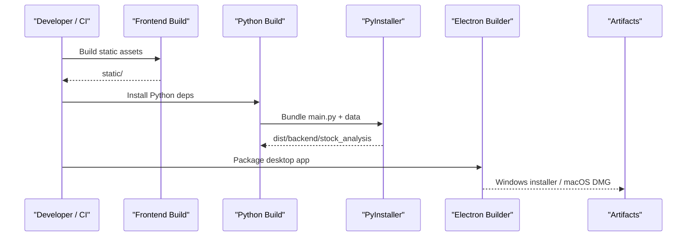
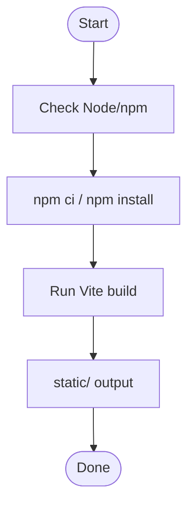
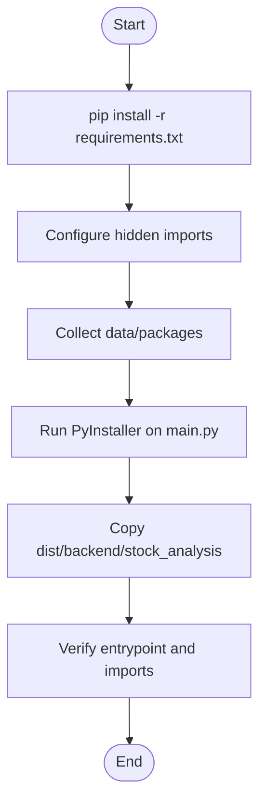
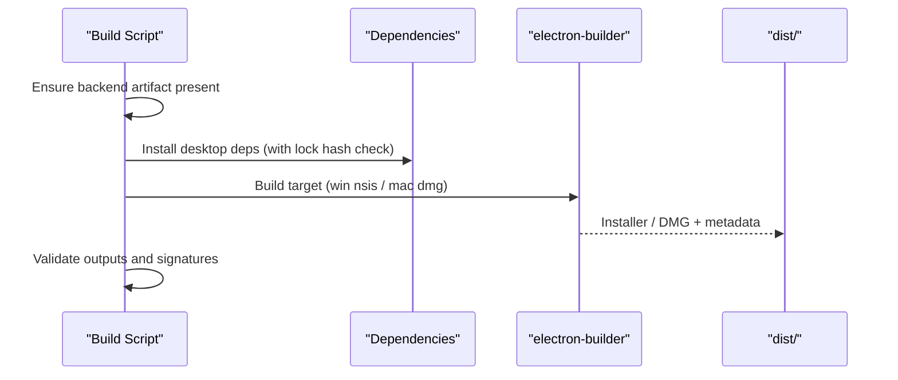
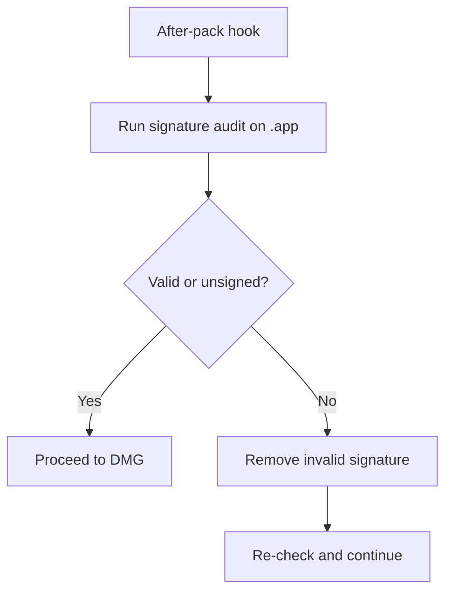
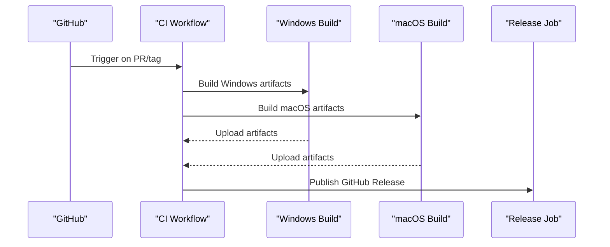
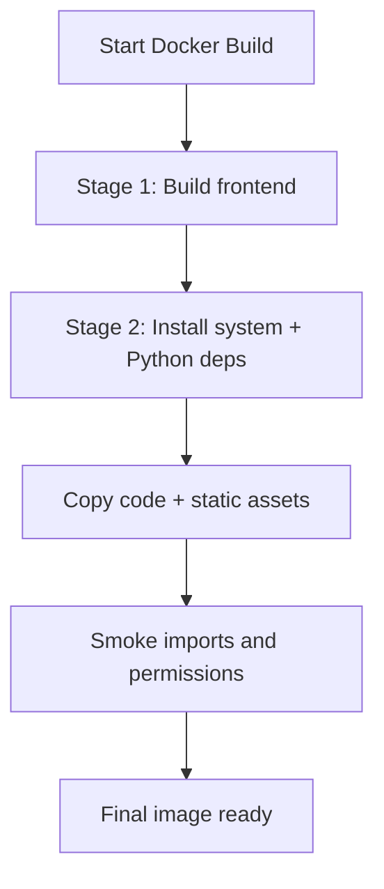
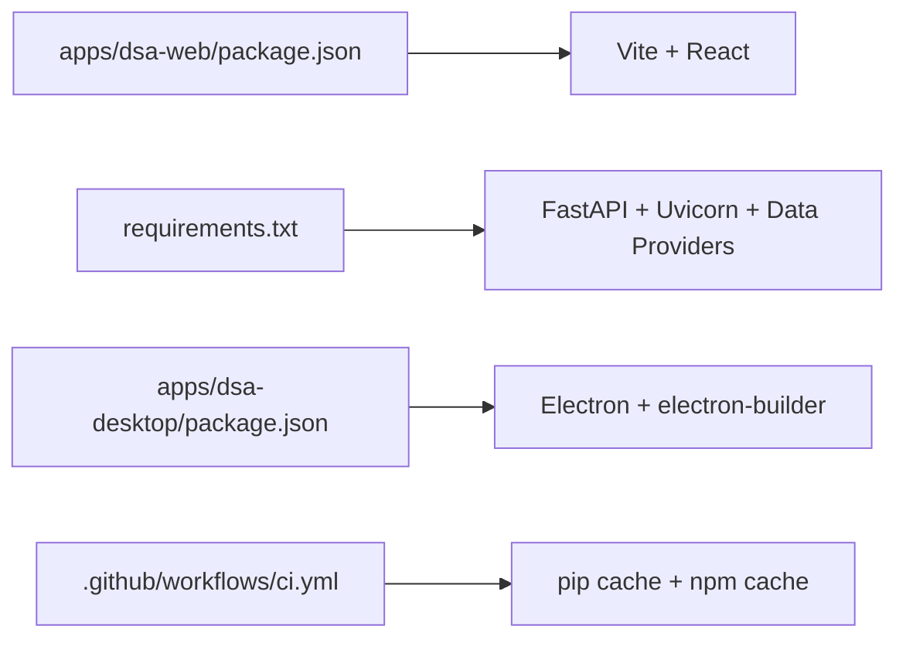

# Build Process & Packaging

<cite>
**Referenced Files in This Document**
- [scripts/build-all-macos.sh](file://scripts/build-all-macos.sh)
- [scripts/build-all.ps1](file://scripts/build-all.ps1)
- [scripts/build-backend-macos.sh](file://scripts/build-backend-macos.sh)
- [scripts/build-backend.ps1](file://scripts/build-backend.ps1)
- [scripts/build-desktop-macos.sh](file://scripts/build-desktop-macos.sh)
- [scripts/build-desktop.ps1](file://scripts/build-desktop.ps1)
- [scripts/macos-signature-audit.sh](file://scripts/macos-signature-audit.sh)
- [scripts/pyinstaller_runtime_compat.py](file://scripts/pyinstaller_runtime_compat.py)
- [apps/dsa-desktop/package.json](file://apps/dsa-desktop/package.json)
- [apps/dsa-web/package.json](file://apps/dsa-web/package.json)
- [apps/dsa-desktop/scripts/afterPackMacos.js](file://apps/dsa-desktop/scripts/afterPackMacos.js)
- [.github/workflows/ci.yml](file://.github/workflows/ci.yml)
- [.github/workflows/desktop-release.yml](file://.github/workflows/desktop-release.yml)
- [docker/Dockerfile](file://docker/Dockerfile)
- [requirements.txt](file://requirements.txt)
- [pyproject.toml](file://pyproject.toml)
- [docs/desktop-package.md](file://docs/desktop-package.md)
</cite>

## Table of Contents
1. Introduction
2. Project Structure
3. Core Components
4. Architecture Overview
5. Detailed Component Analysis
6. Dependency Analysis
7. Performance Considerations
8. Troubleshooting Guide
9. Conclusion
10. Appendices

## Introduction
This document explains the end-to-end build and packaging process for DailyStockAnalysis across Windows, macOS, and Linux. It covers:
- Multi-stage builds that compile frontend assets, resolve Python dependencies, and package desktop applications.
- Platform-specific scripts for building frozen backends with PyInstaller and Electron-based desktop packages.
- CI/CD automation for testing, artifact generation, and release publishing.
- Optimization techniques, caching strategies, debugging guidance, signing considerations, installer creation, and update distribution.

## Project Structure
The project separates concerns into distinct areas:
- Frontend web app under apps/dsa-web (Vite + React).
- Desktop shell under apps/dsa-desktop (Electron + electron-builder).
- Backend Python application packaged via PyInstaller using scripts under scripts/.
- Container image definition under docker/Dockerfile.
- CI workflows under .github/workflows.

```mermaid
graph TB
subgraph "Frontend"
WEB["apps/dsa-web<br/>Vite build"]
end
subgraph "Desktop"
DESK["apps/dsa-desktop<br/>Electron + electron-builder"]
end
subgraph "Backend"
PY["Python app<br/>PyInstaller bundle"]
end
subgraph "CI"
CI[".github/workflows/ci.yml"]
REL[".github/workflows/desktop-release.yml"]
end
subgraph "Container"
DOCKER["docker/Dockerfile"]
end
WEB --> DESK
PY --> DESK
CI --> WEB
CI --> PY
CI --> DESK
REL --> DESK
DOCKER --> PY
```

**Diagram sources**
- [apps/dsa-web/package.json:10-17](file://apps/dsa-web/package.json#L10-L17)
- [apps/dsa-desktop/package.json:18-61](file://apps/dsa-desktop/package.json#L18-L61)
- [scripts/build-backend-macos.sh:25-31](file://scripts/build-backend-macos.sh#L25-L31)
- [scripts/build-backend.ps1:3-9](file://scripts/build-backend.ps1#L3-L9)
- [.github/workflows/ci.yml:155-189](file://.github/workflows/ci.yml#L155-L189)
- [.github/workflows/desktop-release.yml:19-127](file://.github/workflows/desktop-release.yml#L19-L127)
- [docker/Dockerfile:8-18](file://docker/Dockerfile#L8-L18)

**Section sources**
- [apps/dsa-web/package.json:10-17](file://apps/dsa-web/package.json#L10-L17)
- [apps/dsa-desktop/package.json:18-61](file://apps/dsa-desktop/package.json#L18-L61)
- [scripts/build-backend-macos.sh:25-31](file://scripts/build-backend-macos.sh#L25-L31)
- [scripts/build-backend.ps1:3-9](file://scripts/build-backend.ps1#L3-L9)
- [docker/Dockerfile:8-18](file://docker/Dockerfile#L8-L18)

## Core Components
- Frontend asset compilation: Vite builds React UI to static assets consumed by the backend and desktop app.
- Python dependency resolution: pip installs requirements; PyInstaller bundles runtime modules and data files.
- Desktop packaging: Electron + electron-builder produces NSIS installer on Windows and DMG on macOS.
- CI/CD: GitHub Actions runs tests, builds artifacts, and publishes releases.
- Docker: Multi-stage build compiles frontend and assembles a production image.

Key responsibilities:
- scripts/build-backend-*.sh and scripts/build-backend.ps1: Build static assets, install Python deps, run PyInstaller, and validate packaged artifacts.
- scripts/build-desktop-*.sh and scripts/build-desktop.ps1: Install desktop dependencies, invoke electron-builder, and verify outputs.
- apps/dsa-desktop/package.json: Defines Electron app metadata, targets, extra resources, and publish settings.
- .github/workflows: Orchestrates change detection, platform builds, and release publishing.
- docker/Dockerfile: Builds frontend once and embeds it into a minimal Python runtime image.

**Section sources**
- [scripts/build-backend-macos.sh:25-127](file://scripts/build-backend-macos.sh#L25-L127)
- [scripts/build-backend.ps1:3-152](file://scripts/build-backend.ps1#L3-L152)
- [scripts/build-desktop-macos.sh:73-154](file://scripts/build-desktop-macos.sh#L73-L154)
- [scripts/build-desktop.ps1:75-97](file://scripts/build-desktop.ps1#L75-L97)
- [apps/dsa-desktop/package.json:18-61](file://apps/dsa-desktop/package.json#L18-L61)
- [.github/workflows/ci.yml:191-243](file://.github/workflows/ci.yml#L191-L243)
- [docker/Dockerfile:8-18](file://docker/Dockerfile#L8-L18)

## Architecture Overview
The build pipeline is multi-stage and cross-platform:



**Diagram sources**
- [scripts/build-backend-macos.sh:25-127](file://scripts/build-backend-macos.sh#L25-L127)
- [scripts/build-backend.ps1:3-152](file://scripts/build-backend.ps1#L3-L152)
- [scripts/build-desktop-macos.sh:73-154](file://scripts/build-desktop-macos.sh#L73-L154)
- [scripts/build-desktop.ps1:75-97](file://scripts/build-desktop.ps1#L75-L97)
- [apps/dsa-desktop/package.json:18-61](file://apps/dsa-desktop/package.json#L18-L61)

## Detailed Component Analysis

### Frontend Asset Compilation (Vite)
- The web app uses Vite to compile TypeScript/React into static assets.
- The build script ensures node_modules are installed and runs the build step.
- Static assets are later embedded into the backend or served by the desktop app.



**Diagram sources**
- [apps/dsa-web/package.json:10-17](file://apps/dsa-web/package.json#L10-L17)
- [scripts/build-backend-macos.sh:25-31](file://scripts/build-backend-macos.sh#L25-L31)
- [scripts/build-backend.ps1:3-9](file://scripts/build-backend.ps1#L3-L9)

**Section sources**
- [apps/dsa-web/package.json:10-17](file://apps/dsa-web/package.json#L10-L17)
- [scripts/build-backend-macos.sh:25-31](file://scripts/build-backend-macos.sh#L25-L31)
- [scripts/build-backend.ps1:3-9](file://scripts/build-backend.ps1#L3-L9)

### Python Dependency Resolution and PyInstaller Packaging
- Installs Python dependencies from requirements.txt.
- Adds hidden imports and collects required data packages (e.g., litellm, tiktoken, akshare, screening engine, futu).
- Copies built static assets and strategies into the bundle.
- Validates the packaged executable can start and import critical modules.



**Diagram sources**
- [scripts/build-backend-macos.sh:41-127](file://scripts/build-backend-macos.sh#L41-L127)
- [scripts/build-backend.ps1:43-152](file://scripts/build-backend.ps1#L43-L152)
- [scripts/pyinstaller_runtime_compat.py:1-12](file://scripts/pyinstaller_runtime_compat.py#L1-L12)

**Section sources**
- [requirements.txt:1-75](file://requirements.txt#L1-L75)
- [scripts/build-backend-macos.sh:41-127](file://scripts/build-backend-macos.sh#L41-L127)
- [scripts/build-backend.ps1:43-152](file://scripts/build-backend.ps1#L43-L152)
- [scripts/pyinstaller_runtime_compat.py:1-12](file://scripts/pyinstaller_runtime_compat.py#L1-L12)

### Desktop Application Packaging (Electron + electron-builder)
- Ensures backend artifact exists before packaging.
- Installs desktop dependencies with lockfile integrity checks.
- Invokes electron-builder to produce:
  - Windows: NSIS installer and updater metadata.
  - macOS: DMG (unsigned by default; signature audit applied).
- Cleans stale outputs and enforces expected artifact counts.



**Diagram sources**
- [scripts/build-desktop-macos.sh:73-154](file://scripts/build-desktop-macos.sh#L73-L154)
- [scripts/build-desktop.ps1:21-97](file://scripts/build-desktop.ps1#L21-L97)
- [apps/dsa-desktop/package.json:18-61](file://apps/dsa-desktop/package.json#L18-L61)

**Section sources**
- [scripts/build-desktop-macos.sh:73-154](file://scripts/build-desktop-macos.sh#L73-L154)
- [scripts/build-desktop.ps1:21-97](file://scripts/build-desktop.ps1#L21-L97)
- [apps/dsa-desktop/package.json:18-61](file://apps/dsa-desktop/package.json#L18-L61)

### macOS Signature Audit and After-Pack Hook
- A helper script audits and normalizes invalid signatures on macOS artifacts.
- Electron’s afterPack hook invokes this script to clean up broken signatures before DMG creation.
- CI verifies expected unsigned behavior and rejects malformed signatures.



**Diagram sources**
- [apps/dsa-desktop/scripts/afterPackMacos.js:4-25](file://apps/dsa-desktop/scripts/afterPackMacos.js#L4-L25)
- [scripts/macos-signature-audit.sh:32-79](file://scripts/macos-signature-audit.sh#L32-L79)
- [scripts/build-desktop-macos.sh:10-40](file://scripts/build-desktop-macos.sh#L10-L40)

**Section sources**
- [apps/dsa-desktop/scripts/afterPackMacos.js:4-25](file://apps/dsa-desktop/scripts/afterPackMacos.js#L4-L25)
- [scripts/macos-signature-audit.sh:32-79](file://scripts/macos-signature-audit.sh#L32-L79)
- [scripts/build-desktop-macos.sh:10-40](file://scripts/build-desktop-macos.sh#L10-L40)

### CI/CD Integration and Release Automation
- CI detects changed paths and runs appropriate jobs: backend tests, Docker build, desktop packaging on Windows/macOS, and web gate.
- Desktop release workflow:
  - Syncs desktop app version from tag.
  - Builds Windows NSIS installer and macOS DMGs.
  - Validates latest.yml and blockmap consistency.
  - Publishes artifacts to GitHub Releases.



**Diagram sources**
- [.github/workflows/ci.yml:191-243](file://.github/workflows/ci.yml#L191-L243)
- [.github/workflows/desktop-release.yml:19-127](file://.github/workflows/desktop-release.yml#L19-L127)
- [.github/workflows/desktop-release.yml:129-216](file://.github/workflows/desktop-release.yml#L129-L216)
- [.github/workflows/desktop-release.yml:218-247](file://.github/workflows/desktop-release.yml#L218-L247)

**Section sources**
- [.github/workflows/ci.yml:191-243](file://.github/workflows/ci.yml#L191-L243)
- [.github/workflows/desktop-release.yml:19-127](file://.github/workflows/desktop-release.yml#L19-L127)
- [.github/workflows/desktop-release.yml:129-216](file://.github/workflows/desktop-release.yml#L129-L216)
- [.github/workflows/desktop-release.yml:218-247](file://.github/workflows/desktop-release.yml#L218-L247)

### Docker Build (Linux)
- Multi-stage build:
  - Stage 1: Node image builds frontend assets.
  - Stage 2: Python slim image installs system deps, Python deps, copies code and built assets, performs smoke imports, and sets up non-root user and volumes.



**Diagram sources**
- [docker/Dockerfile:8-18](file://docker/Dockerfile#L8-L18)
- [docker/Dockerfile:21-66](file://docker/Dockerfile#L21-L66)
- [docker/Dockerfile:68-105](file://docker/Dockerfile#L68-L105)

**Section sources**
- [docker/Dockerfile:8-18](file://docker/Dockerfile#L8-L18)
- [docker/Dockerfile:21-66](file://docker/Dockerfile#L21-L66)
- [docker/Dockerfile:68-105](file://docker/Dockerfile#L68-L105)

## Dependency Analysis
- Frontend depends on Vite, React ecosystem, and Tailwind tooling.
- Backend depends on FastAPI, Uvicorn, SQLAlchemy, LLM clients, data providers, and optional SDKs.
- Desktop depends on Electron and electron-builder, plus electron-updater for updates.
- CI caches pip and npm artifacts to speed up builds.



**Diagram sources**
- [apps/dsa-web/package.json:18-58](file://apps/dsa-web/package.json#L18-L58)
- [requirements.txt:1-75](file://requirements.txt#L1-L75)
- [apps/dsa-desktop/package.json:11-17](file://apps/dsa-desktop/package.json#L11-L17)
- [.github/workflows/ci.yml:91-112](file://.github/workflows/ci.yml#L91-L112)
- [.github/workflows/ci.yml:205-216](file://.github/workflows/ci.yml#L205-L216)

**Section sources**
- [apps/dsa-web/package.json:18-58](file://apps/dsa-web/package.json#L18-L58)
- [requirements.txt:1-75](file://requirements.txt#L1-L75)
- [apps/dsa-desktop/package.json:11-17](file://apps/dsa-desktop/package.json#L11-L17)
- [.github/workflows/ci.yml:91-112](file://.github/workflows/ci.yml#L91-L112)
- [.github/workflows/ci.yml:205-216](file://.github/workflows/ci.yml#L205-L216)

## Performance Considerations
- Use npm ci for deterministic installs and faster CI runs.
- Cache pip and npm artifacts in CI to reduce network overhead.
- Keep node_modules cached locally via lockfile hashes to avoid reinstall when unchanged.
- Prefer one-dir PyInstaller output for easier debugging and smaller incremental rebuilds.
- Collect only necessary data packages to reduce bundle size.
- In Docker, leverage multi-stage builds to minimize final image size.

[No sources needed since this section provides general guidance]

## Troubleshooting Guide
Common issues and resolutions:
- Missing backend artifact: Ensure the backend has been built before desktop packaging.
- Developer Mode on Windows: Required for symlink creation during electron-builder cache extraction.
- ModuleNotFoundError in packaged backend: Add missing hidden-imports and re-run PyInstaller; verify with packaged import probes.
- Missing AkShare calendar data: Rebuild backend using provided scripts which collect required package data.
- macOS Gatekeeper warnings: Current builds are unsigned; use documented steps to allow execution or sign/notarize for distribution.
- Updater metadata mismatch: Verify latest.yml version and file URLs match the published installer name and tag.

**Section sources**
- [scripts/build-backend-macos.sh:136-158](file://scripts/build-backend-macos.sh#L136-L158)
- [scripts/build-backend.ps1:160-180](file://scripts/build-backend.ps1#L160-L180)
- [scripts/build-desktop-macos.sh:10-40](file://scripts/build-desktop-macos.sh#L10-L40)
- [scripts/build-desktop.ps1:14-23](file://scripts/build-desktop.ps1#L14-L23)
- [docs/desktop-package.md:80-105](file://docs/desktop-package.md#L80-L105)
- [.github/workflows/desktop-release.yml:73-127](file://.github/workflows/desktop-release.yml#L73-L127)

## Conclusion
DailyStockAnalysis employs a robust, cross-platform build and packaging pipeline:
- Frontend assets are compiled once and reused by backend and desktop.
- Python dependencies are resolved and bundled deterministically with PyInstaller.
- Desktop packages are produced per platform with validation and safety checks.
- CI automates testing, artifact generation, and release publishing with strong validations.
Adopting the recommended caching, validation, and signing practices will improve reliability and distribution quality.

[No sources needed since this section summarizes without analyzing specific files]

## Appendices

### Platform-Specific Build Commands
- macOS:
  - Full desktop build: scripts/build-all-macos.sh
  - Backend only: scripts/build-backend-macos.sh
  - Desktop only: scripts/build-desktop-macos.sh
- Windows:
  - Full desktop build: scripts/build-all.ps1
  - Backend only: scripts/build-backend.ps1
  - Desktop only: scripts/build-desktop.ps1
- Linux (Docker):
  - Build image: docker build -f docker/Dockerfile .

**Section sources**
- [scripts/build-all-macos.sh:6-11](file://scripts/build-all-macos.sh#L6-L11)
- [scripts/build-all.ps1:3-8](file://scripts/build-all.ps1#L3-L8)
- [docker/Dockerfile:8-18](file://docker/Dockerfile#L8-L18)

### Signing and Distribution Notes
- macOS:
  - Default builds are unsigned; afterPack hook cleans invalid signatures.
  - For trusted distribution, integrate Apple Developer signing and notarization.
- Windows:
  - NSIS installer supports per-user installation without elevation.
  - Updater relies on latest.yml and blockmaps; ensure they match the installer filename and tag.
- Linux:
  - Distribute via Docker images or packaged binaries built with PyInstaller.

**Section sources**
- [apps/dsa-desktop/scripts/afterPackMacos.js:4-25](file://apps/dsa-desktop/scripts/afterPackMacos.js#L4-L25)
- [scripts/macos-signature-audit.sh:32-79](file://scripts/macos-signature-audit.sh#L32-L79)
- [docs/desktop-package.md:63-79](file://docs/desktop-package.md#L63-L79)
- [.github/workflows/desktop-release.yml:73-127](file://.github/workflows/desktop-release.yml#L73-L127)