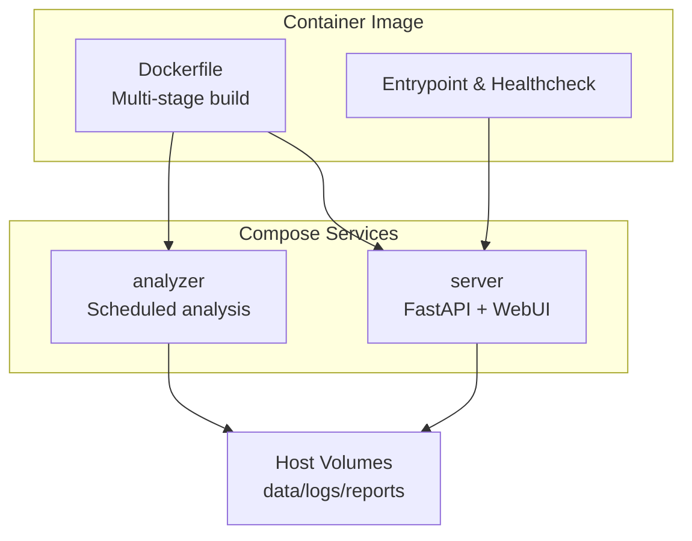
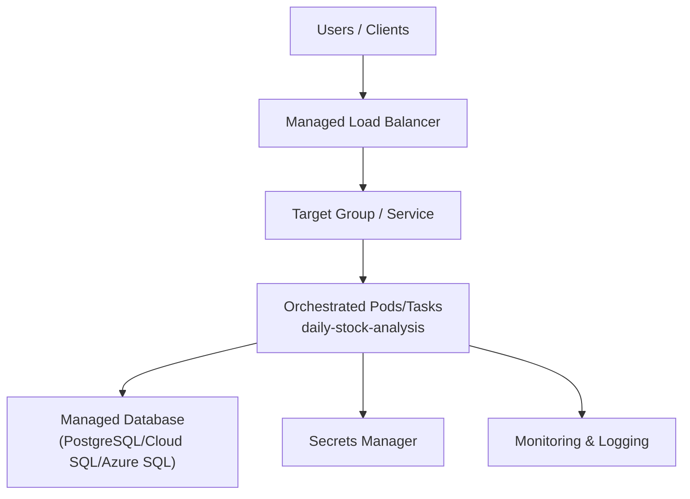
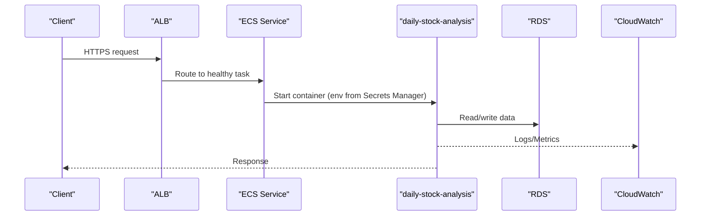
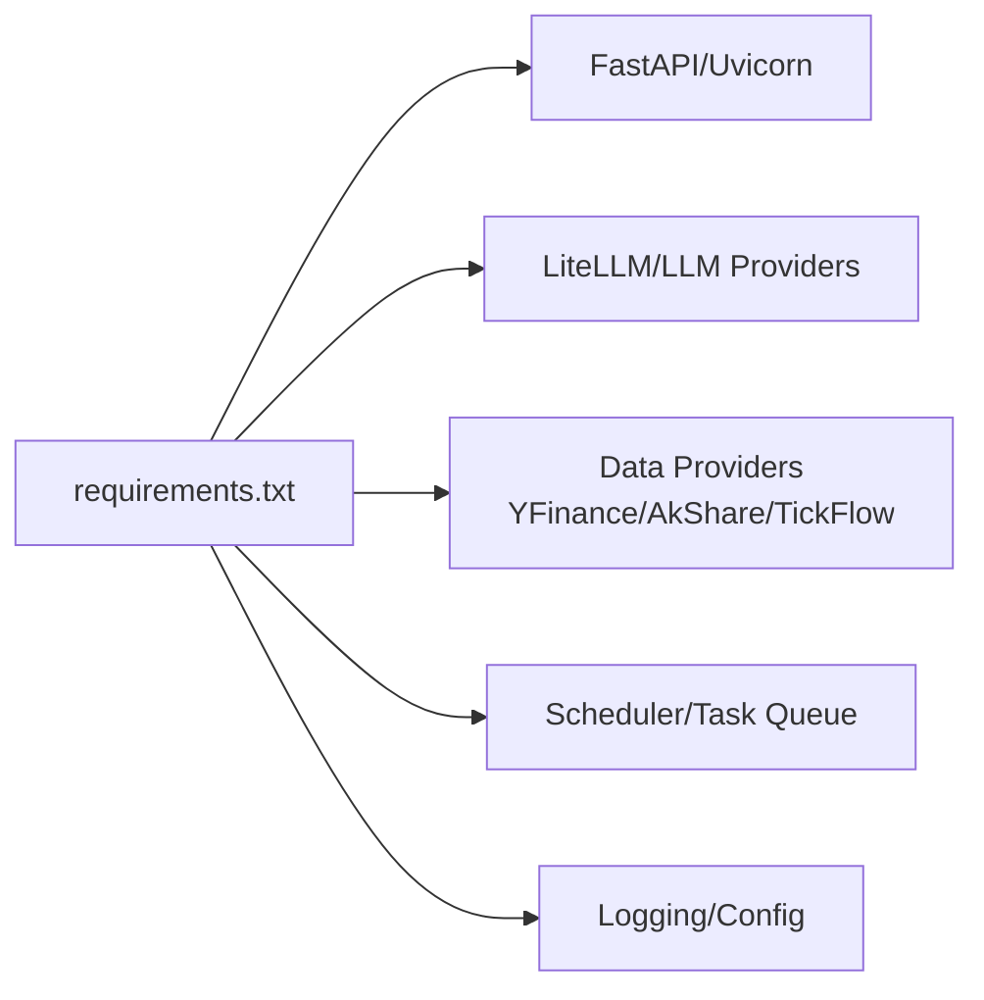

# Cloud Deployment

<cite>
**Referenced Files in This Document**
- [Dockerfile](file://docker/Dockerfile)
- [docker-compose.yml](file://docker/docker-compose.yml)
- [DEPLOY_EN.md](file://docs/DEPLOY_EN.md)
- [deploy-webui-cloud.md](file://docs/deploy-webui-cloud.md)
- [main.py](file://main.py)
- [server.py](file://server.py)
- [webui.py](file://webui.py)
- [config.py](file://src/config.py)
- [requirements.txt](file://requirements.txt)
- [00-daily-analysis.yml](file://.github/workflows/00-daily-analysis.yml)
- [docker-publish.yml](file://.github/workflows/docker-publish.yml)
</cite>

## Table of Contents
1. [Introduction](#introduction)
2. [Project Structure](#project-structure)
3. [Core Components](#core-components)
4. [Architecture Overview](#architecture-overview)
5. [Detailed Component Analysis](#detailed-component-analysis)
6. [Dependency Analysis](#dependency-analysis)
7. [Performance Considerations](#performance-considerations)
8. [Troubleshooting Guide](#troubleshooting-guide)
9. [Conclusion](#conclusion)
10. [Appendices](#appendices)

## Introduction
This document provides cloud deployment guidance for DailyStockAnalysis across major platforms (AWS, Google Cloud Platform, Microsoft Azure). It focuses on containerized deployments using orchestration services (ECS, GKE, AKS), infrastructure as code patterns with Terraform and CloudFormation, and cloud-native monitoring/logging strategies. It also covers auto-scaling policies, load balancer configurations, database provisioning for high availability, security best practices (IAM roles, network security groups, secret management), cost optimization, and performance tuning recommendations tailored to each platform.

## Project Structure
DailyStockAnalysis ships a production-ready container image and a Compose file that define the runtime surface exposed to orchestrators:
- A multi-stage Dockerfile builds the web UI and packages the Python backend into a slim image with health checks and non-root execution.
- docker-compose.yml defines two modes: an analyzer service for scheduled analysis and a server service for FastAPI-based API/WebUI access.
- The application exposes a health endpoint used by orchestrator health checks.



**Diagram sources**
- [Dockerfile:20-105](file://docker/Dockerfile#L20-L105)
- [docker-compose.yml:13-73](file://docker/docker-compose.yml#L13-L73)

**Section sources**
- [Dockerfile:20-105](file://docker/Dockerfile#L20-L105)
- [docker-compose.yml:13-73](file://docker/docker-compose.yml#L13-L73)
- [DEPLOY_EN.md:18-100](file://docs/DEPLOY_EN.md#L18-L100)

## Core Components
- Container image: Multi-stage build, non-root user, health check, persistent volumes for data/logs/reports.
- Services:
  - analyzer: Runs scheduled analysis tasks.
  - server: Exposes FastAPI endpoints and serves the WebUI; binds to 0.0.0.0 inside containers.
- Configuration: Environment-driven via .env and runtime environment variables; supports proxy settings, logging, and feature toggles.

Key runtime behaviors:
- Health endpoint is probed by the container healthcheck.
- Logging defaults to JSON file driver in Compose with rotation.
- Memory limits/reservations are set in Compose to constrain resource usage.

**Section sources**
- [Dockerfile:81-105](file://docker/Dockerfile#L81-L105)
- [docker-compose.yml:35-57](file://docker/docker-compose.yml#L35-L57)
- [main.py:87-118](file://main.py#L87-L118)
- [server.py:21-55](file://server.py#L21-L55)
- [webui.py:26-59](file://webui.py#L26-L59)

## Architecture Overview
The recommended cloud architecture uses a managed container orchestration service to run the container image behind a load balancer, with persistent storage for data/logs/reports and secrets managed via platform secret stores.



[No sources needed since this diagram shows conceptual workflow, not actual code structure]

## Detailed Component Analysis

### AWS ECS Deployment
- Task definition:
  - Use the provided container image.
  - Set environment variables from AWS Secrets Manager or Parameter Store.
  - Mount EFS or use RDS for persistence; map logs to CloudWatch via fluent-bit or sidecar if needed.
  - Configure health checks against the container’s HTTP health endpoint.
- Service:
  - Place behind Application Load Balancer (ALB) for HTTPS termination.
  - Enable auto scaling based on CPU/memory or custom metrics (e.g., request count per task).
- Networking:
  - Place tasks in private subnets; ALB in public subnets.
  - Use security groups to restrict inbound/outbound traffic.
- IAM:
  - Least privilege role for ECS tasks to read secrets and write logs/metrics.
- Monitoring:
  - CloudWatch Logs for stdout/stderr; CloudWatch Metrics for CPU/Memory; optional X-Ray for tracing.
- Auto-scaling:
  - Target tracking or step scaling on CPU utilization or request latency.
- Database:
  - Use Amazon RDS (PostgreSQL) with Multi-AZ for HA; configure security group rules to allow ECS tasks.



**Diagram sources**
- [Dockerfile:95-98](file://docker/Dockerfile#L95-L98)
- [docker-compose.yml:45-57](file://docker/docker-compose.yml#L45-L57)

**Section sources**
- [Dockerfile:95-98](file://docker/Dockerfile#L95-L98)
- [docker-compose.yml:45-57](file://docker/docker-compose.yml#L45-L57)

### Google Cloud Platform (GKE) Deployment
- Cluster and workloads:
  - Deploy the container image as a Deployment with a Service (ClusterIP) and Ingress (managed by GKE Ingress Controller).
  - Use Secret Manager for sensitive configuration; mount as env vars or files.
  - Persist data/logs/reports using PersistentVolumes backed by GCE PD or Filestore.
- Networking:
  - Restrict ingress to specific CIDRs; use Network Policies where applicable.
- IAM:
  - Workload Identity to grant minimal permissions to pods for accessing Secret Manager and other APIs.
- Monitoring:
  - Cloud Logging for structured logs; Cloud Monitoring for metrics and alerts; consider Stackdriver Agent or OpenTelemetry.
- Auto-scaling:
  - Horizontal Pod Autoscaler (HPA) based on CPU/memory or custom metrics; Cluster Autoscaler for node pool scaling.
- Database:
  - Cloud SQL (PostgreSQL) with high availability; connect via private IP and authorized networks.

```mermaid
sequenceDiagram
participant Client as "Client"
participant Ingress as "GKE Ingress"
participant Svc as "Service"
pod as "Pod (daily-stock-analysis)"
participant CSQL as "Cloud SQL"
participant CL as "Cloud Logging"
Client->>Ingress : HTTPS request
Ingress->>Svc : Forward to Service
Svc->>pod : Route to healthy Pod
pod->>CSQL : Query/Update
pod->>CL : Emit logs
pod-->>Client : Response
```

**Diagram sources**
- [Dockerfile:95-98](file://docker/Dockerfile#L95-L98)

**Section sources**
- [Dockerfile:95-98](file://docker/Dockerfile#L95-L98)

### Microsoft Azure (AKS) Deployment
- Workloads:
  - Deploy the container image as a Deployment with a Service and Ingress (NGINX or Azure Application Gateway Ingress Controller).
  - Use Azure Key Vault for secrets; integrate via CSI Driver or environment injection.
  - Persist data/logs/reports using Azure Files or managed disks.
- Networking:
  - Restrict ingress via firewall rules; use NSGs to limit traffic.
- IAM:
  - Managed Identities for least-privilege access to Key Vault and other resources.
- Monitoring:
  - Azure Monitor and Log Analytics for logs and metrics; set up alert rules.
- Auto-scaling:
  - Horizontal Pod Autoscaler (HPA) and Virtual Node/KEDA for event-driven scaling if needed.
- Database:
  - Azure Database for PostgreSQL flexible server with HA; secure via firewall rules and private endpoints.

```mermaid
sequenceDiagram
participant Client as "Client"
participant AGIC as "Application Gateway Ingress"
participant Svc as "Service"
pod as "Pod (daily-stock-analysis)"
participant KV as "Key Vault"
participant AZMON as "Azure Monitor"
Client->>AGIC : HTTPS request
AGIC->>Svc : Route to Service
Svc->>pod : Healthy Pod
pod->>KV : Fetch secrets
pod->>AZMON : Logs/Metrics
pod-->>Client : Response
```

**Diagram sources**
- [Dockerfile:95-98](file://docker/Dockerfile#L95-L98)

**Section sources**
- [Dockerfile:95-98](file://docker/Dockerfile#L95-L98)

### Infrastructure as Code (Terraform/CloudFormation)
- Terraform:
  - Provision cluster (EKS/GKE/AKS), networking, load balancers, databases, and secrets.
  - Define Kubernetes manifests or Helm charts for deploying daily-stock-analysis.
  - Use modules to standardize environments (dev/staging/prod).
- CloudFormation:
  - For AWS-only stacks, define ECS clusters, services, ALBs, RDS instances, and IAM roles.
  - Use parameter store integration for secrets and outputs for URLs.

[No sources needed since this section provides general guidance]

### Cloud-Native Monitoring and Logging
- Containers emit logs to stdout/stderr; configure platform log collectors:
  - AWS: CloudWatch Logs via fluent-bit or FireLens.
  - GCP: Cloud Logging agent or sidecars.
  - Azure: Log Analytics agent or built-in container insights.
- Metrics:
  - Collect CPU/Memory from orchestrator; add app-level metrics via Prometheus/OpenTelemetry exporters.
- Alerting:
  - Define thresholds for error rates, latency, and resource saturation.
  - Integrate with notification channels supported by the application (webhooks, email, chat bots).

[No sources needed since this section provides general guidance]

### Auto-Scaling Policies
- ECS:
  - Target tracking on CPU or custom metrics; scale out/in based on demand.
- GKE:
  - HPA for pods; Cluster Autoscaler for nodes; consider KEDA for event-driven scaling.
- AKS:
  - HPA and Virtual Nodes/KEDA; autoscale node pools based on workload.

[No sources needed since this section provides general guidance]

### Load Balancer Configurations
- TLS termination at the managed load balancer.
- Health checks pointing to the container’s HTTP health endpoint.
- Sticky sessions disabled unless required by application state.
- Rate limiting and WAF rules enabled where available.

[No sources needed since this section provides general guidance]

### Database Provisioning for High Availability
- Use managed relational databases with Multi-AZ or regional HA.
- Configure connection pooling and timeouts appropriate for containerized workloads.
- Backups and point-in-time recovery enabled.
- Private connectivity between orchestrator and database.

[No sources needed since this section provides general guidance]

### Security Best Practices
- IAM Roles:
  - Least privilege for orchestrator services to access secrets, logs, and databases.
- Network Security Groups/Firewalls:
  - Restrict inbound to load balancer ports; outbound only to required endpoints.
- Secret Management:
  - Use platform secret stores (Secrets Manager, Secret Manager, Key Vault).
  - Avoid embedding secrets in images or configs.
- Authentication:
  - Enable admin authentication for WebUI when exposing publicly.
  - Use reverse proxies with trusted headers if behind multiple hops.

**Section sources**
- [deploy-webui-cloud.md:330-343](file://docs/deploy-webui-cloud.md#L330-L343)
- [main.py:98-111](file://main.py#L98-L111)

### Cost Optimization Strategies
- Right-size containers:
  - Start with Compose-recommended memory reservations/limits; adjust based on observed usage.
- Use spot/preemptible instances for non-critical workloads where feasible.
- Scale down during off-hours; schedule jobs to run only on business days.
- Optimize LLM calls and search queries via caching and rate limiting.

**Section sources**
- [docker-compose.yml:50-57](file://docker/docker-compose.yml#L50-L57)
- [DEPLOY_EN.md:58-67](file://docs/DEPLOY_EN.md#L58-L67)

### Performance Tuning Recommendations
- Concurrency:
  - Tune MAX_WORKERS according to workload and memory constraints.
- Data Sources:
  - Prioritize stable providers (e.g., TickFlow/Tushare) to reduce retries and latency.
- Caching:
  - Leverage local caches for stock indices and search results; ensure persistence across restarts.
- Resource Limits:
  - Increase memory limits for heavy workloads (market review, image reports, screening).

**Section sources**
- [00-daily-analysis.yml:420-427](file://.github/workflows/00-daily-analysis.yml#L420-L427)
- [DEPLOY_EN.md:58-67](file://docs/DEPLOY_EN.md#L58-L67)

## Dependency Analysis
The application depends on Python libraries for data fetching, AI analysis, web serving, and scheduling. Dependencies are pinned in requirements.txt and installed in the container image.



**Diagram sources**
- [requirements.txt:1-75](file://requirements.txt#L1-L75)

**Section sources**
- [requirements.txt:1-75](file://requirements.txt#L1-L75)

## Performance Considerations
- Memory:
  - Default Compose sets 1G limit and 512M reservation; increase for heavy workloads.
- Concurrency:
  - Adjust MAX_WORKERS to balance throughput and memory usage.
- I/O:
  - Ensure persistent volumes are fast enough for logs and reports; consider separate volumes for hot data.
- External APIs:
  - Use retries and backoff; prefer stable data sources to minimize failures.

**Section sources**
- [docker-compose.yml:50-57](file://docker/docker-compose.yml#L50-L57)
- [DEPLOY_EN.md:58-67](file://docs/DEPLOY_EN.md#L58-L67)

## Troubleshooting Guide
- Health checks:
  - Validate container health endpoint responds; orchestrator will restart unhealthy tasks/pods.
- Logs:
  - Inspect container logs via platform logging; rotate logs to prevent disk pressure.
- Permissions:
  - Ensure mounted directories have correct ownership for non-root user; entrypoint handles default mounts.
- Access issues:
  - Confirm host binding (0.0.0.0) and port mappings; verify firewall/security group rules.
- Database locks:
  - Stop service and remove lock files if necessary; ensure single writer for SQLite-backed workflows.

**Section sources**
- [Dockerfile:95-98](file://docker/Dockerfile#L95-L98)
- [DEPLOY_EN.md:245-312](file://docs/DEPLOY_EN.md#L245-L312)
- [deploy-webui-cloud.md:206-246](file://docs/deploy-webui-cloud.md#L206-L246)

## Conclusion
DailyStockAnalysis is container-first and ready for modern cloud orchestration. By packaging the app in a secure, health-checked image and running it on managed services (ECS/GKE/AKS), you gain scalability, reliability, and operational simplicity. Pair this with infrastructure as code, centralized secrets, robust monitoring, and tuned auto-scaling to deliver a high-performance, cost-effective deployment across clouds.

## Appendices

### CI/CD and Release Pipeline
- Docker publishing pipeline builds multi-platform images and runs smoke tests before pushing to registries.
- Scheduled GitHub Actions workflow executes daily analysis in a stateless environment, demonstrating how the app can be run without persistent state.

**Section sources**
- [docker-publish.yml:110-184](file://.github/workflows/docker-publish.yml#L110-L184)
- [00-daily-analysis.yml:40-63](file://.github/workflows/00-daily-analysis.yml#L40-L63)