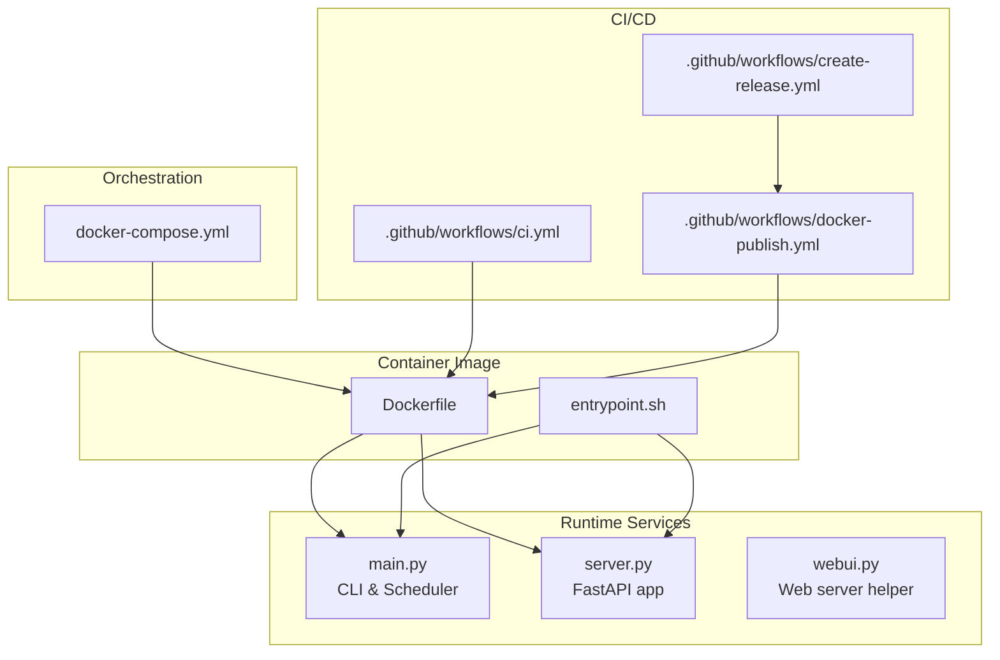
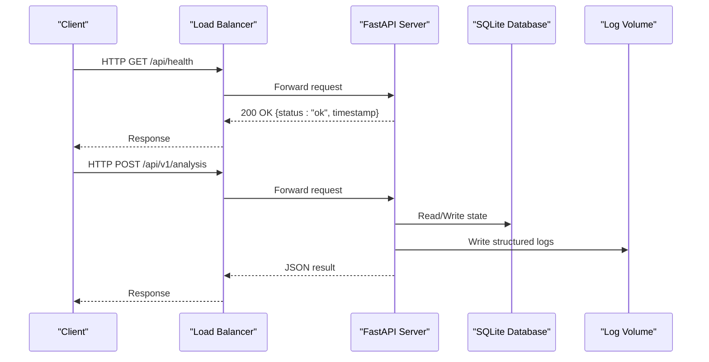
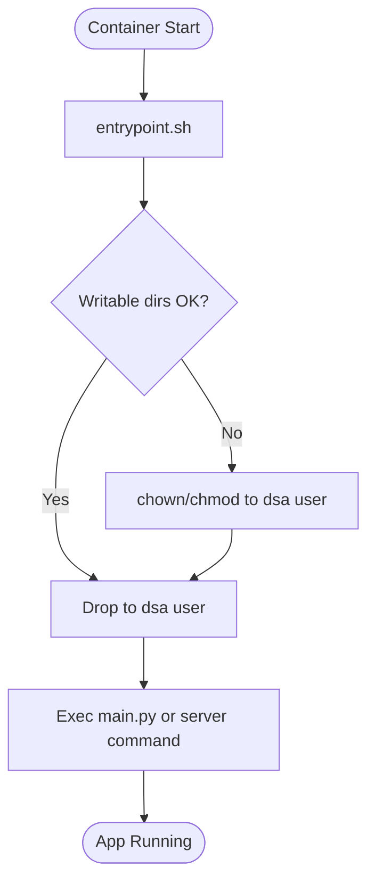
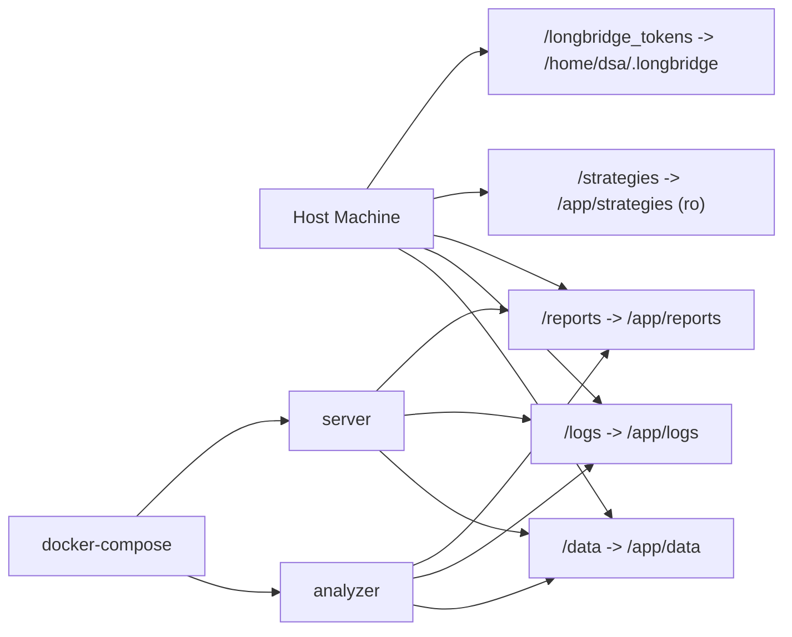
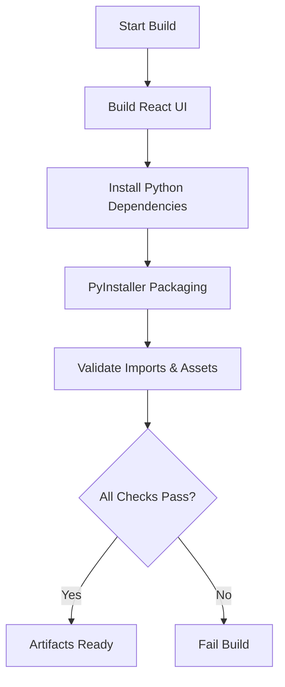
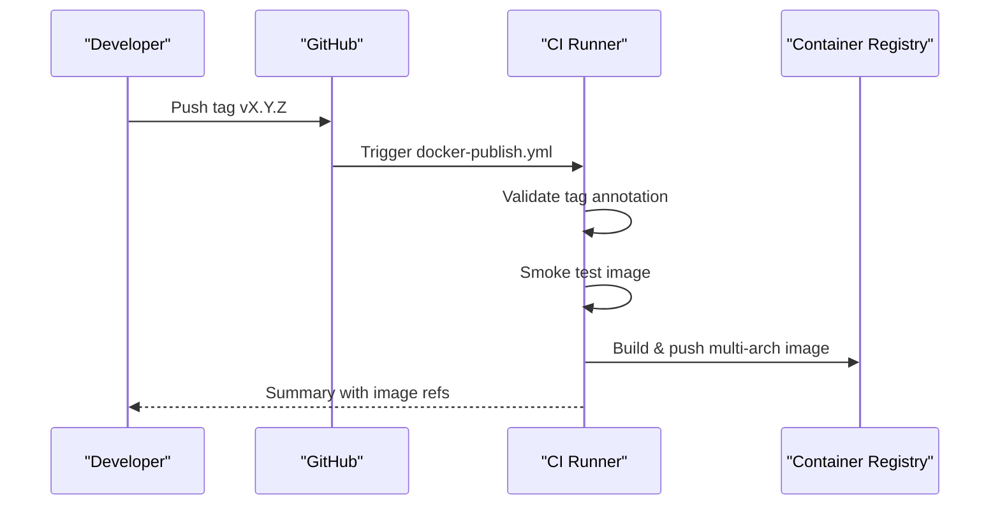
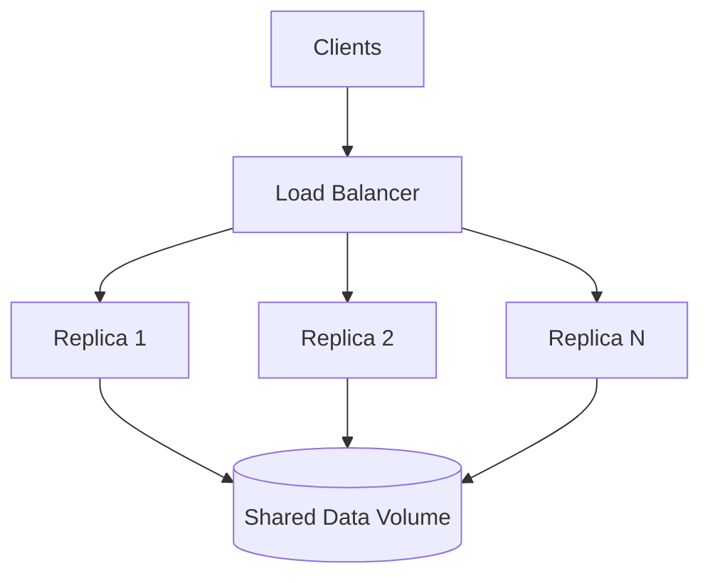
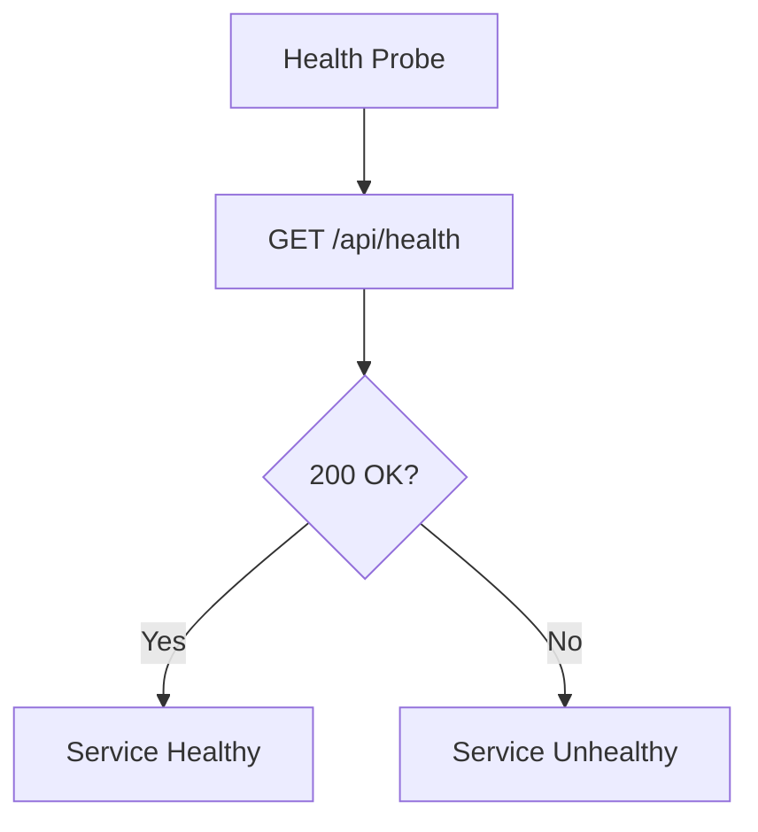
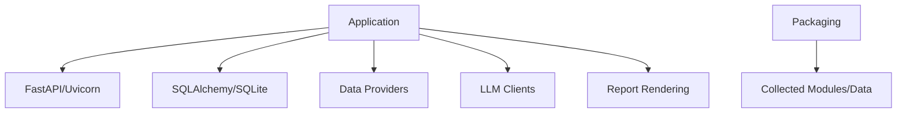

# Deployment Guide

<cite>
**Referenced Files in This Document**
- [Dockerfile](file://docker/Dockerfile)
- [docker-compose.yml](file://docker/docker-compose.yml)
- [entrypoint.sh](file://docker/entrypoint.sh)
- [main.py](file://main.py)
- [server.py](file://server.py)
- [webui.py](file://webui.py)
- [requirements.txt](file://requirements.txt)
- [pyproject.toml](file://pyproject.toml)
- [build-backend-macos.sh](file://scripts/build-backend-macos.sh)
- [build-all-macos.sh](file://scripts/build-all-macos.sh)
- [docker-publish.yml](file://.github/workflows/docker-publish.yml)
- [ci.yml](file://.github/workflows/ci.yml)
- [create-release.yml](file://.github/workflows/create-release.yml)
- [health endpoint](file://api/v1/endpoints/health.py)
</cite>

## Table of Contents
1. Introduction
2. Project Structure
3. Core Components
4. Architecture Overview
5. Detailed Component Analysis
6. Dependency Analysis
7. Performance Considerations
8. Troubleshooting Guide
9. Conclusion
10. Appendices

## Introduction
This guide provides production deployment strategies for DailyStockAnalysis with a focus on containerization, orchestration, cloud deployment options, build processes across platforms, high availability and load balancing patterns, database backup strategies, monitoring and logging, health checks, automated pipelines, troubleshooting, and performance optimization.

## Project Structure
DailyStockAnalysis is a Python-based backend with an optional FastAPI web server, a scheduled analysis engine, and a React-based web UI that is built into static assets and served by the backend. The project includes:
- Container image definition and compose configuration under docker/
- A non-root entrypoint that repairs permissions for mounted volumes
- CLI-driven modes for scheduling analysis or serving the API
- GitHub Actions workflows for CI, Docker publishing, and release creation
- Platform-specific packaging scripts for desktop distribution

**Diagram sources**
- [Dockerfile:1-106](file://docker/Dockerfile#L1-L106)
- [entrypoint.sh:1-93](file://docker/entrypoint.sh#L1-L93)
- [docker-compose.yml:1-73](file://docker/docker-compose.yml#L1-L73)
- [main.py:1-800](file://main.py#L1-L800)
- [server.py:1-55](file://server.py#L1-L55)
- [webui.py:1-60](file://webui.py#L1-L60)
- [ci.yml:1-268](file://.github/workflows/ci.yml#L1-L268)
- [docker-publish.yml:1-196](file://.github/workflows/docker-publish.yml#L1-L196)
- [create-release.yml:1-38](file://.github/workflows/create-release.yml#L1-L38)

**Section sources**
- [Dockerfile:1-106](file://docker/Dockerfile#L1-L106)
- [docker-compose.yml:1-73](file://docker/docker-compose.yml#L1-L73)
- [entrypoint.sh:1-93](file://docker/entrypoint.sh#L1-L93)
- [main.py:1-800](file://main.py#L1-L800)
- [server.py:1-55](file://server.py#L1-L55)
- [webui.py:1-60](file://webui.py#L1-L60)
- [ci.yml:1-268](file://.github/workflows/ci.yml#L1-L268)
- [docker-publish.yml:1-196](file://.github/workflows/docker-publish.yml#L1-L196)
- [create-release.yml:1-38](file://.github/workflows/create-release.yml#L1-L38)

## Core Components
- Container image: Multi-stage build compiles the React frontend and packages Python dependencies into a slim runtime image with wkhtmltopdf and fonts for report rendering. It exposes port 8000 and defines a health check against both /api/health and /health.
- Orchestration: docker-compose defines two services: analyzer (scheduled mode) and server (FastAPI-only). Volumes persist data, logs, reports, strategies, and Longbridge tokens. Logging is rotated via json-file driver.
- Entrypoint: Repairs ownership and permissions for writable directories and drops privileges to a non-root user before executing the application command.
- Application modes:
  - main.py supports --schedule for cron-like runs, --serve/--serve-only for API, and other flags for portfolio, dry-run, workers, market review toggles, etc.
  - server.py initializes logging and imports the FastAPI app for uvicorn.
  - webui.py is a convenience wrapper around uvicorn for quick starts.

**Section sources**
- [Dockerfile:20-106](file://docker/Dockerfile#L20-L106)
- [docker-compose.yml:13-73](file://docker/docker-compose.yml#L13-L73)
- [entrypoint.sh:1-93](file://docker/entrypoint.sh#L1-L93)
- [main.py:272-443](file://main.py#L272-L443)
- [server.py:21-55](file://server.py#L21-L55)
- [webui.py:26-60](file://webui.py#L26-L60)

## Architecture Overview
The system can run as:
- Scheduled analyzer only: executes analysis jobs based on configuration and schedules.
- API server only: serves REST endpoints and serves the prebuilt web UI.
- Combined: API server plus background tasks.

**Diagram sources**
- [docker-compose.yml:59-73](file://docker/docker-compose.yml#L59-L73)
- [server.py:21-55](file://server.py#L21-L55)
- [health endpoint:21-34](file://api/v1/endpoints/health.py#L21-L34)

## Detailed Component Analysis

### Docker Image and Runtime
- Multi-stage build: Node builder compiles the React UI; Python runtime installs dependencies and bundles static assets.
- System dependencies: gcc, curl, gosu, wkhtmltopdf, fontconfig, CJK fonts, and image libraries are installed for report generation.
- Non-root execution: Creates dsa user/group and ensures data/logs/reports directories are owned by this user.
- Health check: Probes /api/health and /health with retries and timeouts suitable for orchestrators.
- Environment variables: TZ, PYTHONUNBUFFERED, LOG_DIR, DATABASE_PATH, WEBUI_HOST, API_PORT.

**Diagram sources**
- [entrypoint.sh:1-93](file://docker/entrypoint.sh#L1-L93)
- [Dockerfile:43-106](file://docker/Dockerfile#L43-L106)

**Section sources**
- [Dockerfile:20-106](file://docker/Dockerfile#L20-L106)
- [entrypoint.sh:1-93](file://docker/entrypoint.sh#L1-L93)

### Service Orchestration with docker-compose
- Services:
  - analyzer: Runs scheduled analysis using default CMD from image.
  - server: Runs FastAPI with host/port from environment; maps API_PORT to host.
- Volumes: Persistent data, logs, reports, read-only strategies, and Longbridge token cache.
- Logging: json-file driver with size and file rotation.
- Resource limits: Memory reservations and limits configured for stability.

**Diagram sources**
- [docker-compose.yml:24-33](file://docker/docker-compose.yml#L24-L33)
- [docker-compose.yml:45-58](file://docker/docker-compose.yml#L45-L58)
- [docker-compose.yml:59-73](file://docker/docker-compose.yml#L59-L73)

**Section sources**
- [docker-compose.yml:13-73](file://docker/docker-compose.yml#L13-L73)

### Build Process for Different Platforms
- Linux/macOS backend packaging:
  - Builds React UI, verifies static assets, installs Python deps, then uses PyInstaller to create a standalone executable with hidden imports and collected data.
  - Validates critical imports (screening pipeline, Futu SDK, orjson), AkShare calendar data, strategies count, and packaged static assets.
- macOS desktop packaging:
  - Orchestrates backend and desktop builds via a single script.
- Windows:
  - Parallel PowerShell scripts exist for building backend and desktop artifacts (referenced by CI).

**Diagram sources**
- [build-backend-macos.sh:25-214](file://scripts/build-backend-macos.sh#L25-L214)
- [build-all-macos.sh:1-12](file://scripts/build-all-macos.sh#L1-L12)
- [ci.yml:191-243](file://.github/workflows/ci.yml#L191-L243)

**Section sources**
- [build-backend-macos.sh:25-214](file://scripts/build-backend-macos.sh#L25-L214)
- [build-all-macos.sh:1-12](file://scripts/build-all-macos.sh#L1-L12)
- [ci.yml:191-243](file://.github/workflows/ci.yml#L191-L243)

### Automated Deployment Pipelines
- CI:
  - Path-based filtering triggers backend tests, Docker build, and desktop packaging when relevant files change.
  - Sharded offline test suite and syntax/flake8 gates.
- Docker publish:
  - On annotated tags or workflow dispatch, validates tag annotation, runs smoke tests, builds multi-arch images, and pushes to GHCR and optionally Docker Hub.
- Release creation:
  - Generates concise release notes and publishes a GitHub release.

**Diagram sources**
- [docker-publish.yml:1-196](file://.github/workflows/docker-publish.yml#L1-L196)
- [create-release.yml:1-38](file://.github/workflows/create-release.yml#L1-L38)
- [ci.yml:1-268](file://.github/workflows/ci.yml#L1-L268)

**Section sources**
- [docker-publish.yml:1-196](file://.github/workflows/docker-publish.yml#L1-L196)
- [create-release.yml:1-38](file://.github/workflows/create-release.yml#L1-L38)
- [ci.yml:1-268](file://.github/workflows/ci.yml#L1-L268)

### Production Configuration Examples

#### High Availability and Load Balancing
- Run multiple replicas of the server service behind a reverse proxy or load balancer.
- Use persistent volumes for data/logs/reports so replicas share state if needed or rely on external storage.
- Configure health probes to /api/health and /health; ensure they remain accessible even when admin auth is enabled.

[No sources needed since this diagram shows conceptual HA pattern]

#### Database Backup Strategy
- Persist SQLite database at /app/data (mapped to host path).
- Schedule periodic backups of the volume directory to offsite storage.
- Ensure consistent snapshots (e.g., filesystem snapshot or stopping writes briefly) to avoid corruption.

[No sources needed since this section provides general guidance]

#### Monitoring and Logging
- Health endpoints:
  - /api/health returns status and timestamp.
  - /health returns status and timestamp and is not handled by SPA fallback.
- Logging:
  - json-file driver with max-size and max-file rotation in compose.
  - Logs written to /app/logs mapped to host.

**Diagram sources**
- [health endpoint:21-34](file://api/v1/endpoints/health.py#L21-L34)
- [docker-compose.yml:45-49](file://docker/docker-compose.yml#L45-L49)

**Section sources**
- [health endpoint:21-34](file://api/v1/endpoints/health.py#L21-L34)
- [docker-compose.yml:45-49](file://docker/docker-compose.yml#L45-L49)

### Cloud Deployment Options

#### AWS
- ECS/Fargate:
  - Deploy the published image with task definitions for analyzer and server.
  - Use EFS or EBS for persistent data/logs/reports.
  - Place ALB in front of server tasks; configure health checks to /api/health.
  - Enable CloudWatch log collection from container logs.
- EKS:
  - Kubernetes manifests similar to docker-compose semantics; use PVCs for persistence.
  - Horizontal Pod Autoscaler based on CPU/memory or custom metrics.

[No sources needed since this section provides general guidance]

#### Google Cloud
- Cloud Run:
  - Stateless containers; mount ephemeral storage or use Cloud SQL/Cloud Storage for persistence.
  - Configure liveness/readiness probes to /api/health.
- GKE:
  - Deploy with StatefulSets for shared storage or sidecar for log shipping.
  - Use Ingress and Cloud Load Balancing for HA.

[No sources needed since this section provides general guidance]

#### Azure
- Azure Container Instances:
  - Quick deployments with persistent volumes for data/logs/reports.
  - Health checks via ACI probes to /api/health.
- AKS:
  - Helm charts mirroring compose services; use managed disks or Azure Files for persistence.
  - Integrate with Application Gateway or Azure Front Door for load balancing.

[No sources needed since this section provides general guidance]

### Security Considerations
- Bind address:
  - Ensure WEBUI_HOST is set appropriately; warnings are logged if binding to public interfaces without authentication.
- Authentication:
  - Health endpoints remain accessible even when admin auth is enabled.
- Secrets management:
  - Store sensitive values in environment variables or secret managers; avoid committing .env files.
- Least privilege:
  - Entrypoint drops to non-root user; ensure mounted volumes have correct ownership.

**Section sources**
- [main.py:94-118](file://main.py#L94-L118)
- [health endpoint:21-34](file://api/v1/endpoints/health.py#L21-L34)
- [entrypoint.sh:63-93](file://docker/entrypoint.sh#L63-L93)

## Dependency Analysis
- Runtime dependencies include FastAPI, Uvicorn, SQLAlchemy, schedule, exchange-calendars, various data providers, LLM clients, and reporting tools.
- Desktop packaging collects additional modules and data assets required for offline operation.

**Diagram sources**
- [requirements.txt:1-75](file://requirements.txt#L1-L75)
- [build-backend-macos.sh:69-123](file://scripts/build-backend-macos.sh#L69-L123)

**Section sources**
- [requirements.txt:1-75](file://requirements.txt#L1-L75)
- [build-backend-macos.sh:69-123](file://scripts/build-backend-macos.sh#L69-L123)

## Performance Considerations
- Resource limits:
  - Set memory reservations and limits in compose or orchestrator; full analysis recommends 1G+ per replica.
- Concurrency:
  - Adjust worker counts via CLI flags or configuration; limit concurrency when resources are constrained.
- I/O:
  - Use fast persistent storage for data/logs/reports; consider SSD-backed volumes.
- Caching:
  - Leverage local caches for stock indices and search results; refresh periodically.
- Network:
  - Configure proxies if required; ensure timeouts and retries are tuned for data providers.

[No sources needed since this section provides general guidance]

## Troubleshooting Guide
- Permission errors on mounted volumes:
  - Entrypoint repairs ownership; verify host mounts are writable and not rootless-restricted.
- Log directory not writable:
  - Application falls back to console logging if file logging fails; fix permissions on LOG_DIR.
- Health checks failing:
  - Verify /api/health and /health respond with 200; ensure no auth blocks these endpoints.
- Missing static assets:
  - Ensure frontend build succeeded and static directory is present; packaging scripts validate references.
- Import failures in packaged builds:
  - Re-run packaging validation steps; ensure hidden imports and collected data are included.

**Section sources**
- [entrypoint.sh:26-85](file://docker/entrypoint.sh#L26-L85)
- [main.py:195-208](file://main.py#L195-L208)
- [health endpoint:21-34](file://api/v1/endpoints/health.py#L21-L34)
- [build-backend-macos.sh:136-214](file://scripts/build-backend-macos.sh#L136-L214)

## Conclusion
DailyStockAnalysis supports robust production deployments through containerization, orchestrated services, and automated pipelines. Use docker-compose for local and small-scale production, scale out with cloud-native services, implement persistent storage and backups, monitor via health endpoints and structured logs, and follow security best practices. The provided CI/CD workflows streamline releases and ensure artifact integrity.

## Appendices

### Key Commands and Flags
- Run scheduled analysis:
  - Use the analyzer service or run main.py with --schedule.
- Run API server only:
  - Use the server service or main.py with --serve-only; configure host/port via environment.
- Web UI helper:
  - webui.py starts uvicorn with configurable host/port.

**Section sources**
- [docker-compose.yml:59-73](file://docker/docker-compose.yml#L59-L73)
- [main.py:272-443](file://main.py#L272-L443)
- [webui.py:26-60](file://webui.py#L26-L60)