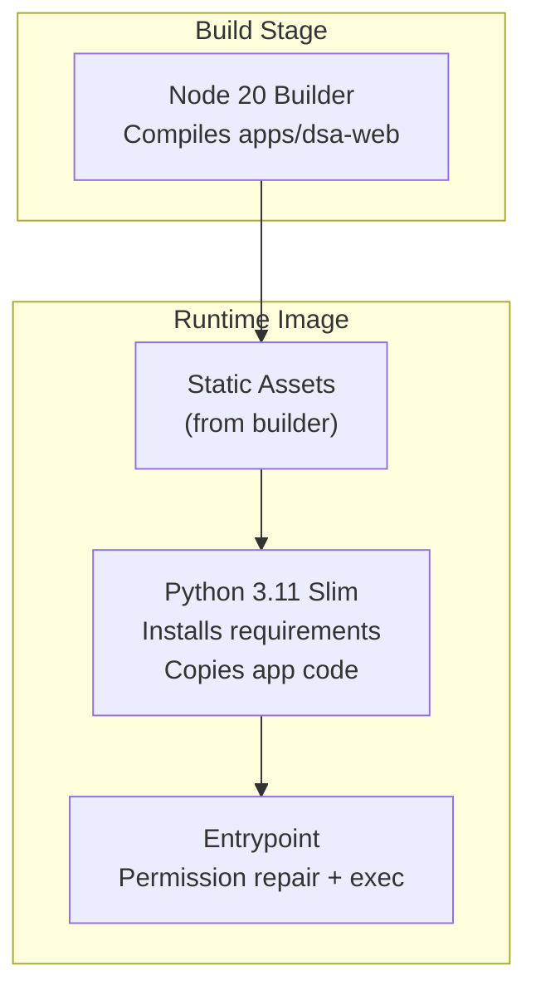
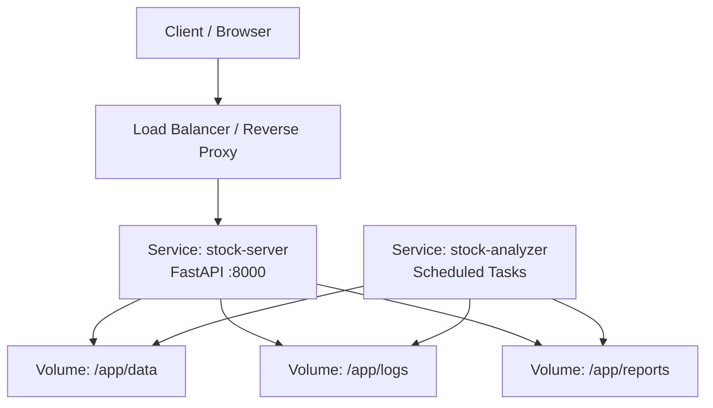
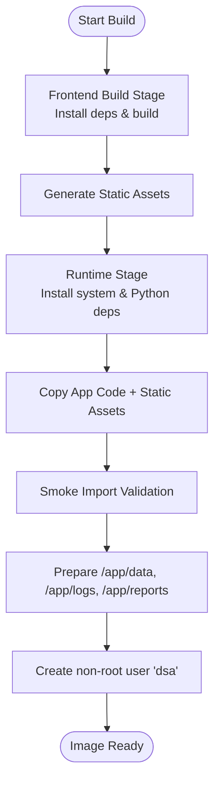
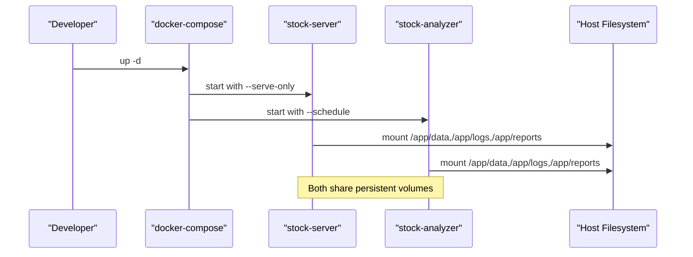
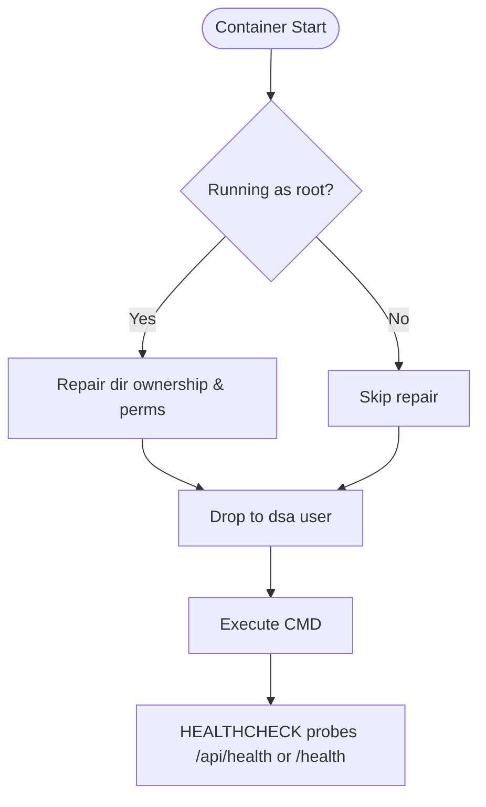
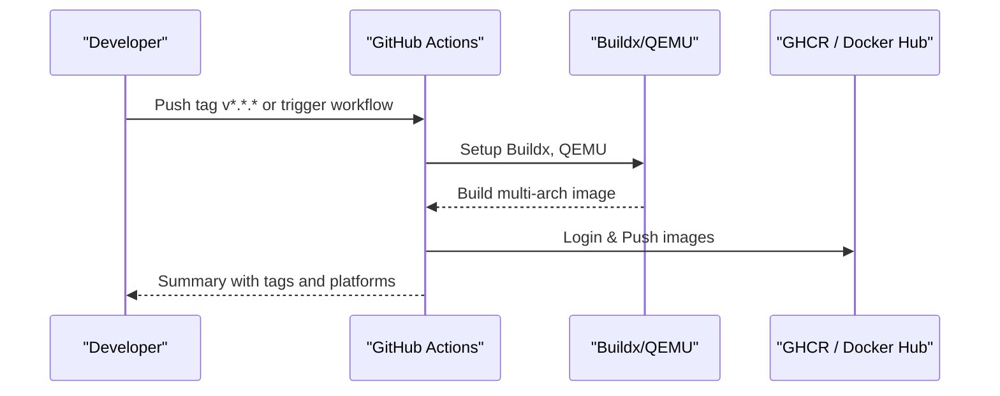
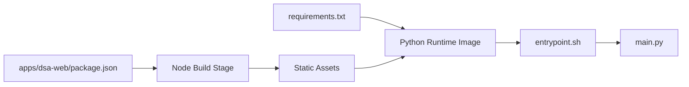

# Docker Deployment

<cite>
**Referenced Files in This Document**
- [Dockerfile](file://docker/Dockerfile)
- [docker-compose.yml](file://docker/docker-compose.yml)
- [entrypoint.sh](file://docker/entrypoint.sh)
- [requirements.txt](file://requirements.txt)
- [package.json](file://apps/dsa-web/package.json)
- [main.py](file://main.py)
- [DEPLOY_EN.md](file://docs/DEPLOY_EN.md)
- [zeabur-deployment.md](file://docs/docker/zeabur-deployment.md)
- [docker-publish.yml](file://.github/workflows/docker-publish.yml)
- [ghcr-dockerhub.yml](file://.github/workflows/ghcr-dockerhub.yml)
</cite>

## Table of Contents
1. Introduction
2. Project Structure
3. Core Components
4. Architecture Overview
5. Detailed Component Analysis
6. Dependency Analysis
7. Performance Considerations
8. Troubleshooting Guide
9. Conclusion
10. Appendices

## Introduction
This document provides comprehensive Docker deployment guidance for DailyStockAnalysis with a focus on containerized strategies. It explains the multi-stage build process that compiles the frontend and optimizes the backend image, details docker-compose orchestration including environment variables and volumes, outlines security practices such as non-root execution, resource limits, and health checks, and presents production-ready patterns for persistence, logging, monitoring, scaling, load balancing, CI/CD automation, and troubleshooting.

## Project Structure
The project ships a dedicated Docker setup under the docker directory:
- A multi-stage Dockerfile that builds the React-based web UI and packages it into a Python runtime image.
- A docker-compose file defining two services: an analyzer (scheduled tasks) and a server (FastAPI).
- An entrypoint script that repairs mounted volume permissions and drops privileges to a non-root user before launching the application.

**Diagram sources**
- [Dockerfile:8-18](file://docker/Dockerfile#L8-L18)
- [Dockerfile:21-66](file://docker/Dockerfile#L21-L66)
- [Dockerfile:68-105](file://docker/Dockerfile#L68-L105)

**Section sources**
- [Dockerfile:1-106](file://docker/Dockerfile#L1-L106)
- [docker-compose.yml:1-73](file://docker/docker-compose.yml#L1-L73)
- [entrypoint.sh:1-93](file://docker/entrypoint.sh#L1-L93)

## Core Components
- Multi-stage Dockerfile:
  - Frontend build stage using Node 20 to compile the web UI and output static assets.
  - Runtime stage based on Python slim image, installs system dependencies (including wkhtmltopdf), Python dependencies, copies source code and built static assets, sets up non-root user, exposes port, declares volumes, defines health check, and configures entrypoint.
- docker-compose:
  - Defines shared configuration via YAML anchors for both services.
  - Loads environment from .env, mounts persistent directories, sets timezone, API host/port, logging rotation, and memory limits/reservations.
  - Provides two services:
    - analyzer: runs scheduled analysis tasks.
    - server: runs FastAPI only, exposing the configured port.
- Entrypoint:
  - Creates and fixes ownership for writable directories (/app/data, /app/logs, /app/reports, /home/dsa/.longbridge).
  - Detects unwritable mounts and attempts chown/chmod; warns if issues persist.
  - Drops privileges to the dsa user and executes the CMD.

**Section sources**
- [Dockerfile:21-105](file://docker/Dockerfile#L21-L105)
- [docker-compose.yml:13-73](file://docker/docker-compose.yml#L13-L73)
- [entrypoint.sh:1-93](file://docker/entrypoint.sh#L1-L93)

## Architecture Overview
DailyStockAnalysis is deployed as one or more containers sharing persistent volumes for data, logs, and reports. The same image supports both scheduled analysis and a FastAPI service.

**Diagram sources**
- [docker-compose.yml:24-33](file://docker/docker-compose.yml#L24-L33)
- [docker-compose.yml:59-73](file://docker/docker-compose.yml#L59-L73)
- [Dockerfile:89-98](file://docker/Dockerfile#L89-L98)

## Detailed Component Analysis

### Multi-stage Build Process
- Frontend compilation:
  - Uses a Node 20 builder to install dependencies and run the build script, producing static assets.
  - Version and revision are injected via build arguments for traceability.
- Backend optimization:
  - Base image pinned to a stable Debian variant to ensure consistent system libraries.
  - Installs only required system packages and Python dependencies.
  - Copies only necessary application directories and prebuilt static assets.
  - Performs a smoke import to validate bundled dependencies without leaving SDK logs.
  - Prepares data/log/report directories and ensures non-root user ownership.

**Diagram sources**
- [Dockerfile:8-18](file://docker/Dockerfile#L8-L18)
- [Dockerfile:21-66](file://docker/Dockerfile#L21-L66)
- [Dockerfile:68-80](file://docker/Dockerfile#L68-L80)

**Section sources**
- [Dockerfile:8-18](file://docker/Dockerfile#L8-L18)
- [Dockerfile:21-80](file://docker/Dockerfile#L21-L80)

### Service Orchestration with docker-compose
- Shared configuration via anchors reduces duplication between services.
- Environment loading:
  - env_file loads secrets and settings from .env at the repository root.
  - Timezone set to Asia/Shanghai.
  - WEBUI_HOST bound to 0.0.0.0 inside the container.
- Volumes:
  - Host directories mapped to /app/data, /app/logs, /app/reports for persistence.
  - Strategies mounted read-only.
  - Longbridge OAuth token cache persisted under /home/dsa/.longbridge.
- Logging:
  - JSON file driver with size and rotation limits.
- Resource constraints:
  - Memory limit and reservation defined per service.
- Services:
  - analyzer: default command runs scheduled mode.
  - server: runs FastAPI only with explicit host/port flags and maps the API port.

**Diagram sources**
- [docker-compose.yml:13-33](file://docker/docker-compose.yml#L13-L33)
- [docker-compose.yml:45-57](file://docker/docker-compose.yml#L45-L57)
- [docker-compose.yml:59-73](file://docker/docker-compose.yml#L59-L73)

**Section sources**
- [docker-compose.yml:13-73](file://docker/docker-compose.yml#L13-L73)

### Entrypoint and Security Practices
- Non-root execution:
  - Creates a dedicated group/user dsa (UID/GID 1000).
  - Entrypoint detects root and repairs ownership for writable directories, then drops privileges using gosu.
- Permission repair:
  - Checks writability for each target directory and SQLite WAL/SHM files when repairing /app/data.
  - Warns if mounts remain unwritable due to host permissions, read-only mounts, rootless Docker, or NFS.
- Health check:
  - Container-level HEALTHCHECK probes FastAPI endpoints and falls back gracefully when not serving.

**Diagram sources**
- [entrypoint.sh:1-93](file://docker/entrypoint.sh#L1-L93)
- [Dockerfile:95-98](file://docker/Dockerfile#L95-L98)

**Section sources**
- [entrypoint.sh:1-93](file://docker/entrypoint.sh#L1-L93)
- [Dockerfile:43-45](file://docker/Dockerfile#L43-L45)
- [Dockerfile:95-98](file://docker/Dockerfile#L95-L98)

### Environment Variables and Configuration
Key environment variables used by the image and services:
- PYTHONUNBUFFERED=1
- LOG_DIR=/app/logs
- DATABASE_PATH=/app/data/stock_analysis.db
- WEBUI_HOST=0.0.0.0
- API_PORT (read from .env; defaults to 8000)
- TZ=Asia/Shanghai

Additional runtime behavior:
- main.py reads ENV_FILE if set, otherwise uses .env next to the script.
- Proxy support can be enabled via USE_PROXY, PROXY_HOST, PROXY_PORT.

**Section sources**
- [Dockerfile:81-90](file://docker/Dockerfile#L81-L90)
- [docker-compose.yml:19-44](file://docker/docker-compose.yml#L19-L44)
- [main.py:87-92](file://main.py#L87-L92)
- [main.py:38-47](file://main.py#L38-L47)

### Production-ready docker-compose Patterns
- Persistence:
  - Mount host directories to /app/data, /app/logs, /app/reports.
  - Persist Longbridge OAuth tokens under /home/dsa/.longbridge.
- Logging:
  - JSON file driver with max-size and max-file rotation.
- Monitoring:
  - Use container health checks to integrate with orchestrators.
  - Inspect logs via docker-compose logs or platform log collectors.
- Scaling:
  - Run multiple instances of the server behind a reverse proxy/load balancer.
  - Keep analyzer single-instance unless you partition workloads carefully.

Example references:
- Volume mounts and logging options are defined in the compose file.
- Port mapping for the server service exposes the API.

**Section sources**
- [docker-compose.yml:24-33](file://docker/docker-compose.yml#L24-L33)
- [docker-compose.yml:45-57](file://docker/docker-compose.yml#L45-L57)
- [docker-compose.yml:66-73](file://docker/docker-compose.yml#L66-L73)

### CI/CD Pipelines for Automated Builds
Two workflows publish images:
- docker-publish.yml:
  - Triggered by tags or manual dispatch.
  - Validates tag annotation, runs backend gate, performs a smoke test of the built image, then publishes multi-arch images to GHCR and optionally Docker Hub.
- ghcr-dockerhub.yml:
  - Manual workflow to build and push images with specified tags to both registries.

Both use Buildx, QEMU for multi-platform builds, metadata actions for tagging, and GitHub Actions caching.

**Diagram sources**
- [docker-publish.yml:1-196](file://.github/workflows/docker-publish.yml#L1-L196)
- [ghcr-dockerhub.yml:1-131](file://.github/workflows/ghcr-dockerhub.yml#L1-L131)

**Section sources**
- [docker-publish.yml:27-196](file://.github/workflows/docker-publish.yml#L27-L196)
- [ghcr-dockerhub.yml:22-131](file://.github/workflows/ghcr-dockerhub.yml#L22-L131)

## Dependency Analysis
- Frontend dependencies:
  - Built with Node 20 and npm scripts defined in package.json.
- Backend dependencies:
  - Python 3.11 slim base image installs requirements listed in requirements.txt.
  - System packages include wkhtmltopdf and fonts for report rendering.
- Cross-cutting:
  - Entrypoint ensures runtime directories exist and are owned by the dsa user.
  - Compose shares volumes across services to avoid data duplication.

**Diagram sources**
- [package.json:1-60](file://apps/dsa-web/package.json#L1-L60)
- [requirements.txt:1-75](file://requirements.txt#L1-L75)
- [Dockerfile:8-18](file://docker/Dockerfile#L8-L18)
- [Dockerfile:21-66](file://docker/Dockerfile#L21-L66)
- [entrypoint.sh:1-93](file://docker/entrypoint.sh#L1-L93)

**Section sources**
- [package.json:1-60](file://apps/dsa-web/package.json#L1-L60)
- [requirements.txt:1-75](file://requirements.txt#L1-L75)
- [Dockerfile:8-66](file://docker/Dockerfile#L8-L66)

## Performance Considerations
- Image size optimization:
  - Multi-stage build isolates heavy Node tooling from the runtime image.
  - Slim base images and minimal apt packages reduce footprint.
  - Cache mounts for npm and pip improve build times.
- Resource limits:
  - Compose sets memory reservations and limits; adjust based on workload.
  - For constrained environments (e.g., 512MB), run either server or analyzer, not both, and reduce concurrency.
- I/O and storage:
  - Persistent volumes for data, logs, and reports prevent rebuild overhead and enable backups.
- Concurrency:
  - Tune MAX_WORKERS and related settings in .env to match available CPU/memory.

[No sources needed since this section provides general guidance]

## Troubleshooting Guide
Common issues and resolutions:
- Permission errors on mounted directories:
  - The entrypoint attempts to fix ownership and permissions; if mounts are read-only or managed by rootless/NFS environments, adjust host permissions or avoid overriding user context.
- Database locked or WAL/SHM permission issues:
  - Ensure /app/data is writable by the dsa user; the entrypoint checks these files during repair.
- API timeout or network issues:
  - Configure proxies via environment variables if required by your region or network policy.
- Insufficient memory:
  - Increase memory limits in docker-compose; consider running only one service or reducing workers.
- Logs and health:
  - Use docker-compose logs to inspect rotated logs.
  - Verify health endpoint responses for service readiness.

Operational references:
- Compose logging configuration and resource limits.
- Entrypoint permission repair logic.
- Health check definition in the image.

**Section sources**
- [docker-compose.yml:45-57](file://docker/docker-compose.yml#L45-L57)
- [entrypoint.sh:26-85](file://docker/entrypoint.sh#L26-L85)
- [Dockerfile:95-98](file://docker/Dockerfile#L95-L98)
- [DEPLOY_EN.md:245-312](file://docs/DEPLOY_EN.md#L245-L312)

## Conclusion
DailyStockAnalysis provides a robust, production-oriented containerization strategy:
- A multi-stage build separates frontend compilation from the lean Python runtime.
- docker-compose orchestrates analyzer and server services with persistent volumes, logging rotation, and resource limits.
- Security is enforced via a non-root user and careful permission handling at startup.
- CI/CD automates multi-architecture image publishing with validation and smoke tests.
Follow the guidance above to deploy, scale, monitor, and maintain DailyStockAnalysis reliably in production environments.

[No sources needed since this section summarizes without analyzing specific files]

## Appendices

### Quick Start Commands
- Build and run all services:
  - docker-compose -f ./docker/docker-compose.yml up -d
- Run only the FastAPI server:
  - docker-compose -f ./docker/docker-compose.yml up -d server
- Run only scheduled analysis:
  - docker-compose -f ./docker/docker-compose.yml up -d analyzer

**Section sources**
- [docker-compose.yml:5-8](file://docker/docker-compose.yml#L5-L8)

### Environment Variables Reference
- Core runtime:
  - PYTHONUNBUFFERED, LOG_DIR, DATABASE_PATH
- Web/API:
  - WEBUI_HOST, API_PORT
- Timezone:
  - TZ=Asia/Shanghai
- Proxy (optional):
  - USE_PROXY, PROXY_HOST, PROXY_PORT

**Section sources**
- [Dockerfile:81-90](file://docker/Dockerfile#L81-L90)
- [docker-compose.yml:35-44](file://docker/docker-compose.yml#L35-L44)
- [main.py:38-47](file://main.py#L38-L47)

### Platform-specific Notes
- Zeabur deployment:
  - Supports the same image; configure startup commands for serve-only or schedule modes.
  - Health checks probe /api/health or /health depending on mode.
  - Persistent storage should include /app/data.

**Section sources**
- [zeabur-deployment.md:60-77](file://docs/docker/zeabur-deployment.md#L60-L77)
- [zeabur-deployment.md:207-221](file://docs/docker/zeabur-deployment.md#L207-L221)
- [zeabur-deployment.md:180-206](file://docs/docker/zeabur-deployment.md#L180-L206)