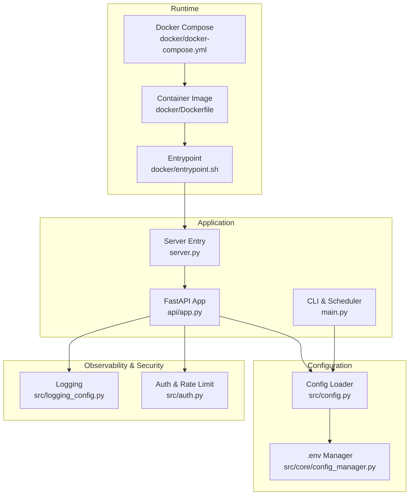
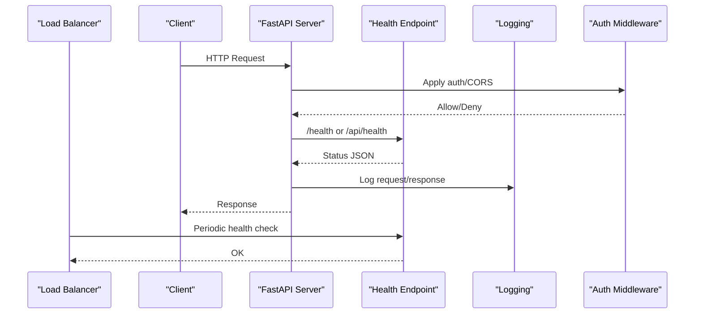
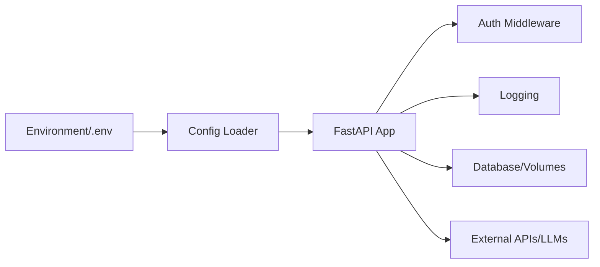
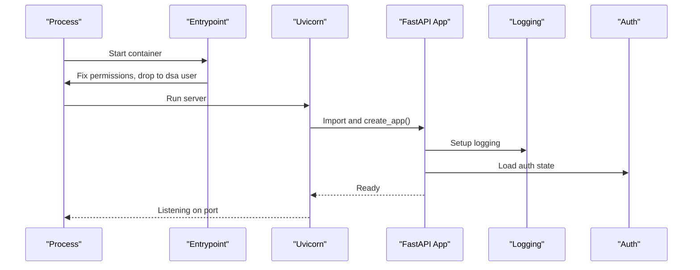

# Production Configuration

<cite>
**Referenced Files in This Document**
- [src/config.py](file://src/config.py)
- [src/core/config_manager.py](file://src/core/config_manager.py)
- [api/app.py](file://api/app.py)
- [server.py](file://server.py)
- [main.py](file://main.py)
- [docker/docker-compose.yml](file://docker/docker-compose.yml)
- [docker/Dockerfile](file://docker/Dockerfile)
- [docker/entrypoint.sh](file://docker/entrypoint.sh)
- [src/logging_config.py](file://src/logging_config.py)
- [src/auth.py](file://src/auth.py)
</cite>

## Table of Contents
1. [Introduction](#introduction)
2. [Project Structure](#project-structure)
3. [Core Components](#core-components)
4. [Architecture Overview](#architecture-overview)
5. [Detailed Component Analysis](#detailed-component-analysis)
6. [Dependency Analysis](#dependency-analysis)
7. [Performance Considerations](#performance-considerations)
8. [Troubleshooting Guide](#troubleshooting-guide)
9. [Conclusion](#conclusion)
10. [Appendices](#appendices)

## Introduction
This document provides production-grade configuration guidance for DailyStockAnalysis with a focus on enterprise deployment. It covers environment variable management, secrets handling, configuration validation, performance tuning (worker processes, memory limits, concurrency), high availability patterns (database replication, load balancing, failover), security hardening (input validation, output encoding, access control), and monitoring/observability (structured logging, metrics collection, distributed tracing).

DailyStockAnalysis ships with:
- A FastAPI application with CORS, authentication middleware, health endpoints, and static asset serving.
- Docker-based packaging with non-root execution, volume mounts, and resource limits.
- A robust configuration system that reads from environment variables and a .env file, with atomic updates and validation helpers.
- Structured logging with rotating files and configurable log levels.
- Built-in admin authentication with session signing, password hashing, and brute-force rate limiting.

## Project Structure
The production surface is composed of the API server, configuration subsystem, container runtime, and observability components. The following diagram maps key files to their roles in production.

**Diagram sources**
- [docker/docker-compose.yml:13-73](file://docker/docker-compose.yml#L13-L73)
- [docker/Dockerfile:21-106](file://docker/Dockerfile#L21-L106)
- [docker/entrypoint.sh:63-90](file://docker/entrypoint.sh#L63-L90)
- [api/app.py:313-384](file://api/app.py#L313-L384)
- [server.py:21-43](file://server.py#L21-L43)
- [src/config.py:13-78](file://src/config.py#L13-L78)
- [src/core/config_manager.py:112-156](file://src/core/config_manager.py#L112-L156)
- [src/logging_config.py:83-198](file://src/logging_config.py#L83-L198)
- [src/auth.py:197-203](file://src/auth.py#L197-L203)

**Section sources**
- [docker/docker-compose.yml:13-73](file://docker/docker-compose.yml#L13-L73)
- [docker/Dockerfile:21-106](file://docker/Dockerfile#L21-L106)
- [api/app.py:313-384](file://api/app.py#L313-L384)
- [server.py:21-43](file://server.py#L21-L43)
- [src/config.py:13-78](file://src/config.py#L13-L78)
- [src/core/config_manager.py:112-156](file://src/core/config_manager.py#L112-L156)
- [src/logging_config.py:83-198](file://src/logging_config.py#L83-L198)
- [src/auth.py:197-203](file://src/auth.py#L197-L203)

## Core Components
- Application server: FastAPI app factory configures CORS, routes, error handlers, and serves the frontend when built. Health endpoints are exposed for load balancers and orchestrators.
- Configuration loader: Centralized environment parsing with typed helpers, defaults, and validation warnings. Supports LLM channel normalization, agent context compression presets, and scheduler settings.
- Environment manager: Atomic read/write of .env with compose placeholder escaping, versioning, and update masking for sensitive keys.
- Logging: Unified setup with console and rotating file handlers, quieted third-party loggers, and LiteLLM level control.
- Authentication: Optional admin auth with PBKDF2 password hashing, signed sessions, brute-force rate limiting, and session secret rotation.

**Section sources**
- [api/app.py:313-384](file://api/app.py#L313-L384)
- [src/config.py:226-323](file://src/config.py#L226-L323)
- [src/core/config_manager.py:112-156](file://src/core/config_manager.py#L112-L156)
- [src/logging_config.py:83-198](file://src/logging_config.py#L83-L198)
- [src/auth.py:197-203](file://src/auth.py#L197-L203)

## Architecture Overview
Production deployment typically runs the FastAPI service inside a container, backed by persistent volumes for data, logs, and reports. The entrypoint ensures writable directories and drops privileges to a non-root user. The API exposes health checks and an OpenAPI schema for integration with gateways and monitoring systems.

**Diagram sources**
- [api/app.py:369-384](file://api/app.py#L369-L384)
- [api/app.py:435-454](file://api/app.py#L435-L454)
- [server.py:21-43](file://server.py#L21-L43)
- [src/logging_config.py:83-198](file://src/logging_config.py#L83-L198)

## Detailed Component Analysis

### Container Runtime and Resource Limits
- Multi-stage build produces a slim Python image with required system libraries and a non-root user.
- Entrypoint repairs directory ownership and permissions for mounted volumes and executes the process as a dedicated user.
- Docker Compose defines services for analyzer and server modes, sets timezone, binds host to 0.0.0.0, and applies memory limits and reservations.

Recommendations for production:
- Keep memory limits aligned with workload; full analysis benefits from 1G+ per container.
- Use separate containers for API and background tasks to isolate resources.
- Mount only necessary directories as read-only where possible (e.g., strategies).

**Section sources**
- [docker/Dockerfile:21-106](file://docker/Dockerfile#L21-L106)
- [docker/entrypoint.sh:63-90](file://docker/entrypoint.sh#L63-L90)
- [docker/docker-compose.yml:13-73](file://docker/docker-compose.yml#L13-L73)

### Application Lifecycle and Startup
- The FastAPI lifespan initializes runtime scheduler, system config service, and warms caches (e.g., stock index and name resolver).
- Background tasks refresh remote stock index cache without blocking startup.
- SPA assets are served securely with path containment checks and explicit MIME types.

Operational notes:
- Ensure static assets are built before deploying the API if you serve the UI.
- Use health endpoints for readiness/liveness probes in orchestration platforms.

**Section sources**
- [api/app.py:237-310](file://api/app.py#L237-L310)
- [api/app.py:390-454](file://api/app.py#L390-L454)
- [api/app.py:502-559](file://api/app.py#L502-L559)

### Configuration Management and Validation
- Environment variables drive configuration; helpers parse booleans, integers, floats with clamping and fallbacks.
- LLM channels support protocol and API surface normalization, model routing, and compatibility checks.
- Agent context compression profiles provide safe defaults for chat history size and token budgets.
- .env updates are atomic with compose-safe escaping and masked writes for sensitive keys.

Production checklist:
- Validate all critical env vars at startup using provided parsers.
- Pin LLM provider protocols and models explicitly to avoid drift.
- Use ENV_FILE to point to a secure location for secrets in production.

**Section sources**
- [src/config.py:226-323](file://src/config.py#L226-L323)
- [src/config.py:393-431](file://src/config.py#L393-L431)
- [src/config.py:501-534](file://src/config.py#L501-L534)
- [src/config.py:629-659](file://src/config.py#L629-L659)
- [src/core/config_manager.py:112-156](file://src/core/config_manager.py#L112-L156)
- [src/core/config_manager.py:177-215](file://src/core/config_manager.py#L177-L215)

### Database and Persistence
- SQLite is used by default with WAL mode and busy timeout controlled via environment variables.
- Data, logs, and reports are persisted through mounted volumes.
- Entrypoint ensures database files and related WAL/SHM files are writable by the app user.

High availability considerations:
- For multi-instance deployments, consider replacing SQLite with a managed relational database and adjusting connection pooling at the ORM layer.
- If retaining SQLite, run a single writer instance and use read replicas or materialized views for analytics.

**Section sources**
- [tests/test_storage.py:846-871](file://tests/test_storage.py#L846-L871)
- [docker/docker-compose.yml:24-33](file://docker/docker-compose.yml#L24-L33)
- [docker/entrypoint.sh:26-42](file://docker/entrypoint.sh#L26-L42)

### API Security and Access Control
- CORS can be restricted to specific origins or set to allow-all for development; a warning is logged when open CORS is combined with disabled admin auth.
- Admin authentication is optional and toggled via environment; when enabled, it enforces session cookies and rate-limits login attempts.
- Session secrets are stored securely with restrictive permissions and can be rotated to invalidate active sessions.

Hardening recommendations:
- Enable ADMIN_AUTH_ENABLED in production and restrict CORS_ORIGINS to known frontends.
- Place the API behind a reverse proxy enforcing TLS and IP allowlists.
- Rotate session secrets periodically and monitor failed login spikes.

**Section sources**
- [api/app.py:346-375](file://api/app.py#L346-L375)
- [src/auth.py:197-203](file://src/auth.py#L197-L203)
- [src/auth.py:81-134](file://src/auth.py#L81-L134)
- [src/auth.py:370-422](file://src/auth.py#L370-L422)

### Observability: Logging, Metrics, Tracing
- Logging supports console and rotating file outputs with configurable levels and quieted third-party loggers.
- LiteLLM logger level can be tuned independently via environment.
- Health endpoints enable external monitoring and load balancer probes.

Metrics and tracing:
- Integrate an OpenTelemetry collector sidecar or agent to capture HTTP spans and business events.
- Export structured logs to a centralized logging platform (e.g., JSON lines) and correlate with traces via trace IDs.

**Section sources**
- [src/logging_config.py:83-198](file://src/logging_config.py#L83-L198)
- [api/app.py:435-454](file://api/app.py#L435-L454)

### Performance Tuning Parameters
- Worker processes: Run multiple Uvicorn workers behind a reverse proxy to utilize CPU cores. Tune based on workload and memory limits.
- Memory limits: Set container memory limits conservatively; full analysis may require more than 1G per container.
- Concurrency: Adjust MAX_WORKERS and scheduler concurrency via environment to match available resources.
- I/O: Prefer SSD-backed volumes for data/logs; ensure WAL mode is enabled for SQLite under concurrent reads.

**Section sources**
- [docker/docker-compose.yml:50-57](file://docker/docker-compose.yml#L50-L57)
- [tests/test_system_config_service.py:4257-4267](file://tests/test_system_config_service.py#L4257-L4267)
- [tests/test_storage.py:846-871](file://tests/test_storage.py#L846-L871)

### High Availability Patterns
- Database replication: Replace SQLite with a managed RDBMS; configure connection pools and read replicas for scaling reads.
- Load balancer setup: Expose /health and /api/health for readiness; use sticky sessions only if required by auth flow.
- Failover mechanisms: Configure health checks with automatic restarts; use rolling updates to minimize downtime.

[No sources needed since this section provides conceptual guidance]

### Security Hardening Practices
- Input validation: Leverage Pydantic schemas in API endpoints and sanitize inputs before processing.
- Output encoding: Serve static assets with correct MIME types and prevent path traversal via containment checks.
- Access control: Enforce admin authentication, restrict CORS, and place the API behind a trusted network boundary.

**Section sources**
- [api/app.py:502-559](file://api/app.py#L502-L559)
- [api/app.py:346-375](file://api/app.py#L346-L375)
- [src/auth.py:197-203](file://src/auth.py#L197-L203)

## Dependency Analysis
The production stack composes runtime, application, configuration, and observability layers. The following diagram shows how they interact during a typical request.

**Diagram sources**
- [src/config.py:13-78](file://src/config.py#L13-L78)
- [src/core/config_manager.py:112-156](file://src/core/config_manager.py#L112-L156)
- [api/app.py:313-384](file://api/app.py#L313-L384)
- [src/logging_config.py:83-198](file://src/logging_config.py#L83-L198)
- [src/auth.py:197-203](file://src/auth.py#L197-L203)

**Section sources**
- [src/config.py:13-78](file://src/config.py#L13-L78)
- [src/core/config_manager.py:112-156](file://src/core/config_manager.py#L112-L156)
- [api/app.py:313-384](file://api/app.py#L313-L384)
- [src/logging_config.py:83-198](file://src/logging_config.py#L83-L198)
- [src/auth.py:197-203](file://src/auth.py#L197-L203)

## Performance Considerations
- Scale horizontally with multiple Uvicorn workers and a reverse proxy.
- Tune memory limits per container to match workload; avoid running analyzer and server concurrently on constrained nodes.
- Use connection pooling for databases when migrating away from SQLite.
- Monitor CPU and memory usage; adjust worker count and concurrency parameters accordingly.

[No sources needed since this section provides general guidance]

## Troubleshooting Guide
Common issues and resolutions:
- Frontend not built: The API serves a diagnostic page when static assets are missing; build the frontend or start with auto-build.
- Permission errors: Entrypoint repairs mount ownership; verify host permissions and avoid rootless/NFS restrictions.
- Health checks failing: Ensure /health and /api/health respond correctly; validate container networking and ports.
- Auth failures: Check ADMIN_AUTH_ENABLED and session secret permissions; rotate secrets if necessary.

**Section sources**
- [api/app.py:402-433](file://api/app.py#L402-L433)
- [docker/entrypoint.sh:63-90](file://docker/entrypoint.sh#L63-L90)
- [src/auth.py:81-134](file://src/auth.py#L81-L134)

## Conclusion
DailyStockAnalysis provides a solid foundation for production deployments with containerization, secure defaults, and extensible configuration. By enabling authentication, restricting CORS, tuning performance parameters, and integrating observability tooling, teams can operate the system reliably at scale. For high availability, migrate to a managed database with replication and implement load-balanced health checks.

[No sources needed since this section summarizes without analyzing specific files]

## Appendices

### Environment Variables Reference
Key environment variables for production:
- DATABASE_PATH: Path to SQLite database file.
- SQLITE_WAL_ENABLED, SQLITE_BUSY_TIMEOUT_MS: SQLite performance tuning.
- WEBUI_HOST, API_PORT: Bind address and port for the API server.
- CORS_ORIGINS, CORS_ALLOW_ALL: Restrict or allow browser origins.
- ADMIN_AUTH_ENABLED: Toggle admin authentication.
- ADMIN_SESSION_MAX_AGE_HOURS: Session lifetime.
- LOG_DIR, LITELLM_LOG_LEVEL: Logging configuration.
- ENV_FILE: Path to .env file for secrets.

**Section sources**
- [docker/Dockerfile:81-88](file://docker/Dockerfile#L81-L88)
- [docker/docker-compose.yml:35-44](file://docker/docker-compose.yml#L35-L44)
- [src/logging_config.py:68-80](file://src/logging_config.py#L68-L80)
- [src/auth.py:362-367](file://src/auth.py#L362-L367)

### Example Deployment Flows

#### API Startup Sequence

**Diagram sources**
- [docker/entrypoint.sh:63-90](file://docker/entrypoint.sh#L63-L90)
- [server.py:21-43](file://server.py#L21-L43)
- [api/app.py:313-384](file://api/app.py#L313-L384)
- [src/logging_config.py:83-198](file://src/logging_config.py#L83-L198)
- [src/auth.py:197-203](file://src/auth.py#L197-L203)