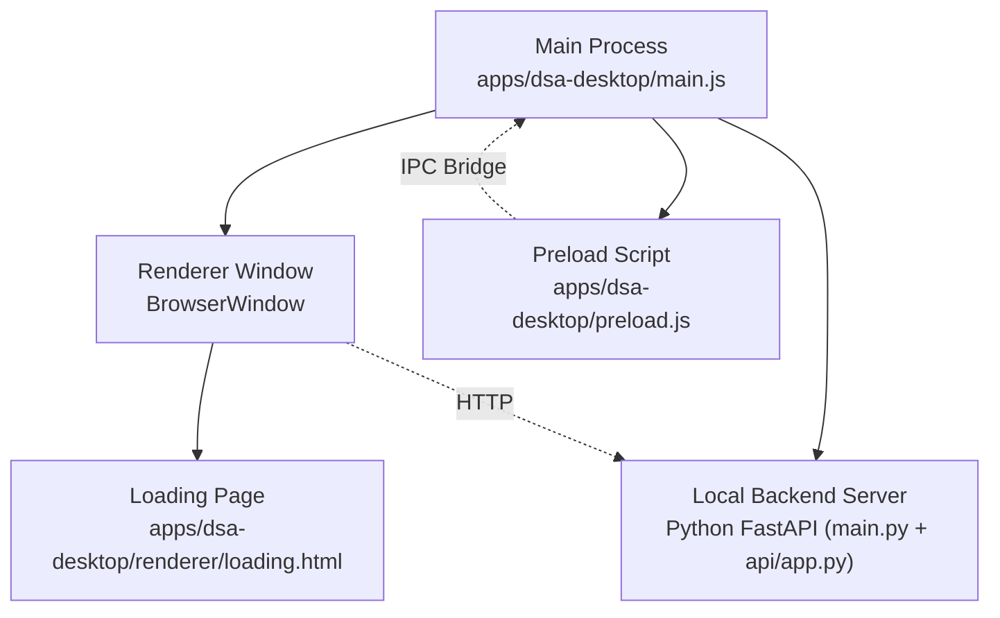
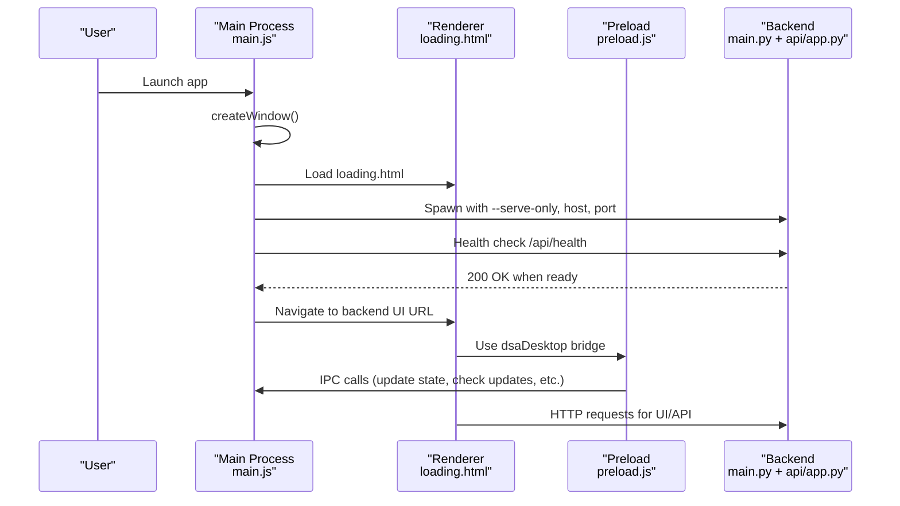
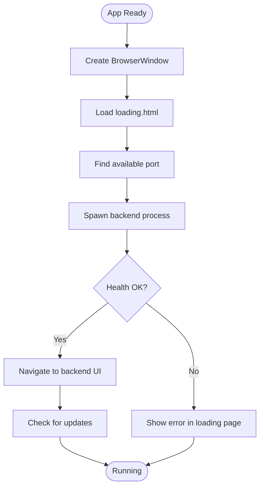
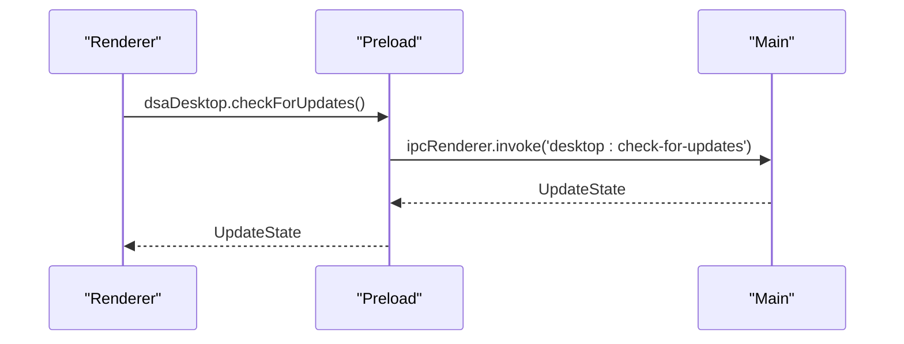
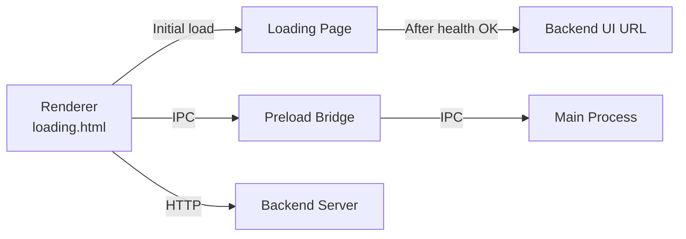
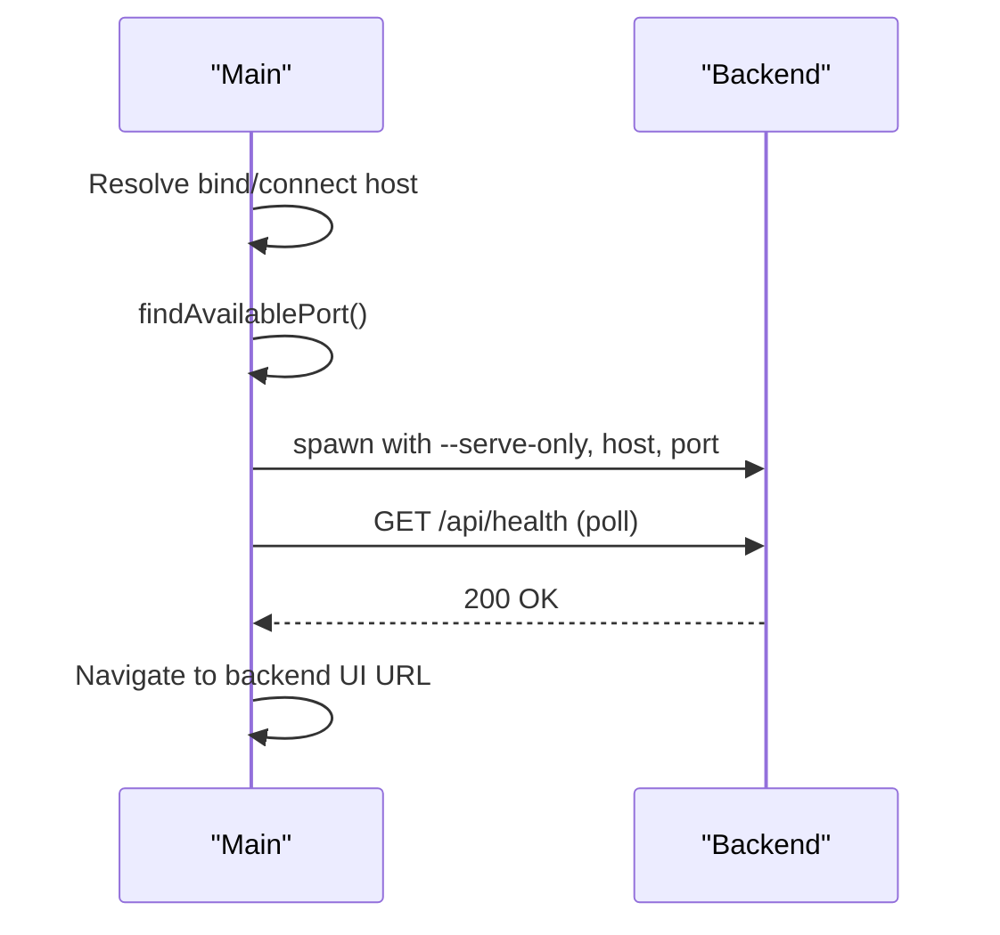
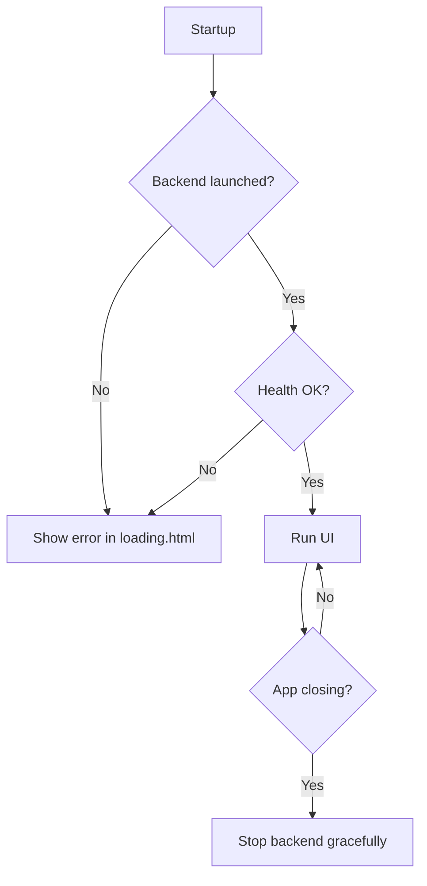
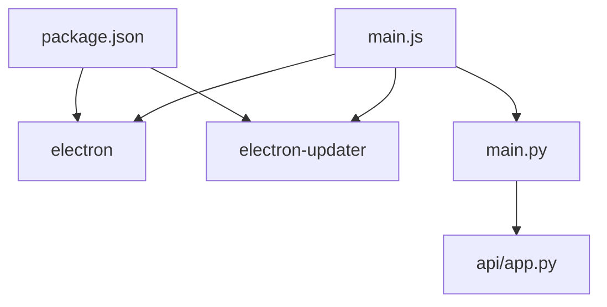

# Application Architecture

<cite>
**Referenced Files in This Document**
- [main.js](file://apps/dsa-desktop/main.js)
- [preload.js](file://apps/dsa-desktop/preload.js)
- [package.json](file://apps/dsa-desktop/package.json)
- [loading.html](file://apps/dsa-desktop/renderer/loading.html)
- [main.py](file://main.py)
- [app.py](file://api/app.py)
</cite>

## Table of Contents
1. [Introduction](#introduction)
2. [Project Structure](#project-structure)
3. [Core Components](#core-components)
4. [Architecture Overview](#architecture-overview)
5. [Detailed Component Analysis](#detailed-component-analysis)
6. [Dependency Analysis](#dependency-analysis)
7. [Performance Considerations](#performance-considerations)
8. [Troubleshooting Guide](#troubleshooting-guide)
9. [Conclusion](#conclusion)

## Introduction
This document describes the Electron-based Desktop Application architecture for Daily Stock Analysis. It explains how the main process manages windows, integrates with the system, and controls the lifecycle of a local backend server. It also details the preload script’s secure IPC bridge between renderer and main processes, the renderer’s role as a UI client to the local backend, and the application startup sequence including error handling and resource management. Diagrams illustrate process relationships, data flow patterns, and security boundaries.

## Project Structure
The desktop app lives under apps/dsa-desktop and consists of:
- Main process (Electron): orchestrates window creation, backend lifecycle, update checks, and IPC handlers.
- Preload script: exposes a minimal, typed API surface to the renderer via contextBridge.
- Renderer assets: a lightweight loading page shown while the backend starts; the actual UI is served by the local backend.
- Packaging configuration: defines entry points, bundled resources, and platform-specific build settings.

**Diagram sources**
- [main.js:1908-1920](file://apps/dsa-desktop/main.js#L1908-L1920)
- [preload.js:18-55](file://apps/dsa-desktop/preload.js#L18-L55)
- [loading.html:1-143](file://apps/dsa-desktop/renderer/loading.html#L1-L143)
- [main.py:114-118](file://main.py#L114-L118)
- [app.py:166-185](file://api/app.py#L166-L185)

**Section sources**
- [package.json:1-67](file://apps/dsa-desktop/package.json#L1-L67)
- [main.js:1908-1920](file://apps/dsa-desktop/main.js#L1908-L1920)
- [preload.js:18-55](file://apps/dsa-desktop/preload.js#L18-L55)
- [loading.html:1-143](file://apps/dsa-desktop/renderer/loading.html#L1-L143)

## Core Components
- Main process responsibilities:
  - Window management: creates BrowserWindow with secure webPreferences, loads a loading page first, then switches to the backend-served UI once healthy.
  - System integration: opens external links safely, handles native theme changes, and manages OS-level updates on supported platforms.
  - Backend lifecycle: resolves executable or development entry, spawns the Python backend with environment variables, waits for health readiness, and shuts it down on quit.
  - Update mechanism: supports both electron-updater (packaged Windows NSIS) and a manual GitHub Releases fallback; backs up runtime state before install and restores after failure.
  - IPC exposure: registers ipcMain handlers for update state, update checks, release page opening, and share image rendering.

- Preload script responsibilities:
  - Exposes a small, safe API surface to the renderer via contextBridge.
  - Provides methods to get/update state, check for updates, open releases, render share images, and subscribe to update events.

- Renderer responsibilities:
  - Displays a loading screen during startup.
  - Loads the actual UI from the local backend URL once ready.
  - Uses the dsaDesktop bridge to interact with the main process through IPC.

- Local backend server:
  - Python FastAPI service started in serve-only mode with host/port configured by the main process.
  - Serves the web UI assets and API endpoints consumed by the renderer.

**Section sources**
- [main.js:1169-1250](file://apps/dsa-desktop/main.js#L1169-L1250)
- [main.js:1972-2065](file://apps/dsa-desktop/main.js#L1972-L2065)
- [main.js:1854-1872](file://apps/dsa-desktop/main.js#L1854-L1872)
- [preload.js:18-55](file://apps/dsa-desktop/preload.js#L18-L55)
- [loading.html:120-143](file://apps/dsa-desktop/renderer/loading.html#L120-L143)
- [main.py:114-118](file://main.py#L114-L118)
- [app.py:166-185](file://api/app.py#L166-L185)

## Architecture Overview
The desktop app follows a three-process model:
- Main process: orchestrates everything, owns system resources, and mediates privileged operations.
- Renderer process: untrusted UI layer that communicates with the main process via a restricted IPC bridge and calls the local backend over HTTP.
- Backend process: isolated Python service providing APIs and serving static assets.

**Diagram sources**
- [main.js:1908-1920](file://apps/dsa-desktop/main.js#L1908-L1920)
- [main.js:1972-2065](file://apps/dsa-desktop/main.js#L1972-L2065)
- [preload.js:18-55](file://apps/dsa-desktop/preload.js#L18-L55)
- [main.py:114-118](file://main.py#L114-L118)
- [app.py:166-185](file://api/app.py#L166-L185)

## Detailed Component Analysis

### Main Process Responsibilities
- Window management:
  - Creates a BrowserWindow with contextIsolation enabled and nodeIntegration disabled.
  - Injects preload script and passes version via additionalArguments.
  - Loads a loading page first, then navigates to the backend UI once healthy.
  - Sets window open handler to open external URLs in the shell.

- Backend lifecycle:
  - Resolves backend executable path (packaged) or development entrypoint.
  - Spawns backend with environment variables (DSA_DESKTOP_MODE, WEBUI_HOST, WEBUI_PORT, DATABASE_PATH, LOG_DIR).
  - Waits for /api/health readiness with timeouts and progress logging.
  - Gracefully stops backend on quit using SIGTERM/SIGKILL or taskkill on Windows.

- Update mechanism:
  - Supports automatic updates via electron-updater on packaged Windows NSIS builds.
  - Falls back to checking GitHub Releases JSON and prompting user to download manually.
  - Backs up runtime files before install and restores them if needed.

- IPC handlers:
  - Exposes handlers for getting update state, checking for updates, installing downloaded updates, opening release pages, and rendering share images.

**Diagram sources**
- [main.js:1908-1920](file://apps/dsa-desktop/main.js#L1908-L1920)
- [main.js:1972-2065](file://apps/dsa-desktop/main.js#L1972-L2065)
- [main.js:1810-1852](file://apps/dsa-desktop/main.js#L1810-L1852)

**Section sources**
- [main.js:1908-1920](file://apps/dsa-desktop/main.js#L1908-L1920)
- [main.js:1169-1250](file://apps/dsa-desktop/main.js#L1169-L1250)
- [main.js:1810-1852](file://apps/dsa-desktop/main.js#L1810-L1852)
- [main.js:1854-1872](file://apps/dsa-desktop/main.js#L1854-L1872)

### Preload Script Security Boundary
The preload script acts as a secure bridge:
- Uses contextBridge.exposeInMainWorld to expose only necessary functions.
- Methods include retrieving update state, checking for updates, installing downloaded updates, opening release pages, rendering share images, and subscribing to update events.
- All IPC channels are explicitly named and limited to what the renderer needs.

**Diagram sources**
- [preload.js:18-55](file://apps/dsa-desktop/preload.js#L18-L55)
- [main.js:1854-1856](file://apps/dsa-desktop/main.js#L1854-L1856)

**Section sources**
- [preload.js:18-55](file://apps/dsa-desktop/preload.js#L18-L55)
- [main.js:1854-1856](file://apps/dsa-desktop/main.js#L1854-L1856)

### Renderer Process Architecture
- The renderer initially displays loading.html while the backend starts.
- Once the backend is healthy, the main process navigates to the backend’s UI URL.
- The renderer interacts with the main process via the dsaDesktop bridge exposed by preload.
- All UI and API interactions are performed against the local backend over HTTP.

**Diagram sources**
- [loading.html:120-143](file://apps/dsa-desktop/renderer/loading.html#L120-L143)
- [preload.js:18-55](file://apps/dsa-desktop/preload.js#L18-L55)
- [main.js:1972-2065](file://apps/dsa-desktop/main.js#L1972-L2065)

**Section sources**
- [loading.html:120-143](file://apps/dsa-desktop/renderer/loading.html#L120-L143)
- [preload.js:18-55](file://apps/dsa-desktop/preload.js#L18-L55)
- [main.js:1972-2065](file://apps/dsa-desktop/main.js#L1972-L2065)

### Backend Integration and Startup Sequence
- The main process determines bind host and connect host, ensuring public hosts are sanitized to localhost for safety.
- It finds an available port within a range and spawns the backend with serve-only mode and explicit host/port arguments.
- Environment variables configure database path, log directory, and disable non-desktop features.
- A health check loop polls /api/health until success or timeout, then navigates to the main UI URL.

**Diagram sources**
- [main.js:1968-1985](file://apps/dsa-desktop/main.js#L1968-L1985)
- [main.js:1994-2065](file://apps/dsa-desktop/main.js#L1994-L2065)
- [main.py:114-118](file://main.py#L114-L118)

**Section sources**
- [main.js:1968-1985](file://apps/dsa-desktop/main.js#L1968-L1985)
- [main.js:1994-2065](file://apps/dsa-desktop/main.js#L1994-L2065)
- [main.py:114-118](file://main.py#L114-L118)

### Error Handling Mechanisms
- Startup errors: If backend launch fails or health check times out, the loading page is reloaded with an encoded error message for visibility.
- Backend exit: On quit or window-all-closed, the main process stops the backend gracefully, falling back to force kill if necessary.
- Update failures: Errors during update checks or installation set the update state to ERROR and log details; user prompts guide next steps.

**Diagram sources**
- [main.js:1987-1992](file://apps/dsa-desktop/main.js#L1987-L1992)
- [main.js:2066-2070](file://apps/dsa-desktop/main.js#L2066-L2070)
- [main.js:2081-2090](file://apps/dsa-desktop/main.js#L2081-L2090)

**Section sources**
- [main.js:1987-1992](file://apps/dsa-desktop/main.js#L1987-L1992)
- [main.js:2066-2070](file://apps/dsa-desktop/main.js#L2066-L2070)
- [main.js:2081-2090](file://apps/dsa-desktop/main.js#L2081-L2090)

### Resource Management Strategies
- Logging: Centralized logging to desktop.log with timestamps; backend stdout/stderr captured and logged.
- Port selection: Scans a port range to avoid conflicts; binds to sanitized host.
- Filesystem: Ensures directories exist; backs up runtime state before updates; migrates macOS packaged runtime files.
- Process cleanup: Waits for backend exit with timeouts; uses platform-specific termination strategies.

**Section sources**
- [main.js:916-938](file://apps/dsa-desktop/main.js#L916-L938)
- [main.js:988-1009](file://apps/dsa-desktop/main.js#L988-L1009)
- [main.js:1252-1332](file://apps/dsa-desktop/main.js#L1252-L1332)
- [main.js:493-655](file://apps/dsa-desktop/main.js#L493-L655)

## Dependency Analysis
The desktop app depends on:
- Electron framework for windowing and IPC.
- electron-updater for automatic updates on supported platforms.
- A local Python backend (FastAPI) that serves the UI and APIs.

**Diagram sources**
- [package.json:11-17](file://apps/dsa-desktop/package.json#L11-L17)
- [main.js:1466-1484](file://apps/dsa-desktop/main.js#L1466-L1484)
- [main.py:114-118](file://main.py#L114-L118)
- [app.py:166-185](file://api/app.py#L166-L185)

**Section sources**
- [package.json:11-17](file://apps/dsa-desktop/package.json#L11-L17)
- [main.js:1466-1484](file://apps/dsa-desktop/main.js#L1466-L1484)
- [main.py:114-118](file://main.py#L114-L118)
- [app.py:166-185](file://api/app.py#L166-L185)

## Performance Considerations
- Health polling interval and timeouts are tuned to balance responsiveness and resource usage.
- Background tasks like update checks run without blocking UI navigation.
- Share image rendering uses a hidden window with strict constraints to minimize memory and CPU impact.
- Avoid binding to public interfaces unless authentication is enabled; the main process enforces localhost for desktop connections.

[No sources needed since this section provides general guidance]

## Troubleshooting Guide
Common issues and resolutions:
- Backend fails to start: Check logs/desktop.log for spawn errors; verify backend executable path or development entrypoint exists.
- Health check timeout: Ensure no firewall blocks localhost ports; confirm backend listens on the selected host/port.
- Blank UI after startup: Verify frontend assets are present and consistent; the backend logs asset mismatches.
- Update not available: Confirm platform support for electron-updater; otherwise use manual GitHub Releases flow.

**Section sources**
- [main.js:916-938](file://apps/dsa-desktop/main.js#L916-L938)
- [main.js:1987-1992](file://apps/dsa-desktop/main.js#L1987-L1992)
- [main.js:2066-2070](file://apps/dsa-desktop/main.js#L2066-L2070)
- [app.py:76-113](file://api/app.py#L76-L113)

## Conclusion
The Desktop Application employs a secure, modular Electron architecture with clear separation of concerns:
- Main process manages system resources, window lifecycle, and backend orchestration.
- Preload script provides a minimal, auditable IPC bridge to the renderer.
- Renderer focuses on UI presentation and user interaction, delegating privileged operations to the main process.
- Local backend serves the UI and APIs, isolated from renderer privileges.
Robust startup sequencing, health checks, error handling, and resource management ensure a reliable user experience across platforms.