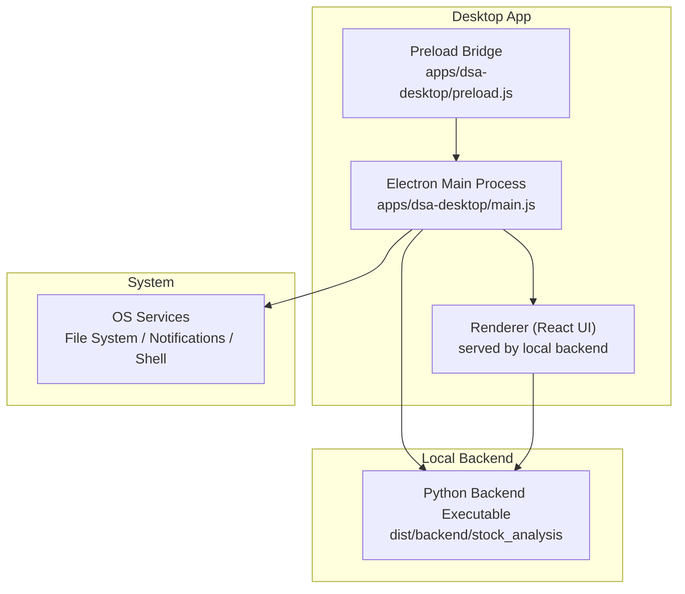
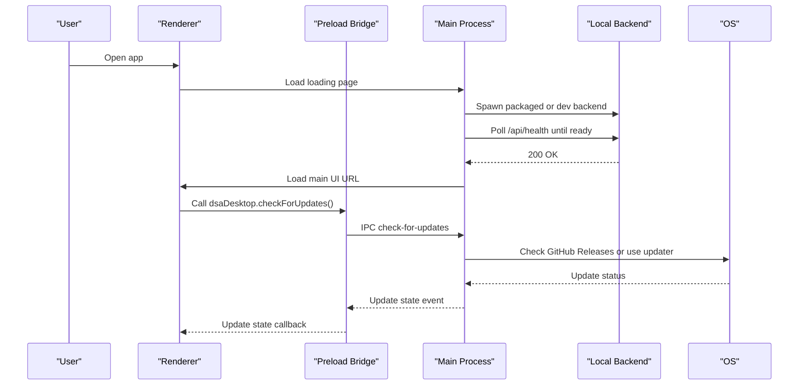
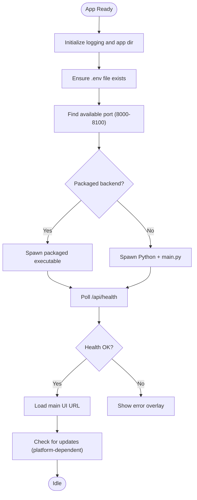
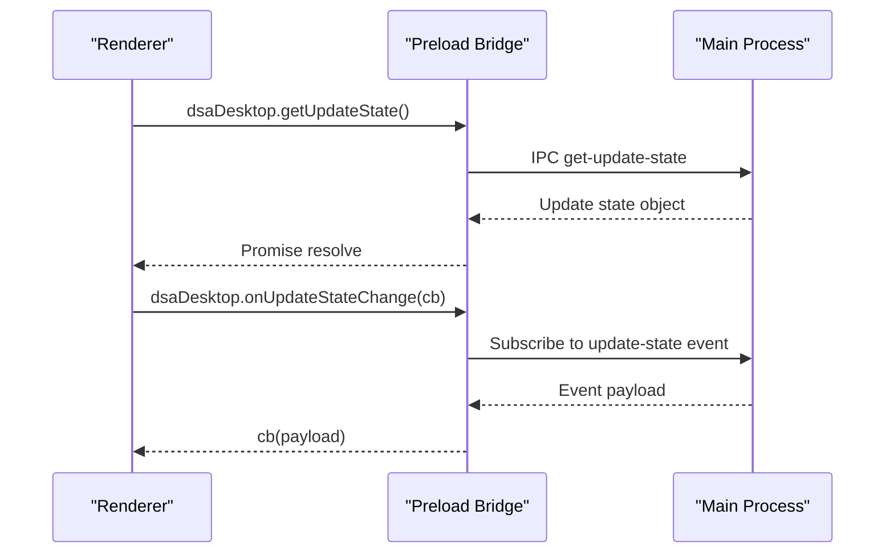
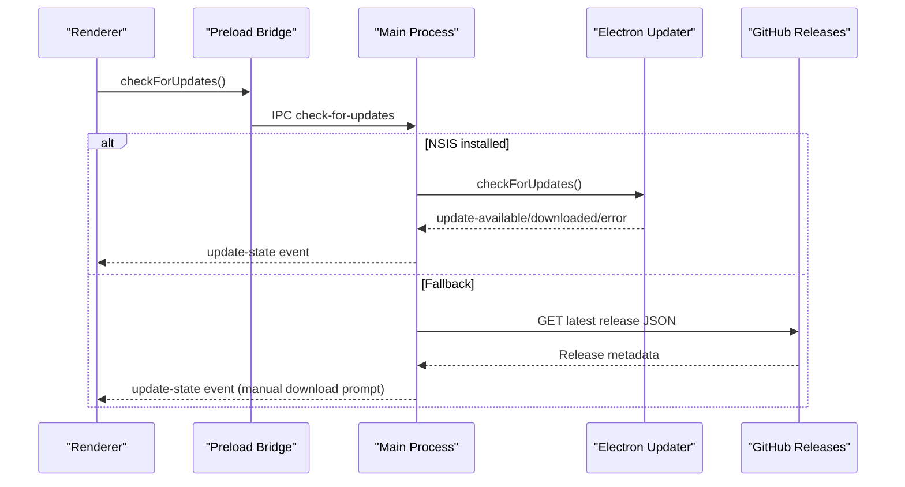
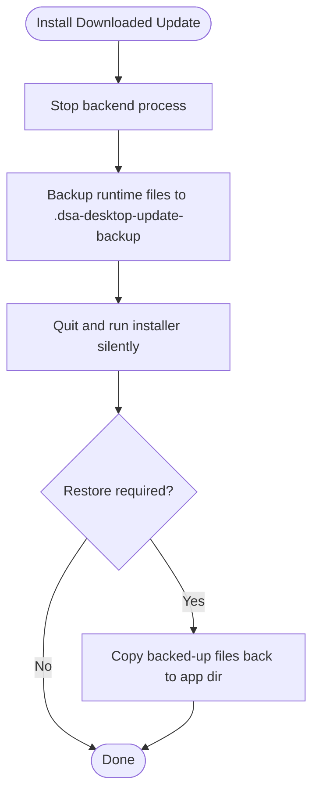
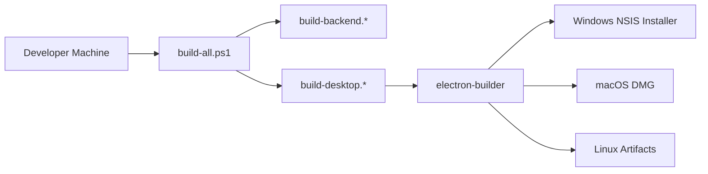
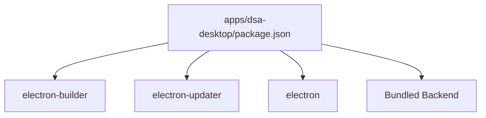

# Desktop Application

<cite>
**Referenced Files in This Document**
- [main.js](file://apps/dsa-desktop/main.js)
- [preload.js](file://apps/dsa-desktop/preload.js)
- [package.json](file://apps/dsa-desktop/package.json)
- [installer.nsh](file://apps/dsa-desktop/installer.nsh)
- [afterPackMacos.js](file://apps/dsa-desktop/scripts/afterPackMacos.js)
- [desktop-package.md](file://docs/desktop-package.md)
- [build-all.ps1](file://scripts/build-all.ps1)
- [build-desktop.ps1](file://scripts/build-desktop.ps1)
</cite>

## Table of Contents
1. [Introduction](#introduction)
2. [Project Structure](#project-structure)
3. [Core Components](#core-components)
4. [Architecture Overview](#architecture-overview)
5. [Detailed Component Analysis](#detailed-component-analysis)
6. [Dependency Analysis](#dependency-analysis)
7. [Performance Considerations](#performance-considerations)
8. [Troubleshooting Guide](#troubleshooting-guide)
9. [Conclusion](#conclusion)
10. [Appendices](#appendices)

## Introduction
This document explains the Electron-based desktop application that provides local stock analysis capabilities. It covers the main process, preload bridge, renderer integration, local backend server lifecycle, auto-update mechanisms, packaging and distribution across Windows, macOS, and Linux, as well as platform-specific considerations, signing guidance, and troubleshooting.

## Project Structure
The desktop application lives under apps/dsa-desktop and is built with Electron and electron-builder. The React UI is served by a local Python backend that the desktop app launches and monitors. Packaging includes NSIS for Windows, DMG for macOS, and generic artifacts for Linux.

**Diagram sources**
- [main.js:1874-2073](file://apps/dsa-desktop/main.js#L1874-L2073)
- [package.json:18-62](file://apps/dsa-desktop/package.json#L18-L62)

**Section sources**
- [package.json:1-67](file://apps/dsa-desktop/package.json#L1-L67)
- [desktop-package.md:1-13](file://docs/desktop-package.md#L1-L13)

## Core Components
- Main process: manages window lifecycle, local backend startup/shutdown, health checks, update checks, runtime state backup/restore, and IPC handlers.
- Preload script: exposes a minimal, secure API surface to the renderer via contextBridge.
- Renderer: loads the React UI from the local backend and communicates with the main process through the preload bridge.
- Local backend: launched alongside the app; serves the UI and provides offline analysis APIs.
- Packaging: electron-builder configuration defines targets, extra resources, and post-pack hooks.

Key responsibilities:
- Launching and monitoring the backend process and waiting for readiness.
- Selecting an available port and constructing safe URLs for the renderer.
- Providing update checking and installation flows for supported platforms.
- Backing up and restoring user runtime data around updates.

**Section sources**
- [main.js:1-2136](file://apps/dsa-desktop/main.js#L1-L2136)
- [preload.js:1-68](file://apps/dsa-desktop/preload.js#L1-L68)
- [package.json:18-62](file://apps/dsa-desktop/package.json#L18-L62)

## Architecture Overview
The desktop app follows a three-process model:
- Main process orchestrates system resources and lifecycle.
- Renderer displays the UI and delegates privileged operations to the main process via the preload bridge.
- A local backend runs as a child process, serving the UI and providing offline analysis features.

**Diagram sources**
- [main.js:1874-2073](file://apps/dsa-desktop/main.js#L1874-L2073)
- [main.js:1682-1808](file://apps/dsa-desktop/main.js#L1682-L1808)
- [preload.js:18-55](file://apps/dsa-desktop/preload.js#L18-L55)

## Detailed Component Analysis

### Main Process Lifecycle and Backend Management
- Initializes logging and resolves app directory based on platform and packaging mode.
- Ensures .env exists by copying from template if missing.
- Finds an available port in a configured range and constructs backend URLs safely.
- Spawns the backend either as a packaged executable or via Python in development mode.
- Waits for backend health endpoint before loading the main UI.
- Handles window events and ensures backend shutdown on quit.

**Diagram sources**
- [main.js:916-938](file://apps/dsa-desktop/main.js#L916-L938)
- [main.js:974-1009](file://apps/dsa-desktop/main.js#L974-L1009)
- [main.js:1169-1250](file://apps/dsa-desktop/main.js#L1169-L1250)
- [main.js:1011-1167](file://apps/dsa-desktop/main.js#L1011-L1167)
- [main.js:1874-2073](file://apps/dsa-desktop/main.js#L1874-L2073)

**Section sources**
- [main.js:916-1009](file://apps/dsa-desktop/main.js#L916-L1009)
- [main.js:1169-1250](file://apps/dsa-desktop/main.js#L1169-L1250)
- [main.js:1874-2073](file://apps/dsa-desktop/main.js#L1874-L2073)

### Secure Preload Bridge
- Exposes a small, typed API to the renderer: version, update state retrieval, update checks, install downloaded update, open release page, render share image, and subscription to update state changes.
- Uses ipcRenderer.invoke and event listeners to communicate with the main process.

**Diagram sources**
- [preload.js:18-55](file://apps/dsa-desktop/preload.js#L18-L55)
- [main.js:1854-1872](file://apps/dsa-desktop/main.js#L1854-L1872)

**Section sources**
- [preload.js:1-68](file://apps/dsa-desktop/preload.js#L1-L68)
- [main.js:1854-1872](file://apps/dsa-desktop/main.js#L1854-L1872)

### Auto-Update Mechanisms
Two update paths are implemented:
- Electron Updater path: Available on Windows NSIS-installed builds; downloads and installs updates silently after user confirmation.
- Fallback path: For non-NSIS or unsupported environments; checks GitHub Releases and prompts to open the release page.

Key behaviors:
- Maintains a normalized update state with status, versions, timestamps, and messages.
- Prompts users when an update is available or downloaded.
- Before installing, stops the backend and backs up runtime files to avoid data loss.

**Diagram sources**
- [main.js:1682-1808](file://apps/dsa-desktop/main.js#L1682-L1808)
- [main.js:1810-1852](file://apps/dsa-desktop/main.js#L1810-L1852)
- [preload.js:24-35](file://apps/dsa-desktop/preload.js#L24-L35)

**Section sources**
- [main.js:1551-1680](file://apps/dsa-desktop/main.js#L1551-L1680)
- [main.js:1682-1852](file://apps/dsa-desktop/main.js#L1682-L1852)

### Runtime Data Backup and Restore
- On Windows NSIS-installed builds, the app backs up critical runtime files before updating and restores them afterward if needed.
- Migration logic moves legacy macOS runtime files into the Electron user data directory once.

**Diagram sources**
- [main.js:1583-1638](file://apps/dsa-desktop/main.js#L1583-L1638)
- [main.js:493-609](file://apps/dsa-desktop/main.js#L493-L609)
- [main.js:611-655](file://apps/dsa-desktop/main.js#L611-L655)

**Section sources**
- [main.js:493-655](file://apps/dsa-desktop/main.js#L493-L655)
- [main.js:1583-1638](file://apps/dsa-desktop/main.js#L1583-L1638)

### Packaging and Distribution
- Targets:
  - Windows: NSIS installer with custom macros to prevent writing to protected directories.
  - macOS: DMG with afterPack hook to normalize signatures and audit artifacts.
  - Linux: Generic artifacts via electron-builder defaults.
- Extra resources include environment template and bundled backend executable.
- Build scripts enforce prerequisites and coordinate backend and desktop builds.

**Diagram sources**
- [package.json:18-62](file://apps/dsa-desktop/package.json#L18-L62)
- [afterPackMacos.js:1-26](file://apps/dsa-desktop/scripts/afterPackMacos.js#L1-L26)
- [build-all.ps1:1-9](file://scripts/build-all.ps1#L1-L9)
- [build-desktop.ps1:1-101](file://scripts/build-desktop.ps1#L1-L101)

**Section sources**
- [package.json:18-62](file://apps/dsa-desktop/package.json#L18-L62)
- [installer.nsh:1-120](file://apps/dsa-desktop/installer.nsh#L1-L120)
- [afterPackMacos.js:1-26](file://apps/dsa-desktop/scripts/afterPackMacos.js#L1-L26)
- [build-all.ps1:1-9](file://scripts/build-all.ps1#L1-L9)
- [build-desktop.ps1:1-101](file://scripts/build-desktop.ps1#L1-L101)

### Customizing Desktop Features
- Share image rendering: The main process can render a hidden window to capture HTML content as PNG using the current backend origin for security.
- Environment overrides: The main process reads .env and environment variables to configure backend host, port, database path, and log directory.
- Window behavior: Background color adapts to native theme; external links are opened via shell.openExternal.

Examples of customization points:
- Adjust share image dimensions and maximum height constants.
- Extend allowed hosts or bind addresses for local network access.
- Add new IPC channels in preload and handle them in main.

**Section sources**
- [main.js:1345-1455](file://apps/dsa-desktop/main.js#L1345-L1455)
- [main.js:819-902](file://apps/dsa-desktop/main.js#L819-L902)
- [main.js:1958-1961](file://apps/dsa-desktop/main.js#L1958-L1961)

### Integrating with System Notifications and File Systems
- Notifications: Use Electron’s dialog and shell APIs to inform users about updates and open external pages securely.
- File system access: Restricted to the main process; the renderer accesses files only through explicit IPC calls exposed by the preload bridge.

Best practices:
- Validate all URLs passed to shell.openExternal.
- Keep sensitive operations in the main process and expose minimal interfaces to the renderer.

**Section sources**
- [main.js:1551-1581](file://apps/dsa-desktop/main.js#L1551-L1581)
- [main.js:1857-1859](file://apps/dsa-desktop/main.js#L1857-L1859)
- [preload.js:18-55](file://apps/dsa-desktop/preload.js#L18-L55)

## Dependency Analysis
- Electron and electron-updater are runtime dependencies for the desktop app.
- electron-builder is used at build time to package the app and generate installers.
- The backend is bundled as an extra resource and launched as a child process.

**Diagram sources**
- [package.json:11-17](file://apps/dsa-desktop/package.json#L11-L17)
- [package.json:18-62](file://apps/dsa-desktop/package.json#L18-L62)

**Section sources**
- [package.json:11-17](file://apps/dsa-desktop/package.json#L11-L17)
- [package.json:18-62](file://apps/dsa-desktop/package.json#L18-L62)

## Performance Considerations
- Health polling interval and timeouts are tuned to avoid blocking startup while ensuring timely failure detection.
- Backend output decoding handles encoding differences and avoids excessive logging during startup.
- Share image rendering uses a hidden window with controlled dimensions to minimize memory usage.

Recommendations:
- Monitor logs for repeated health probe errors and adjust timeouts if necessary.
- Avoid heavy work in the renderer; delegate to main or backend where appropriate.

[No sources needed since this section provides general guidance]

## Troubleshooting Guide
Common issues and resolutions:
- “Preparing backend...” indefinitely:
  - Check logs for backend start errors and ensure .env is present and valid.
  - Confirm no port conflicts in the selected range; the app selects an available port automatically.
- ModuleNotFoundError in backend:
  - Rebuild the backend artifact using provided scripts to ensure all modules and package data are included.
- Blank UI:
  - Ensure the React UI build artifacts exist and are served by the backend.
- macOS “app is damaged” warning:
  - Follow documented steps to clear quarantine attributes and re-open; long-term fix requires code signing and notarization.
- Update failures:
  - Inspect update state and logs; verify presence of updater metadata for Windows NSIS builds.

Platform-specific notes:
- Windows: Installer prevents writing to protected directories; per-user install recommended.
- macOS: AfterPack hook normalizes signatures; unsigned builds may require manual trust actions.
- Linux: Use standard electron-builder artifacts; ensure runtime dependencies are available.

**Section sources**
- [desktop-package.md:315-339](file://docs/desktop-package.md#L315-L339)
- [desktop-package.md:80-105](file://docs/desktop-package.md#L80-L105)
- [installer.nsh:81-119](file://apps/dsa-desktop/installer.nsh#L81-L119)
- [main.js:1998-2070](file://apps/dsa-desktop/main.js#L1998-L2070)

## Conclusion
The desktop application combines Electron’s robust process model with a local backend to deliver offline-capable stock analysis. It provides secure IPC via preload, resilient startup with health checks, and cross-platform packaging with optional automatic updates. Proper configuration, careful handling of runtime files, and adherence to platform-specific guidelines ensure reliable distribution and operation.

[No sources needed since this section summarizes without analyzing specific files]

## Appendices

### Installation and Setup by Platform
- Windows:
  - Use the NSIS installer or portable unpacked folder.
  - Developer Mode may be required for building due to symlink creation.
- macOS:
  - DMG contains an unsigned app; follow quarantine clearance steps if prompted.
  - AfterPack hook attempts to normalize signatures prior to DMG creation.
- Linux:
  - Use electron-builder artifacts; ensure system libraries and Python runtime are available if running in development mode.

**Section sources**
- [desktop-package.md:42-64](file://docs/desktop-package.md#L42-L64)
- [desktop-package.md:80-105](file://docs/desktop-package.md#L80-L105)
- [build-desktop.ps1:1-101](file://scripts/build-desktop.ps1#L1-L101)

### Signing Requirements for Distribution
- Current CI produces unsigned artifacts for macOS DMGs.
- To eliminate Gatekeeper warnings and improve trust, integrate Apple Developer code signing and notarization into the release workflow.
- Audit signed artifacts to ensure no residual or corrupted signatures are published.

**Section sources**
- [desktop-package.md:80-105](file://docs/desktop-package.md#L80-L105)
- [afterPackMacos.js:1-26](file://apps/dsa-desktop/scripts/afterPackMacos.js#L1-L26)