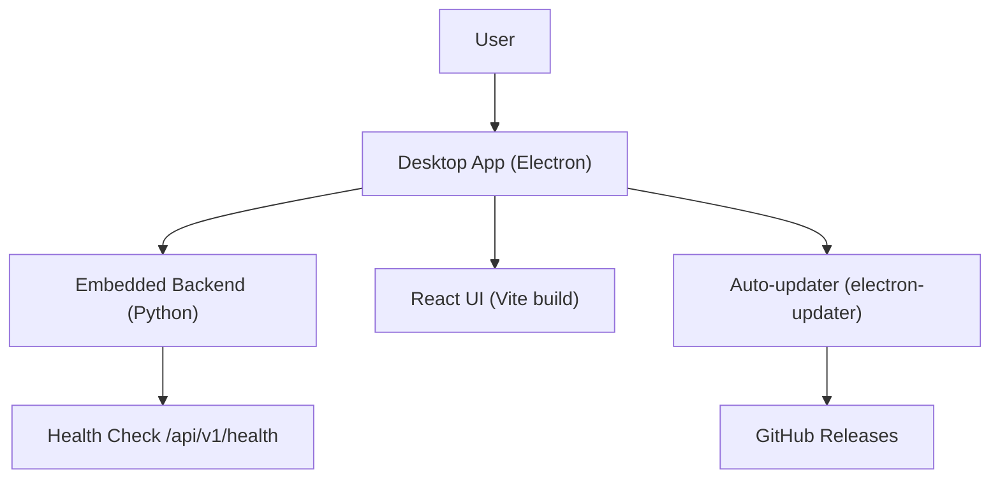
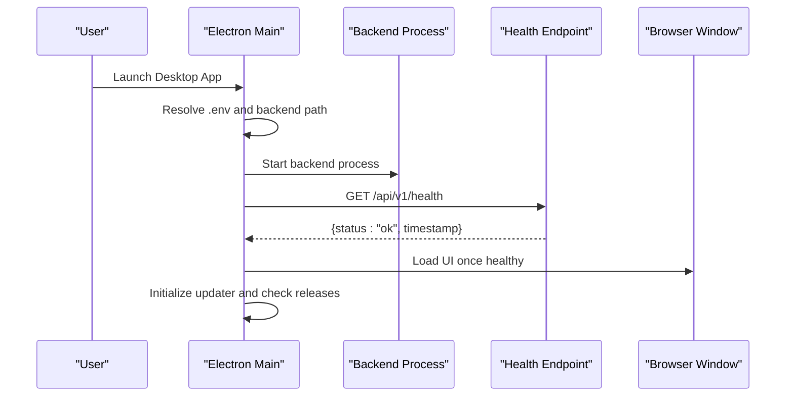
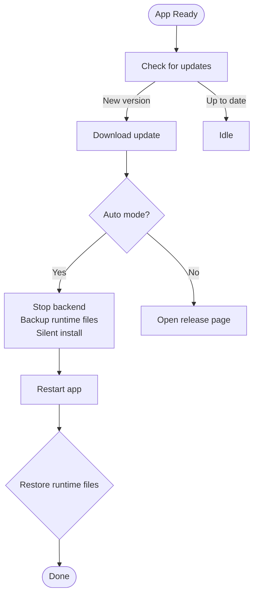
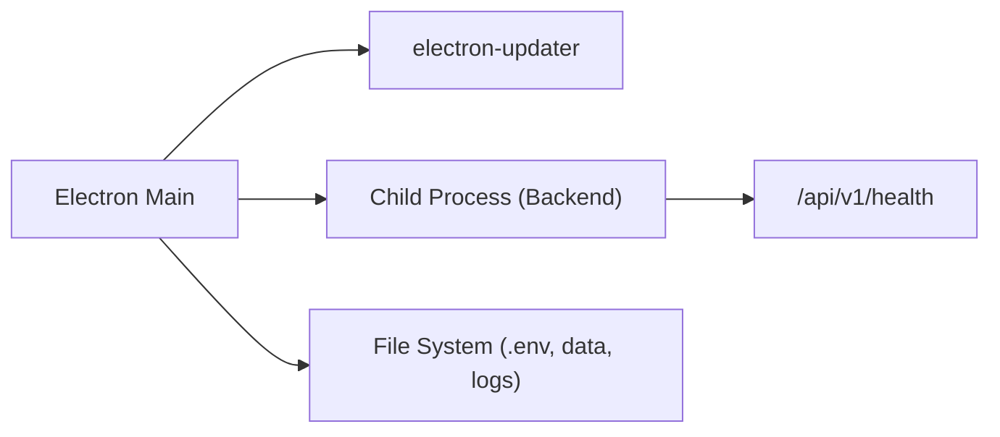

# Installation & Setup

<cite>
**Referenced Files in This Document**
- [main.js](file://apps/dsa-desktop/main.js)
- [package.json](file://apps/dsa-desktop/package.json)
- [installer.nsh](file://apps/dsa-desktop/installer.nsh)
- [desktop-package.md](file://docs/desktop-package.md)
- [health.py](file://api/v1/endpoints/health.py)
- [check_env.py](file://scripts/check_env.py)
- [build-all.ps1](file://scripts/build-all.ps1)
- [run-desktop.ps1](file://scripts/run-desktop.ps1)
</cite>

## Table of Contents
1. Introduction
2. Project Structure
3. Core Components
4. Architecture Overview
5. Detailed Component Analysis
6. Dependency Analysis
7. Performance Considerations
8. Troubleshooting Guide
9. Conclusion
10. Appendices

## Introduction
This document provides comprehensive installation and setup instructions for the Desktop Application across Windows (NSIS installer), macOS (DMG package), and Linux environments. It covers system requirements, environment configuration via .env, initial launch procedures, auto-update behavior, version management, local backend server path configuration, development workflow, and verification through health checks. It also includes troubleshooting guidance for common installation issues, permission problems, and platform-specific considerations.

## Project Structure
The Desktop Application is an Electron-based app that bundles a React UI and a frozen Python backend. On first run, it starts the embedded backend, waits for it to be healthy, then loads the UI. Configuration files (.env), database files, and logs are stored in a user-writable location next to the executable on Windows or in the Electron user data directory on macOS.

**Diagram sources**
- [main.js:1-800](file://apps/dsa-desktop/main.js#L1-L800)
- [package.json:18-62](file://apps/dsa-desktop/package.json#L18-L62)
- [health.py:21-34](file://api/v1/endpoints/health.py#L21-L34)

**Section sources**
- [desktop-package.md:1-12](file://docs/desktop-package.md#L1-L12)
- [desktop-package.md:247-279](file://docs/desktop-package.md#L247-L279)

## Core Components
- Desktop shell (Electron): Launches the embedded backend, manages window lifecycle, handles updates, and coordinates runtime state backup/restore during updates.
- Embedded backend (Python): Serves the API and UI assets; exposes a health endpoint used by the desktop shell to confirm readiness.
- Auto-updater: Checks GitHub Releases for new versions, downloads updates (Windows NSIS installers), and performs silent restart-and-install with runtime file backups.
- Installer (NSIS): Guides per-user installation, blocks protected directories, and supports quiet upgrades.

Key responsibilities:
- Environment resolution: Reads .env from appropriate locations based on platform and packaging mode.
- Backend discovery: Resolves the bundled backend executable path or uses an override via environment variable.
- Update flow: Backs up runtime files before installing updates and restores them if needed.

**Section sources**
- [main.js:657-701](file://apps/dsa-desktop/main.js#L657-L701)
- [main.js:493-609](file://apps/dsa-desktop/main.js#L493-L609)
- [package.json:18-62](file://apps/dsa-desktop/package.json#L18-L62)
- [installer.nsh:1-120](file://apps/dsa-desktop/installer.nsh#L1-L120)

## Architecture Overview
The desktop application orchestrates three main phases at startup:
1. Resolve environment and backend path.
2. Start the embedded backend process and wait for health.
3. Load the React UI and enable update checks.

**Diagram sources**
- [main.js:1-800](file://apps/dsa-desktop/main.js#L1-L800)
- [health.py:21-34](file://api/v1/endpoints/health.py#L21-L34)

## Detailed Component Analysis

### Windows Installation (NSIS)
- Download the latest installer from GitHub Releases.
- Run the installer; choose a user-writable directory (system-protected directories like Program Files and Windows are blocked).
- The installer installs per-user without elevation.
- After installation, locate the installed folder and edit .env to configure API keys and stock lists.
- Launch the application from the Start menu or the installed executable.

Notes:
- The installer prevents selecting protected directories to avoid runtime write failures for .env, data/, and logs/.
- Updates will reuse the current install directory and perform a silent restart-and-install after download.

**Section sources**
- [installer.nsh:82-119](file://apps/dsa-desktop/installer.nsh#L82-L119)
- [desktop-package.md:63-79](file://docs/desktop-package.md#L63-L79)
- [desktop-package.md:247-279](file://docs/desktop-package.md#L247-L279)

### macOS Installation (DMG)
- Download the DMG matching your architecture (Apple Silicon or Intel).
- Open the DMG and drag the app into Applications.
- First launch may be blocked by Gatekeeper because the app is unsigned; follow system prompts to allow opening.
- If necessary, remove quarantine attributes using the terminal command provided in the documentation.
- Configure .env in the Electron user data directory and launch the app.

Notes:
- Runtime files (.env, data/, logs/) are stored in the Electron user data directory to survive app replacement.
- Migration from older packaged apps occurs automatically when old files are still accessible.

**Section sources**
- [desktop-package.md:80-105](file://docs/desktop-package.md#L80-L105)
- [desktop-package.md:269-279](file://docs/desktop-package.md#L269-L279)

### Linux Setup
- Use the win-unpacked distribution approach or run the development workflow to start the desktop shell and backend locally.
- Ensure Node.js and Python dependencies are installed, build the React UI, and start the Electron app.
- Configure .env in the user data directory and verify the backend health endpoint.

Notes:
- The repository focuses on Windows NSIS and macOS DMG packaging; Linux typically runs via development scripts or unpacked distributions.

**Section sources**
- [desktop-package.md:14-40](file://docs/desktop-package.md#L14-L40)
- [desktop-package.md:211-245](file://docs/desktop-package.md#L211-L245)

### System Requirements
- Node.js 18+ and Python 3.10+ for building and development.
- Windows Developer Mode required for certain build steps involving symbolic links.
- Sufficient disk space for the app bundle, backend artifacts, and runtime data.
- Network access to GitHub Releases for update checks and optional data providers.

**Section sources**
- [desktop-package.md:44-55](file://docs/desktop-package.md#L44-L55)

### Environment Variables (.env)
- Location:
  - Windows: Next to the executable in the installed folder.
  - macOS: In the Electron user data directory.
- First run copies .env.example to .env if missing.
- Required keys include AI API keys and STOCK_LIST; other options are documented in .env.example.
- You can override the backend path via an environment variable if needed.

**Section sources**
- [desktop-package.md:269-279](file://docs/desktop-package.md#L269-L279)
- [main.js:657-673](file://apps/dsa-desktop/main.js#L657-L673)

### Initial Launch Procedures
- Windows: Run the installed executable or use the Start menu entry.
- macOS: Open the app from Applications; handle Gatekeeper prompts if necessary.
- Development: Build the React UI and start the Electron app in dev mode.

Verification:
- The desktop shell waits for the backend’s /api/v1/health endpoint before loading the UI.
- You can call the health endpoint directly to confirm the backend is running.

**Section sources**
- [desktop-package.md:14-12](file://docs/desktop-package.md#L1-L12)
- [health.py:21-34](file://api/v1/endpoints/health.py#L21-L34)

### Auto-Update Mechanism and Version Management
- Update modes:
  - Automatic: Downloads and prompts to restart-and-install on Windows NSIS builds.
  - Manual: Users can check for updates and open the release page.
- Update states include idle, checking, up-to-date, update-available, downloading, downloaded, installing, and error.
- Before installing, the app stops the backend, backs up runtime files, and performs a silent install; it restores files if needed.
- Version comparison uses semantic versioning; prerelease handling is supported.

**Diagram sources**
- [main.js:68-82](file://apps/dsa-desktop/main.js#L68-L82)
- [main.js:188-207](file://apps/dsa-desktop/main.js#L188-L207)
- [main.js:232-292](file://apps/dsa-desktop/main.js#L232-L292)
- [main.js:1596-1638](file://apps/dsa-desktop/main.js#L1596-L1638)

**Section sources**
- [main.js:294-398](file://apps/dsa-desktop/main.js#L294-L398)
- [main.js:493-609](file://apps/dsa-desktop/main.js#L493-L609)
- [desktop-package.md:306-313](file://docs/desktop-package.md#L306-L313)

### Local Backend Server Path Configuration
- Override the backend executable path via an environment variable.
- In packaged mode, the app resolves the bundled backend under resources/backend.
- On macOS, additional PATH entries are appended to ensure CLI tools are discoverable.

**Section sources**
- [main.js:657-701](file://apps/dsa-desktop/main.js#L657-L701)

### Development Environment Setup
- One-click development script builds the React UI and starts the Electron app in dev mode.
- Alternatively, build the UI manually and run the desktop app in development.

Steps:
- Use the provided PowerShell script to automate dependency installation and dev launch.
- For manual steps, build the React UI, then start the Electron app.

**Section sources**
- [run-desktop.ps1:1-18](file://scripts/run-desktop.ps1#L1-L18)
- [desktop-package.md:14-40](file://docs/desktop-package.md#L14-L40)

### Verifying Successful Installation
- Health check: Call /api/v1/health to confirm the backend is ready.
- Logs: Inspect desktop.log for startup messages and errors.
- Environment validation: Use the provided environment checker script to validate configuration, database connectivity, and optional LLM/data fetch tests.

**Section sources**
- [health.py:21-34](file://api/v1/endpoints/health.py#L21-L34)
- [check_env.py:88-122](file://scripts/check_env.py#L88-L122)
- [desktop-package.md:315-329](file://docs/desktop-package.md#L315-L329)

## Dependency Analysis
- Electron main process depends on:
  - electron-updater for automatic updates.
  - Child process spawning to manage the backend lifecycle.
  - File system operations for .env and runtime state backup/restore.
- Backend exposes a minimal health endpoint used by the desktop shell.
- Installer script enforces safe installation paths and supports upgrade flows.

**Diagram sources**
- [package.json:11-17](file://apps/dsa-desktop/package.json#L11-L17)
- [main.js:1-20](file://apps/dsa-desktop/main.js#L1-L20)
- [health.py:21-34](file://api/v1/endpoints/health.py#L21-L34)

**Section sources**
- [package.json:18-62](file://apps/dsa-desktop/package.json#L18-L62)
- [installer.nsh:1-120](file://apps/dsa-desktop/installer.nsh#L1-L120)

## Performance Considerations
- Avoid installing into system-protected directories to prevent permission-related slowdowns and failures.
- Keep network access open for update checks; timeouts are handled gracefully.
- Ensure sufficient disk space for runtime data and logs to avoid I/O bottlenecks.

[No sources needed since this section provides general guidance]

## Troubleshooting Guide
Common issues and resolutions:
- “Preparing backend...” indefinitely:
  - Check desktop.log for errors.
  - Confirm .env exists and is correctly configured.
  - Verify ports 8000–8100 are free; the app selects an available port automatically.
- ModuleNotFoundError during backend startup:
  - Rebuild the backend using the provided scripts to ensure all modules are included.
  - Missing package data (e.g., AkShare calendar) indicates incomplete bundling; rebuild using the correct scripts.
- UI blank:
  - Ensure static assets were built; rebuild the React UI if necessary.
- macOS Gatekeeper prompts:
  - Follow system prompts to allow the app; if needed, remove quarantine attributes as documented.
- Permission errors:
  - Do not install into Program Files or Windows directories; use a user-writable location.
  - On Docker-like environments, ensure writable mounts and correct ownership.

**Section sources**
- [desktop-package.md:315-339](file://docs/desktop-package.md#L315-L339)
- [installer.nsh:82-119](file://apps/dsa-desktop/installer.nsh#L82-L119)

## Conclusion
You now have the complete guide to install, configure, and operate the Desktop Application on Windows, macOS, and Linux. Use the health endpoint and environment validation scripts to verify your setup. Leverage the auto-update mechanism for seamless upgrades and consult the troubleshooting section for common issues.

[No sources needed since this section summarizes without analyzing specific files]

## Appendices

### Quick Commands and Scripts
- Build all desktop artifacts (Windows):
  - Use the build-all script to construct backend and desktop packages.
- Start desktop in development mode:
  - Use the run-desktop script to build UI and launch Electron.

**Section sources**
- [build-all.ps1:1-9](file://scripts/build-all.ps1#L1-L9)
- [run-desktop.ps1:1-18](file://scripts/run-desktop.ps1#L1-L18)