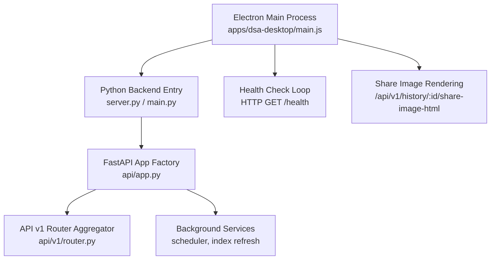
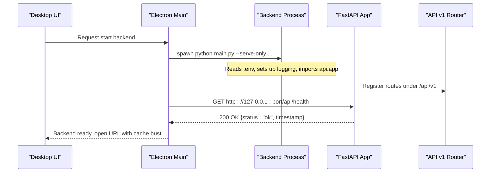
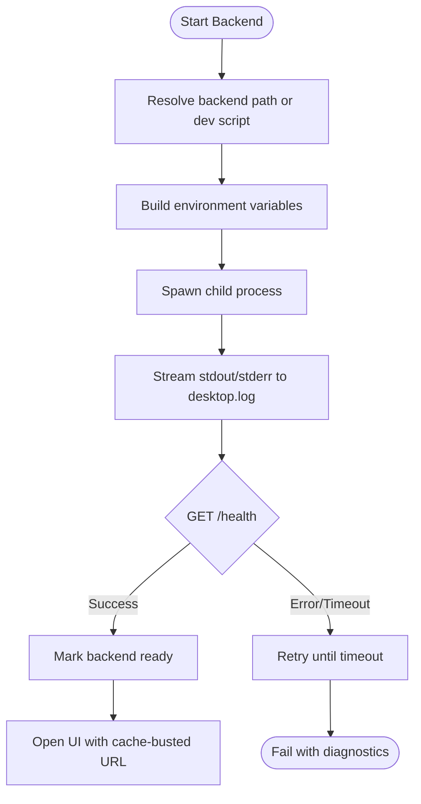
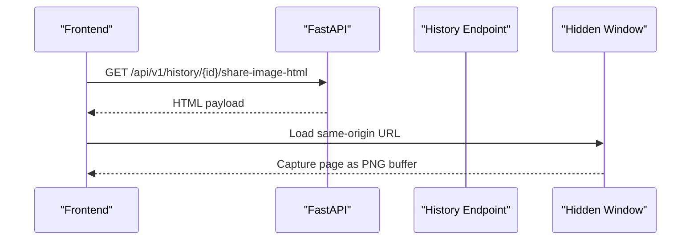
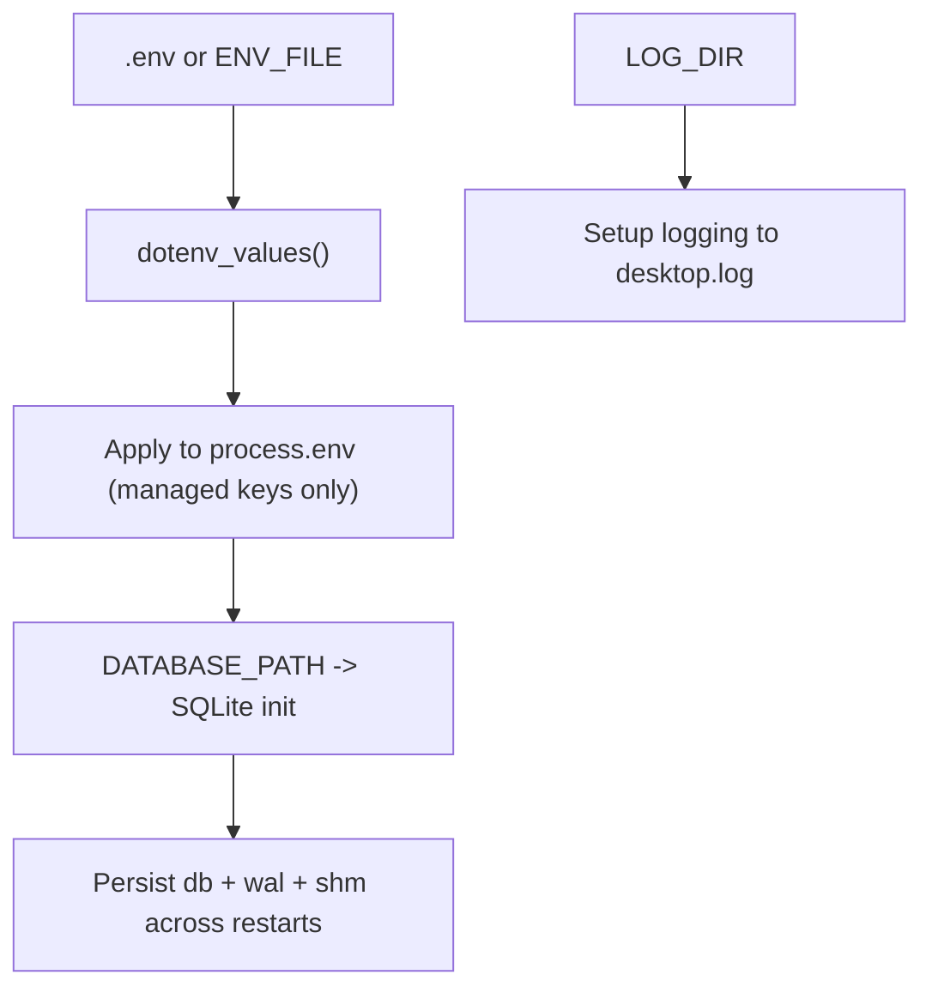
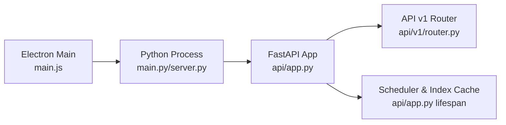

# Local Backend Integration

<cite>
**Referenced Files in This Document**
- [main.js](file://apps/dsa-desktop/main.js)
- [preload.js](file://apps/dsa-desktop/preload.js)
- [server.py](file://server.py)
- [api/app.py](file://api/app.py)
- [api/v1/router.py](file://api/v1/router.py)
- [main.py](file://main.py)
- [src/config.py](file://src/config.py)
</cite>

## Table of Contents
1. [Introduction](#introduction)
2. [Project Structure](#project-structure)
3. [Core Components](#core-components)
4. [Architecture Overview](#architecture-overview)
5. [Detailed Component Analysis](#detailed-component-analysis)
6. [Dependency Analysis](#dependency-analysis)
7. [Performance Considerations](#performance-considerations)
8. [Troubleshooting Guide](#troubleshooting-guide)
9. [Conclusion](#conclusion)
10. [Appendices](#appendices)

## Introduction
This document explains how the Desktop Application integrates with its embedded Python backend server. It covers process lifecycle management (startup, shutdown, health monitoring), communication protocols (REST API and file sharing), configuration propagation (environment variables, database initialization, persistence), and practical guidance for customization, debugging, and performance tuning for local analysis workflows.

## Project Structure
The desktop integration spans three layers:
- Electron main process: launches and manages the backend process, resolves ports and environment, performs health checks, and renders share images via a hidden window.
- Python backend entrypoints: FastAPI application factory, router aggregation, and optional standalone server runner.
- Configuration and runtime services: environment loading, scheduler wiring, and background tasks such as stock index refresh.

**Diagram sources**
- [main.js:865-902](file://apps/dsa-desktop/main.js#L865-L902)
- [main.js:988-1167](file://apps/dsa-desktop/main.js#L988-L1167)
- [server.py:21-55](file://server.py#L21-L55)
- [api/app.py:313-454](file://api/app.py#L313-L454)
- [api/v1/router.py:31-117](file://api/v1/router.py#L31-L117)

**Section sources**
- [main.js:865-902](file://apps/dsa-desktop/main.js#L865-L902)
- [server.py:21-55](file://server.py#L21-L55)
- [api/app.py:313-454](file://api/app.py#L313-L454)
- [api/v1/router.py:31-117](file://api/v1/router.py#L31-L117)

## Core Components
- Electron main process orchestrator:
  - Resolves backend executable or development script path.
  - Builds environment variables for the backend (including DATABASE_PATH, LOG_DIR, WEBUI_HOST/PORT).
  - Spawns the backend process, streams stdout/stderr to desktop.log, and monitors exit codes.
  - Probes /health until ready; supports timeouts and progress callbacks.
  - Graceful shutdown using SIGTERM then SIGKILL fallback on non-Windows; taskkill on Windows.
- FastAPI application:
  - Creates app instance, registers CORS, auth middleware, error handlers, and routes under /api/v1.
  - Serves static frontend assets when present; otherwise returns a helpful “not built” page.
  - Provides /health endpoints at both /health and /api/health.
  - Background startup tasks: scheduler reconciliation, stock index cache warmup.
- Configuration system:
  - Loads .env values, applies proxy settings if enabled, and exposes typed helpers for parsing booleans, integers, floats, and lists.
  - Supports dynamic hot-reload of env-managed keys without clobbering process overrides.

**Section sources**
- [main.js:657-701](file://apps/dsa-desktop/main.js#L657-L701)
- [main.js:865-902](file://apps/dsa-desktop/main.js#L865-L902)
- [main.js:988-1167](file://apps/dsa-desktop/main.js#L988-L1167)
- [main.js:1169-1250](file://apps/dsa-desktop/main.js#L1169-L1250)
- [main.js:1294-1332](file://apps/dsa-desktop/main.js#L1294-L1332)
- [api/app.py:313-454](file://api/app.py#L313-L454)
- [api/app.py:237-310](file://api/app.py#L237-L310)
- [main.py:121-170](file://main.py#L121-L170)
- [src/config.py:226-323](file://src/config.py#L226-L323)

## Architecture Overview
The desktop app runs the backend as a child process and communicates over HTTP. The backend exposes REST endpoints under /api/v1 and serves the web UI statically when available. Health checks drive readiness gating before the UI is shown.

**Diagram sources**
- [main.js:1169-1250](file://apps/dsa-desktop/main.js#L1169-L1250)
- [main.js:988-1167](file://apps/dsa-desktop/main.js#L988-L1167)
- [server.py:21-55](file://server.py#L21-L55)
- [api/app.py:313-454](file://api/app.py#L313-L454)
- [api/v1/router.py:31-117](file://api/v1/router.py#L31-L117)

## Detailed Component Analysis

### Backend Lifecycle Management (Startup, Shutdown, Health)
- Startup:
  - Determines whether to run packaged backend executable or development script.
  - Builds environment including DSA_DESKTOP_MODE, ENV_FILE, DATABASE_PATH, LOG_DIR, PYTHONUTF8/PYTHONIOENCODING, and disables non-essential features (WEBUI_ENABLED, BOT_ENABLED, stream bots).
  - Spawns process with stdio piped; logs first stdout/stderr timestamps and full output lines.
- Health monitoring:
  - Polls HTTP GET to /health with configurable timeout, interval, per-request timeout, and abort hook.
  - Emits progress events for probe_start, probe_status, probe_timeout, probe_error, ready, total_timeout, final_error.
- Shutdown:
  - Sends SIGTERM; waits briefly; escalates to SIGKILL if needed; on Windows uses taskkill /T /F.
  - Clears internal process reference after exit confirmation.

**Diagram sources**
- [main.js:657-701](file://apps/dsa-desktop/main.js#L657-L701)
- [main.js:865-902](file://apps/dsa-desktop/main.js#L865-L902)
- [main.js:988-1167](file://apps/dsa-desktop/main.js#L988-L1167)
- [main.js:1169-1250](file://apps/dsa-desktop/main.js#L1169-L1250)

**Section sources**
- [main.js:988-1167](file://apps/dsa-desktop/main.js#L988-L1167)
- [main.js:1169-1250](file://apps/dsa-desktop/main.js#L1169-L1250)
- [main.js:1294-1332](file://apps/dsa-desktop/main.js#L1294-L1332)

### Communication Protocols: REST API and File Sharing
- REST API:
  - All business endpoints are mounted under /api/v1 via router aggregation.
  - Health endpoints exposed at both /health and /api/health for convenience.
  - Static asset serving and SPA fallback are handled by the app factory when frontend assets exist.
- File sharing:
  - Share image generation uses a hidden BrowserWindow to render /api/v1/history/:id/share-image-html from the backend origin and capture a PNG.
  - Origin validation ensures the target URL belongs to the configured backend origin.

**Diagram sources**
- [api/v1/router.py:31-117](file://api/v1/router.py#L31-L117)
- [api/app.py:398-454](file://api/app.py#L398-L454)
- [api/app.py:476-496](file://api/app.py#L476-L496)
- [main.js:1345-1455](file://apps/dsa-desktop/main.js#L1345-L1455)

**Section sources**
- [api/v1/router.py:31-117](file://api/v1/router.py#L31-L117)
- [api/app.py:398-454](file://api/app.py#L398-L454)
- [api/app.py:476-496](file://api/app.py#L476-L496)
- [main.js:1345-1455](file://apps/dsa-desktop/main.js#L1345-L1455)

### WebSocket Connections for Real-Time Updates
- No WebSocket implementation was found in the analyzed files. Real-time updates should be implemented as additional FastAPI endpoints or SSE/WebSocket routes under /api/v1 if required.

[No sources needed since this section does not analyze specific files]

### Configuration Management: Environment Variables, Database Initialization, Persistence
- Environment propagation:
  - Desktop builds an explicit environment for the backend, including DATABASE_PATH, LOG_DIR, WEBUI_HOST/PORT, and feature toggles.
  - On macOS, PATH is extended to include common CLI directories to ensure backend tools are discoverable.
- Database initialization and persistence:
  - DATABASE_PATH is passed to the backend; SQLite files (db, wal, shm) are included in runtime state backup/restore to persist across updates/restarts.
  - Logs directory is created and written to desktop.log for troubleshooting.
- Runtime config reload:
  - The Python side can reload env-managed keys without overriding process-level environment, enabling live updates for some settings.

**Diagram sources**
- [main.js:865-902](file://apps/dsa-desktop/main.js#L865-L902)
- [main.js:428-521](file://apps/dsa-desktop/main.js#L428-L521)
- [main.py:121-170](file://main.py#L121-L170)
- [main.py:250-270](file://main.py#L250-L270)

**Section sources**
- [main.js:865-902](file://apps/dsa-desktop/main.js#L865-L902)
- [main.js:428-521](file://apps/dsa-desktop/main.js#L428-L521)
- [main.py:121-170](file://main.py#L121-L170)
- [main.py:250-270](file://main.py#L250-L270)
- [src/config.py:226-323](file://src/config.py#L226-L323)

### Customizing Backend Behavior
- Bind host/port:
  - Control via WEBUI_HOST and WEBUI_PORT; desktop normalizes public bind hosts to loopback for safety.
- Feature toggles:
  - Disable Web UI, bots, and streaming channels by setting corresponding flags in the backend environment.
- Proxy usage:
  - Enable USE_PROXY and configure PROXY_HOST/PROXY_PORT to route outbound requests through a local proxy.
- Scheduler behavior:
  - Use environment variables to control runtime scheduler ownership, force enable, suppress start, and immediate run behavior during app lifespan.

**Section sources**
- [main.js:703-718](file://apps/dsa-desktop/main.js#L703-L718)
- [main.js:865-902](file://apps/dsa-desktop/main.js#L865-L902)
- [main.py:40-47](file://main.py#L40-L47)
- [api/app.py:237-310](file://api/app.py#L237-L310)

### Debugging Connection Issues
- Inspect desktop.log for backend spawn, first stdout/stderr timestamps, health probe results, and exit codes.
- Verify port availability; the desktop scans a range to find an open port before launching.
- Confirm /health responds with 200 OK; check CORS and auth settings if browser requests fail.
- Validate that frontend assets are present; missing assets produce a blank page and are logged by the app factory.

**Section sources**
- [main.js:916-938](file://apps/dsa-desktop/main.js#L916-L938)
- [main.js:988-1167](file://apps/dsa-desktop/main.js#L988-L1167)
- [api/app.py:76-113](file://api/app.py#L76-L113)
- [api/app.py:398-454](file://api/app.py#L398-L454)

### Optimizing Performance for Local Analysis Workflows
- Reduce cold-start latency:
  - Background stock index refresh and name resolver warmup occur during app lifespan to avoid first-request delays.
- Concurrency limits:
  - Tune LLM concurrency and timeouts via configuration helpers to balance responsiveness and resource usage.
- Logging:
  - Set appropriate log levels; prefer file logging for production-like runs and console logging for quick iterations.

**Section sources**
- [api/app.py:237-310](file://api/app.py#L237-L310)
- [src/config.py:226-323](file://src/config.py#L226-L323)

## Dependency Analysis
The desktop main process depends on Node APIs to spawn and monitor the Python backend. The backend depends on FastAPI, routers, and services for scheduling and data caching.

**Diagram sources**
- [main.js:1169-1250](file://apps/dsa-desktop/main.js#L1169-L1250)
- [server.py:21-55](file://server.py#L21-L55)
- [api/app.py:313-454](file://api/app.py#L313-L454)
- [api/v1/router.py:31-117](file://api/v1/router.py#L31-L117)

**Section sources**
- [main.js:1169-1250](file://apps/dsa-desktop/main.js#L1169-L1250)
- [server.py:21-55](file://server.py#L21-L55)
- [api/app.py:313-454](file://api/app.py#L313-L454)
- [api/v1/router.py:31-117](file://api/v1/router.py#L31-L117)

## Performance Considerations
- Prefer packaged backend executables for faster startup and fewer import overheads.
- Keep DATABASE_PATH on fast local storage; WAL mode helps concurrent reads/writes.
- Avoid binding to public interfaces unless behind a trusted network or with authentication enabled.
- Use background tasks (index refresh, scheduler) to amortize startup costs.

[No sources needed since this section provides general guidance]

## Troubleshooting Guide
- Backend fails to start:
  - Check desktop.log for spawn errors, first stdout/stderr timestamps, and exit codes.
  - Ensure backend executable exists or development script path is correct.
- Health check never succeeds:
  - Verify port availability and that /health returns 200.
  - Inspect CORS and auth configurations if accessing from a browser.
- Frontend blank page:
  - Confirm static assets exist; the app logs missing assets on startup.
- Data not persisted:
  - Ensure DATABASE_PATH points to a writable location; verify db, wal, shm files exist and are backed up/restored across updates.

**Section sources**
- [main.js:916-938](file://apps/dsa-desktop/main.js#L916-L938)
- [main.js:988-1167](file://apps/dsa-desktop/main.js#L988-L1167)
- [api/app.py:76-113](file://api/app.py#L76-L113)
- [api/app.py:398-454](file://api/app.py#L398-L454)

## Conclusion
The Desktop Application embeds and manages a Python FastAPI backend through robust process lifecycle controls, health polling, and safe environment propagation. REST APIs under /api/v1 provide all functionality, while file sharing leverages headless rendering of backend-generated HTML. Configuration is centralized and extensible, with clear hooks for customization, debugging, and performance tuning.

[No sources needed since this section summarizes without analyzing specific files]

## Appendices

### Key Environment Variables
- DSA_DESKTOP_MODE: Enables desktop-specific behavior in the backend.
- ENV_FILE: Path to .env used by the backend for configuration.
- DATABASE_PATH: Location of SQLite database for persistence.
- LOG_DIR: Directory for backend logs; desktop writes desktop.log here.
- WEBUI_HOST/WEBUI_PORT: Controls backend bind address and port.
- USE_PROXY/PROXY_HOST/PROXY_PORT: Optional local proxy for outbound requests.

**Section sources**
- [main.js:865-902](file://apps/dsa-desktop/main.js#L865-L902)
- [main.py:40-47](file://main.py#L40-L47)