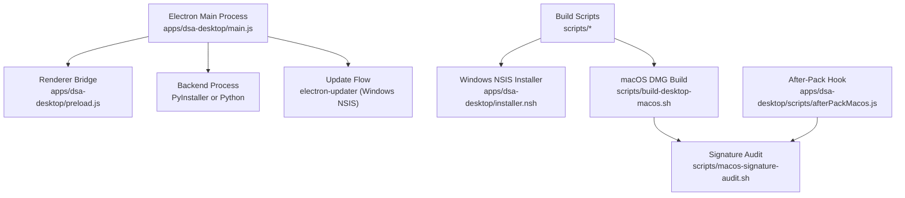
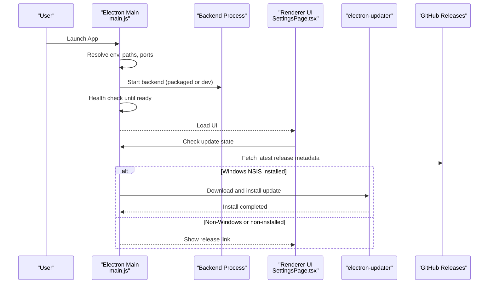
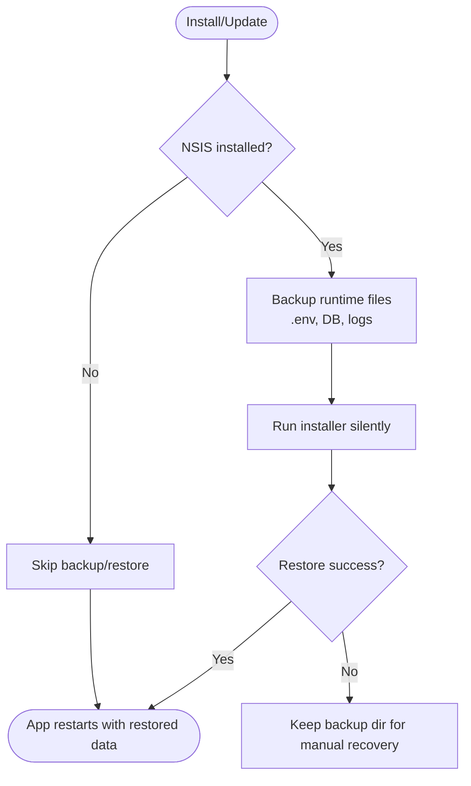
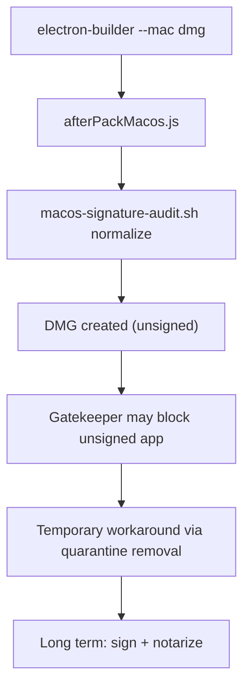
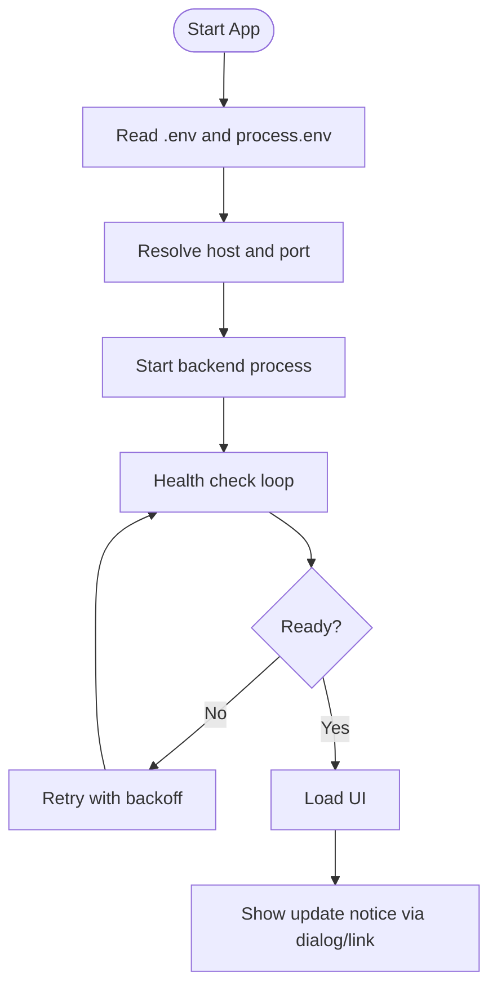
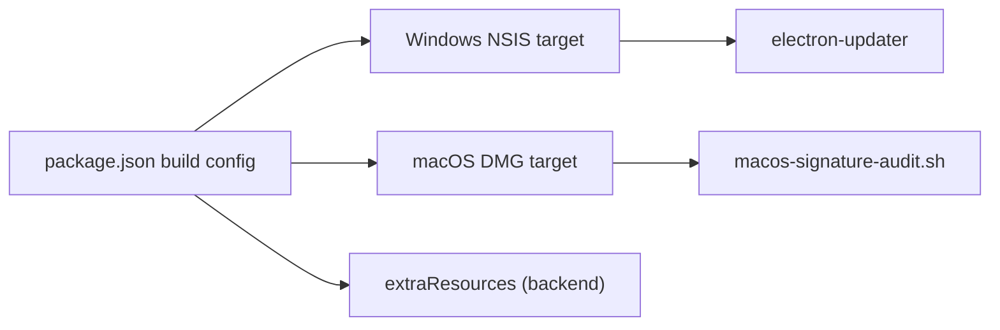

# Platform-Specific Features

<cite>
**Referenced Files in This Document**
- [package.json](file://apps/dsa-desktop/package.json)
- [main.js](file://apps/dsa-desktop/main.js)
- [preload.js](file://apps/dsa-desktop/preload.js)
- [installer.nsh](file://apps/dsa-desktop/installer.nsh)
- [afterPackMacos.js](file://apps/dsa-desktop/scripts/afterPackMacos.js)
- [build-desktop-macos.sh](file://scripts/build-desktop-macos.sh)
- [macos-signature-audit.sh](file://scripts/macos-signature-audit.sh)
- [build-desktop.ps1](file://scripts/build-desktop.ps1)
- [desktop-package.md](file://docs/desktop-package.md)
- [SettingsPage.tsx](file://apps/dsa-web/src/pages/SettingsPage.tsx)
- [main.test.js](file://apps/dsa-desktop/tests/main.test.js)
</cite>

## Table of Contents
1. Introduction
2. Project Structure
3. Core Components
4. Architecture Overview
5. Detailed Component Analysis
6. Dependency Analysis
7. Performance Considerations
8. Troubleshooting Guide
9. Conclusion

## Introduction
This document explains platform-specific features and capabilities for the Desktop Application built with Electron. It covers:
- Windows: NSIS installer customization, update flow, runtime file placement, and compatibility considerations.
- macOS: DMG packaging, signature audit and normalization, code signing prerequisites, notarization guidance, and environment integration.
- Linux: current support status and distribution considerations.
- Cross-platform concerns: file path handling, encoding behavior, backend host/port resolution, and system notification behavior.
It also provides troubleshooting and deployment guidance per operating system.

## Project Structure
The desktop application lives under apps/dsa-desktop and is packaged with electron-builder. Platform targets are configured in package.json, and build scripts orchestrate platform-specific steps. The main process manages backend lifecycle, updates, and IPC bridges to the renderer.

**Diagram sources**
- [package.json:18-61](file://apps/dsa-desktop/package.json#L18-L61)
- [main.js:1169-1249](file://apps/dsa-desktop/main.js#L1169-L1249)
- [installer.nsh:1-120](file://apps/dsa-desktop/installer.nsh#L1-L120)
- [build-desktop-macos.sh:73-176](file://scripts/build-desktop-macos.sh#L73-L176)
- [macos-signature-audit.sh:1-94](file://scripts/macos-signature-audit.sh#L1-L94)
- [afterPackMacos.js:1-26](file://apps/dsa-desktop/scripts/afterPackMacos.js#L1-L26)

**Section sources**
- [package.json:1-67](file://apps/dsa-desktop/package.json#L1-L67)
- [desktop-package.md:42-83](file://docs/desktop-package.md#L42-L83)

## Core Components
- Electron main process: launches the embedded backend, resolves ports and hosts, handles update checks, and exposes IPC channels to the UI.
- Preload bridge: exposes a safe API surface to the renderer for update state, release page navigation, and share image rendering.
- Packaging configuration: defines Windows NSIS target and macOS DMG target; includes extra resources such as the bundled backend.
- Platform build scripts: enforce dependency caching, validate artifacts, and run signature audits on macOS.

Key responsibilities:
- Backend lifecycle management and health probing.
- Update state computation and broadcasting to the UI.
- Runtime file backup/restore around updates (Windows).
- macOS runtime migration from app bundle to user data directory.

**Section sources**
- [main.js:1-800](file://apps/dsa-desktop/main.js#L1-L800)
- [main.js:800-1200](file://apps/dsa-desktop/main.js#L800-L1200)
- [main.js:1200-1600](file://apps/dsa-desktop/main.js#L1200-L1600)
- [preload.js:1-67](file://apps/dsa-desktop/preload.js#L1-L67)
- [package.json:18-61](file://apps/dsa-desktop/package.json#L18-L61)

## Architecture Overview
The desktop app runs an embedded backend process and serves the React UI within Electron. On startup, it selects an available port, starts the backend, waits for health readiness, then loads the UI. Updates are checked against GitHub Releases; on Windows NSIS installs, automatic download and silent install are supported. macOS builds produce unsigned DMGs by default and include signature normalization via after-pack hooks.

**Diagram sources**
- [main.js:1169-1249](file://apps/dsa-desktop/main.js#L1169-L1249)
- [main.js:1466-1587](file://apps/dsa-desktop/main.js#L1466-L1587)
- [preload.js:18-55](file://apps/dsa-desktop/preload.js#L18-L55)
- [SettingsPage.tsx:201-236](file://apps/dsa-web/src/pages/SettingsPage.tsx#L201-L236)

## Detailed Component Analysis

### Windows: NSIS Installer Customization and Update Flow
- Target and artifact naming are defined for NSIS packaging.
- The installer enforces per-user installation and blocks protected directories to avoid runtime write failures.
- During updates, the app backs up runtime files before installing, then restores them if needed.
- Automatic updates rely on electron-updater with GitHub Releases metadata.

**Diagram sources**
- [installer.nsh:1-120](file://apps/dsa-desktop/installer.nsh#L1-L120)
- [main.js:493-609](file://apps/dsa-desktop/main.js#L493-L609)
- [main.js:1583-1600](file://apps/dsa-desktop/main.js#L1583-L1600)

**Section sources**
- [package.json:40-56](file://apps/dsa-desktop/package.json#L40-L56)
- [installer.nsh:1-120](file://apps/dsa-desktop/installer.nsh#L1-L120)
- [main.js:493-609](file://apps/dsa-desktop/main.js#L493-L609)
- [main.js:1457-1587](file://apps/dsa-desktop/main.js#L1457-L1587)
- [desktop-package.md:42-83](file://docs/desktop-package.md#L42-L83)

### macOS: DMG Packaging, Signature Audit, Signing, and Notarization
- Builds produce unsigned DMGs by default; after-pack hook runs a signature audit script to normalize artifacts before DMG creation.
- CI and local scripts verify expected unsigned state and guard against broken signatures.
- Code signing and notarization are not enabled by default; documentation outlines temporary workarounds and long-term requirements.

**Diagram sources**
- [afterPackMacos.js:1-26](file://apps/dsa-desktop/scripts/afterPackMacos.js#L1-L26)
- [macos-signature-audit.sh:1-94](file://scripts/macos-signature-audit.sh#L1-L94)
- [build-desktop-macos.sh:73-176](file://scripts/build-desktop-macos.sh#L73-L176)
- [desktop-package.md:80-105](file://docs/desktop-package.md#L80-L105)

**Section sources**
- [package.json:57-61](file://apps/dsa-desktop/package.json#L57-L61)
- [afterPackMacos.js:1-26](file://apps/dsa-desktop/scripts/afterPackMacos.js#L1-L26)
- [macos-signature-audit.sh:1-94](file://scripts/macos-signature-audit.sh#L1-L94)
- [build-desktop-macos.sh:73-176](file://scripts/build-desktop-macos.sh#L73-L176)
- [desktop-package.md:80-105](file://docs/desktop-package.md#L80-L105)

### Linux Distribution Support and Desktop Integration
- No Linux target is configured in the desktop package configuration; therefore, no Linux installer or AppImage generation is present in this repository.
- For Linux distribution, consider using the web application or containerized deployment documented elsewhere.

[No sources needed since this section summarizes current support status without analyzing specific files]

### Cross-Platform Considerations
- File paths and runtime storage:
  - Windows NSIS installs place runtime files next to the executable; macOS packaged apps migrate runtime files to Electron’s user data directory.
  - The app detects platform and adjusts path handling accordingly.
- Encoding and output decoding:
  - Backend stdout/stderr decoding uses UTF-8 with a fallback to GBK on Windows when replacement characters are detected.
  - Environment variables force UTF-8 mode for the backend process.
- Backend host and port resolution:
  - The app selects an available port in a range and binds to a normalized host; public bind addresses are resolved to localhost for the UI connection.
- System notifications:
  - The desktop app does not implement native OS notification APIs in the analyzed files; update prompts use Electron dialogs and release links.

**Diagram sources**
- [main.js:819-901](file://apps/dsa-desktop/main.js#L819-L901)
- [main.js:940-959](file://apps/dsa-desktop/main.js#L940-L959)
- [main.js:988-1167](file://apps/dsa-desktop/main.js#L988-L1167)
- [main.js:1551-1581](file://apps/dsa-desktop/main.js#L1551-L1581)

**Section sources**
- [main.js:413-418](file://apps/dsa-desktop/main.js#L413-L418)
- [main.js:611-655](file://apps/dsa-desktop/main.js#L611-L655)
- [main.js:819-901](file://apps/dsa-desktop/main.js#L819-L901)
- [main.js:940-959](file://apps/dsa-desktop/main.js#L940-L959)
- [main.js:988-1167](file://apps/dsa-desktop/main.js#L988-L1167)
- [main.js:1551-1581](file://apps/dsa-desktop/main.js#L1551-L1581)

## Dependency Analysis
- electron-builder configures Windows NSIS and macOS DMG targets and includes extra resources for the backend.
- electron-updater is used only for Windows NSIS installations to enable automatic updates.
- macOS build pipeline depends on codesign and related tools for signature auditing.

**Diagram sources**
- [package.json:18-61](file://apps/dsa-desktop/package.json#L18-L61)
- [macos-signature-audit.sh:1-94](file://scripts/macos-signature-audit.sh#L1-L94)

**Section sources**
- [package.json:18-61](file://apps/dsa-desktop/package.json#L18-L61)
- [build-desktop.ps1:1-101](file://scripts/build-desktop.ps1#L1-L101)
- [build-desktop-macos.sh:73-176](file://scripts/build-desktop-macos.sh#L73-L176)

## Performance Considerations
- Port selection avoids blocking by scanning a bounded range and closing sockets promptly.
- Health checks use timeouts and intervals to prevent indefinite waits.
- macOS PATH extension ensures CLI tools are discoverable for backend operations.
- Avoiding system-protected install directories reduces permission-related delays and failures.

[No sources needed since this section provides general guidance]

## Troubleshooting Guide

### Windows
- Installation blocked on protected directories:
  - The installer prevents selecting Program Files or Windows directories to ensure writable runtime locations. Choose a user-writable directory instead.
- Update restore failures:
  - If runtime file restoration fails after an update, a backup directory is retained for manual recovery. Review logs and restore missing files.
- Developer Mode required for builds:
  - Building requires enabling Developer Mode to allow symlink creation for the cache.

**Section sources**
- [installer.nsh:81-119](file://apps/dsa-desktop/installer.nsh#L81-L119)
- [main.js:523-609](file://apps/dsa-desktop/main.js#L523-L609)
- [build-desktop.ps1:1-24](file://scripts/build-desktop.ps1#L1-L24)

### macOS
- Unsigned app blocked by Gatekeeper:
  - Current builds are unsigned; users may need to confirm opening in system settings or remove quarantine attributes for trusted downloads.
- Broken signatures in artifacts:
  - The after-pack hook normalizes artifacts; CI verifies expected unsigned state. Rebuild if signature errors persist.
- Code signing and notarization:
  - To distribute signed and notarized apps, configure Apple Developer identity and integrate signing/notarization into the build pipeline.

**Section sources**
- [desktop-package.md:80-105](file://docs/desktop-package.md#L80-L105)
- [afterPackMacos.js:1-26](file://apps/dsa-desktop/scripts/afterPackMacos.js#L1-L26)
- [macos-signature-audit.sh:1-94](file://scripts/macos-signature-audit.sh#L1-L94)
- [build-desktop-macos.sh:10-40](file://scripts/build-desktop-macos.sh#L10-L40)

### Linux
- No Linux desktop target is configured; use the web application or container deployment.

[No sources needed since this section summarizes current support status]

### Cross-Platform
- Backend never becomes ready:
  - Check logs for port conflicts or backend start errors; ensure the selected port is free and the backend executable exists.
- Encoding issues in logs:
  - On Windows, the main process decodes backend output with UTF-8 and falls back to GBK when replacement characters appear.
- Public bind address exposure:
  - Even if the backend binds to a public address, the UI connects to localhost to avoid accidental exposure.

**Section sources**
- [main.js:988-1167](file://apps/dsa-desktop/main.js#L988-L1167)
- [main.js:940-959](file://apps/dsa-desktop/main.js#L940-L959)
- [main.js:819-839](file://apps/dsa-desktop/main.js#L819-L839)

## Conclusion
The Desktop Application provides robust platform-specific packaging and runtime behaviors:
- Windows: NSIS installer with per-user installs, protected directory protection, and automatic updates backed by electron-updater and GitHub Releases.
- macOS: DMG packaging with signature normalization and CI safeguards; signing and notarization are not enabled by default but can be integrated for distribution.
- Linux: No desktop target is currently configured; web or container deployment is recommended.
Cross-platform logic ensures reliable backend lifecycle, safe URL construction, and consistent encoding handling across systems.

[No sources needed since this section summarizes without analyzing specific files]