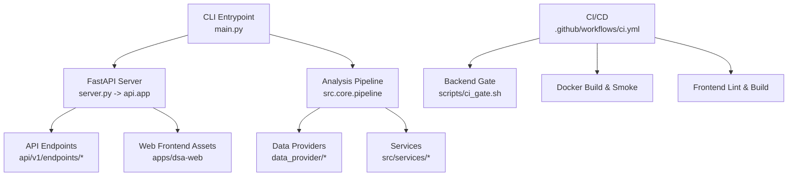
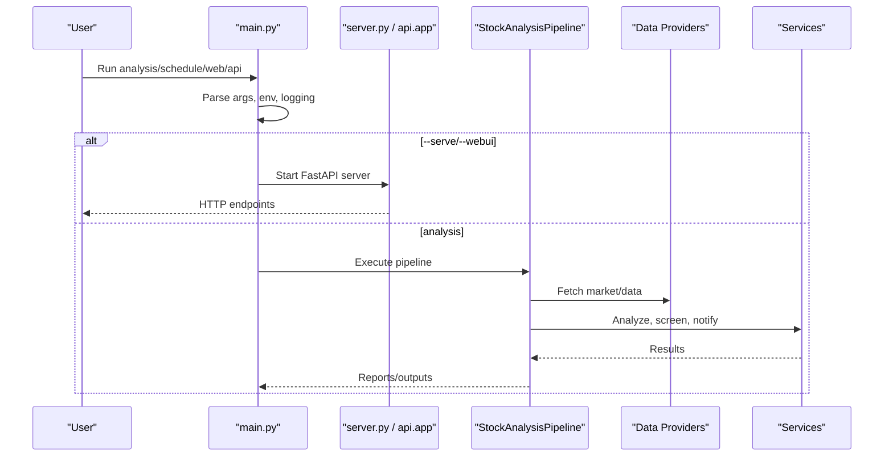
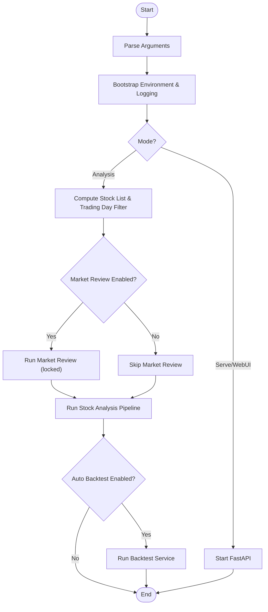
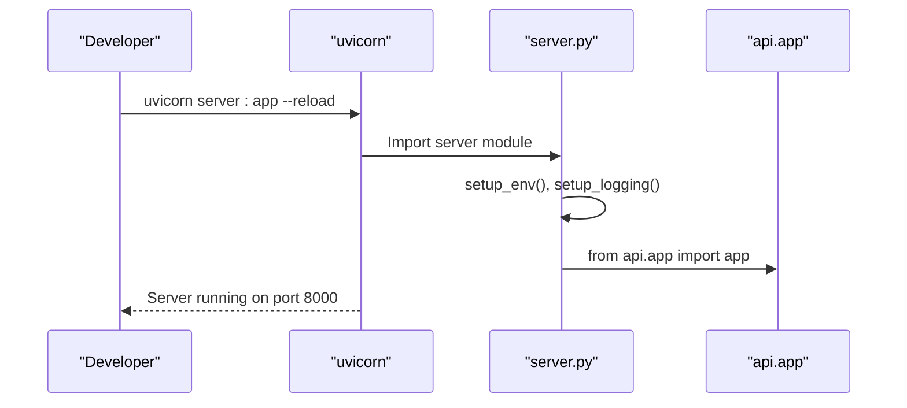
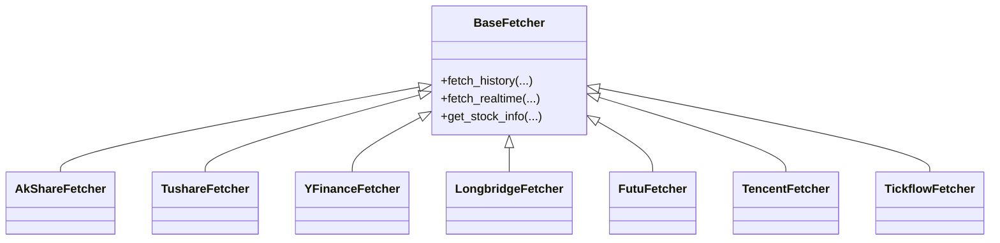
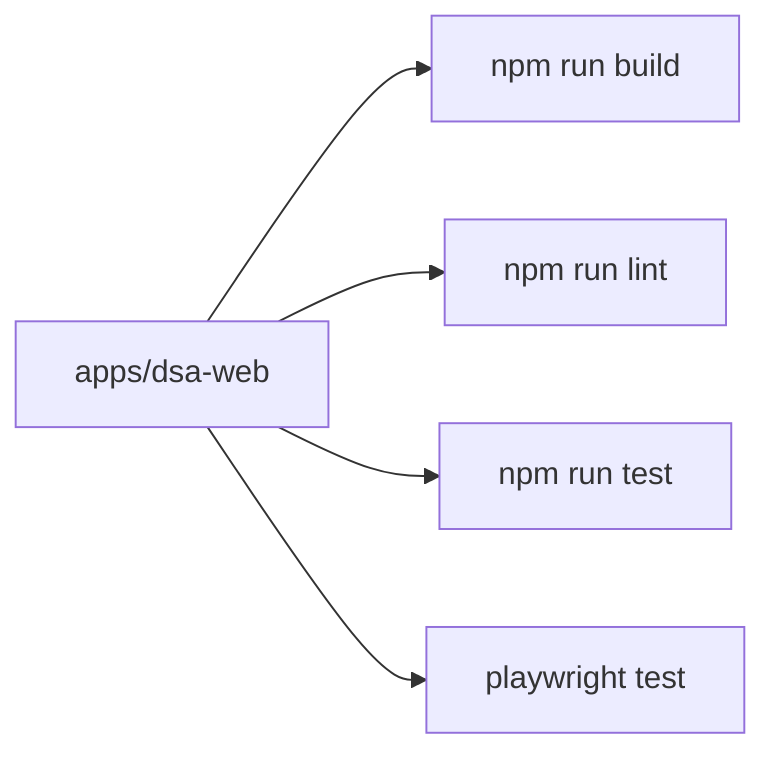
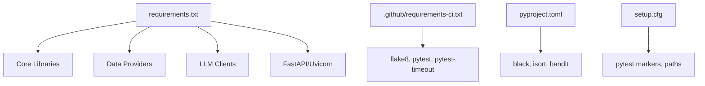

# Development Guide

<cite>
**Referenced Files in This Document**
- [README.md](file://README.md)
- [pyproject.toml](file://pyproject.toml)
- [requirements.txt](file://requirements.txt)
- [main.py](file://main.py)
- [server.py](file://server.py)
- [setup.cfg](file://setup.cfg)
- [.github/requirements-ci.txt](file://.github/requirements-ci.txt)
- [.github/workflows/ci.yml](file://.github/workflows/ci.yml)
- [scripts/ci_gate.sh](file://scripts/ci_gate.sh)
- [tests/conftest.py](file://tests/conftest.py)
- [apps/dsa-web/package.json](file://apps/dsa-web/package.json)
</cite>

## Table of Contents
1. Introduction
2. Project Structure
3. Core Components
4. Architecture Overview
5. Detailed Component Analysis
6. Dependency Analysis
7. Performance Considerations
8. Troubleshooting Guide
9. Conclusion
10. Appendices

## Introduction
This Development Guide explains how to set up a local development environment, follow coding standards, run tests, and extend DailyStockAnalysis with new features such as custom agents or data providers. It also covers the CI pipeline, code quality checks, release procedures, and contribution workflows.

## Project Structure
DailyStockAnalysis is a multi-component system:
- Python backend (FastAPI API, analysis pipeline, agents, data providers, services)
- Web frontend (React/Vite app under apps/dsa-web)
- Desktop app (Electron-based under apps/dsa-desktop)
- CLI entrypoints for analysis and scheduling
- Docker packaging and GitHub Actions CI/CD

**Diagram sources**
- [main.py:272-443](file://main.py#L272-L443)
- [server.py:21-55](file://server.py#L21-L55)
- [.github/workflows/ci.yml:79-130](file://.github/workflows/ci.yml#L79-L130)
- [scripts/ci_gate.sh:66-72](file://scripts/ci_gate.sh#L66-L72)

**Section sources**
- [README.md:63-179](file://README.md#L63-L179)
- [server.py:21-55](file://server.py#L21-L55)
- [main.py:272-443](file://main.py#L272-L443)

## Core Components
- CLI orchestration and scheduling: main.py parses arguments, configures environment, filters trading days, runs market review and stock analysis, and supports web/API modes.
- FastAPI server: server.py initializes logging and exposes the application instance for uvicorn.
- Configuration and dependencies: requirements.txt pins core libraries; pyproject.toml defines formatting and linting preferences; setup.cfg configures pytest markers and flake8 rules.
- Testing harness: tests/conftest.py patches test clients and async behavior for stable test execution.

Key responsibilities:
- Environment bootstrap and proxy handling
- Argument parsing for analysis modes, scheduling, and web/API
- Trading day filtering and market review gating
- Backtest automation hooks
- Logging initialization and fallbacks

**Section sources**
- [main.py:272-443](file://main.py#L272-L443)
- [main.py:446-800](file://main.py#L446-L800)
- [server.py:21-55](file://server.py#L21-L55)
- [requirements.txt:1-75](file://requirements.txt#L1-L75)
- [pyproject.toml:1-29](file://pyproject.toml#L1-L29)
- [setup.cfg:22-43](file://setup.cfg#L22-L43)
- [tests/conftest.py:144-252](file://tests/conftest.py#L144-L252)

## Architecture Overview
The runtime architecture separates concerns across CLI, API, services, and data providers. The CLI drives batch analysis and scheduling; the API serves interactive requests; services encapsulate business logic; data providers abstract market data sources.

**Diagram sources**
- [main.py:272-443](file://main.py#L272-L443)
- [server.py:21-55](file://server.py#L21-L55)

## Detailed Component Analysis

### CLI Orchestration and Modes
- Parses flags for debug, dry-run, stocks, portfolio, notify, schedule, market-review, webui, serve, backtest, and more.
- Computes trading-day filters and effective regions.
- Integrates market review locking and reuse of context.
- Supports auto-backtest after analysis runs.

**Diagram sources**
- [main.py:272-443](file://main.py#L272-L443)
- [main.py:446-800](file://main.py#L446-L800)

**Section sources**
- [main.py:272-443](file://main.py#L272-L443)
- [main.py:446-800](file://main.py#L446-L800)

### FastAPI Server Entry
- Initializes environment and logging.
- Imports and exposes the FastAPI app for uvicorn.
- Supports development reload mode.

**Diagram sources**
- [server.py:21-55](file://server.py#L21-L55)

**Section sources**
- [server.py:21-55](file://server.py#L21-L55)

### Data Provider Abstraction
- Multiple fetchers implement a common interface for different markets and sources.
- Fallback priority is defined in dependencies and resolved at runtime by services/pipeline.

**Diagram sources**
- [requirements.txt:12-25](file://requirements.txt#L12-L25)

**Section sources**
- [requirements.txt:12-25](file://requirements.txt#L12-L25)

### Agent and Strategy Extension Points
- Agents live under src/agent with base classes and specialized implementations.
- Skills and strategies are modular and can be extended via configuration and registry patterns.
- Tools surface capabilities like analysis, backtesting, and market data access.

Guidelines for adding a new agent:
- Implement a subclass of the base agent and register it through the agent factory/registry.
- Provide tool integrations if the agent needs to call data or analysis tools.
- Add tests covering agent behavior and tool interactions.

Guidelines for adding a new strategy:
- Create a YAML strategy file under strategies or services/screening strategies directory.
- Wire it into the screening pipeline and add unit/integration tests.

**Section sources**
- [main.py:272-443](file://main.py#L272-L443)

### Web Frontend and E2E Tests
- Frontend project under apps/dsa-web uses Vite, TypeScript, React, and Tailwind.
- Unit tests via Vitest; E2E tests via Playwright.
- Scripts include dev, build, lint, test, and preview.

**Diagram sources**
- [apps/dsa-web/package.json:10-16](file://apps/dsa-web/package.json#L10-L16)

**Section sources**
- [apps/dsa-web/package.json:1-60](file://apps/dsa-web/package.json#L1-L60)

## Dependency Analysis
- Python dependencies are pinned in requirements.txt with explicit versions and conditional installs for platform compatibility.
- CI dependencies add flake8, pytest, and pytest-timeout.
- Formatting and linting configured in pyproject.toml and setup.cfg.

**Diagram sources**
- [requirements.txt:1-75](file://requirements.txt#L1-L75)
- [.github/requirements-ci.txt:1-8](file://.github/requirements-ci.txt#L1-L8)
- [pyproject.toml:1-29](file://pyproject.toml#L1-L29)
- [setup.cfg:1-21](file://setup.cfg#L1-L21)

**Section sources**
- [requirements.txt:1-75](file://requirements.txt#L1-L75)
- [.github/requirements-ci.txt:1-8](file://.github/requirements-ci.txt#L1-L8)
- [pyproject.toml:1-29](file://pyproject.toml#L1-L29)
- [setup.cfg:1-21](file://setup.cfg#L1-L21)

## Performance Considerations
- Use trading-day filtering to avoid unnecessary work on non-trading days.
- Prefer cached or preloaded market context where available to reduce redundant network calls.
- Leverage retry/backoff libraries for resilient external API calls.
- Keep data provider fallback chains efficient; prioritize faster/more reliable sources first.
- For large datasets, consider batching and pagination in data provider calls.

[No sources needed since this section provides general guidance]

## Troubleshooting Guide
Common issues and resolutions:
- Environment not loaded: Ensure .env exists and variables are set; use main.py’s environment bootstrap or server.py’s setup_env().
- Proxy issues: Set USE_PROXY, PROXY_HOST, PROXY_PORT; verify network settings.
- Logging failures: If file logging fails, the system falls back to console logs; check permissions for log directories.
- Test hangs: CI uses timeouts and thread-safe helpers; locally ensure you run tests with pytest-timeout enabled.
- API errors: Check CORS, authentication, and request payloads against schemas in api/v1/schemas.

Relevant utilities:
- ci_gate.sh enforces syntax, critical lint checks, deterministic scripts, and offline tests with timeouts.
- tests/conftest.py stabilizes async/threading behavior for tests.

**Section sources**
- [main.py:149-208](file://main.py#L149-L208)
- [scripts/ci_gate.sh:24-64](file://scripts/ci_gate.sh#L24-L64)
- [tests/conftest.py:144-252](file://tests/conftest.py#L144-L252)

## Conclusion
DailyStockAnalysis provides a robust, extensible platform for automated stock analysis, reporting, and interaction via CLI, API, and Web UI. By following the development workflow, coding standards, and testing procedures outlined here, contributors can confidently add features, improve reliability, and maintain high code quality.

[No sources needed since this section summarizes without analyzing specific files]

## Appendices

### Local Development Setup
- Clone the repository and create a virtual environment.
- Install Python dependencies from requirements.txt.
- Copy .env.example to .env and configure required secrets.
- Run analysis via CLI or start the Web/API server.

Commands:
- python main.py --debug
- python main.py --dry-run
- python main.py --schedule
- python main.py --webui
- python main.py --serve-only

**Section sources**
- [README.md:154-179](file://README.md#L154-L179)
- [main.py:272-443](file://main.py#L272-L443)

### Coding Standards
- Python formatting: black line length 120, target versions 3.10–3.12.
- Import sorting: isort profile black, line length 120.
- Security scanning: bandit excludes tests and allows assert in tests.
- Flake8: max line length 120, ignores conflicting rules with black.
- Pytest: markers unit, integration, network; testpaths and naming conventions.

**Section sources**
- [pyproject.toml:1-29](file://pyproject.toml#L1-L29)
- [setup.cfg:1-21](file://setup.cfg#L1-L21)
- [setup.cfg:22-43](file://setup.cfg#L22-L43)

### Testing Procedures
- Offline unit and integration tests: run pytest without network marker.
- Network tests: mark with @pytest.mark.network; run selectively.
- Sharded CI tests: use PYTEST_SPLITS and PYTEST_GROUP for parallelization.
- Timeouts: pytest-timeout enforced in CI gate script.

Local commands:
- pytest -m "not network"
- pytest -m "network"
- ./scripts/ci_gate.sh offline-tests

**Section sources**
- [setup.cfg:22-43](file://setup.cfg#L22-L43)
- [scripts/ci_gate.sh:24-64](file://scripts/ci_gate.sh#L24-L64)
- [.github/workflows/ci.yml:125-130](file://.github/workflows/ci.yml#L125-L130)

### Adding New Features
- New data provider:
  - Implement a fetcher adhering to the base interface.
  - Add dependency in requirements.txt if needed.
  - Register routing in services/pipeline and add tests.
- New agent:
  - Create an agent class extending the base agent.
  - Integrate tools and skills as needed.
  - Add unit and integration tests.
- New screening strategy:
  - Add YAML strategy file under services/screening strategies.
  - Wire into the screening pipeline and test selection/ranking.

**Section sources**
- [requirements.txt:12-25](file://requirements.txt#L12-L25)
- [main.py:272-443](file://main.py#L272-L443)

### Continuous Integration and Code Quality
- CI triggers on pull requests to main.
- Change detection gates backend, docker, frontend jobs.
- Backend gate includes syntax, flake8, deterministic checks, and offline tests with sharding.
- Docker build and smoke tests validate imports.
- Frontend gate runs lint and build when frontend code changes.

Local checks:
- pip install -r requirements.txt
- pip install flake8 pytest
- ./scripts/ci_gate.sh all

**Section sources**
- [.github/workflows/ci.yml:1-268](file://.github/workflows/ci.yml#L1-L268)
- [scripts/ci_gate.sh:66-72](file://scripts/ci_gate.sh#L66-L72)

### Release Procedures
- Automated releases are orchestrated via GitHub Actions workflows.
- Desktop packaging builds are gated by change detection and run on Windows/macOS runners.
- Docker images are built and smoke-tested in CI.

**Section sources**
- [.github/workflows/ci.yml:155-243](file://.github/workflows/ci.yml#L155-L243)

### Documentation and Changelog Maintenance
- Update relevant docs when changing behavior or APIs.
- Maintain CHANGELOG.md and other contract docs consumed by tests.
- Follow Conventional Commits for clear history and automated changelog generation.

**Section sources**
- [README.md:63-179](file://README.md#L63-L179)
- [.github/workflows/ci.yml:29-43](file://.github/workflows/ci.yml#L29-L43)

### Community Contribution Process
- Fork the repo, create feature branches, and open pull requests.
- Use issue templates for bugs and feature requests.
- Adhere to commit conventions and code standards.
- Run local checks before pushing changes.

**Section sources**
- [README.md:63-179](file://README.md#L63-L179)