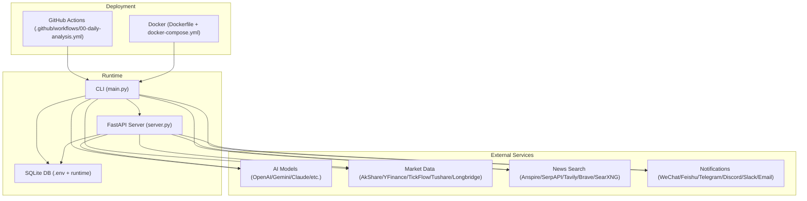
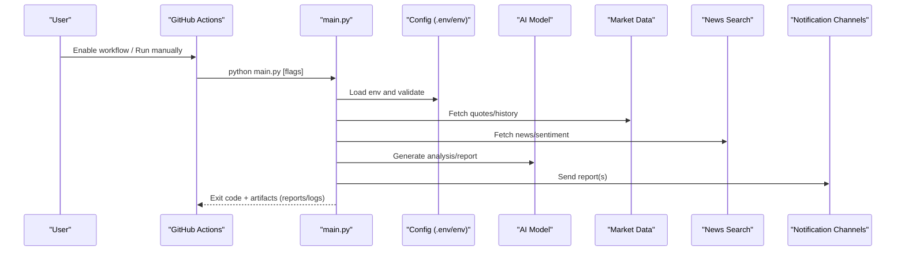
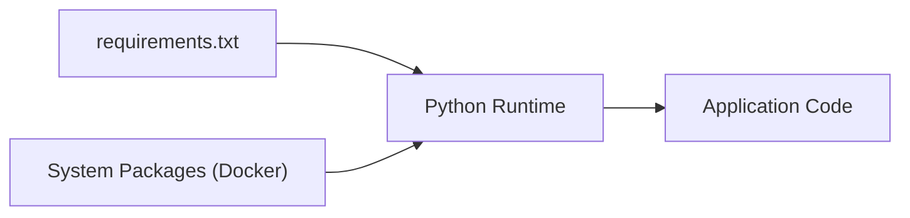

# Getting Started

<cite>
**Referenced Files in This Document**
- [README.md](file://README.md)
- [requirements.txt](file://requirements.txt)
- [main.py](file://main.py)
- [server.py](file://server.py)
- [docker/Dockerfile](file://docker/Dockerfile)
- [docker/docker-compose.yml](file://docker/docker-compose.yml)
- [.github/workflows/00-daily-analysis.yml](file://.github/workflows/00-daily-analysis.yml)
- [src/config.py](file://src/config.py)
- [src/notification.py](file://src/notification.py)
- [docs/full-guide.md](file://docs/full-guide.md)
- [docs/LLM_CONFIG_GUIDE.md](file://docs/LLM_CONFIG_GUIDE.md)
</cite>

## Table of Contents
1. [Introduction](#introduction)
2. [Project Structure](#project-structure)
3. [Core Components](#core-components)
4. [Architecture Overview](#architecture-overview)
5. [Detailed Component Analysis](#detailed-component-analysis)
6. [Dependency Analysis](#dependency-analysis)
7. [Performance Considerations](#performance-considerations)
8. [Troubleshooting Guide](#troubleshooting-guide)
9. [Conclusion](#conclusion)
10. [Appendices](#appendices)

## Introduction
This guide helps you get DailyStockAnalysis running quickly and reliably. You will choose an installation method, configure AI models and notifications, set your watchlist, and run your first analysis. The recommended path is GitHub Actions for zero-cost, serverless scheduling. Alternatives include local setup with pip or Docker deployment.

## Project Structure
DailyStockAnalysis provides:
- A CLI and scheduler to run daily stock analysis and market reviews
- A FastAPI backend and Web UI for interactive use
- Docker images and compose files for containerized deployments
- GitHub Actions workflows for automated runs
- Extensible notification channels and data sources

**Diagram sources**
- [.github/workflows/00-daily-analysis.yml:1-565](file://.github/workflows/00-daily-analysis.yml#L1-L565)
- [docker/Dockerfile:1-106](file://docker/Dockerfile#L1-L106)
- [docker/docker-compose.yml:1-73](file://docker/docker-compose.yml#L1-L73)
- [main.py:1-800](file://main.py#L1-L800)
- [server.py:1-55](file://server.py#L1-L55)

**Section sources**
- [README.md:63-179](file://README.md#L63-L179)
- [docs/full-guide.md:1-200](file://docs/full-guide.md#L1-L200)

## Core Components
- CLI and scheduler: main entry point, argument parsing, trading-day checks, pipeline orchestration, and optional web/API modes.
- FastAPI server: exposes REST endpoints and serves the Web UI when enabled.
- Configuration: centralized environment loading and validation for AI, data sources, notifications, and runtime behavior.
- Notifications: multi-channel delivery with routing, deduplication, quiet hours, and severity controls.
- Data providers: pluggable market data and news search backends with fallbacks.

Key capabilities exposed via CLI flags include dry-run, single-stock notify, schedule mode, market review only, and serving the API/Web UI.

**Section sources**
- [main.py:272-443](file://main.py#L272-L443)
- [main.py:446-800](file://main.py#L446-L800)
- [server.py:1-55](file://server.py#L1-L55)
- [src/config.py:226-400](file://src/config.py#L226-L400)
- [src/notification.py:185-200](file://src/notification.py#L185-L200)

## Architecture Overview
The system can run in three primary modes:
- GitHub Actions scheduled workflow that installs dependencies, injects secrets as environment variables, and executes the CLI.
- Local execution using Python directly.
- Containerized execution via Docker or Docker Compose.

**Diagram sources**
- [.github/workflows/00-daily-analysis.yml:40-565](file://.github/workflows/00-daily-analysis.yml#L40-L565)
- [main.py:149-220](file://main.py#L149-L220)
- [src/config.py:226-400](file://src/config.py#L226-L400)
- [src/notification.py:185-200](file://src/notification.py#L185-L200)

## Detailed Component Analysis

### Installation Methods

#### Recommended: GitHub Actions
- Fork the repository and enable Actions.
- Add required Secrets/Variables under Settings → Secrets and variables → Actions.
- Minimum required:
  - One AI model key (e.g., ANSPIRE_API_KEYS, AIHUBMIX_KEY, GEMINI_API_KEY, OPENAI_API_KEY, or ANTHROPIC_API_KEY).
  - STOCK_LIST with at least one ticker.
  - Optional: a notification channel (e.g., WECHAT_WEBHOOK_URL, TELEGRAM_BOT_TOKEN, EMAIL_*).
- Trigger the workflow manually or wait for the scheduled run.

What happens:
- The workflow installs dependencies from requirements.txt.
- It sets environment variables from Secrets/Variables.
- It runs the CLI with optional flags based on inputs.
- It uploads reports and logs as artifacts.

**Section sources**
- [README.md:63-150](file://README.md#L63-L150)
- [.github/workflows/00-daily-analysis.yml:40-565](file://.github/workflows/00-daily-analysis.yml#L40-L565)
- [requirements.txt:1-75](file://requirements.txt#L1-L75)

#### Local Setup with pip
- Clone the repo and install dependencies.
- Create a .env file and set keys for AI, data sources, and notifications.
- Run the CLI to analyze stocks or start the Web UI/API.

Useful commands:
- Analyze stocks
- Dry-run to fetch data without AI
- Schedule mode for periodic runs
- Serve-only to run the API/Web UI

**Section sources**
- [README.md:152-179](file://README.md#L152-L179)
- [main.py:272-443](file://main.py#L272-L443)

#### Docker Deployment
- Use the provided Dockerfile and docker-compose.yml.
- Mount volumes for data, logs, and reports.
- Pass environment variables via .env or compose environment.
- Choose analyzer (scheduled) or server (API/Web UI) services.

Health check targets the FastAPI health endpoint.

**Section sources**
- [docker/Dockerfile:1-106](file://docker/Dockerfile#L1-L106)
- [docker/docker-compose.yml:1-73](file://docker/docker-compose.yml#L1-L73)

### Environment Configuration

#### AI Models
- Supported providers include OpenAI-compatible, Gemini, Anthropic Claude, DeepSeek, Anspire, AIHubMix, and more.
- Configure via environment variables or LiteLLM YAML configuration.
- For simple setups, set a provider key and model; for advanced routing, define channels and fallbacks.

Common variables:
- Provider-specific keys (e.g., GEMINI_API_KEY, ANTHROPIC_API_KEY, OPENAI_API_KEY, ANSPIRE_API_KEYS, AIHUBMIX_KEY)
- LiteLLM settings (e.g., LITELLM_MODEL, LITELLM_CONFIG, LITELLM_CONFIG_YAML)
- Generation backend options (e.g., GENERATION_BACKEND, GENERATION_FALLBACK_BACKEND)

**Section sources**
- [docs/LLM_CONFIG_GUIDE.md:102-163](file://docs/LLM_CONFIG_GUIDE.md#L102-L163)
- [docs/full-guide.md:56-68](file://docs/full-guide.md#L56-L68)
- [.github/workflows/00-daily-analysis.yml:64-269](file://.github/workflows/00-daily-analysis.yml#L64-L269)

#### Notification Channels
- Supported channels include WeChat, Feishu, DingTalk, Telegram, Discord, Slack, Email, Pushover, ntfy, Gotify, PushPlus, ServerChan3, and custom webhooks.
- Configure per channel; multiple channels can be active simultaneously.
- Control routing, deduplication, cooldown, quiet hours, and minimum severity.

Common variables:
- Channel credentials (e.g., WECHAT_WEBHOOK_URL, FEISHU_WEBHOOK_URL, TELEGRAM_BOT_TOKEN, EMAIL_SENDER, SLACK_BOT_TOKEN)
- Routing and noise control (e.g., NOTIFICATION_REPORT_CHANNELS, NOTIFICATION_DEDUP_TTL_SECONDS, NOTIFICATION_QUIET_HOURS)

**Section sources**
- [docs/full-guide.md:70-147](file://docs/full-guide.md#L70-L147)
- [src/notification.py:185-200](file://src/notification.py#L185-L200)
- [.github/workflows/00-daily-analysis.yml:313-396](file://.github/workflows/00-daily-analysis.yml#L313-L396)

#### Market Data Sources
- Free sources (AkShare, Baostock, YFinance) work out of the box; stability varies.
- Token-based sources improve reliability (TickFlow, Tushare, Longbridge).
- Real-time source priority can be tuned via environment variables.

Common variables:
- TUSHARE_TOKEN, TICKFLOW_API_KEY, LONGBRIDGE_*
- REALTIME_SOURCE_PRIORITY

**Section sources**
- [README.md:52-62](file://README.md#L52-L62)
- [docs/full-guide.md:168-191](file://docs/full-guide.md#L168-L191)
- [.github/workflows/00-daily-analysis.yml:271-296](file://.github/workflows/00-daily-analysis.yml#L271-L296)

### Quickest Path to Success: GitHub Actions
Follow these steps:
1. Fork the repository.
2. Add at least one AI model key and STOCK_LIST.
3. Optionally add a notification channel.
4. Enable Actions and run the workflow manually.
5. Check artifacts for reports and logs.

Expected outcome:
- On weekdays at the configured time (or on manual trigger), the workflow runs analysis and sends reports if configured.

**Section sources**
- [README.md:63-150](file://README.md#L63-L150)
- [.github/workflows/00-daily-analysis.yml:40-565](file://.github/workflows/00-daily-analysis.yml#L40-L565)

### Basic Usage Examples

#### Analyze Stocks Locally
- Run the CLI with your desired flags.
- Use --dry-run to test data fetching without AI.
- Use --stocks to specify tickers.
- Use --market-review to run market overview only.

#### Configure Watchlists
- Set STOCK_LIST in .env or via environment variables.
- In GitHub Actions, set STOCK_LIST_CONFIG or STOCK_LIST in Secrets/Variables.
- The CLI supports comma-separated lists and normalizes separators.

#### Receive Reports
- Configure at least one notification channel.
- Use NOTIFICATION_REPORT_CHANNELS to limit which channels receive reports.
- Use SINGLE_STOCK_NOTIFY to push after each stock or aggregate at the end.

**Section sources**
- [README.md:152-179](file://README.md#L152-L179)
- [main.py:272-443](file://main.py#L272-L443)
- [docs/full-guide.md:113-147](file://docs/full-guide.md#L113-L147)

## Dependency Analysis
- Python dependencies are declared in requirements.txt and include core libraries, data providers, LLM clients, search engines, and web frameworks.
- Docker builds install system packages (e.g., wkhtmltopdf) and Python dependencies, then copy application code and static assets.
- GitHub Actions installs requirements.txt and runs the CLI with injected environment variables.

**Diagram sources**
- [requirements.txt:1-75](file://requirements.txt#L1-L75)
- [docker/Dockerfile:20-52](file://docker/Dockerfile#L20-L52)

**Section sources**
- [requirements.txt:1-75](file://requirements.txt#L1-L75)
- [docker/Dockerfile:20-106](file://docker/Dockerfile#L20-L106)

## Performance Considerations
- Use token-based data sources (TickFlow, Tushare, Longbridge) for stable and faster results.
- Tune concurrency and timeouts for LLM calls via generation backend settings.
- Limit report size and language to reduce processing overhead.
- In Docker, allocate sufficient memory for full analysis; consider reducing workers for constrained environments.

[No sources needed since this section provides general guidance]

## Troubleshooting Guide

Common issues and resolutions:
- Missing AI model key: Ensure at least one provider key is set; verify model availability and base URL if using OpenAI-compatible endpoints.
- Empty watchlist: Confirm STOCK_LIST is set; the CLI will skip analysis if empty and market review is disabled.
- Notification failures: Validate webhook URLs, tokens, and channel-specific fields; use --check-notify to diagnose.
- Data source errors: Prefer token-based sources; adjust REALTIME_SOURCE_PRIORITY; check rate limits and network access.
- Docker permissions: Ensure mounted directories are writable by the non-root user; the entrypoint repairs ownership where possible.

Diagnostic tips:
- Use --debug for verbose logs.
- Use --dry-run to isolate data fetching vs. AI generation.
- Inspect uploaded artifacts (reports and logs) in GitHub Actions.
- Review environment variable mapping in the workflow to ensure all required keys are present.

**Section sources**
- [main.py:173-209](file://main.py#L173-L209)
- [main.py:719-800](file://main.py#L719-L800)
- [docs/full-guide.md:70-147](file://docs/full-guide.md#L70-L147)
- [.github/workflows/00-daily-analysis.yml:428-565](file://.github/workflows/00-daily-analysis.yml#L428-L565)

## Conclusion
You can get DailyStockAnalysis running in minutes via GitHub Actions with minimal configuration, or locally/Docker for full control. Start with one AI model and one notification channel, add your watchlist, and iterate. Use the Web UI and API for interactive exploration, and rely on the extensive configuration options to tailor performance, reliability, and reporting to your needs.

[No sources needed since this section summarizes without analyzing specific files]

## Appendices

### Quick Reference: Essential Variables
- AI: ANSPIRE_API_KEYS, AIHUBMIX_KEY, GEMINI_API_KEY, OPENAI_API_KEY, ANTHROPIC_API_KEY, LITELLM_MODEL
- Data: TUSHARE_TOKEN, TICKFLOW_API_KEY, LONGBRIDGE_*
- News: ANSPIRE_API_KEYS, SERPAPI_API_KEYS, TAVILY_API_KEYS, BRAVE_API_KEYS, SEARXNG_BASE_URLS
- Notifications: WECHAT_WEBHOOK_URL, FEISHU_WEBHOOK_URL, TELEGRAM_BOT_TOKEN, DISCORD_WEBHOOK_URL, SLACK_BOT_TOKEN, EMAIL_*
- Runtime: STOCK_LIST, REPORT_TYPE, REPORT_LANGUAGE, SINGLE_STOCK_NOTIFY, MAX_WORKERS

**Section sources**
- [docs/full-guide.md:56-191](file://docs/full-guide.md#L56-L191)
- [.github/workflows/00-daily-analysis.yml:64-396](file://.github/workflows/00-daily-analysis.yml#L64-L396)