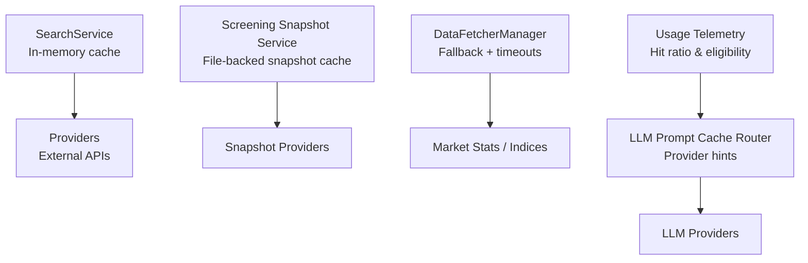
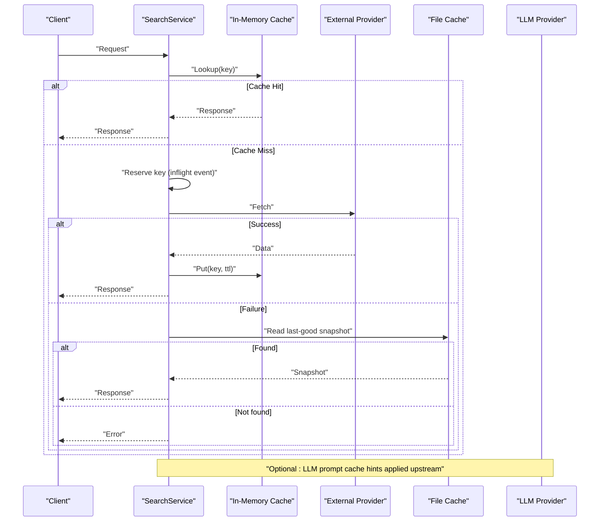
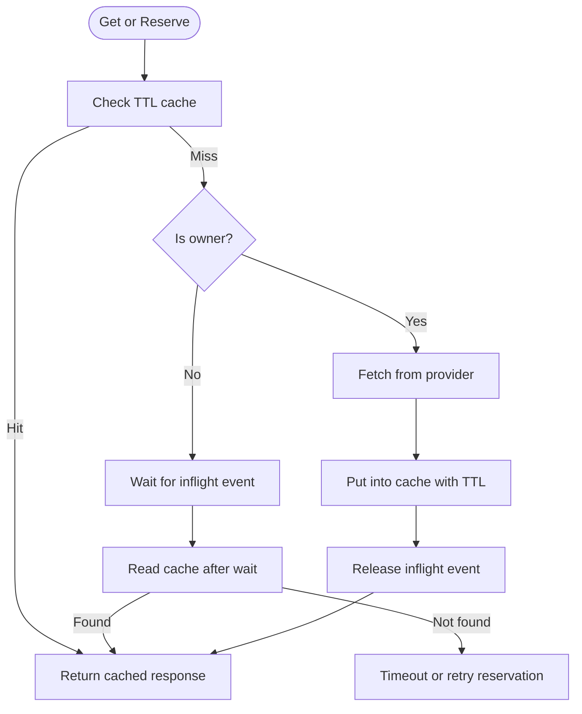
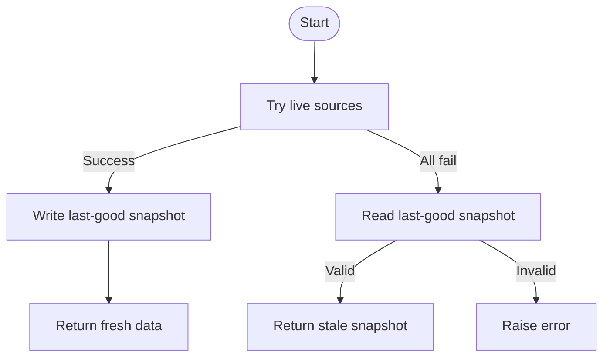
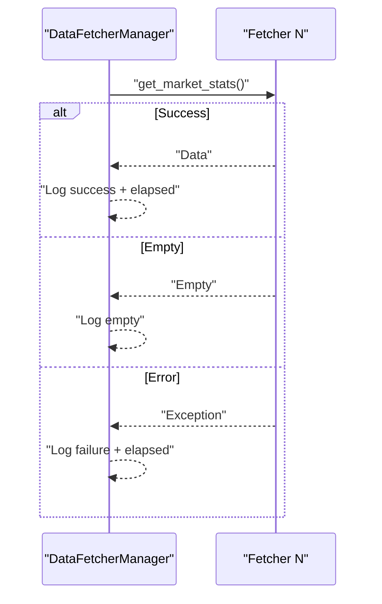
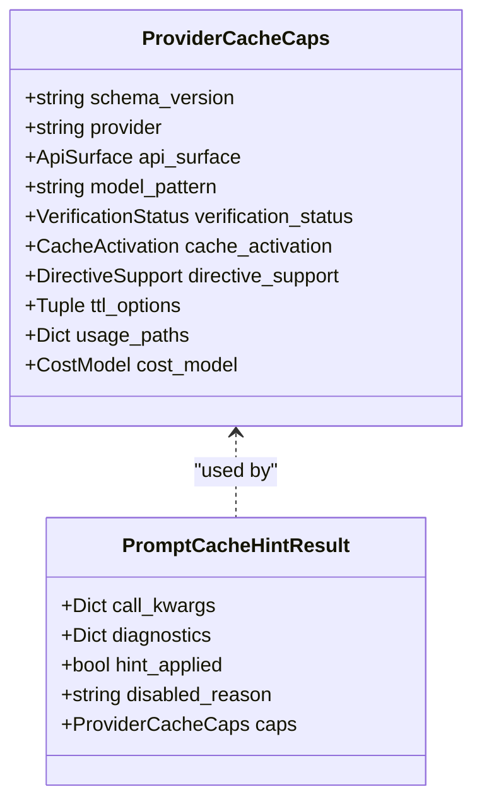
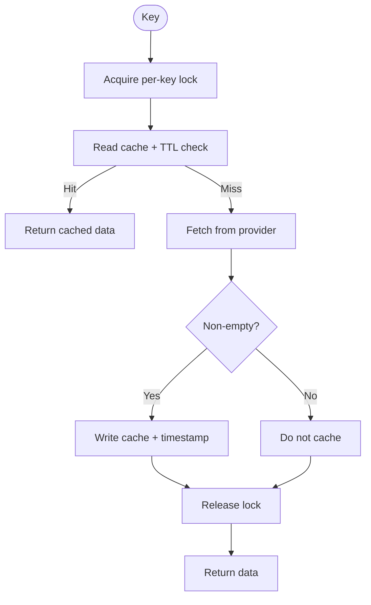
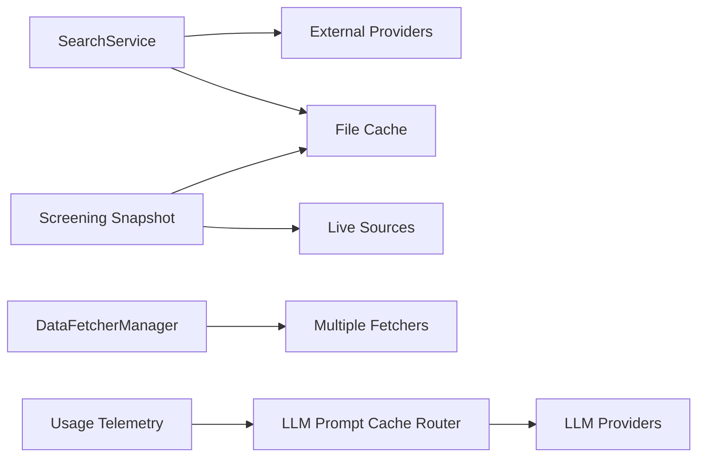

# Caching Strategies & Performance

<cite>
**Referenced Files in This Document**
- [src/search_service.py](file://src/search_service.py)
- [data_provider/base.py](file://data_provider/base.py)
- [src/services/screening/snapshot.py](file://src/services/screening/snapshot.py)
- [data_provider/tw_institutional_fetcher.py](file://data_provider/tw_institutional_fetcher.py)
- [src/llm/provider_cache.py](file://src/llm/provider_cache.py)
- [src/llm/usage.py](file://src/llm/usage.py)
- [src/config.py](file://src/config.py)
- [src/storage.py](file://src/storage.py)
- [tests/test_search_service_concurrency.py](file://tests/test_search_service_concurrency.py)
- [tests/test_stock_index_loader.py](file://tests/test_stock_index_loader.py)
</cite>

## Table of Contents
1. [Introduction](#introduction)
2. [Project Structure](#project-structure)
3. [Core Components](#core-components)
4. [Architecture Overview](#architecture-overview)
5. [Detailed Component Analysis](#detailed-component-analysis)
6. [Dependency Analysis](#dependency-analysis)
7. [Performance Considerations](#performance-considerations)
8. [Troubleshooting Guide](#troubleshooting-guide)
9. [Conclusion](#conclusion)
10. [Appendices](#appendices)

## Introduction
This document explains the multi-level caching strategies used to optimize data retrieval and reduce API calls across market data providers. It covers in-memory caches, file-based persistence, provider-specific prompt caching, cache invalidation policies, TTL management, cache warming, concurrent access controls, configuration options, monitoring hit rates, and production memory management.

## Project Structure
Caching is implemented at multiple layers:
- In-process in-memory caches with TTL and size limits for search results and snapshots
- File-based persistence for last-good snapshots and stock index metadata
- Provider-side prompt caching via LLM routing hints and usage telemetry
- Data provider fallbacks and circuit-breaking to avoid repeated failures

**Diagram sources**
- [src/search_service.py:2674-2781](file://src/search_service.py#L2674-L2781)
- [src/services/screening/snapshot.py:65-135](file://src/services/screening/snapshot.py#L65-L135)
- [data_provider/base.py:3007-3059](file://data_provider/base.py#L3007-L3059)
- [src/llm/provider_cache.py:509-583](file://src/llm/provider_cache.py#L509-L583)
- [src/llm/usage.py:1105-1132](file://src/llm/usage.py#L1105-L1132)

**Section sources**
- [src/search_service.py:2674-2781](file://src/search_service.py#L2674-L2781)
- [src/services/screening/snapshot.py:65-135](file://src/services/screening/snapshot.py#L65-L135)
- [data_provider/base.py:3007-3059](file://data_provider/base.py#L3007-L3059)
- [src/llm/provider_cache.py:509-583](file://src/llm/provider_cache.py#L509-L583)
- [src/llm/usage.py:1105-1132](file://src/llm/usage.py#L1105-L1132)

## Core Components
- SearchService in-memory cache:
  - Keyed by query parameters with TTL expiration
  - Concurrency-safe read/write using a lock
  - Request coalescing via inflight events to prevent duplicate work
  - Hard cap on cache size with eviction strategy
- Screening snapshot service:
  - Tries configured live sources; falls back to last-good snapshot file
  - Validates required columns and source health
  - Persists successful responses with metadata (source priority, freshness)
- DataFetcherManager:
  - Iterates fetchers with timeouts and logs per-provider performance
  - Skips specific providers when necessary and aggregates stats
- LLM prompt cache router:
  - Applies provider-specific cache hints (keys, retention, block control)
  - Normalizes diagnostics and filters telemetry
- Usage telemetry:
  - Computes cache observation categories and eligibility
  - Detects invalid or impossible token counts

**Section sources**
- [src/search_service.py:2674-2781](file://src/search_service.py#L2674-L2781)
- [src/services/screening/snapshot.py:65-135](file://src/services/screening/snapshot.py#L65-L135)
- [data_provider/base.py:3007-3059](file://data_provider/base.py#L3007-L3059)
- [src/llm/provider_cache.py:509-583](file://src/llm/provider_cache.py#L509-L583)
- [src/llm/usage.py:1105-1132](file://src/llm/usage.py#L1105-L1132)

## Architecture Overview
The system combines several caching layers to minimize external calls and improve responsiveness:

**Diagram sources**
- [src/search_service.py:2694-2781](file://src/search_service.py#L2694-L2781)
- [src/services/screening/snapshot.py:65-135](file://src/services/screening/snapshot.py#L65-L135)
- [src/llm/provider_cache.py:509-583](file://src/llm/provider_cache.py#L509-L583)

## Detailed Component Analysis

### SearchService In-Memory Cache
- TTL-based entries keyed by normalized query parameters
- Thread-safe operations protected by a lock
- Request coalescing:
  - First caller reserves the key and performs the fetch
  - Subsequent callers wait on an event until the result is cached
- Eviction policy:
  - On write, expired entries are removed first
  - If still over limit, oldest entries are evicted (FIFO by timestamp)

**Diagram sources**
- [src/search_service.py:2694-2781](file://src/search_service.py#L2694-L2781)

**Section sources**
- [src/search_service.py:2674-2781](file://src/search_service.py#L2674-L2781)
- [tests/test_search_service_concurrency.py:87-231](file://tests/test_search_service_concurrency.py#L87-L231)

### Screening Snapshot File-Based Persistence
- Tries multiple live sources in order
- On success, writes last-good snapshot with metadata (source priority, timestamps)
- On failure, reads last-good snapshot if within age threshold and required columns match
- Validates column presence and records source health metrics

**Diagram sources**
- [src/services/screening/snapshot.py:65-135](file://src/services/screening/snapshot.py#L65-L135)

**Section sources**
- [src/services/screening/snapshot.py:65-135](file://src/services/screening/snapshot.py#L65-L135)
- [tests/test_stock_index_loader.py:625-708](file://tests/test_stock_index_loader.py#L625-L708)

### DataFetcherManager Fallback and Timeouts
- Executes tasks with short-lived threads and enforces timeouts
- Logs per-provider success, empty, and failure states
- Skips specific providers (e.g., TickFlowFetcher) when needed
- Aggregates elapsed time and errors for diagnostics

**Diagram sources**
- [data_provider/base.py:3007-3059](file://data_provider/base.py#L3007-L3059)

**Section sources**
- [data_provider/base.py:3007-3059](file://data_provider/base.py#L3007-L3059)

### LLM Prompt Cache Routing and Telemetry
- Applies provider-specific cache hints based on capability registry
- Supports OpenAI prompt keys, Anthropic block cache control, DeepSeek user IDs, and others
- Filters telemetry fields when disabled
- Computes cache observation categories and eligibility thresholds

**Diagram sources**
- [src/llm/provider_cache.py:89-165](file://src/llm/provider_cache.py#L89-L165)
- [src/llm/provider_cache.py:509-583](file://src/llm/provider_cache.py#L509-L583)

**Section sources**
- [src/llm/provider_cache.py:509-583](file://src/llm/provider_cache.py#L509-L583)
- [src/llm/usage.py:1105-1132](file://src/llm/usage.py#L1105-L1132)
- [src/config.py:169-178](file://src/config.py#L169-L178)

### Provider-Specific In-Memory Cache with Locks
- Per-key locks prevent race conditions during concurrent fetches
- TTL-based validity checks ensure staleness handling
- Only non-empty results are cached to avoid long blackouts

**Diagram sources**
- [data_provider/tw_institutional_fetcher.py:227-256](file://data_provider/tw_institutional_fetcher.py#L227-L256)

**Section sources**
- [data_provider/tw_institutional_fetcher.py:227-256](file://data_provider/tw_institutional_fetcher.py#L227-L256)

## Dependency Analysis
Caching components interact through well-defined interfaces:
- SearchService depends on external providers and optionally persists to file cache
- Screening snapshot service coordinates multiple sources and file fallback
- DataFetcherManager orchestrates provider execution with timeouts and logging
- LLM prompt cache router configures request hints and filters telemetry
- Usage telemetry validates and categorizes cache behavior

**Diagram sources**
- [src/search_service.py:2674-2781](file://src/search_service.py#L2674-L2781)
- [src/services/screening/snapshot.py:65-135](file://src/services/screening/snapshot.py#L65-L135)
- [data_provider/base.py:3007-3059](file://data_provider/base.py#L3007-L3059)
- [src/llm/provider_cache.py:509-583](file://src/llm/provider_cache.py#L509-L583)
- [src/llm/usage.py:1105-1132](file://src/llm/usage.py#L1105-L1132)

**Section sources**
- [src/search_service.py:2674-2781](file://src/search_service.py#L2674-L2781)
- [src/services/screening/snapshot.py:65-135](file://src/services/screening/snapshot.py#L65-L135)
- [data_provider/base.py:3007-3059](file://data_provider/base.py#L3007-L3059)
- [src/llm/provider_cache.py:509-583](file://src/llm/provider_cache.py#L509-L583)
- [src/llm/usage.py:1105-1132](file://src/llm/usage.py#L1105-L1132)

## Performance Considerations
- In-memory cache size limit:
  - Hard cap enforced on write path with expired entry cleanup and FIFO eviction
- TTL management:
  - SearchService uses configurable TTL for entries
  - Snapshot service supports TTL-based freshness checks
- Concurrency controls:
  - Locks and events prevent duplicate fetches and race conditions
  - Per-key locks isolate concurrent operations
- Provider fallbacks:
  - Timeouts and retries reduce latency spikes
  - Health tracking avoids repeatedly calling failing sources
- Memory management:
  - SQLite storage layer manages persistent state efficiently
  - Docker resource profiles guide memory allocation in production

[No sources needed since this section provides general guidance]

## Troubleshooting Guide
Common issues and resolutions:
- Low cache hit rate:
  - Verify TTL settings and key normalization
  - Ensure requests are deduplicated via inflight events
- Stale data:
  - Adjust TTL values based on data volatility
  - Validate snapshot source priorities and required columns
- Race conditions:
  - Confirm per-key locks are acquired before fetches
  - Ensure inflight events are released after cache writes
- Provider failures:
  - Inspect logs for per-provider timing and errors
  - Use fallback mechanisms to maintain availability
- LLM prompt cache not applied:
  - Check diagnostics level and hint application status
  - Validate capability registry matches provider and model

**Section sources**
- [src/search_service.py:2694-2781](file://src/search_service.py#L2694-L2781)
- [src/services/screening/snapshot.py:65-135](file://src/services/screening/snapshot.py#L65-L135)
- [data_provider/base.py:3007-3059](file://data_provider/base.py#L3007-L3059)
- [src/llm/provider_cache.py:509-583](file://src/llm/provider_cache.py#L509-L583)
- [src/llm/usage.py:1105-1132](file://src/llm/usage.py#L1105-L1132)

## Conclusion
The multi-level caching architecture significantly reduces API calls and improves response times by combining in-memory caches, file-based persistence, provider fallbacks, and LLM prompt caching. Proper TTL management, concurrency controls, and telemetry enable robust operation in production environments. Monitoring hit rates and tuning configurations ensures optimal performance under varying loads.

[No sources needed since this section summarizes without analyzing specific files]

## Appendices

### Configuration Options
- LLM prompt cache diagnostics level:
  - Controlled via environment variable parsing with conservative fallback
- Snapshot cache TTL:
  - Configurable per snapshot fetch call
- Search cache TTL:
  - Used to determine entry validity and wait timeouts

**Section sources**
- [src/config.py:169-178](file://src/config.py#L169-L178)
- [src/services/screening/snapshot.py:65-135](file://src/services/screening/snapshot.py#L65-L135)
- [src/search_service.py:2674-2781](file://src/search_service.py#L2674-L2781)

### Monitoring Cache Hit Rates
- Usage telemetry computes cache observation categories:
  - Full hit, partial hit, zero hit, write-only, unknown
- Eligibility thresholds ensure meaningful metrics
- Invalid usage detection prevents misleading statistics

**Section sources**
- [src/llm/usage.py:1105-1132](file://src/llm/usage.py#L1105-L1132)

### Production Memory Management
- Storage layer uses SQLAlchemy with efficient indexing
- Docker resource profiles define memory limits and reservations
- Cache size limits prevent unbounded growth

**Section sources**
- [src/storage.py:1-800](file://src/storage.py#L1-L800)
- [tests/test_docker_entrypoint.py:64-105](file://tests/test_docker_entrypoint.py#L64-L105)