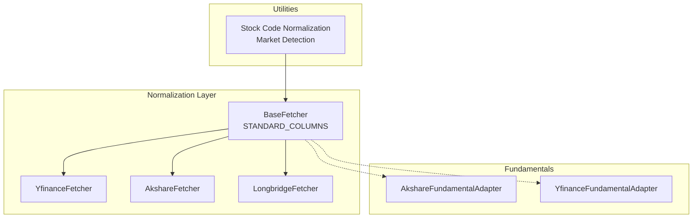
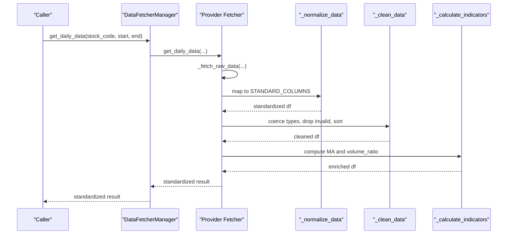
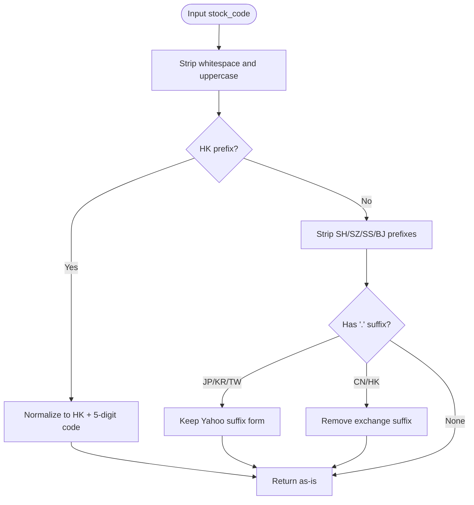
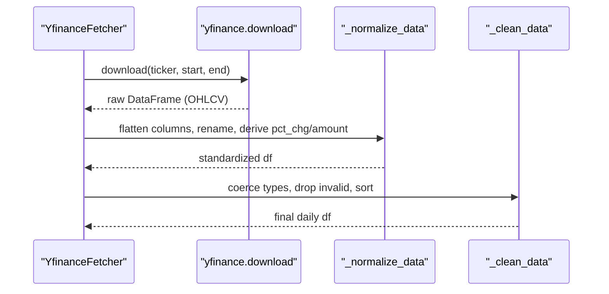
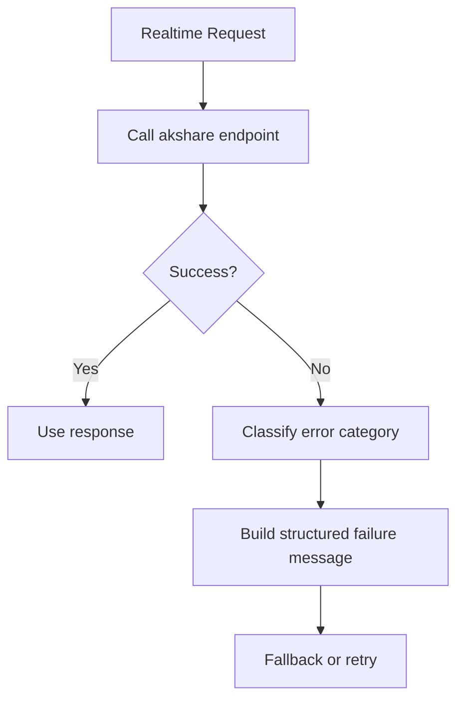
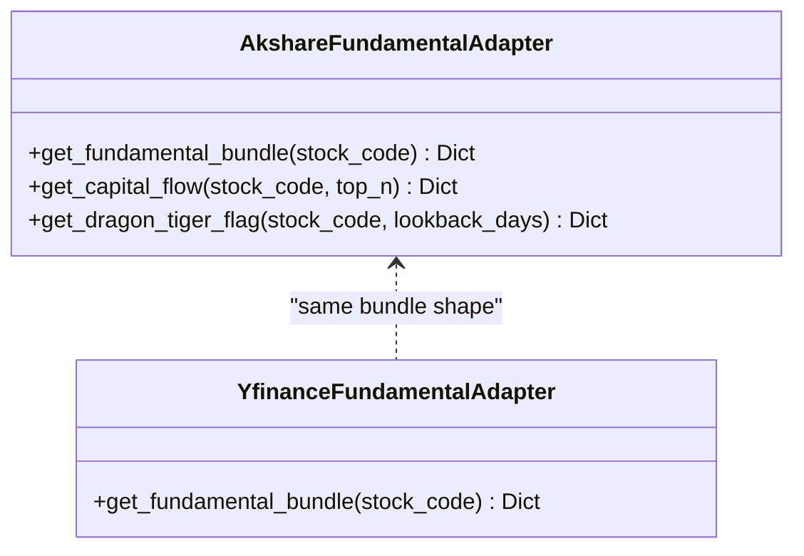
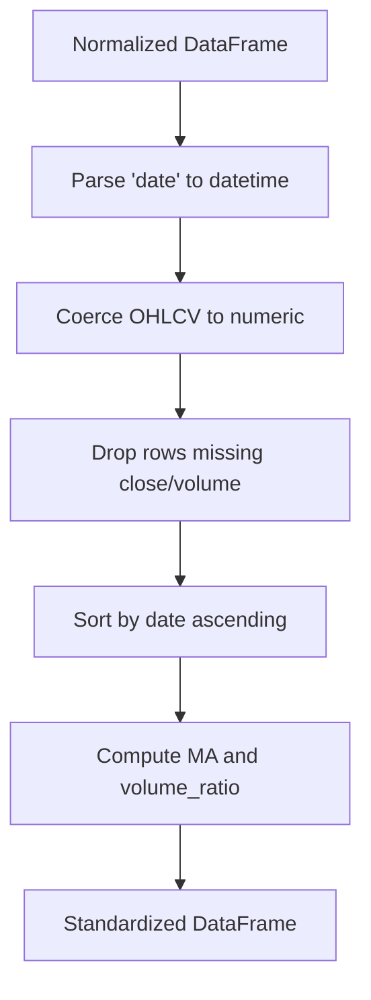
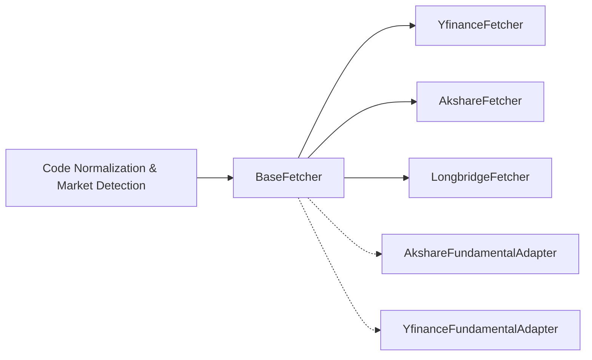

# Data Normalization & Standardization

<cite>
**Referenced Files in This Document**
- [base.py](file://data_provider/base.py)
- [yfinance_fetcher.py](file://data_provider/yfinance_fetcher.py)
- [akshare_fetcher.py](file://data_provider/akshare_fetcher.py)
- [longbridge_fetcher.py](file://data_provider/longbridge_fetcher.py)
- [fundamental_adapter.py](file://data_provider/fundamental_adapter.py)
- [yfinance_fundamental_adapter.py](file://data_provider/yfinance_fundamental_adapter.py)
- [snapshot.py](file://src/services/screening/snapshot.py)
</cite>

## Table of Contents
1. Introduction
2. Project Structure
3. Core Components
4. Architecture Overview
5. Detailed Component Analysis
6. Dependency Analysis
7. Performance Considerations
8. Troubleshooting Guide
9. Conclusion

## Introduction
This document explains the data normalization layer that converts provider-specific financial data into unified standard structures. It focuses on:
- The STANDARD_COLUMNS contract and how different providers map to consistent fields like date, open, high, low, close, volume, amount, pct_chg.
- Fundamental adapters for ratios, earnings, dividends, and company information from multiple sources.
- Stock code normalization across A-share, HK, US, Japan, Korea, and Taiwan formats.
- Transformation pipelines, adapter pattern usage, validation, type coercion, and quality checks.

## Project Structure
The normalization layer is centered around a base fetcher interface and market-specific implementations:
- Base abstractions define the standard columns and common cleaning/indicator logic.
- Provider fetchers implement raw fetching and mapping to the standard schema.
- Fundamental adapters normalize non-price fundamentals (growth, earnings, dividends, institutions).
- Utilities handle stock code normalization and market detection.

**Diagram sources**
- [base.py:40-42](file://data_provider/base.py#L40-L42)
- [yfinance_fetcher.py:236-306](file://data_provider/yfinance_fetcher.py#L236-L306)
- [akshare_fetcher.py:391-400](file://data_provider/akshare_fetcher.py#L391-L400)
- [longbridge_fetcher.py:926-941](file://data_provider/longbridge_fetcher.py#L926-L941)
- [fundamental_adapter.py:264-414](file://data_provider/fundamental_adapter.py#L264-L414)
- [yfinance_fundamental_adapter.py:138-374](file://data_provider/yfinance_fundamental_adapter.py#L138-L374)

**Section sources**
- [base.py:40-42](file://data_provider/base.py#L40-L42)
- [base.py:331-589](file://data_provider/base.py#L331-L589)

## Core Components
- STANDARD_COLUMNS defines the canonical daily OHLCV schema: date, open, high, low, close, volume, amount, pct_chg.
- BaseFetcher.get_daily_data orchestrates: fetch raw data, normalize columns, clean data, compute indicators, and return standardized results.
- Each provider implements _normalize_data to map its native columns to STANDARD_COLUMNS.
- Fundamental adapters produce normalized bundles with growth, earnings, dividends, and institutional metrics.

Key responsibilities:
- Column mapping and missing-field handling.
- Type coercion and null handling.
- Derived fields computation (e.g., pct_chg when not provided).
- Consistent output schema for downstream consumers.

**Section sources**
- [base.py:40-42](file://data_provider/base.py#L40-L42)
- [base.py:452-589](file://data_provider/base.py#L452-L589)

## Architecture Overview
The normalization pipeline follows an adapter pattern:
- Callers request daily data via BaseFetcher.get_daily_data.
- The manager selects a suitable provider based on market and availability.
- The provider returns a DataFrame; _normalize_data maps it to STANDARD_COLUMNS.
- _clean_data coerces types, removes invalid rows, sorts by date.
- _calculate_indicators adds moving averages and volume ratio.

**Diagram sources**
- [base.py:452-589](file://data_provider/base.py#L452-L589)
- [yfinance_fetcher.py:236-306](file://data_provider/yfinance_fetcher.py#L236-L306)
- [longbridge_fetcher.py:926-941](file://data_provider/longbridge_fetcher.py#L926-L941)

## Detailed Component Analysis

### STANDARD_COLUMNS and Daily Schema
- The canonical daily schema is defined once and enforced across all providers.
- Providers must ensure these columns exist after normalization; missing fields are filled or derived where possible.

Examples of provider mappings:
- YfinanceFetcher maps Open/High/Low/Close/Volume to standard names and derives pct_chg and amount.
- LongbridgeFetcher renames turnover to amount and derives pct_chg if absent.
- Other providers follow similar patterns to align with STANDARD_COLUMNS.

**Section sources**
- [base.py:40-42](file://data_provider/base.py#L40-L42)
- [yfinance_fetcher.py:236-306](file://data_provider/yfinance_fetcher.py#L236-L306)
- [longbridge_fetcher.py:926-941](file://data_provider/longbridge_fetcher.py#L926-L941)

### Stock Code Normalization and Market Detection
- normalize_stock_code strips exchange prefixes/suffixes and normalizes HK codes to a canonical form while preserving Yahoo suffix forms for JP/KR/TW.
- Market detection helpers identify US, HK, JP, KR, TW, CN markets to route requests appropriately.
- These utilities ensure consistent code handling across fetchers and adapters.

**Diagram sources**
- [base.py:71-150](file://data_provider/base.py#L71-L150)
- [base.py:156-202](file://data_provider/base.py#L156-L202)

**Section sources**
- [base.py:71-150](file://data_provider/base.py#L71-L150)
- [base.py:156-202](file://data_provider/base.py#L156-L202)

### Provider Normalization Pipelines

#### YfinanceFetcher
- Converts internal codes to Yahoo symbols, handles MultiIndex columns, resets index to extract date, maps OHLCV, computes pct_chg and amount, and appends code.
- Ensures only required columns are returned.

**Diagram sources**
- [yfinance_fetcher.py:200-234](file://data_provider/yfinance_fetcher.py#L200-L234)
- [yfinance_fetcher.py:236-306](file://data_provider/yfinance_fetcher.py#L236-L306)
- [base.py:531-589](file://data_provider/base.py#L531-L589)

**Section sources**
- [yfinance_fetcher.py:200-306](file://data_provider/yfinance_fetcher.py#L200-L306)
- [base.py:531-589](file://data_provider/base.py#L531-L589)

#### AkshareFetcher
- Implements robust error classification and timeouts for realtime endpoints.
- Uses helper functions to classify HTTP errors and build failure messages, improving resilience and observability.

**Diagram sources**
- [akshare_fetcher.py:262-322](file://data_provider/akshare_fetcher.py#L262-L322)

**Section sources**
- [akshare_fetcher.py:262-322](file://data_provider/akshare_fetcher.py#L262-L322)

#### LongbridgeFetcher
- Maps provider-specific fields to STANDARD_COLUMNS, including renaming turnover to amount and deriving pct_chg when missing.
- Guarantees presence of all standard columns even if some are unavailable.

**Section sources**
- [longbridge_fetcher.py:926-941](file://data_provider/longbridge_fetcher.py#L926-L941)

### Fundamental Adapters
Both adapters produce a normalized bundle with consistent keys:
- growth: revenue_yoy, net_profit_yoy, roe, gross_margin
- earnings: financial_report (report_date, revenue, net_profit_parent, operating_cash_flow, currency), dividend (events, ttm totals, yield), forecast summaries
- institution: holding changes, top10 holder changes
- source_chain and errors for traceability

AkshareFundamentalAdapter:
- Probes multiple AkShare endpoints and extracts fields using keyword-based column matching.
- Builds dividend events, filters by code, and computes TTM aggregates.

YfinanceFundamentalAdapter:
- Reads yfinance info and statements, computes YoY from quarterly statements when available, and derives dividend yield from TTM cash and latest price.
- Adds belong_boards from sector/industry metadata.

**Diagram sources**
- [fundamental_adapter.py:264-414](file://data_provider/fundamental_adapter.py#L264-L414)
- [yfinance_fundamental_adapter.py:138-374](file://data_provider/yfinance_fundamental_adapter.py#L138-L374)

**Section sources**
- [fundamental_adapter.py:264-414](file://data_provider/fundamental_adapter.py#L264-L414)
- [yfinance_fundamental_adapter.py:138-374](file://data_provider/yfinance_fundamental_adapter.py#L138-L374)

### Data Validation, Type Coercion, and Quality Checks
- Date parsing: ensure date columns are datetime; coerce to numeric for OHLCV and derived fields.
- Null handling: drop rows without critical fields (close, volume); fill missing pct_chg where possible.
- Sorting: enforce ascending date order for time-series consistency.
- Indicator computation: rolling means for MA5/MA10/MA20 and volume ratio with safe defaults.
- Snapshot normalization utilities demonstrate a reusable pattern for coercing numeric fields and filtering invalid prices.

**Diagram sources**
- [base.py:531-589](file://data_provider/base.py#L531-L589)
- [snapshot.py:773-803](file://src/services/screening/snapshot.py#L773-L803)

**Section sources**
- [base.py:531-589](file://data_provider/base.py#L531-L589)
- [snapshot.py:773-803](file://src/services/screening/snapshot.py#L773-L803)

## Dependency Analysis
- BaseFetcher depends on STANDARD_COLUMNS and provides shared cleaning and indicator logic used by all fetchers.
- Provider fetchers depend on market detection and code normalization utilities to route and format requests correctly.
- Fundamental adapters depend on external libraries (AkShare, yfinance) but present a stable bundle interface to callers.

**Diagram sources**
- [base.py:40-42](file://data_provider/base.py#L40-L42)
- [base.py:71-202](file://data_provider/base.py#L71-L202)
- [yfinance_fetcher.py:236-306](file://data_provider/yfinance_fetcher.py#L236-L306)
- [akshare_fetcher.py:391-400](file://data_provider/akshare_fetcher.py#L391-L400)
- [longbridge_fetcher.py:926-941](file://data_provider/longbridge_fetcher.py#L926-L941)
- [fundamental_adapter.py:264-414](file://data_provider/fundamental_adapter.py#L264-L414)
- [yfinance_fundamental_adapter.py:138-374](file://data_provider/yfinance_fundamental_adapter.py#L138-L374)

**Section sources**
- [base.py:40-42](file://data_provider/base.py#L40-L42)
- [base.py:71-202](file://data_provider/base.py#L71-L202)

## Performance Considerations
- Avoid redundant computations: derive pct_chg only when missing; reuse computed MAs.
- Minimize network calls: rely on provider-level retries and circuit breakers; cache where appropriate.
- Efficient cleaning: coerce types vectorially and drop invalid rows early to reduce downstream processing.
- Indicator windows: use rolling windows with minimal periods to avoid excessive memory usage on large series.

[No sources needed since this section provides general guidance]

## Troubleshooting Guide
Common issues and resolutions:
- Missing date column: ensure providers reset index and map date/datetime columns consistently.
- Empty or NaN OHLCV: verify numeric coercion and drop invalid rows; check provider availability and fallbacks.
- Incorrect pct_chg: confirm derivation from close when not provided; validate rounding and fillna behavior.
- Fundamental data gaps: adapters report status and source_chain; inspect errors and partial coverage.

**Section sources**
- [base.py:531-589](file://data_provider/base.py#L531-L589)
- [fundamental_adapter.py:292-414](file://data_provider/fundamental_adapter.py#L292-L414)
- [yfinance_fundamental_adapter.py:146-374](file://data_provider/yfinance_fundamental_adapter.py#L146-L374)

## Conclusion
The normalization layer enforces a single, reliable daily schema and fundamental bundle across diverse providers. By centralizing STANDARD_COLUMNS, leveraging the adapter pattern, and applying robust validation and coercion, the system ensures consistent, high-quality data for downstream analysis and reporting. Extending support to new providers involves implementing _normalize_data to map provider fields to STANDARD_COLUMNS and optionally contributing fundamental adapters for richer context.