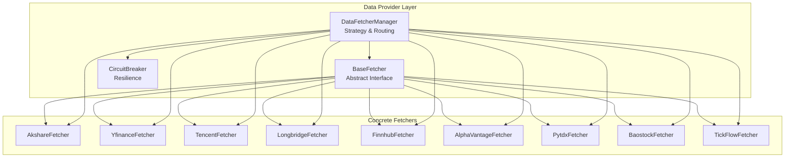
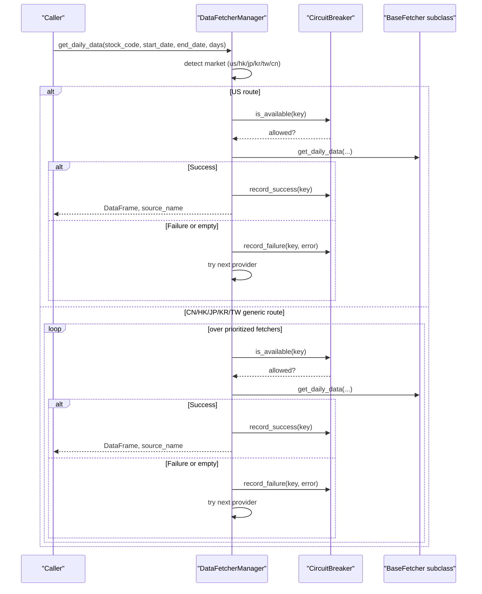
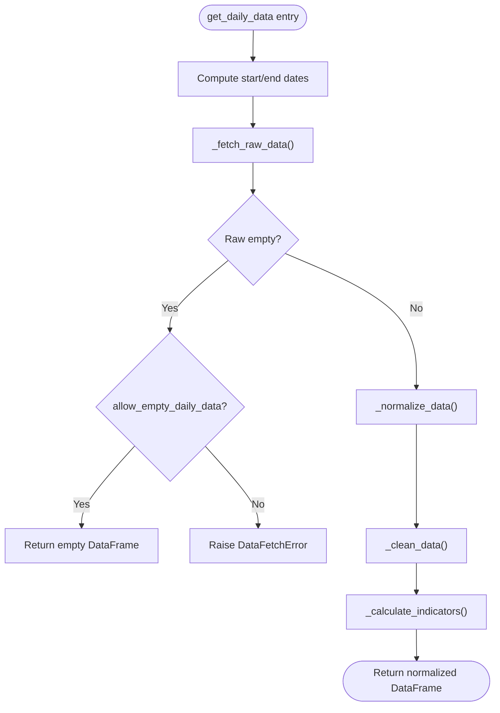
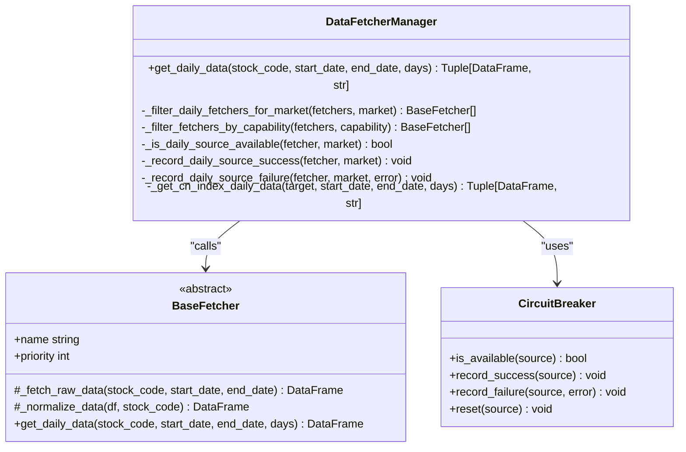
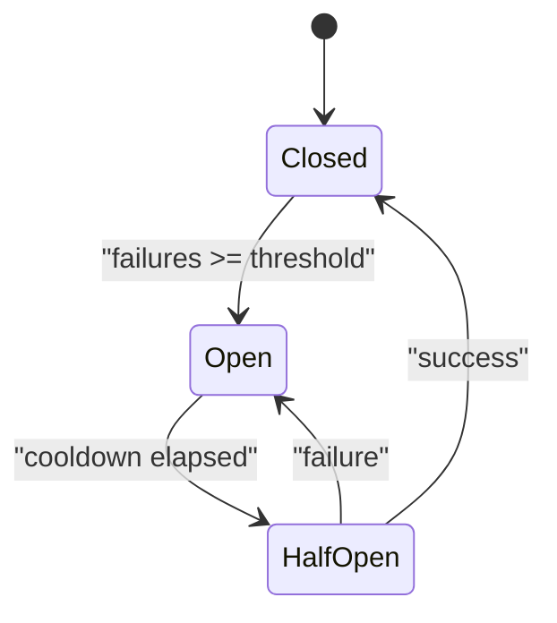
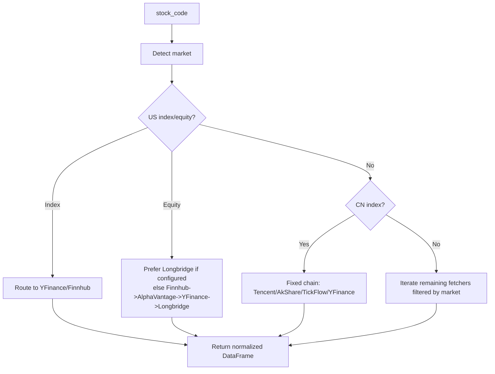
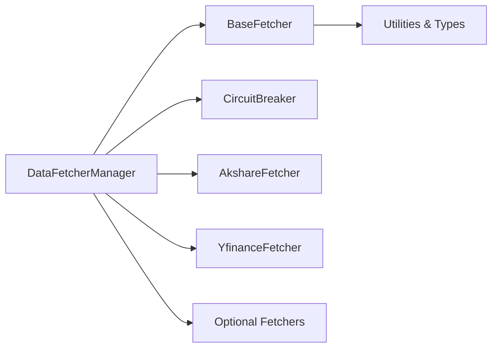

# Data Provider Architecture

<cite>
**Referenced Files in This Document**
- [base.py](file://data_provider/base.py)
- [realtime_types.py](file://data_provider/realtime_types.py)
- [yfinance_fetcher.py](file://data_provider/yfinance_fetcher.py)
- [akshare_fetcher.py](file://data_provider/akshare_fetcher.py)
- [__init__.py](file://data_provider/__init__.py)
</cite>

## Table of Contents
1. Introduction
2. Project Structure
3. Core Components
4. Architecture Overview
5. Detailed Component Analysis
6. Dependency Analysis
7. Performance Considerations
8. Troubleshooting Guide
9. Conclusion

## Introduction
This document explains the pluggable data provider architecture that standardizes market data access across multiple providers. It focuses on:
- The BaseFetcher abstract class that defines a unified interface for all fetchers via _fetch_raw_data and _normalize_data.
- The DataFetcherManager that implements strategy-based routing, automatic failover, and priority-based selection.
- The CircuitBreaker implementation that prevents cascading failures when providers become unavailable.
- How the system handles different markets (A-shares, HK, US, JP, KR, TW) while returning consistent data formats.
- How to integrate new providers into the framework.

## Project Structure
The data provider subsystem is organized around a base abstraction and multiple concrete fetchers, coordinated by a manager that routes requests based on market type and availability.

**Diagram sources**
- [base.py:331-529](file://data_provider/base.py#L331-L529)
- [base.py:604-1905](file://data_provider/base.py#L604-L1905)
- [realtime_types.py:285-465](file://data_provider/realtime_types.py#L285-L465)
- [yfinance_fetcher.py:58-200](file://data_provider/yfinance_fetcher.py#L58-L200)
- [akshare_fetcher.py:1-200](file://data_provider/akshare_fetcher.py#L1-L200)

**Section sources**
- [base.py:331-529](file://data_provider/base.py#L331-L529)
- [base.py:604-1905](file://data_provider/base.py#L604-L1905)
- [realtime_types.py:285-465](file://data_provider/realtime_types.py#L285-L465)
- [yfinance_fetcher.py:58-200](file://data_provider/yfinance_fetcher.py#L58-L200)
- [akshare_fetcher.py:1-200](file://data_provider/akshare_fetcher.py#L1-L200)

## Core Components
- BaseFetcher: Abstract base defining the unified daily data pipeline and common utilities. Subclasses implement raw fetching and normalization.
- DataFetcherManager: Strategy manager that selects and retries fetchers by priority and capability, with circuit breaker integration and market-specific routing.
- CircuitBreaker: Per-source state machine (closed/open/half-open) to avoid cascading failures and enable recovery.

Key responsibilities:
- Unified interface: get_daily_data orchestrates raw fetch, normalization, cleaning, and indicator calculation.
- Strategy pattern: Manager maintains ordered list of fetchers and tries them in sequence until success.
- Resilience: CircuitBreaker short-circuits failing sources and allows controlled probing after cooldown.

**Section sources**
- [base.py:331-529](file://data_provider/base.py#L331-L529)
- [base.py:604-1905](file://data_provider/base.py#L604-L1905)
- [realtime_types.py:285-465](file://data_provider/realtime_types.py#L285-L465)

## Architecture Overview
The architecture uses a layered design:
- Abstraction layer: BaseFetcher defines contract and shared processing.
- Routing layer: DataFetcherManager decides which fetcher to call based on market detection and availability.
- Implementation layer: Concrete fetchers adapt provider-specific APIs to the unified contract.
- Resilience layer: CircuitBreaker protects against repeated calls to failing sources.

**Diagram sources**
- [base.py:1643-1905](file://data_provider/base.py#L1643-L1905)
- [base.py:815-845](file://data_provider/base.py#L815-L845)
- [realtime_types.py:331-426](file://data_provider/realtime_types.py#L331-L426)

## Detailed Component Analysis

### BaseFetcher: Unified Interface and Processing Pipeline
- Purpose: Define a consistent daily data workflow so callers do not care about provider specifics.
- Contract:
  - _fetch_raw_data: Provider-specific retrieval returning a DataFrame with provider-native columns.
  - _normalize_data: Convert provider columns to standardized columns.
- Shared pipeline:
  - get_daily_data computes date range, calls _fetch_raw_data, then _normalize_data, cleans data, and calculates indicators (e.g., moving averages, volume ratio).
- Utilities:
  - Market helpers to classify codes (US, HK, JP, KR, TW, CN).
  - Code normalization to strip exchange prefixes/suffixes consistently.
  - Standard column set for output consistency.

**Diagram sources**
- [base.py:452-529](file://data_provider/base.py#L452-L529)
- [base.py:531-589](file://data_provider/base.py#L531-L589)

**Section sources**
- [base.py:331-529](file://data_provider/base.py#L331-L529)
- [base.py:531-589](file://data_provider/base.py#L531-L589)

### DataFetcherManager: Strategy Pattern, Priority Routing, and Failover
- Responsibilities:
  - Maintain an ordered list of fetchers by priority.
  - Detect market from stock code and apply market-specific routing.
  - Try providers in order; on failure or empty result, move to the next.
  - Integrate CircuitBreaker per market+provider key to skip temporarily unhealthy sources.
  - Provide specialized chains for US indices vs US equities vs CN indices.
- Key behaviors:
  - Filters out fetchers that do not support a given market.
  - Uses capability probes to skip unavailable fetchers at runtime.
  - Records provider run metrics and fallback targets for observability.
  - For CN indices, uses a fixed chain (e.g., Tencent/AkShare/TickFlow/YFinance) with provider-specific symbol mapping.

**Diagram sources**
- [base.py:604-1905](file://data_provider/base.py#L604-L1905)
- [base.py:331-529](file://data_provider/base.py#L331-L529)
- [realtime_types.py:285-465](file://data_provider/realtime_types.py#L285-L465)

**Section sources**
- [base.py:604-1905](file://data_provider/base.py#L604-L1905)

### CircuitBreaker: Preventing Cascading Failures
- States:
  - Closed: Normal operation.
  - Open: Source is skipped for a cooldown period.
  - Half-open: Limited probe attempts after cooldown; success restores closed, failure reopens.
- Behavior:
  - Tracks per-source failures and last failure time.
  - Supports configurable thresholds and cooldowns.
  - Provides methods to record successes/failures and reset states.

**Diagram sources**
- [realtime_types.py:285-465](file://data_provider/realtime_types.py#L285-L465)

**Section sources**
- [realtime_types.py:285-465](file://data_provider/realtime_types.py#L285-L465)

### Market-Specific Routing and Consistent Output
- Market detection:
  - US stocks/indexes, HK (including bare 4–5 digit codes), JP (.T), KR (.KS/.KQ), TW (.TW/.TWO), and CN defaults.
- Routing rules:
  - US indices: prefer YFinance; optionally Finnhub.
  - US equities: Longbridge preferred if configured; otherwise Finnhub -> AlphaVantage -> YFinance -> Longbridge.
  - CN indices: fixed chain with provider-specific symbols.
  - Other markets: iterate through available fetchers filtered by market support.
- Consistency:
  - All fetchers normalize to a standard column set before returning.
  - Common indicators are computed in the base pipeline.

**Diagram sources**
- [base.py:1643-1905](file://data_provider/base.py#L1643-L1905)
- [base.py:942-1140](file://data_provider/base.py#L942-L1140)

**Section sources**
- [base.py:1643-1905](file://data_provider/base.py#L1643-L1905)
- [base.py:942-1140](file://data_provider/base.py#L942-L1140)

### Example Implementations

#### YfinanceFetcher
- Role: International fallback covering US, HK, JP, KR, TW, and CN via Yahoo Finance suffixes.
- Highlights:
  - Converts various code formats to Yahoo-compatible symbols.
  - Implements retry with exponential backoff for network resilience.
  - Serves as a universal safety net when domestic sources fail.

**Section sources**
- [yfinance_fetcher.py:58-200](file://data_provider/yfinance_fetcher.py#L58-L200)

#### AkshareFetcher
- Role: Primary domestic source with robust anti-blocking measures and caching.
- Highlights:
  - User-Agent rotation, random jitter, and tenacity-based retries.
  - Realtime quote caching and ETF-specific handling.
  - Integration with unified types and circuit breakers.

**Section sources**
- [akshare_fetcher.py:1-200](file://data_provider/akshare_fetcher.py#L1-L200)

### Integrating a New Provider
Steps to add a new fetcher:
1. Create a new class inheriting from BaseFetcher.
2. Implement:
   - _fetch_raw_data: Retrieve provider-specific data as a DataFrame.
   - _normalize_data: Map provider columns to the standard set.
3. Register the fetcher:
   - Add import and instance creation in the manager’s default initialization path.
   - Ensure the fetcher’s name and supported markets are recognized by the manager’s filters.
4. Optionally implement capability probes (e.g., is_available) to allow runtime filtering.
5. Test market routing and failover behavior.

**Section sources**
- [base.py:1533-1633](file://data_provider/base.py#L1533-L1633)
- [__init__.py:1-67](file://data_provider/__init__.py#L1-L67)

## Dependency Analysis
- BaseFetcher depends on:
  - Standardization utilities and market helpers.
  - Optional fundamental adapters and realtime types for extended features.
- DataFetcherManager depends on:
  - All concrete fetchers (lazily initialized based on configuration).
  - CircuitBreaker for health gating.
  - Configuration service to decide optional providers (e.g., Tushare, TickFlow, Longbridge, Finnhub, AlphaVantage).
- Concrete fetchers depend on:
  - External libraries (e.g., yfinance, akshare, requests) and internal utilities.

**Diagram sources**
- [base.py:1533-1633](file://data_provider/base.py#L1533-L1633)
- [base.py:604-845](file://data_provider/base.py#L604-L845)
- [realtime_types.py:285-465](file://data_provider/realtime_types.py#L285-L465)

**Section sources**
- [base.py:1533-1633](file://data_provider/base.py#L1533-L1633)
- [base.py:604-845](file://data_provider/base.py#L604-L845)
- [realtime_types.py:285-465](file://data_provider/realtime_types.py#L285-L465)

## Performance Considerations
- Prioritized routing reduces latency by trying the best source first.
- CircuitBreaker avoids repeated calls to failing sources, saving resources.
- Market-specific filters prevent unnecessary attempts on unsupported providers.
- CN index fixed chains optimize symbol mapping and reduce misrouting.
- Prefetching can pre-warm caches for batch scenarios where supported.

[No sources needed since this section provides general guidance]

## Troubleshooting Guide
Common issues and remedies:
- All providers return empty results:
  - Verify market detection and symbol conversion.
  - Check CN index symbol mapping and bare-code conflicts.
- Frequent timeouts or rate limits:
  - Inspect CircuitBreaker state and cooldown settings.
  - Adjust provider priorities or disable problematic sources temporarily.
- Inconsistent data quality:
  - Confirm normalization logic in the chosen fetcher.
  - Validate indicator calculations in the base pipeline.

Operational tips:
- Use manager logs to trace provider attempts, errors, and fallbacks.
- Reset CircuitBreaker state during diagnostics if needed.
- Prefer providers with capability probes enabled for dynamic filtering.

**Section sources**
- [base.py:1643-1905](file://data_provider/base.py#L1643-L1905)
- [realtime_types.py:331-426](file://data_provider/realtime_types.py#L331-L426)

## Conclusion
The Data Provider Architecture delivers a resilient, extensible, and market-aware data access layer. By standardizing through BaseFetcher, orchestrating via DataFetcherManager, and protecting with CircuitBreaker, it ensures consistent, high-quality market data across diverse providers and regions. New providers can be integrated cleanly by implementing the contract and registering within the manager’s lifecycle.

[No sources needed since this section summarizes without analyzing specific files]