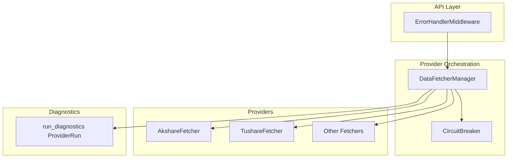
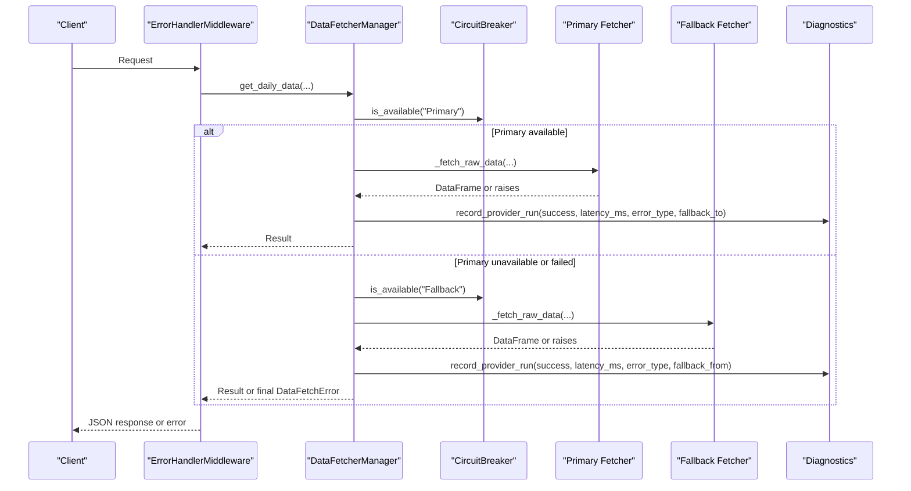
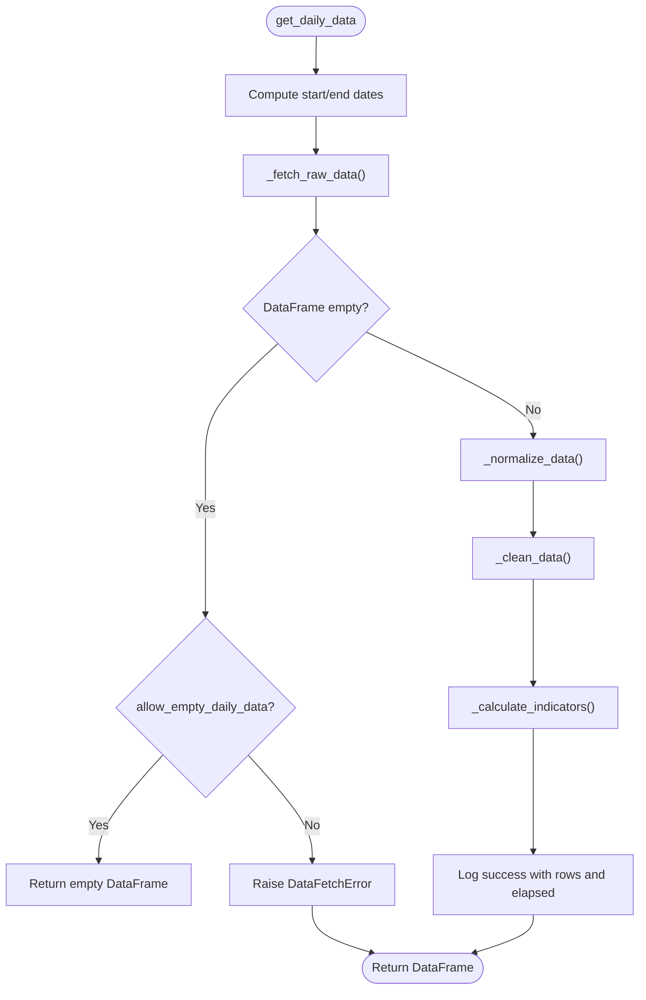
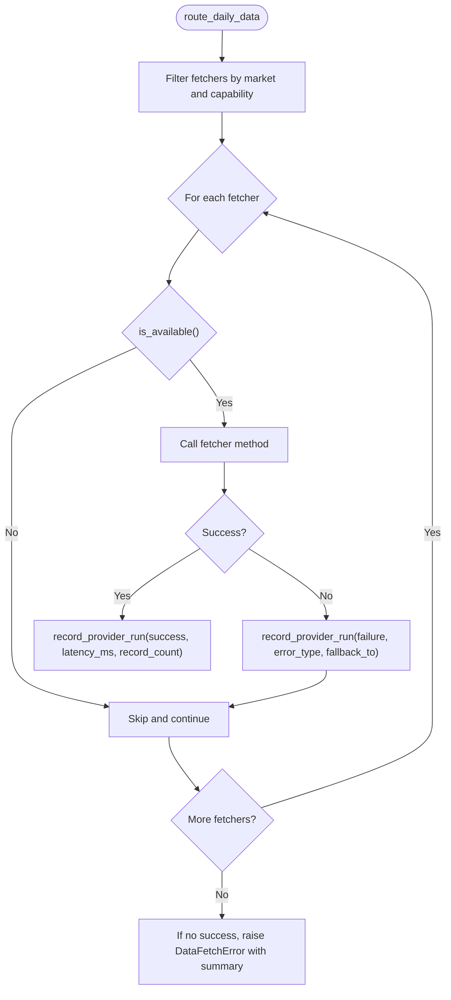
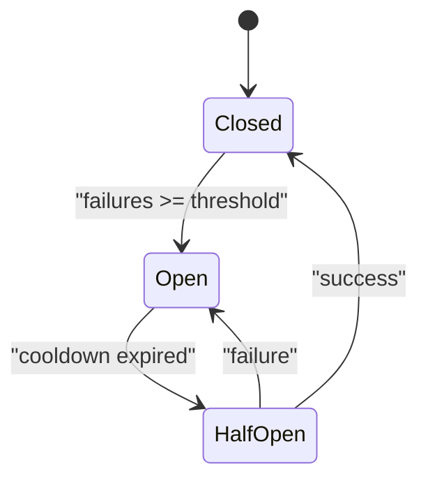
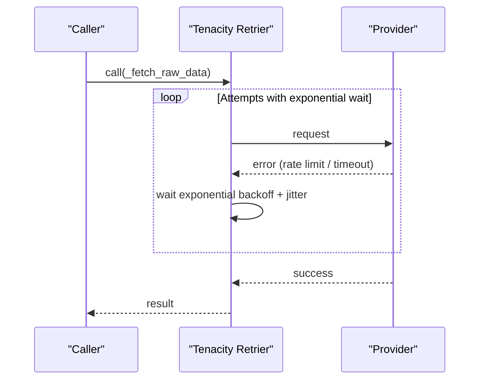
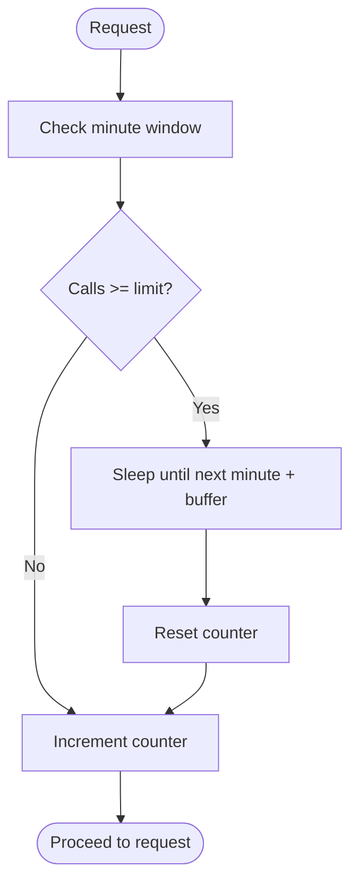
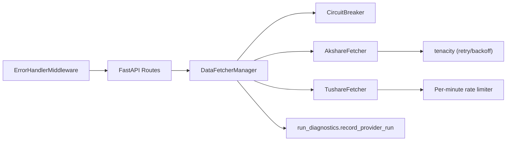

# Error Handling & Recovery

<cite>
**Referenced Files in This Document**
- [base.py](file://data_provider/base.py)
- [realtime_types.py](file://data_provider/realtime_types.py)
- [akshare_fetcher.py](file://data_provider/akshare_fetcher.py)
- [tushare_fetcher.py](file://data_provider/tushare_fetcher.py)
- [error_handler.py](file://api/middlewares/error_handler.py)
- [run_diagnostics.py](file://src/services/run_diagnostics.py)
</cite>

## Table of Contents
1. [Introduction](#introduction)
2. [Project Structure](#project-structure)
3. [Core Components](#core-components)
4. [Architecture Overview](#architecture-overview)
5. [Detailed Component Analysis](#detailed-component-analysis)
6. [Dependency Analysis](#dependency-analysis)
7. [Performance Considerations](#performance-considerations)
8. [Troubleshooting Guide](#troubleshooting-guide)
9. [Conclusion](#conclusion)

## Introduction
This document explains how the system ensures reliable data acquisition across multiple market data providers by implementing robust error handling, retry logic with exponential backoff, circuit breaker patterns, automatic failover, rate limiting, graceful degradation, and comprehensive logging and monitoring. It focuses on the exception hierarchy (DataFetchError, RateLimitError, DataSourceUnavailableError), provider routing and fallback, timeout handling, network connectivity issues, and provider-specific error responses.

## Project Structure
The error handling and recovery mechanisms are primarily implemented in:
- The data provider layer that defines fetchers, a manager for multi-provider orchestration, and shared utilities.
- A circuit breaker implementation for per-provider health gating.
- API middleware that normalizes errors to clients.
- Diagnostics and tracing infrastructure that records provider attempts, failures, and fallbacks.

**Diagram sources**
- [error_handler.py:24-129](file://api/middlewares/error_handler.py#L24-L129)
- [base.py:604-889](file://data_provider/base.py#L604-L889)
- [realtime_types.py:285-465](file://data_provider/realtime_types.py#L285-L465)
- [run_diagnostics.py:869-907](file://src/services/run_diagnostics.py#L869-L907)

**Section sources**
- [error_handler.py:24-129](file://api/middlewares/error_handler.py#L24-L129)
- [base.py:604-889](file://data_provider/base.py#L604-L889)
- [realtime_types.py:285-465](file://data_provider/realtime_types.py#L285-L465)
- [run_diagnostics.py:869-907](file://src/services/run_diagnostics.py#L869-L907)

## Core Components
- Exception hierarchy: DataFetchError, RateLimitError, DataSourceUnavailableError.
- BaseFetcher: standardized daily data retrieval, normalization, indicator calculation, and consistent error logging.
- DataFetcherManager: multi-provider routing, capability filtering, availability probing, and automatic failover.
- CircuitBreaker: per-provider open/closed/half-open state machine with configurable thresholds and cooldown.
- Retry and backoff: tenacity-based exponential backoff in specific fetchers; bounded retries with timeouts in core runtime.
- Rate limiting: per-fetcher throttling (e.g., Tushare minute-based limiter).
- Diagnostics: structured recording of provider runs, latency, errors, fallbacks, and record counts.

**Section sources**
- [base.py:316-329](file://data_provider/base.py#L316-L329)
- [base.py:331-590](file://data_provider/base.py#L331-L590)
- [base.py:604-889](file://data_provider/base.py#L604-L889)
- [realtime_types.py:285-465](file://data_provider/realtime_types.py#L285-L465)
- [akshare_fetcher.py:38-49](file://data_provider/akshare_fetcher.py#L38-L49)
- [tushare_fetcher.py:253-285](file://data_provider/tushare_fetcher.py#L253-L285)
- [run_diagnostics.py:142-170](file://src/services/run_diagnostics.py#L142-L170)
- [run_diagnostics.py:869-907](file://src/services/run_diagnostics.py#L869-L907)

## Architecture Overview
The system uses a layered approach:
- API middleware catches unhandled exceptions and returns uniform JSON errors.
- DataFetcherManager selects an ordered list of fetchers based on market capabilities and current availability.
- Each fetcher implements its own request logic, rate limiting, and provider-specific error mapping.
- CircuitBreaker gates access to each provider after repeated failures, allowing controlled recovery probes.
- Diagnostics capture every attempt, including success/failure, latency, error types, and fallback relationships.

**Diagram sources**
- [error_handler.py:24-129](file://api/middlewares/error_handler.py#L24-L129)
- [base.py:604-889](file://data_provider/base.py#L604-L889)
- [realtime_types.py:285-465](file://data_provider/realtime_types.py#L285-L465)
- [run_diagnostics.py:869-907](file://src/services/run_diagnostics.py#L869-L907)

## Detailed Component Analysis

### Exception Hierarchy and Usage
- DataFetchError: base class for all data acquisition errors raised by fetchers and managers.
- RateLimitError: subclass indicating provider rate limits were hit; used to trigger backoff or switch providers.
- DataSourceUnavailableError: subclass indicating provider is temporarily unavailable; used to skip via circuit breaker and failover.

These exceptions are raised consistently during raw data fetching and normalized at the manager level before being recorded in diagnostics and propagated up to the API layer.

**Section sources**
- [base.py:316-329](file://data_provider/base.py#L316-L329)
- [base.py:490-529](file://data_provider/base.py#L490-L529)

### BaseFetcher: Standardized Acquisition and Logging
BaseFetcher provides:
- A unified entry point for daily data retrieval that computes date ranges, calls provider-specific fetchers, normalizes columns, cleans data, and calculates indicators.
- Consistent error logging that unwraps chained exceptions and summarizes them for stable log messages.
- Random jitter sleep to reduce thundering herd effects when calling providers.

**Diagram sources**
- [base.py:452-529](file://data_provider/base.py#L452-L529)
- [base.py:531-589](file://data_provider/base.py#L531-L589)

**Section sources**
- [base.py:452-589](file://data_provider/base.py#L452-L589)

### DataFetcherManager: Multi-Provider Routing and Failover
Key responsibilities:
- Maintain an ordered list of fetchers filtered by market support and capability probes.
- Per-attempt logging and diagnostics, including fallback relationships and error types.
- Automatic failover: if the primary fails, try the next configured provider until one succeeds or all fail.
- Availability checks using circuit breaker and optional per-fetcher availability probes.

**Diagram sources**
- [base.py:604-889](file://data_provider/base.py#L604-L889)
- [base.py:993-1012](file://data_provider/base.py#L993-L1012)
- [base.py:1805-1829](file://data_provider/base.py#L1805-L1829)

**Section sources**
- [base.py:604-889](file://data_provider/base.py#L604-L889)
- [base.py:993-1012](file://data_provider/base.py#L993-L1012)
- [base.py:1805-1829](file://data_provider/base.py#L1805-L1829)

### Circuit Breaker: Open/Closed/Half-Open State Machine
The CircuitBreaker protects downstream providers from cascading failures:
- CLOSED: normal operation.
- OPEN: after N consecutive failures; requests are skipped for a cooldown period.
- HALF_OPEN: limited probe attempts allowed; success restores CLOSED, failure reopens.

It is used to gate daily source availability and real-time quote sources.

**Diagram sources**
- [realtime_types.py:285-465](file://data_provider/realtime_types.py#L285-L465)

**Section sources**
- [realtime_types.py:285-465](file://data_provider/realtime_types.py#L285-L465)

### Retry Logic and Exponential Backoff
- AkshareFetcher uses tenacity with exponential backoff and retry conditions to handle transient provider errors and rate limits.
- Core runtime includes a bounded retry loop with timeouts for fundamental tasks, ensuring total duration stays within budget.

**Diagram sources**
- [akshare_fetcher.py:38-49](file://data_provider/akshare_fetcher.py#L38-L49)
- [base.py:3104-3139](file://data_provider/base.py#L3104-L3139)

**Section sources**
- [akshare_fetcher.py:38-49](file://data_provider/akshare_fetcher.py#L38-L49)
- [base.py:3104-3139](file://data_provider/base.py#L3104-L3139)

### Rate Limiting and Throttling
- TushareFetcher enforces a per-minute call limit, sleeping until the next minute boundary when quota is reached.
- BaseFetcher includes random jitter sleeps to avoid synchronized bursts across fetchers.

**Diagram sources**
- [tushare_fetcher.py:253-285](file://data_provider/tushare_fetcher.py#L253-L285)
- [base.py:591-602](file://data_provider/base.py#L591-L602)

**Section sources**
- [tushare_fetcher.py:253-285](file://data_provider/tushare_fetcher.py#L253-L285)
- [base.py:591-602](file://data_provider/base.py#L591-L602)

### Graceful Degradation and Automatic Failover
- When a primary provider fails (including due to circuit breaker), the manager tries subsequent providers in order.
- Diagnostics record fallback relationships (fallback_from, fallback_to) so operators can visualize degradation paths.
- If all providers fail, a consolidated DataFetchError is raised with a summary of errors.

**Section sources**
- [base.py:993-1012](file://data_provider/base.py#L993-L1012)
- [base.py:1805-1829](file://data_provider/base.py#L1805-L1829)
- [run_diagnostics.py:869-907](file://src/services/run_diagnostics.py#L869-L907)

### Timeout Handling and Network Connectivity
- Fetchers set explicit timeouts for HTTP calls (e.g., Akshare history timeout constants).
- Core runtime wraps tasks with timeouts and best-effort retries, returning results or errors along with total duration in milliseconds.
- Desktop health check code demonstrates per-request timeouts and total timeout enforcement with progress events.

**Section sources**
- [akshare_fetcher.py:66-68](file://data_provider/akshare_fetcher.py#L66-L68)
- [base.py:3104-3139](file://data_provider/base.py#L3104-L3139)

### Error Logging, Monitoring, and Alerting
- BaseFetcher logs detailed error summaries with unwrapped exception types and reasons.
- DataFetcherManager records provider runs with success/failure, latency, error type, fallback relationships, and record counts.
- API middleware centralizes unhandled exception logging and returns uniform error responses to clients.

**Section sources**
- [base.py:487-529](file://data_provider/base.py#L487-L529)
- [run_diagnostics.py:869-907](file://src/services/run_diagnostics.py#L869-L907)
- [error_handler.py:24-129](file://api/middlewares/error_handler.py#L24-L129)

## Dependency Analysis

**Diagram sources**
- [error_handler.py:24-129](file://api/middlewares/error_handler.py#L24-L129)
- [base.py:604-889](file://data_provider/base.py#L604-L889)
- [realtime_types.py:285-465](file://data_provider/realtime_types.py#L285-L465)
- [akshare_fetcher.py:38-49](file://data_provider/akshare_fetcher.py#L38-L49)
- [tushare_fetcher.py:253-285](file://data_provider/tushare_fetcher.py#L253-L285)
- [run_diagnostics.py:869-907](file://src/services/run_diagnostics.py#L869-L907)

**Section sources**
- [error_handler.py:24-129](file://api/middlewares/error_handler.py#L24-L129)
- [base.py:604-889](file://data_provider/base.py#L604-L889)
- [realtime_types.py:285-465](file://data_provider/realtime_types.py#L285-L465)
- [akshare_fetcher.py:38-49](file://data_provider/akshare_fetcher.py#L38-L49)
- [tushare_fetcher.py:253-285](file://data_provider/tushare_fetcher.py#L253-L285)
- [run_diagnostics.py:869-907](file://src/services/run_diagnostics.py#L869-L907)

## Performance Considerations
- Use circuit breakers to prevent overload on failing providers and reduce wasted retries.
- Apply exponential backoff with jitter to smooth traffic spikes and respect provider rate limits.
- Enforce per-minute rate limits where providers require it to avoid bans.
- Keep timeouts tight enough to fail fast but generous enough to accommodate slow networks.
- Record latency and record counts to identify bottlenecks and optimize provider selection.

[No sources needed since this section provides general guidance]

## Troubleshooting Guide
Common issues and resolutions:
- Rate limit exceeded:
  - Symptom: Provider returns rate limit errors; fetcher sleeps until next minute or backs off exponentially.
  - Action: Reduce request frequency, increase cooldown, or route to alternative providers.
  - Evidence: Look for rate limit logs and tenacity backoff entries; check per-minute counters.
- Provider unavailable:
  - Symptom: Repeated failures cause circuit breaker to open; manager skips provider until cooldown expires.
  - Action: Wait for cooldown, verify provider status, or adjust failure_threshold/cooldown_seconds.
  - Evidence: Circuit breaker state transitions and “unavailable” diagnostic records.
- Timeouts:
  - Symptom: Requests exceed configured timeouts; tasks return errors with duration metrics.
  - Action: Increase timeouts for slow providers or investigate network issues; consider fallback.
  - Evidence: Diagnostic latency_ms and error_type fields; logs around timeout boundaries.
- All providers failed:
  - Symptom: Final DataFetchError raised with aggregated error summary.
  - Action: Inspect fallback chain and error messages; prioritize fixing primary provider.
  - Evidence: Manager logs summarizing attempts and errors; diagnostics showing fallback_from/to.

**Section sources**
- [base.py:487-529](file://data_provider/base.py#L487-L529)
- [base.py:993-1012](file://data_provider/base.py#L993-L1012)
- [base.py:1805-1829](file://data_provider/base.py#L1805-L1829)
- [realtime_types.py:285-465](file://data_provider/realtime_types.py#L285-L465)
- [tushare_fetcher.py:253-285](file://data_provider/tushare_fetcher.py#L253-L285)
- [akshare_fetcher.py:38-49](file://data_provider/akshare_fetcher.py#L38-L49)
- [error_handler.py:24-129](file://api/middlewares/error_handler.py#L24-L129)
- [run_diagnostics.py:869-907](file://src/services/run_diagnostics.py#L869-L907)

## Conclusion
The system combines a clear exception hierarchy, robust retry with exponential backoff, circuit breaker protection, automatic failover, rate limiting, and comprehensive diagnostics to ensure resilient data acquisition across diverse market data providers. By standardizing error handling at the base layer and orchestrating provider selection at the manager layer, the application gracefully degrades under stress while providing rich observability for troubleshooting and alerting.

[No sources needed since this section summarizes without analyzing specific files]