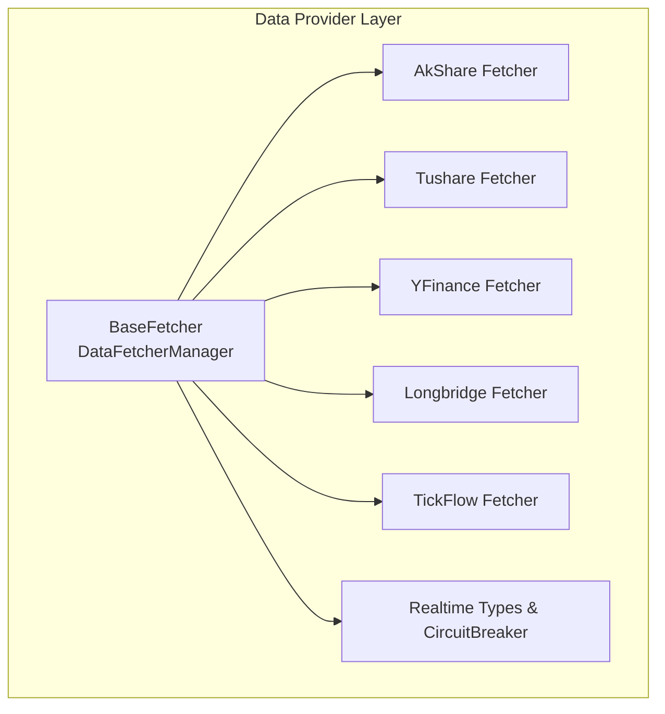
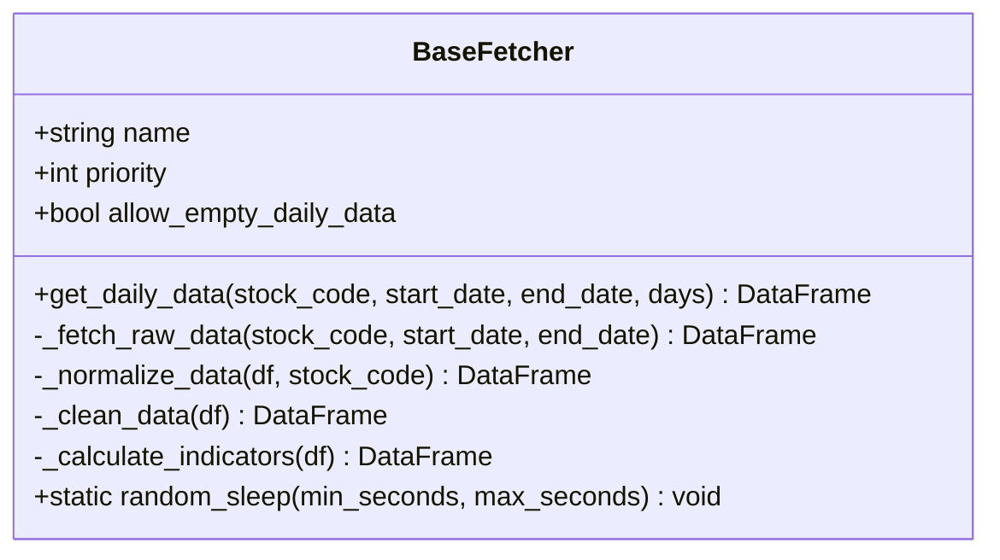
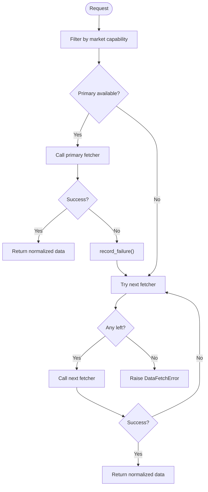
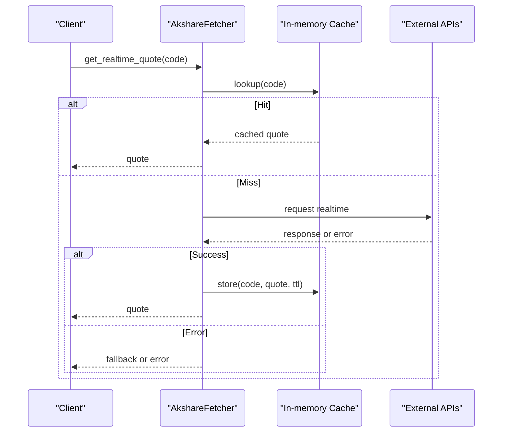
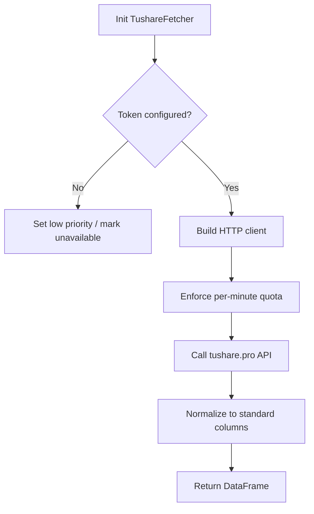
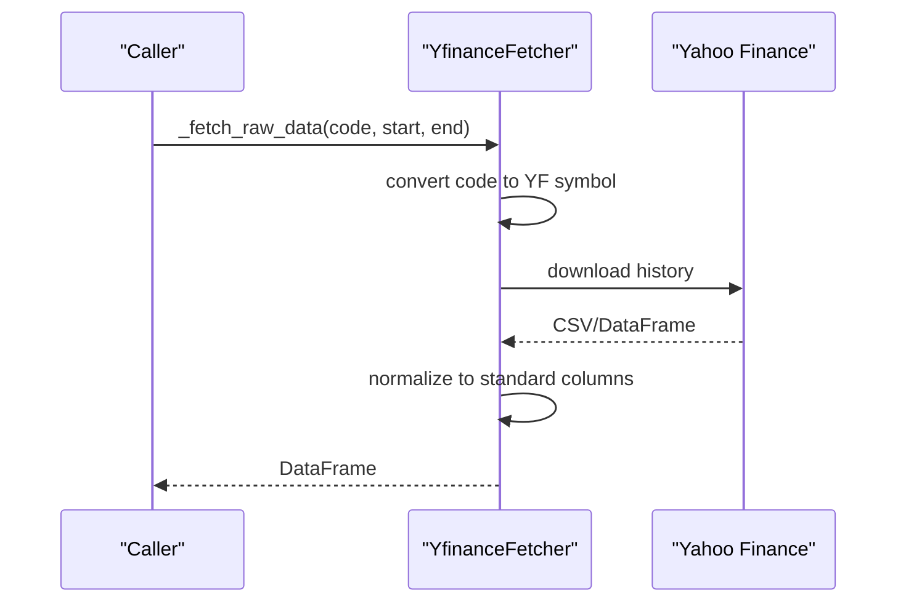
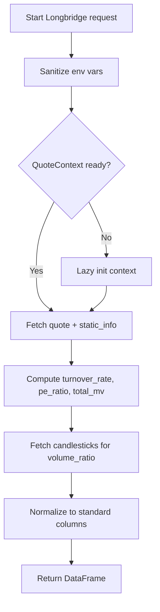
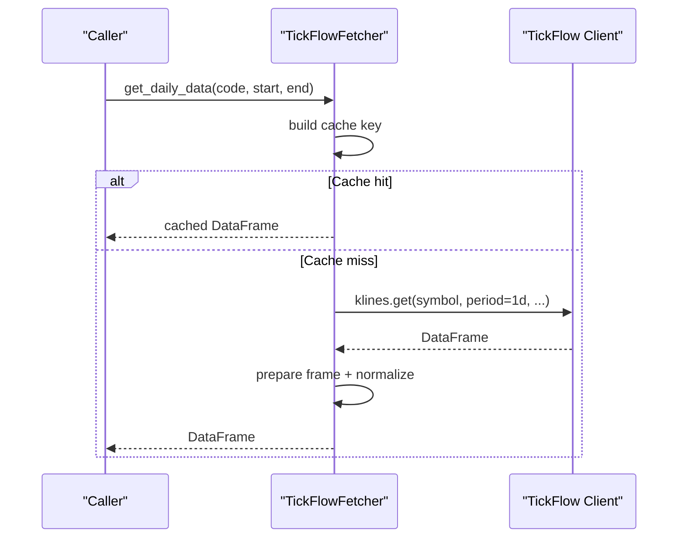
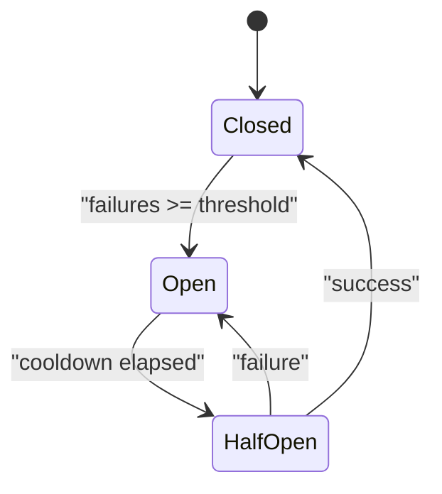
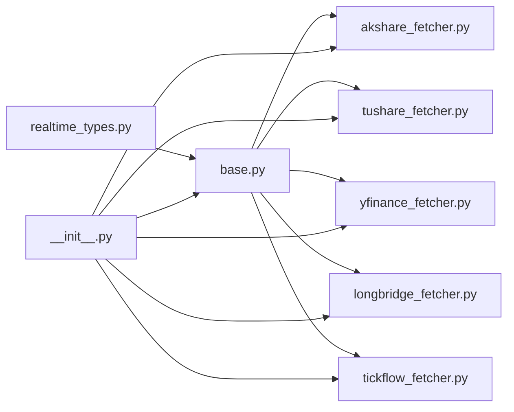

# Market Data Integration

<cite>
**Referenced Files in This Document**
- [base.py](file://data_provider/base.py)
- [__init__.py](file://data_provider/__init__.py)
- [akshare_fetcher.py](file://data_provider/akshare_fetcher.py)
- [yfinance_fetcher.py](file://data_provider/yfinance_fetcher.py)
- [tushare_fetcher.py](file://data_provider/tushare_fetcher.py)
- [longbridge_fetcher.py](file://data_provider/longbridge_fetcher.py)
- [tickflow_fetcher.py](file://data_provider/tickflow_fetcher.py)
- [realtime_types.py](file://data_provider/realtime_types.py)
</cite>

## Table of Contents
1. [Introduction](#introduction)
2. [Project Structure](#project-structure)
3. [Core Components](#core-components)
4. [Architecture Overview](#architecture-overview)
5. [Detailed Component Analysis](#detailed-component-analysis)
6. [Dependency Analysis](#dependency-analysis)
7. [Performance Considerations](#performance-considerations)
8. [Troubleshooting Guide](#troubleshooting-guide)
9. [Conclusion](#conclusion)
10. [Appendices](#appendices)

## Introduction
This document explains the pluggable Market Data Integration system that standardizes access to multiple global markets and providers (AkShare, Tushare, YFinance, Longbridge, TickFlow, and others). It focuses on:
- The base fetcher interface that unifies data acquisition across providers
- Fallback mechanisms that automatically switch sources when primary providers fail
- Caching strategies that optimize performance and reduce API calls
- Normalization layer that converts provider-specific responses into unified structures
- Rate limiting, error handling, retry logic, and resilience patterns for robust data acquisition across markets and time zones

## Project Structure
The market data integration lives under data_provider with a clear separation of concerns:
- Base abstractions and manager orchestration
- Provider-specific fetchers implementing the base interface
- Shared types and circuit breakers for real-time quotes and resilience
- Package exports that register available fetchers



**Diagram sources**
- [base.py:331-602](file://data_provider/base.py#L331-L602)
- [base.py:604-800](file://data_provider/base.py#L604-L800)
- [realtime_types.py:285-465](file://data_provider/realtime_types.py#L285-L465)

**Section sources**
- [__init__.py:1-67](file://data_provider/__init__.py#L1-L67)

## Core Components
- BaseFetcher: Abstract class defining the unified daily data acquisition contract, including raw fetching, normalization, cleaning, indicator calculation, and standardized metrics.
- DataFetcherManager: Strategy manager that orchestrates multiple fetchers, enforces market capability filters, applies fallback routing, and manages health via a circuit breaker.
- Realtime types and CircuitBreaker: Unified quote model and failure-aware state machine to protect downstream systems from cascading failures.

Key responsibilities:
- Standardized column set for daily OHLCV and derived fields
- Market detection helpers (CN/HK/US/JP/KR/TW)
- Retry and jitter utilities
- Manager-level routing by market and capability

**Section sources**
- [base.py:331-602](file://data_provider/base.py#L331-L602)
- [base.py:604-800](file://data_provider/base.py#L604-L800)
- [realtime_types.py:94-194](file://data_provider/realtime_types.py#L94-L194)
- [realtime_types.py:285-465](file://data_provider/realtime_types.py#L285-L465)

## Architecture Overview
The system uses a strategy pattern where DataFetcherManager selects an appropriate BaseFetcher implementation based on market capabilities and availability. Each provider implements _fetch_raw_data and _normalize_data to conform to the shared schema.

```mermaid
sequenceDiagram
participant Caller as "Caller"
participant Mgr as "DataFetcherManager"
participant F1 as "Primary Fetcher"
participant F2 as "Fallback Fetcher"
participant CB as "CircuitBreaker"
Caller->>Mgr : get_daily_data(code, start, end)
Mgr->>CB : is_available(fetcher.name)
alt Primary available
Mgr->>F1 : _fetch_raw_data(...)
F1-->>Mgr : DataFrame or error
alt Success
Mgr->>F1 : _normalize_data(...)
F1-->>Mgr : normalized DataFrame
Mgr-->>Caller : result
else Error
Mgr->>CB : record_failure(name)
Mgr->>Mgr : select next fetcher
Mgr->>F2 : _fetch_raw_data(...)
F2-->>Mgr : DataFrame or error
opt Success
Mgr->>F2 : _normalize_data(...)
F2-->>Mgr : normalized DataFrame
Mgr-->>Caller : result
else Failure
Mgr-->>Caller : raise DataFetchError
end
end
else Primary not available
Mgr->>F2 : _fetch_raw_data(...)
...
end
```

**Diagram sources**
- [base.py:452-529](file://data_provider/base.py#L452-L529)
- [base.py:604-800](file://data_provider/base.py#L604-L800)
- [realtime_types.py:285-465](file://data_provider/realtime_types.py#L285-L465)

## Detailed Component Analysis

### BaseFetcher: Unified Daily Data Contract
- Defines abstract methods for raw fetching and normalization
- Provides a unified get_daily_data pipeline: date range computation, raw fetch, normalization, cleaning, indicator calculation
- Implements standard columns and common indicators (MA5/10/20, volume ratio)
- Includes random sleep utility for rate limiting and anti-blocking



**Diagram sources**
- [base.py:331-602](file://data_provider/base.py#L331-L602)

**Section sources**
- [base.py:331-602](file://data_provider/base.py#L331-L602)

### DataFetcherManager: Routing, Fallback, and Health
- Maintains a list of fetchers sorted by priority
- Filters fetchers by market capability using a registry map
- Applies per-fetcher call serialization and availability probes
- Uses a shared circuit breaker to skip unhealthy sources during cooldowns
- Provides ordered fallback lists for specific scenarios (e.g., CN index daily/name)



**Diagram sources**
- [base.py:604-800](file://data_provider/base.py#L604-L800)
- [realtime_types.py:285-465](file://data_provider/realtime_types.py#L285-L465)

**Section sources**
- [base.py:604-800](file://data_provider/base.py#L604-L800)

### AkShare Fetcher
- Free, broad coverage; includes built-in jitter, user-agent rotation, tenacity-based retries, and circuit breaker usage
- Supports A-shares and HK codes; includes ETF detection and specialized Tencent amount/volume normalization
- Caches realtime quotes and HK universe snapshots to reduce load



**Diagram sources**
- [akshare_fetcher.py:1-200](file://data_provider/akshare_fetcher.py#L1-L200)

**Section sources**
- [akshare_fetcher.py:1-200](file://data_provider/akshare_fetcher.py#L1-L200)

### Tushare Fetcher
- Requires token; provides high-quality, stable data with explicit rate limiting per minute
- Uses a lightweight HTTP client to avoid SDK dependency issues
- Dynamically adjusts priority if token/API unavailable



**Diagram sources**
- [tushare_fetcher.py:1-200](file://data_provider/tushare_fetcher.py#L1-L200)

**Section sources**
- [tushare_fetcher.py:1-200](file://data_provider/tushare_fetcher.py#L1-L200)

### YFinance Fetcher
- Global coverage (US/HK/JP/KR/TW/CN); acts as a reliable fallback
- Converts local codes to Yahoo Finance symbols (including US indices mapping)
- Retries on transient network errors with exponential backoff



**Diagram sources**
- [yfinance_fetcher.py:1-200](file://data_provider/yfinance_fetcher.py#L1-L200)

**Section sources**
- [yfinance_fetcher.py:1-200](file://data_provider/yfinance_fetcher.py#L1-L200)

### Longbridge Fetcher
- Covers US and HK; computes turnover, PE, and volume ratio via combined quote/static_info/history endpoints
- Lazy QuoteContext initialization; static info cache with configurable TTL
- Environment sanitization and region-aware endpoint selection



**Diagram sources**
- [longbridge_fetcher.py:1-200](file://data_provider/longbridge_fetcher.py#L1-L200)

**Section sources**
- [longbridge_fetcher.py:1-200](file://data_provider/longbridge_fetcher.py#L1-L200)

### TickFlow Fetcher
- Optional A-share daily K-line and realtime quote support
- In-process client with capability checks and caches for daily klines and quotes
- Enforces kline count limits and supports adjust modes



**Diagram sources**
- [tickflow_fetcher.py:1-200](file://data_provider/tickflow_fetcher.py#L1-L200)

**Section sources**
- [tickflow_fetcher.py:1-200](file://data_provider/tickflow_fetcher.py#L1-L200)

### Realtime Types and Circuit Breaker
- UnifiedRealtimeQuote standardizes fields across providers, including metadata like source, timestamps, staleness, and missing fields
- CircuitBreaker implements closed/open/half-open states with configurable thresholds and cooldowns
- Separate breakers for realtime quotes and chip distribution endpoints



**Diagram sources**
- [realtime_types.py:94-194](file://data_provider/realtime_types.py#L94-L194)
- [realtime_types.py:285-465](file://data_provider/realtime_types.py#L285-L465)

**Section sources**
- [realtime_types.py:94-194](file://data_provider/realtime_types.py#L94-L194)
- [realtime_types.py:285-465](file://data_provider/realtime_types.py#L285-L465)

## Dependency Analysis
- Base abstractions are consumed by all fetchers
- DataFetcherManager depends on market capability maps and circuit breaker
- Providers depend on external libraries (akshare, yfinance, longbridge, tickflow) and may be optional depending on environment configuration
- Package __init__ exposes the public surface and registers available fetchers



**Diagram sources**
- [__init__.py:1-67](file://data_provider/__init__.py#L1-L67)
- [base.py:331-602](file://data_provider/base.py#L331-L602)
- [realtime_types.py:285-465](file://data_provider/realtime_types.py#L285-L465)

**Section sources**
- [__init__.py:1-67](file://data_provider/__init__.py#L1-L67)

## Performance Considerations
- Caching
  - AkShare: process-level caches for realtime quotes and HK universe with TTLs to reduce repeated heavy calls
  - Longbridge: static info cache with configurable TTL to minimize repeated static queries
  - TickFlow: in-process daily kline and quote caches keyed by symbol/date ranges
- Rate Limiting and Jitter
  - BaseFetcher.random_sleep introduces jitter between requests
  - TushareFetcher enforces per-minute quotas to respect provider limits
- Concurrency and Serialization
  - DataFetcherManager serializes calls to shared fetcher state via per-instance locks to prevent race conditions
- Network Resilience
  - Tenacity-based retries with exponential backoff in YFinance and other providers
  - CircuitBreaker prevents repeated calls to failing sources

[No sources needed since this section provides general guidance]

## Troubleshooting Guide
Common issues and remedies:
- Provider unavailable or token missing
  - Ensure required tokens/env are set (e.g., TUSHARE_TOKEN, LONGBRIDGE_*). Unconfigured providers will be deprioritized or marked unavailable.
- Rate limit exceeded
  - Observe per-minute counters (Tushare) and jitter; consider reducing concurrency or increasing intervals.
- Frequent timeouts or flaky networks
  - Rely on built-in retries and circuit breaker; check logs for failure counts and cooldowns.
- Empty or partial data
  - Verify market code normalization and suffix handling; confirm provider supports the target market/code format.
- Stale realtime quotes
  - Check fetched_at vs provider_timestamp and stale_seconds; refresh or wait for TTL expiry.

**Section sources**
- [base.py:316-329](file://data_provider/base.py#L316-L329)
- [base.py:452-529](file://data_provider/base.py#L452-L529)
- [realtime_types.py:285-465](file://data_provider/realtime_types.py#L285-L465)

## Conclusion
The Market Data Integration system provides a resilient, pluggable architecture for multi-market data acquisition. By standardizing through BaseFetcher, orchestrating via DataFetcherManager, and enforcing resilience with CircuitBreaker and caching, it ensures reliable access across diverse providers while optimizing performance and minimizing API costs. Extending the system with new providers follows a consistent pattern: implement raw fetching and normalization, declare market capabilities, and integrate with the manager’s routing and fallback logic.

[No sources needed since this section summarizes without analyzing specific files]

## Appendices

### Adding a New Market Data Provider
Steps to add a new fetcher:
1. Implement BaseFetcher
   - Define name, priority, and optionally allow_empty_daily_data
   - Implement _fetch_raw_data to return a DataFrame with provider-specific columns
   - Implement _normalize_data to map to STANDARD_COLUMNS
2. Register market capabilities
   - If needed, update DataFetcherManager._DAILY_MARKET_FETCHER_SUPPORT to include your fetcher and supported markets
3. Integrate with manager
   - Ensure your fetcher is imported and exposed via package __init__
4. Add caching and rate limiting
   - Use in-process caches where appropriate
   - Apply jitter and respect provider quotas
5. Test normalization and fallback behavior
   - Validate that get_daily_data returns clean, normalized data
   - Confirm fallback works when primary fails

**Section sources**
- [base.py:331-602](file://data_provider/base.py#L331-L602)
- [base.py:604-800](file://data_provider/base.py#L604-L800)
- [__init__.py:1-67](file://data_provider/__init__.py#L1-L67)

### Handling Market-Specific Data Formats
- Code normalization
  - Use normalize_stock_code to strip exchange prefixes/suffixes consistently
  - Market detection helpers (_is_hk_market, _is_us_market, _is_jp_market, _is_kr_market, _is_tw_market) guide routing
- Symbol conversion
  - Convert local codes to provider-specific formats (e.g., YFinance suffixes, Longbridge instruments)
- Column mapping
  - Map provider columns to STANDARD_COLUMNS in _normalize_data
- Indicator calculation
  - Leverage BaseFetcher._calculate_indicators for MA and volume ratio; extend if needed

**Section sources**
- [base.py:71-150](file://data_provider/base.py#L71-L150)
- [base.py:156-201](file://data_provider/base.py#L156-L201)
- [base.py:531-589](file://data_provider/base.py#L531-L589)
- [yfinance_fetcher.py:97-182](file://data_provider/yfinance_fetcher.py#L97-L182)

### Rate Limiting, Error Handling, and Retry Logic
- Rate limiting
  - BaseFetcher.random_sleep adds jitter
  - TushareFetcher enforces per-minute quotas
- Error handling
  - DataFetchError and subclasses wrap provider errors
  - summarize_exception and unwrap_exception improve log stability
- Retry logic
  - Tenacity decorators provide exponential backoff and selective retries
- Circuit breaking
  - CircuitBreaker protects against cascading failures with closed/open/half-open states

**Section sources**
- [base.py:44-68](file://data_provider/base.py#L44-L68)
- [base.py:316-329](file://data_provider/base.py#L316-L329)
- [base.py:591-601](file://data_provider/base.py#L591-L601)
- [yfinance_fetcher.py:184-189](file://data_provider/yfinance_fetcher.py#L184-L189)
- [realtime_types.py:285-465](file://data_provider/realtime_types.py#L285-L465)