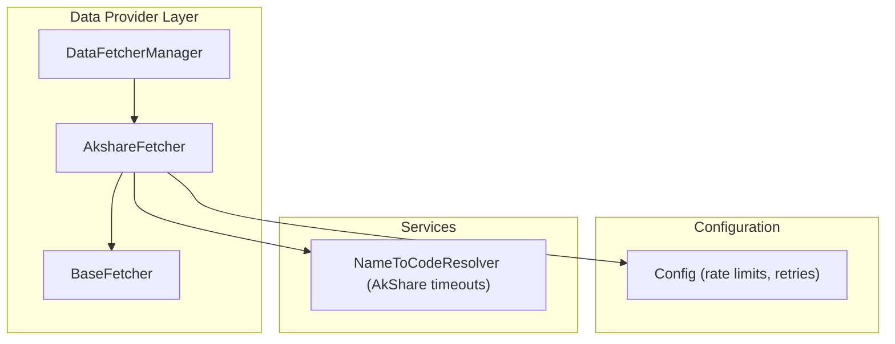
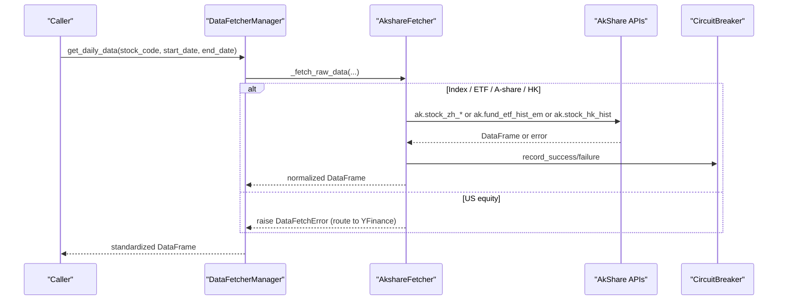
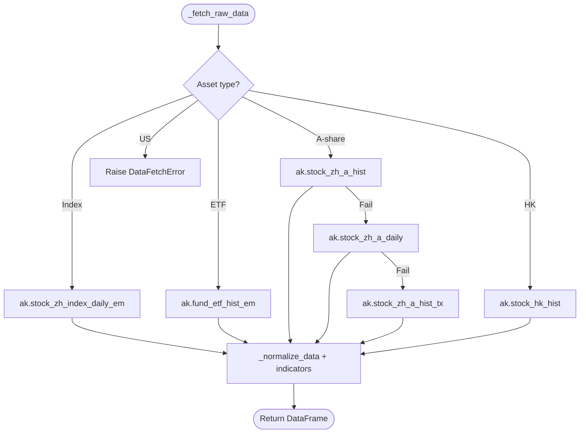
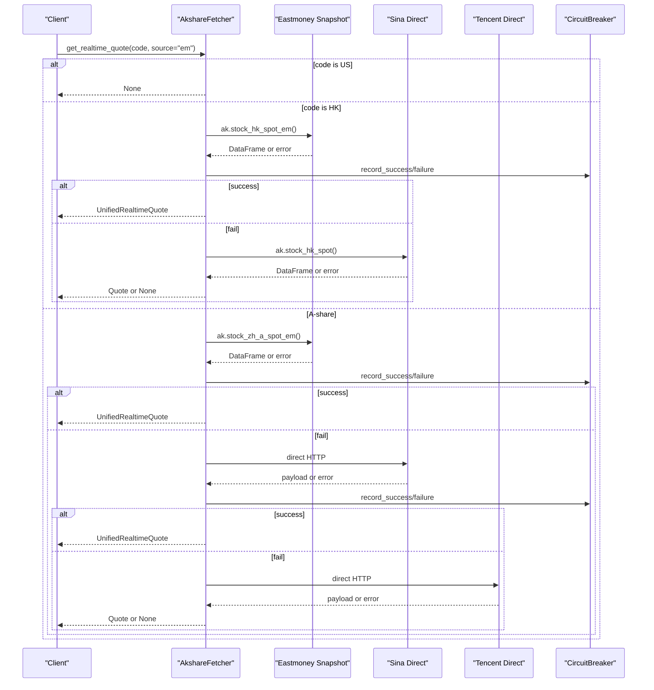
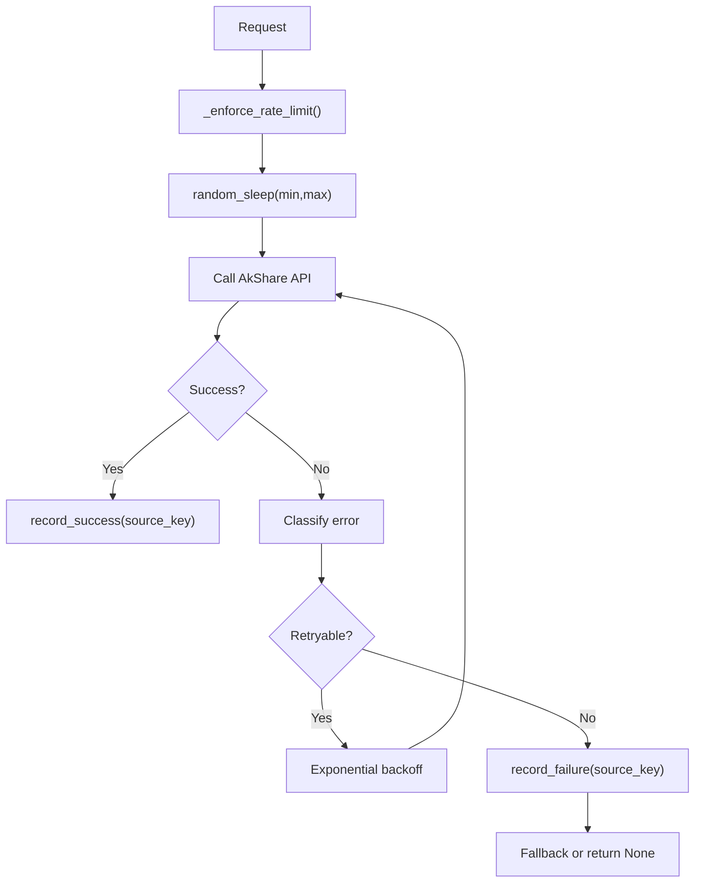
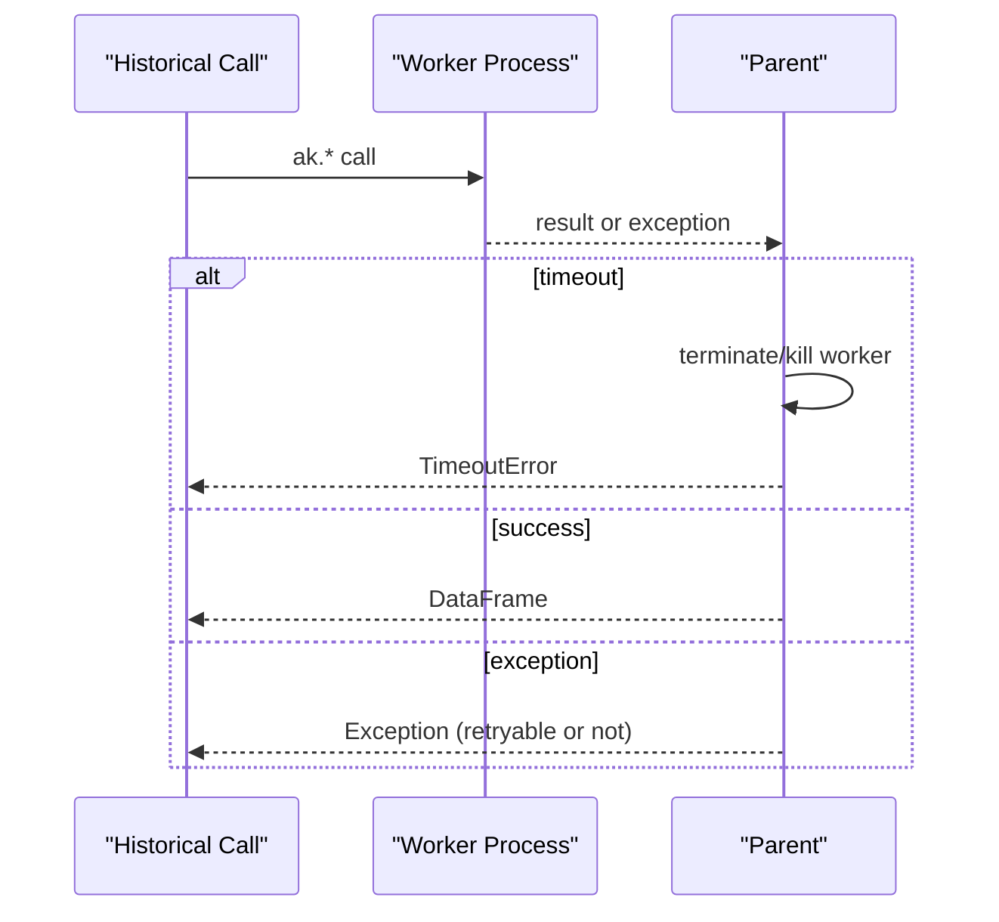
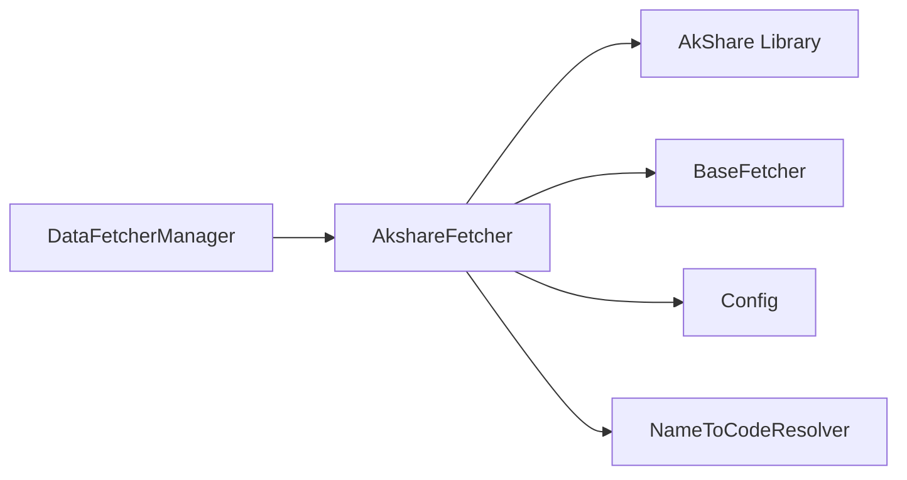

# AkShare Provider

<cite>
**Referenced Files in This Document**
- [akshare_fetcher.py](file://data_provider/akshare_fetcher.py)
- [base.py](file://data_provider/base.py)
- [config.py](file://src/config.py)
- [name_to_code_resolver.py](file://src/services/name_to_code_resolver.py)
- [test_akshare_history_timeout.py](file://tests/test_akshare_history_timeout.py)
- [test_akshare_index_daily.py](file://tests/test_akshare_index_daily.py)
</cite>

## Table of Contents
1. [Introduction](#introduction)
2. [Project Structure](#project-structure)
3. [Core Components](#core-components)
4. [Architecture Overview](#architecture-overview)
5. [Detailed Component Analysis](#detailed-component-analysis)
6. [Dependency Analysis](#dependency-analysis)
7. [Performance Considerations](#performance-considerations)
8. [Troubleshooting Guide](#troubleshooting-guide)
9. [Conclusion](#conclusion)
10. [Appendices](#appendices)

## Introduction
This document explains how the AkShare provider is implemented and used within the system to fetch market data for A-shares and Hong Kong stocks. It covers supported data types (daily history, real-time quotes, fundamentals), authentication requirements, rate limiting policies, data quality characteristics, configuration options, error handling behaviors, fallback strategies when AkShare is unavailable, practical usage scenarios, common issues, troubleshooting steps, limitations versus other providers, and guidance on when to choose AkShare.

## Project Structure
The AkShare integration lives under the data provider layer and integrates with a unified fetcher abstraction and manager:
- The AkShare-specific implementation is in akshare_fetcher.py.
- The shared base class and manager are in base.py.
- Configuration values that affect AkShare behavior are defined in config.py.
- Name-to-code resolution includes AkShare-specific timeouts and failure caching in name_to_code_resolver.py.
- Tests validate timeout handling and index daily behavior.

**Diagram sources**
- [akshare_fetcher.py:391-422](file://data_provider/akshare_fetcher.py#L391-L422)
- [base.py:331-372](file://data_provider/base.py#L331-L372)
- [base.py:604-683](file://data_provider/base.py#L604-L683)
- [config.py:1258-1269](file://src/config.py#L1258-L1269)
- [name_to_code_resolver.py:38-54](file://src/services/name_to_code_resolver.py#L38-L54)

**Section sources**
- [akshare_fetcher.py:1-120](file://data_provider/akshare_fetcher.py#L1-L120)
- [base.py:1-160](file://data_provider/base.py#L1-L160)
- [config.py:1258-1269](file://src/config.py#L1258-L1269)
- [name_to_code_resolver.py:38-54](file://src/services/name_to_code_resolver.py#L38-L54)

## Core Components
- AkshareFetcher: Implements daily history, real-time quotes, chip distribution, market stats, sector/concept rankings, hot stocks, limit-up pool, and index name lookup via AkShare APIs. It enforces rate limiting, user-agent rotation, circuit breakers, and process-wrapped timeouts for historical calls.
- BaseFetcher: Defines the unified interface for fetching daily data, normalization, cleaning, indicator calculation, and provides shared utilities like random sleep and standard columns.
- DataFetcherManager: Orchestrates multiple fetchers by priority and capability, filters support per market, and applies health checks and fallbacks.
- Config: Provides AkShare-specific rate limiting parameters and retry settings.
- NameToCodeResolver: Wraps AkShare lookups with bounded timeouts and failure caching to avoid hangs during cold starts.

Key responsibilities:
- Daily history routing: A-share indices, ETFs, A-shares, HK shares; US equities are explicitly not handled by AkShare and routed elsewhere.
- Real-time quotes: Multiple backends (Eastmoney, Sina, Tencent) with caching and circuit breakers.
- Enhanced features: Chip distribution, market statistics, sector/concept rankings, hot stock lists, limit-up pools.

**Section sources**
- [akshare_fetcher.py:460-500](file://data_provider/akshare_fetcher.py#L460-L500)
- [akshare_fetcher.py:1059-1101](file://data_provider/akshare_fetcher.py#L1059-L1101)
- [base.py:452-529](file://data_provider/base.py#L452-L529)
- [base.py:619-683](file://data_provider/base.py#L619-L683)
- [config.py:1258-1269](file://src/config.py#L1258-L1269)

## Architecture Overview
The AkShare provider participates in a multi-source strategy pattern where requests are routed based on asset type and market capabilities. Historical calls are wrapped in a subprocess with a hard timeout to prevent hanging network calls. Real-time quote retrieval uses caches and circuit breakers to reduce load and handle failures gracefully.

**Diagram sources**
- [akshare_fetcher.py:460-500](file://data_provider/akshare_fetcher.py#L460-L500)
- [akshare_fetcher.py:502-579](file://data_provider/akshare_fetcher.py#L502-L579)
- [akshare_fetcher.py:908-970](file://data_provider/akshare_fetcher.py#L908-L970)
- [base.py:619-683](file://data_provider/base.py#L619-L683)

## Detailed Component Analysis

### Daily History Routing and Fallbacks
- Index daily: Uses ak.stock_zh_index_daily_em for registry-recognized A-share indices. Validates required columns, sorts dates, computes pct_chg if missing, and ensures amount column presence.
- A-share daily: Tries Eastmoney (ak.stock_zh_a_hist), then Sina (ak.stock_zh_a_daily), then Tencent (ak.stock_zh_a_hist_tx). Each call is wrapped with a bounded timeout and rate limiting.
- ETF daily: Uses ak.fund_etf_hist_em with qfq adjustment.
- HK daily: Uses ak.stock_hk_hist with qfq adjustment.
- US equity: Explicitly unsupported; raises DataFetchError so higher-level routing can use YFinance.

**Diagram sources**
- [akshare_fetcher.py:460-500](file://data_provider/akshare_fetcher.py#L460-L500)
- [akshare_fetcher.py:502-579](file://data_provider/akshare_fetcher.py#L502-L579)
- [akshare_fetcher.py:581-750](file://data_provider/akshare_fetcher.py#L581-L750)
- [akshare_fetcher.py:752-811](file://data_provider/akshare_fetcher.py#L752-L811)
- [akshare_fetcher.py:908-970](file://data_provider/akshare_fetcher.py#L908-L970)

**Section sources**
- [akshare_fetcher.py:460-500](file://data_provider/akshare_fetcher.py#L460-L500)
- [akshare_fetcher.py:502-579](file://data_provider/akshare_fetcher.py#L502-L579)
- [akshare_fetcher.py:581-750](file://data_provider/akshare_fetcher.py#L581-L750)
- [akshare_fetcher.py:752-811](file://data_provider/akshare_fetcher.py#L752-L811)
- [akshare_fetcher.py:908-970](file://data_provider/akshare_fetcher.py#L908-L970)

### Real-Time Quotes
- A-share quotes: Three backends with caching and circuit breakers:
  - Eastmoney (full snapshot): ak.stock_zh_a_spot_em
  - Sina (direct HTTP): hq.sinajs.cn/list
  - Tencent (direct HTTP): qt.gtimg.cn/q
- ETF quotes: ak.fund_etf_spot_em with cache and circuit breaker.
- HK quotes: Primary ak.stock_hk_spot_em with fallback ak.stock_hk_spot; both cached and guarded by circuit breakers.
- US quotes: Not supported by AkShare; returns None to allow other providers.

**Diagram sources**
- [akshare_fetcher.py:1059-1101](file://data_provider/akshare_fetcher.py#L1059-L1101)
- [akshare_fetcher.py:1103-1202](file://data_provider/akshare_fetcher.py#L1103-L1202)
- [akshare_fetcher.py:1204-1353](file://data_provider/akshare_fetcher.py#L1204-L1353)
- [akshare_fetcher.py:1355-1506](file://data_provider/akshare_fetcher.py#L1355-L1506)
- [akshare_fetcher.py:1607-1805](file://data_provider/akshare_fetcher.py#L1607-L1805)

**Section sources**
- [akshare_fetcher.py:1059-1101](file://data_provider/akshare_fetcher.py#L1059-L1101)
- [akshare_fetcher.py:1103-1202](file://data_provider/akshare_fetcher.py#L1103-L1202)
- [akshare_fetcher.py:1204-1353](file://data_provider/akshare_fetcher.py#L1204-L1353)
- [akshare_fetcher.py:1355-1506](file://data_provider/akshare_fetcher.py#L1355-L1506)
- [akshare_fetcher.py:1607-1805](file://data_provider/akshare_fetcher.py#L1607-L1805)

### Fundamentals and Enhanced Data
- Chip distribution: ak.stock_cyq_em for A-shares only; skipped for US/HK/ETFs. Returns latest day metrics such as profit ratio, average cost, and concentration bands.
- Market stats: Computes up/down/flat counts, limit-up/limit-down counts, and total turnover from snapshots using robust column detection and A-share rules.
- Sector/concept rankings: Aggregates top/bottom sectors by change percentage from Eastmoney/Sina endpoints.
- Hot stocks: Attempts multiple ranking endpoints (Eastmoney popularity/up, Xueqiu follow list).
- Limit-up pool: Retrieves and ranks limit-up stocks by consecutive boards and seal time.

**Section sources**
- [akshare_fetcher.py:1807-1883](file://data_provider/akshare_fetcher.py#L1807-L1883)
- [akshare_fetcher.py:1984-2143](file://data_provider/akshare_fetcher.py#L1984-L2143)
- [akshare_fetcher.py:2145-2240](file://data_provider/akshare_fetcher.py#L2145-L2240)
- [akshare_fetcher.py:2242-2336](file://data_provider/akshare_fetcher.py#L2242-L2336)
- [akshare_fetcher.py:2338-2388](file://data_provider/akshare_fetcher.py#L2338-L2388)

### Authentication Requirements
- No API token is required for AkShare usage in this implementation. Requests rely on public scraping endpoints exposed through AkShare.
- Proxy configuration may be needed depending on environment; the system automatically sets NO_PROXY for domestic financial domains when proxies are configured to avoid misrouting requests.

**Section sources**
- [akshare_fetcher.py:1-24](file://data_provider/akshare_fetcher.py#L1-L24)
- [config.py:1390-1429](file://src/config.py#L1390-L1429)

### Rate Limiting Policies
- Per-request jitter and minimum interval enforced before each AkShare call to reduce anti-bot triggers.
- Exponential backoff retries for connection errors and timeouts on historical calls.
- Circuit breakers protect real-time quote endpoints; failures record and temporarily block further calls until cooldown expires.
- Global retry and delay settings are configurable via central config.

**Diagram sources**
- [akshare_fetcher.py:439-458](file://data_provider/akshare_fetcher.py#L439-L458)
- [akshare_fetcher.py:460-465](file://data_provider/akshare_fetcher.py#L460-L465)
- [akshare_fetcher.py:1103-1202](file://data_provider/akshare_fetcher.py#L1103-L1202)
- [akshare_fetcher.py:1204-1353](file://data_provider/akshare_fetcher.py#L1204-L1353)
- [akshare_fetcher.py:1355-1506](file://data_provider/akshare_fetcher.py#L1355-L1506)
- [akshare_fetcher.py:1607-1805](file://data_provider/akshare_fetcher.py#L1607-L1805)

**Section sources**
- [akshare_fetcher.py:439-465](file://data_provider/akshare_fetcher.py#L439-L465)
- [akshare_fetcher.py:1103-1202](file://data_provider/akshare_fetcher.py#L1103-L1202)
- [akshare_fetcher.py:1204-1353](file://data_provider/akshare_fetcher.py#L1204-L1353)
- [akshare_fetcher.py:1355-1506](file://data_provider/akshare_fetcher.py#L1355-L1506)
- [akshare_fetcher.py:1607-1805](file://data_provider/akshare_fetcher.py#L1607-L1805)
- [config.py:1258-1269](file://src/config.py#L1258-L1269)

### Data Quality Characteristics
- Normalization: Standardizes column names to date/open/high/low/close/volume/amount/pct_chg and adds computed indicators (MA5/10/20, volume_ratio).
- Validation: Index daily requires specific columns; invalid or unparseable dates cause explicit errors. Missing amount is tolerated but flagged.
- Robust parsing: Real-time quote parsers handle variable field formats and compute derived fields (e.g., change_pct from price/pre_close).
- Market stats: Applies A-share limit-up/limit-down rules per stock type (BSE, STAR/ChiNext, ST, others) and calculates totals.

**Section sources**
- [akshare_fetcher.py:972-1007](file://data_provider/akshare_fetcher.py#L972-L1007)
- [akshare_fetcher.py:502-579](file://data_provider/akshare_fetcher.py#L502-L579)
- [akshare_fetcher.py:1204-1353](file://data_provider/akshare_fetcher.py#L1204-L1353)
- [akshare_fetcher.py:1355-1506](file://data_provider/akshare_fetcher.py#L1355-L1506)
- [akshare_fetcher.py:2056-2143](file://data_provider/akshare_fetcher.py#L2056-L2143)
- [base.py:531-589](file://data_provider/base.py#L531-L589)

### Configuration Options
- AkShare request spacing: akshare_sleep_min and akshare_sleep_max control jitter and minimum intervals.
- Retries: max_retries, retry_base_delay, retry_max_delay apply broadly to fetcher operations.
- Proxy handling: Automatic NO_PROXY setup for domestic financial domains when proxies are configured.
- Priority: AkShareFetcher priority can be overridden via AKSHARE_PRIORITY.

**Section sources**
- [config.py:1258-1269](file://src/config.py#L1258-L1269)
- [config.py:1390-1429](file://src/config.py#L1390-L1429)
- [akshare_fetcher.py:404-422](file://data_provider/akshare_fetcher.py#L404-L422)

### Error Handling Behaviors and Fallback Strategies
- Historical calls: Wrapped in subprocess with a hard timeout; TimeoutError terminates worker processes promptly.
- Multi-source fallback: For A-share daily, tries Eastmoney -> Sina -> Tencent; for HK real-time, tries Eastmoney -> Sina; for market stats and rankings, tries Eastmoney then Sina.
- Circuit breakers: Real-time quote sources are marked unavailable after repeated failures, preventing thundering herds.
- Exception classification: Errors are categorized (timeout, rate limit, remote disconnect, request error) to guide retries and fallbacks.

**Diagram sources**
- [akshare_fetcher.py:325-389](file://data_provider/akshare_fetcher.py#L325-L389)
- [test_akshare_history_timeout.py:107-137](file://tests/test_akshare_history_timeout.py#L107-L137)

**Section sources**
- [akshare_fetcher.py:325-389](file://data_provider/akshare_fetcher.py#L325-L389)
- [akshare_fetcher.py:581-750](file://data_provider/akshare_fetcher.py#L581-L750)
- [akshare_fetcher.py:1607-1805](file://data_provider/akshare_fetcher.py#L1607-L1805)
- [akshare_fetcher.py:1984-2054](file://data_provider/akshare_fetcher.py#L1984-L2054)
- [test_akshare_history_timeout.py:107-137](file://tests/test_akshare_history_timeout.py#L107-L137)

### Practical Examples
- A-share daily history: Request daily bars for an A-share code; the system routes to Eastmoney first, falls back to Sina/Tencent if needed, normalizes columns, and computes indicators.
- HK daily history: Request daily bars for a HK code; uses ak.stock_hk_hist with qfq adjustment.
- Real-time A-share quote: Request quote with default source; tries Eastmoney snapshot, then Sina/Tencent direct endpoints with caching and circuit breakers.
- Real-time HK quote: Request quote; tries Eastmoney snapshot, falls back to Sina endpoint.
- Chip distribution: Request chip metrics for an A-share; returns latest day metrics if available.
- Market stats: Compute market-wide up/down/flat counts and limit-up/limit-down statistics from snapshots.

Note: Provide concrete invocation paths via the documented methods rather than code snippets here.

**Section sources**
- [akshare_fetcher.py:460-500](file://data_provider/akshare_fetcher.py#L460-L500)
- [akshare_fetcher.py:908-970](file://data_provider/akshare_fetcher.py#L908-L970)
- [akshare_fetcher.py:1059-1101](file://data_provider/akshare_fetcher.py#L1059-L1101)
- [akshare_fetcher.py:1607-1805](file://data_provider/akshare_fetcher.py#L1607-L1805)
- [akshare_fetcher.py:1807-1883](file://data_provider/akshare_fetcher.py#L1807-L1883)
- [akshare_fetcher.py:1984-2143](file://data_provider/akshare_fetcher.py#L1984-L2143)

### Common Issues and Troubleshooting
- API timeouts: Historical calls are wrapped with a hard timeout; ensure akshare_sleep_min/max are set appropriately to avoid bursts. Use logs to identify which backend timed out and verify fallback behavior.
- Rate limiting/anti-bot: If you see “banned”, “blocked”, “频率”, “rate”, or “限制” messages, increase sleep intervals and reduce concurrency. Circuit breakers will temporarily disable problematic sources.
- Data format changes: Column validation for index daily ensures required fields exist; unexpected formats trigger DataFetchError. Monitor logs for schema mismatches and adjust expectations accordingly.
- Cold start hangs: Name-to-code resolver uses bounded timeouts and failure caching to avoid blocking during startup.

Recommended steps:
- Increase akshare_sleep_min/max and reduce concurrent requests.
- Check circuit breaker status for real-time quote sources.
- Inspect logs for error categories (timeout, rate limit, remote disconnect) and adjust retry/backoff settings.
- Validate proxy and NO_PROXY settings to ensure domestic endpoints are not routed incorrectly.

**Section sources**
- [akshare_fetcher.py:262-305](file://data_provider/akshare_fetcher.py#L262-L305)
- [akshare_fetcher.py:439-465](file://data_provider/akshare_fetcher.py#L439-L465)
- [akshare_fetcher.py:502-579](file://data_provider/akshare_fetcher.py#L502-L579)
- [name_to_code_resolver.py:38-54](file://src/services/name_to_code_resolver.py#L38-L54)
- [config.py:1390-1429](file://src/config.py#L1390-L1429)

### Limitations Compared to Other Providers
- US equities: AkShare does not provide reliable adjusted prices for US stocks; the system routes US equity requests to YFinance instead.
- Real-time depth: Some endpoints return limited fields compared to paid providers; additional fields may be missing (e.g., PE/PB on certain backends).
- Reliability: Scraping-based endpoints can be unstable or rate-limited; circuit breakers and fallbacks mitigate but do not eliminate risk.
- Coverage: Certain specialized datasets (e.g., detailed order book, tick-level data) are not provided by AkShare.

When to choose AkShare:
- A-share and HK coverage without requiring paid credentials.
- Daily history and basic real-time quotes sufficient for analysis workflows.
- Need for free, broad coverage with built-in fallbacks and resilience mechanisms.

**Section sources**
- [akshare_fetcher.py:488-500](file://data_provider/akshare_fetcher.py#L488-L500)
- [akshare_fetcher.py:1078-1083](file://data_provider/akshare_fetcher.py#L1078-L1083)
- [base.py:619-683](file://data_provider/base.py#L619-L683)

## Dependency Analysis
AkShare depends on:
- AkShare library functions for data retrieval.
- Base fetcher abstractions for consistent interfaces and processing.
- Configuration for rate limiting and retry behavior.
- Services for name-to-code resolution with bounded timeouts.

**Diagram sources**
- [akshare_fetcher.py:391-422](file://data_provider/akshare_fetcher.py#L391-L422)
- [base.py:331-372](file://data_provider/base.py#L331-L372)
- [config.py:1258-1269](file://src/config.py#L1258-L1269)
- [name_to_code_resolver.py:38-54](file://src/services/name_to_code_resolver.py#L38-L54)

**Section sources**
- [akshare_fetcher.py:391-422](file://data_provider/akshare_fetcher.py#L391-L422)
- [base.py:331-372](file://data_provider/base.py#L331-L372)
- [config.py:1258-1269](file://src/config.py#L1258-L1269)
- [name_to_code_resolver.py:38-54](file://src/services/name_to_code_resolver.py#L38-L54)

## Performance Considerations
- Subprocess-wrapped historical calls prevent long-hanging requests; ensure timeout values are appropriate for your environment.
- Caching real-time snapshots reduces repeated full-market pulls; TTL balances freshness against load.
- Circuit breakers avoid cascading failures during outages; tune thresholds and cooldowns if necessary.
- Rate limiting jitter minimizes anti-bot triggers; adjust sleep ranges based on observed stability.

[No sources needed since this section provides general guidance]

## Troubleshooting Guide
- Identify error category: Use logs to determine whether failures are timeouts, rate limits, or remote disconnects.
- Adjust rate limits: Increase akshare_sleep_min/max and reduce concurrency.
- Verify fallback chain: Confirm that secondary sources (Sina/Tencent) are reachable and returning valid payloads.
- Check circuit breaker state: If sources are repeatedly failing, they may be disabled temporarily; wait for cooldown or investigate upstream issues.
- Validate data schemas: Ensure expected columns exist; index daily validates required fields and rejects malformed data.

**Section sources**
- [akshare_fetcher.py:262-305](file://data_provider/akshare_fetcher.py#L262-L305)
- [akshare_fetcher.py:502-579](file://data_provider/akshare_fetcher.py#L502-L579)
- [akshare_fetcher.py:1103-1202](file://data_provider/akshare_fetcher.py#L1103-L1202)
- [akshare_fetcher.py:1204-1353](file://data_provider/akshare_fetcher.py#L1204-L1353)
- [akshare_fetcher.py:1355-1506](file://data_provider/akshare_fetcher.py#L1355-L1506)
- [akshare_fetcher.py:1607-1805](file://data_provider/akshare_fetcher.py#L1607-L1805)

## Conclusion
The AkShare provider delivers comprehensive A-share and HK market data with robust rate limiting, circuit breakers, and fallback strategies. It supports daily history, real-time quotes, chip distribution, market stats, and various rankings. While it lacks US equity support and some advanced datasets, its free access and resilient design make it suitable for many analysis workflows. Configure sleep intervals and retries appropriately, monitor circuit breaker states, and leverage fallback chains to maintain reliability.

[No sources needed since this section summarizes without analyzing specific files]

## Appendices
- Environment variables affecting AkShare:
  - AKSHARE_PRIORITY: Override fetcher priority.
  - akshare_sleep_min/akshare_sleep_max: Control jitter and minimum intervals.
  - max_retries, retry_base_delay, retry_max_delay: Global retry settings.
  - Proxy-related: NO_PROXY auto-set for domestic domains when proxies are configured.

**Section sources**
- [akshare_fetcher.py:404-422](file://data_provider/akshare_fetcher.py#L404-L422)
- [config.py:1258-1269](file://src/config.py#L1258-L1269)
- [config.py:1390-1429](file://src/config.py#L1390-L1429)