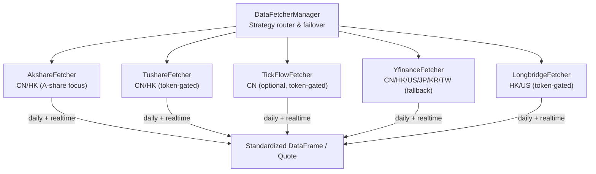
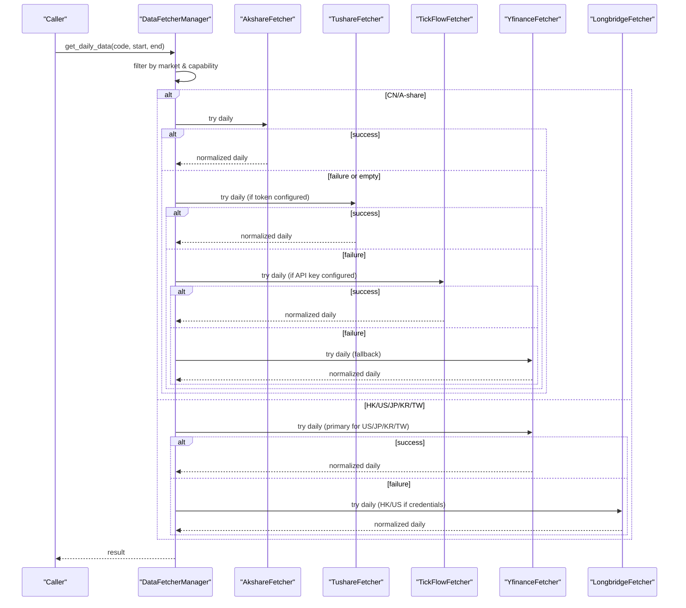
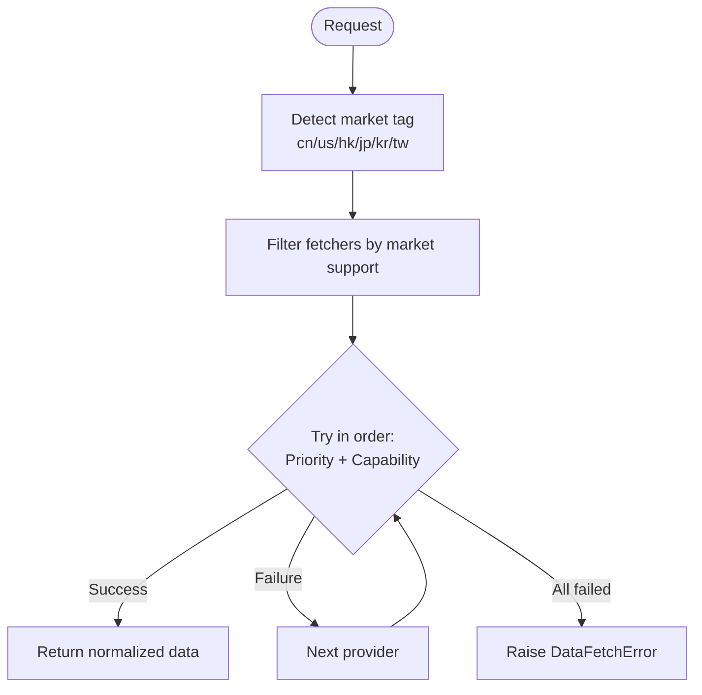

# Market Data Providers

<cite>
**Referenced Files in This Document**
- [base.py](file://data_provider/base.py)
- [akshare_fetcher.py](file://data_provider/akshare_fetcher.py)
- [yfinance_fetcher.py](file://data_provider/yfinance_fetcher.py)
- [tickflow_fetcher.py](file://data_provider/tickflow_fetcher.py)
- [longbridge_fetcher.py](file://data_provider/longbridge_fetcher.py)
- [tushare_fetcher.py](file://data_provider/tushare_fetcher.py)
</cite>

## Table of Contents
1. Introduction
2. Project Structure
3. Core Components
4. Architecture Overview
5. Detailed Component Analysis
6. Dependency Analysis
7. Performance Considerations
8. Troubleshooting Guide
9. Conclusion

## Introduction
This document explains the market data providers used by the system: AkShare, YFinance, TickFlow, Longbridge, Tushare, and other supported sources. It covers capabilities, markets covered, authentication, rate limits, data quality characteristics, configuration options, error handling, fallback strategies, provider selection logic, and practical guidance for choosing the best source based on market coverage, freshness, and reliability needs.

## Project Structure
The data provider layer is built around a common base class and a manager that orchestrates multiple fetchers with automatic failover and capability-based routing. Each provider implements a standardized interface to fetch daily history and optional real-time quotes, then normalizes outputs into a consistent schema.

**Diagram sources**
- [base.py:604-800](file://data_provider/base.py#L604-L800)
- [akshare_fetcher.py:391-500](file://data_provider/akshare_fetcher.py#L391-L500)
- [yfinance_fetcher.py:58-235](file://data_provider/yfinance_fetcher.py#L58-L235)
- [tickflow_fetcher.py:84-208](file://data_provider/tickflow_fetcher.py#L84-L208)
- [longbridge_fetcher.py:414-800](file://data_provider/longbridge_fetcher.py#L414-L800)
- [tushare_fetcher.py:135-547](file://data_provider/tushare_fetcher.py#L135-L547)

**Section sources**
- [base.py:331-590](file://data_provider/base.py#L331-L590)
- [base.py:604-800](file://data_provider/base.py#L604-L800)

## Core Components
- BaseFetcher: Abstract contract for all providers defining raw fetch, normalization, cleaning, indicator calculation, and optional real-time/market stats methods.
- DataFetcherManager: Strategy manager that orders fetchers by priority, filters by market/capability, enforces per-fetcher locks, and applies circuit breakers and health checks.

Key responsibilities:
- Normalize stock codes across markets.
- Route requests to the best available provider for the target market.
- Apply retry, backoff, and circuit breaker policies.
- Provide unified output schemas for daily OHLCV and real-time quotes.

**Section sources**
- [base.py:331-590](file://data_provider/base.py#L331-L590)
- [base.py:604-800](file://data_provider/base.py#L604-L800)

## Architecture Overview
Provider selection and fallback flow:

**Diagram sources**
- [base.py:619-645](file://data_provider/base.py#L619-L645)
- [akshare_fetcher.py:484-500](file://data_provider/akshare_fetcher.py#L484-L500)
- [yfinance_fetcher.py:190-235](file://data_provider/yfinance_fetcher.py#L190-L235)
- [longbridge_fetcher.py:743-800](file://data_provider/longbridge_fetcher.py#L743-L800)
- [tushare_fetcher.py:470-547](file://data_provider/tushare_fetcher.py#L470-L547)
- [tickflow_fetcher.py:169-208](file://data_provider/tickflow_fetcher.py#L169-L208)

## Detailed Component Analysis

### AkShare Provider
- Markets: A-shares (CN), Hong Kong (HK). Explicitly does not support US stocks; those are routed to YFinance.
- Authentication: None required.
- Rate limits: Built-in jitter and exponential backoff; anti-bot protections via random User-Agent and sleep intervals.
- Data quality: High coverage for CN; ETFs supported; index data supported via registry mapping. Realtime quote endpoints include Sina/Tencent with caching and robust error classification.
- Configuration: Priority configurable via environment; optional East Money patch toggle; history call timeout control.
- Error handling: Converts rate-limit signals to explicit errors; retries on transient network issues; falls back among internal sources (East Money, Sina, Tencent) before raising.
- Fallback strategy: Within AkShare, tries multiple internal sources; at manager level, falls back to Tushare/TickFlow/YFinance as needed.

Practical use:
- Best for CN A-share daily history and indices when no token is available.
- Use for HK equities when you prefer free sources.

Known limitations:
- US stocks explicitly unsupported; rely on YFinance for correct adjusted prices.
- Subject to anti-bot measures; jitter/backoff helps but may still throttle under heavy load.

**Section sources**
- [akshare_fetcher.py:391-500](file://data_provider/akshare_fetcher.py#L391-L500)
- [akshare_fetcher.py:581-750](file://data_provider/akshare_fetcher.py#L581-L750)
- [akshare_fetcher.py:262-322](file://data_provider/akshare_fetcher.py#L262-L322)

### YFinance Provider
- Markets: CN, HK, US, Japan (JP), Korea (KR), Taiwan (TW).
- Authentication: None required.
- Rate limits: Exponential backoff retries; uses Yahoo Finance APIs which can be inconsistent for some markets.
- Data quality: Broadest market coverage; amount derived from volume*close; pct_chg computed; index support via mappings; Stooq fallback for US quotes when necessary.
- Configuration: Priority configurable via environment; supports suffix-only symbols for JP/KR/TW; converts A-share codes to .SS/.SZ; handles BSE (.BJ).
- Error handling: Retries on connection/timeout; raises DataFetchError on empty results; provides index realtime helpers and Stooq fallback for US quotes.
- Fallback strategy: Primary fallback for US/JP/KR/TW; also used for CN/HK when others fail.

Practical use:
- Default choice for US equities and indices; good for JP/KR/TW where Yahoo has coverage.
- Useful as a universal fallback when domestic sources fail.

Known limitations:
- Amount field is estimated for many instruments.
- Some indices or exotic tickers may have limited coverage.

**Section sources**
- [yfinance_fetcher.py:58-235](file://data_provider/yfinance_fetcher.py#L58-L235)
- [yfinance_fetcher.py:351-527](file://data_provider/yfinance_fetcher.py#L351-L527)
- [yfinance_fetcher.py:537-686](file://data_provider/yfinance_fetcher.py#L537-L686)

### TickFlow Provider
- Markets: CN A-shares and ETFs only.
- Authentication: Requires an API key; optional feature set (batch daily K-lines, universe quotes) gated by permissions.
- Rate limits: Internal batching and caches; respects server-side limits; capability negative cache avoids repeated failures.
- Data quality: Clean OHLCV; volume converted from lots to shares; supports multiple adjust modes; strong validation to reject truncated responses.
- Configuration: Priority, kline adjust mode, batch size, timeouts; optional prefetch for daily K-lines and realtime quotes.
- Error handling: Permission errors detected and cached; truncated responses rejected; graceful degradation when batch features unavailable.
- Fallback strategy: If TickFlow is unavailable or permission-limited, manager routes to other CN sources (e.g., AkShare, Tushare).

Practical use:
- Preferred for CN A-share daily K-lines when high-quality, consistent data is required and API key is available.
- Prefetching improves performance in batch analysis scenarios.

Known limitations:
- Only CN A-share/ETF symbols supported.
- Batch features may be disabled due to permissions.

**Section sources**
- [tickflow_fetcher.py:84-208](file://data_provider/tickflow_fetcher.py#L84-L208)
- [tickflow_fetcher.py:395-445](file://data_provider/tickflow_fetcher.py#L395-L445)
- [tickflow_fetcher.py:574-682](file://data_provider/tickflow_fetcher.py#L574-L682)

### Longbridge Provider
- Markets: HK and US.
- Authentication: OAuth 2.0 client ID preferred; legacy API key triplet supported; region and endpoint customization via environment variables.
- Rate limits: Connection cooldown after closed context errors; static info TTL reduces repeated calls; derived metrics computed locally (turnover, volume ratio).
- Data quality: Realtime quotes plus static info enable turnover_rate, pe_ratio, pb_ratio, total_mv, circ_mv; volume_ratio computed from recent daily candles.
- Configuration: Region, HTTP/WebSocket URLs, log path, language, overnight push mode; static info TTL; connection cooldown seconds.
- Error handling: Detects connection errors and enters cooldown; validates OAuth token cache; gracefully returns None when unavailable.
- Fallback strategy: Used as last resort for HK/US when YFinance fails or insufficient fields are needed.

Practical use:
- When you need richer derived fields (turnover, PE/PB, market caps) for HK/US or when YFinance lacks certain fields.
- Good for HK/US realtime quotes with additional fundamentals.

Known limitations:
- Requires valid credentials; headless environments must provide token cache or legacy keys.
- SDK version compatibility affects OAuth availability.

**Section sources**
- [longbridge_fetcher.py:414-800](file://data_provider/longbridge_fetcher.py#L414-L800)
- [longbridge_fetcher.py:82-143](file://data_provider/longbridge_fetcher.py#L82-L143)
- [longbridge_fetcher.py:226-322](file://data_provider/longbridge_fetcher.py#L226-L322)

### Tushare Provider
- Markets: CN A-shares and ETFs; HK via hk_daily; US not supported.
- Authentication: Requires a token; dynamic priority boost when configured and initialized successfully.
- Rate limits: Per-minute counter with forced wait when quota exceeded; exponential backoff retries.
- Data quality: High-quality CN data; unit conversions applied for A-share vol/amount; HK data handled without scaling; trade calendar caching.
- Configuration: Custom HTTP URL via environment; token management; priority tuning; trade date caching.
- Error handling: Quota exceeded mapped to rate limit errors; explicit messages for missing token; fallback to legacy realtime if Pro unavailable.
- Fallback strategy: After AkShare/TickFlow for CN; otherwise manager proceeds to YFinance.

Practical use:
- Strong choice for CN A-share/ETF daily history when token is available and quota permits.
- Useful for HK daily via hk_daily when needed.

Known limitations:
- No US support; HK realtime not supported.
- Free tier quotas apply; careful usage required.

**Section sources**
- [tushare_fetcher.py:135-236](file://data_provider/tushare_fetcher.py#L135-L236)
- [tushare_fetcher.py:246-295](file://data_provider/tushare_fetcher.py#L246-L295)
- [tushare_fetcher.py:470-547](file://data_provider/tushare_fetcher.py#L470-L547)
- [tushare_fetcher.py:701-800](file://data_provider/tushare_fetcher.py#L701-L800)

### Other Supported Sources
- Additional fetchers exist (e.g., Efinance, Tencent, Pytdx, Baostock, Futu, Finnhub, Alpha Vantage) and are registered in the manager’s market support map. They follow the same base contract and are considered by the manager according to market capability and availability.

**Section sources**
- [base.py:619-632](file://data_provider/base.py#L619-L632)

## Dependency Analysis
Provider selection is governed by market tags and capability filters:

**Diagram sources**
- [base.py:243-256](file://data_provider/base.py#L243-L256)
- [base.py:619-645](file://data_provider/base.py#L619-L645)
- [base.py:765-800](file://data_provider/base.py#L765-L800)

**Section sources**
- [base.py:243-256](file://data_provider/base.py#L243-L256)
- [base.py:619-645](file://data_provider/base.py#L619-L645)
- [base.py:765-800](file://data_provider/base.py#L765-L800)

## Performance Considerations
- Jitter and backoff: All providers implement randomized delays and exponential backoff to reduce rate limiting risk.
- Caching:
  - AkShare: Realtime quote caches with TTL; ETF and HK caches to reduce expensive calls.
  - TickFlow: Daily K-line and realtime quote caches; batch prefetch for large sets.
  - Longbridge: Static info TTL to avoid repeated fundamental lookups; connection cooldown to prevent reconnect storms.
  - Tushare: Trade calendar cache refreshed per day.
- Batching: TickFlow supports batch daily K-lines and quote batches when permitted.
- Timeouts: AkShare wraps calls with process-level timeouts to prevent hangs.

[No sources needed since this section provides general guidance]

## Troubleshooting Guide
Common issues and remedies:
- Rate limiting:
  - AkShare: Anti-bot detection triggers retries and backoff; consider reducing concurrency or increasing jitter.
  - Tushare: Per-minute quota enforced; wait until next minute window; monitor usage.
  - Longbridge: Connection cooldown after closed contexts; verify credentials and region settings.
- Missing fields:
  - YFinance: Amount often estimated; use Longbridge for precise turnover/PE/PB when available.
- Authentication:
  - TickFlow: Ensure API key configured; check permission errors and capability negative cache behavior.
  - Longbridge: Validate OAuth token cache or legacy keys; ensure environment variables are non-empty and region-mapped.
- Unsupported markets:
  - AkShare/Tushare do not support US; route to YFinance or Longbridge.
  - TickFlow only supports CN A-share/ETF; use other providers for HK/US.

**Section sources**
- [akshare_fetcher.py:262-322](file://data_provider/akshare_fetcher.py#L262-L322)
- [tushare_fetcher.py:246-295](file://data_provider/tushare_fetcher.py#L246-L295)
- [longbridge_fetcher.py:464-478](file://data_provider/longbridge_fetcher.py#L464-L478)
- [tickflow_fetcher.py:304-332](file://data_provider/tickflow_fetcher.py#L304-L332)

## Conclusion
The system selects the best provider per market using a layered strategy:
- CN A-share/ETF: Prefer AkShare (free), then Tushare (token-gated), then TickFlow (token-gated), then YFinance as fallback.
- HK: Prefer AkShare or YFinance; Longbridge when richer fields are needed.
- US: Prefer YFinance; Longbridge for enhanced fields when credentials are present.
- JP/KR/TW: Prefer YFinance.

Providers implement robust error handling, rate limiting, and caching to maximize reliability. Configure tokens and priorities appropriately to tailor behavior to your environment and data needs.

[No sources needed since this section summarizes without analyzing specific files]