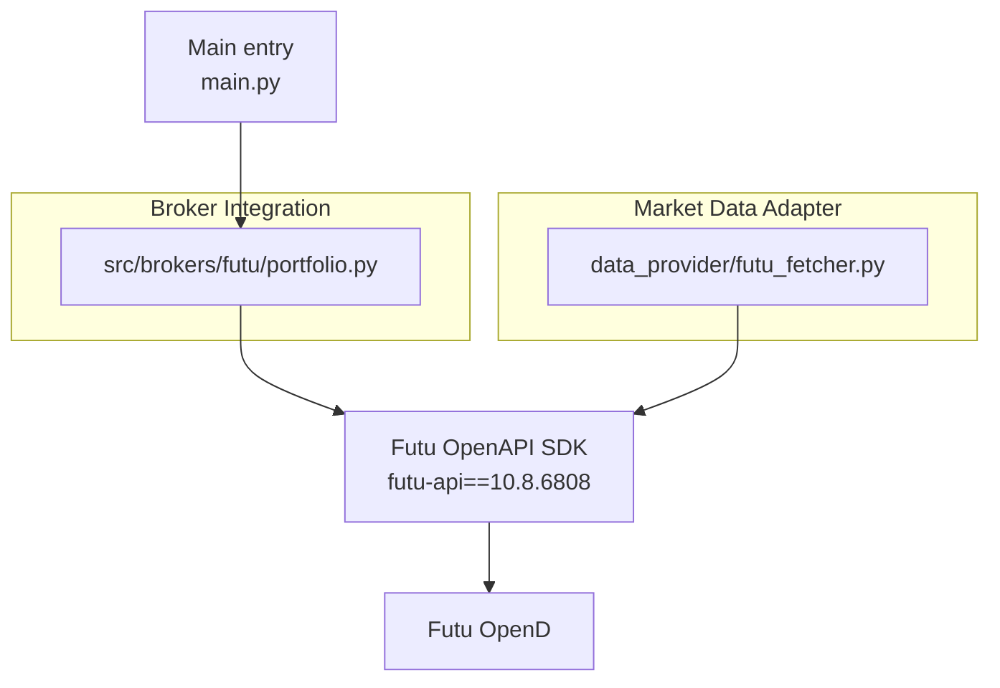
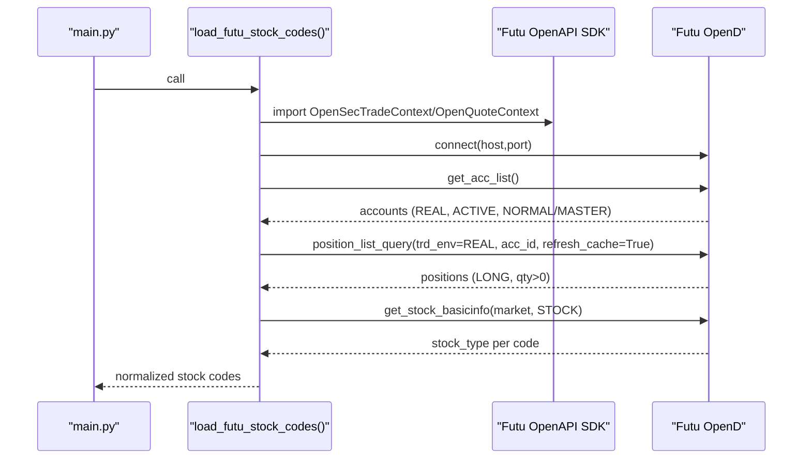
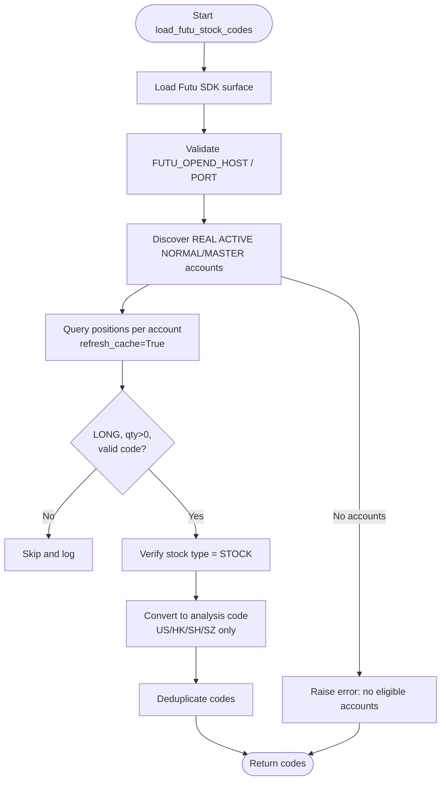
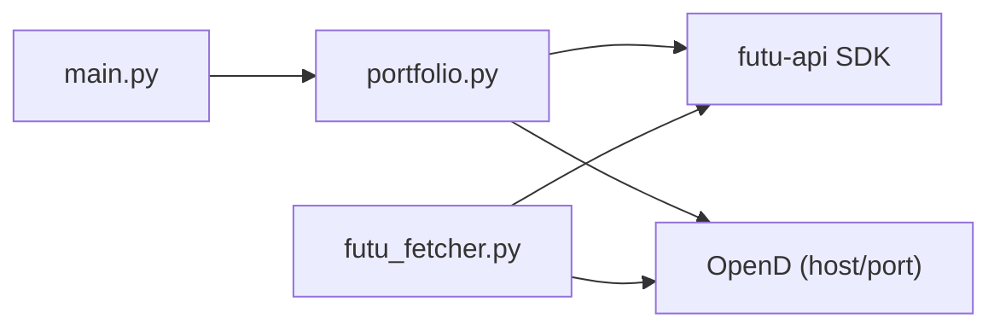

# Broker Integration

<cite>
**Referenced Files in This Document**
- [portfolio.py](file://src/brokers/futu/portfolio.py)
- [futu_fetcher.py](file://data_provider/futu_fetcher.py)
- [test_futu_portfolio_service.py](file://tests/test_futu_portfolio_service.py)
- [full-guide_EN.md](file://docs/full-guide_EN.md)
- [main.py](file://main.py)
</cite>

## Table of Contents
1. [Introduction](#introduction)
2. [Project Structure](#project-structure)
3. [Core Components](#core-components)
4. [Architecture Overview](#architecture-overview)
5. [Detailed Component Analysis](#detailed-component-analysis)
6. [Dependency Analysis](#dependency-analysis)
7. [Performance Considerations](#performance-considerations)
8. [Troubleshooting Guide](#troubleshooting-guide)
9. [Conclusion](#conclusion)

## Introduction
This document explains the Broker Integration for Futu Securities within the project. It covers how the system connects to Futu OpenD via the pinned Futu OpenAPI SDK, discovers eligible accounts, authenticates through OpenD sessions, and synchronizes positions to produce a deduplicated list of supported stock codes. It also documents configuration options, supported account types and markets, security considerations, and troubleshooting steps for common connection and account access issues.

## Project Structure
The Futu integration spans two main areas:
- Portfolio synchronization (broker-side): reads real accounts and positions from Futu OpenD and converts them into analysis-ready stock codes.
- Market data fetching (data-provider side): optional read-only market data adapter for HK quotes and daily K-lines via Futu OpenD.

**Diagram sources**
- [portfolio.py:52-83](file://src/brokers/futu/portfolio.py#L52-L83)
- [futu_fetcher.py:66-122](file://data_provider/futu_fetcher.py#L66-L122)
- [main.py:546-550](file://main.py#L546-L550)

**Section sources**
- [portfolio.py:1-485](file://src/brokers/futu/portfolio.py#L1-L485)
- [futu_fetcher.py:1-349](file://data_provider/futu_fetcher.py#L1-L349)
- [main.py:546-550](file://main.py#L546-L550)

## Core Components
- Futu portfolio loader: validates environment settings, loads the SDK, discovers active REAL accounts, queries positions, filters to supported markets, and returns normalized stock codes.
- Futu market data fetcher: provides read-only quote and historical data for HK symbols using an OpenQuoteContext.

Key capabilities:
- Connection management: IPv4-only validation, configurable host/port, safe context closing.
- Account discovery: selects NORMAL and MASTER roles with ACTIVE status; supports optional single-account selection.
- Position synchronization: refreshes positions, keeps only LONG non-zero quantities, filters to US/HK/SH/SZ stocks, and converts to internal code format.
- Error handling: raises domain-specific errors with actionable messages for missing SDK, invalid config, or API failures.

**Section sources**
- [portfolio.py:115-162](file://src/brokers/futu/portfolio.py#L115-L162)
- [portfolio.py:165-230](file://src/brokers/futu/portfolio.py#L165-L230)
- [portfolio.py:233-316](file://src/brokers/futu/portfolio.py#L233-L316)
- [portfolio.py:358-457](file://src/brokers/futu/portfolio.py#L358-L457)
- [futu_fetcher.py:66-122](file://data_provider/futu_fetcher.py#L66-L122)

## Architecture Overview
The portfolio synchronization flow connects to Futu OpenD, enumerates eligible accounts, pulls positions, validates and filters holdings, and outputs analysis-ready codes. The market data adapter independently opens a quote context for read-only market data operations.

**Diagram sources**
- [portfolio.py:165-230](file://src/brokers/futu/portfolio.py#L165-L230)
- [portfolio.py:233-316](file://src/brokers/futu/portfolio.py#L233-L316)
- [portfolio.py:358-457](file://src/brokers/futu/portfolio.py#L358-L457)
- [main.py:546-550](file://main.py#L546-L550)

## Detailed Component Analysis

### Futu Portfolio Loader
Responsibilities:
- Validate and load environment variables for OpenD host/port, selected account ID, and security firm.
- Discover eligible accounts: REAL environment, ACTIVE status, NORMAL or MASTER role.
- Query positions with refresh enabled, filter to LONG non-zero quantities.
- Filter to supported markets (US, HK, SH, SZ), exclude CN B-shares, verify stock type, and convert to internal code format.
- Return deduplicated analysis codes.

Configuration handling:
- FUTU_OPEND_HOST: defaults to 127.0.0.1; must be IPv4 or hostname resolving to IPv4.
- FUTU_OPEND_PORT: defaults to 11111; validated as integer within 1–65535.
- FUTU_ACC_ID: optional positive integer to select one account; otherwise merges all eligible accounts.
- FUTU_SECURITY_FIRM: optional explicit broker enum name; defaults to NONE for one-off auto-detection.

Supported account types:
- NORMAL and MASTER roles are accepted when ACTIVE.

Supported markets:
- US, HK, SH, SZ; other markets are skipped with warnings.

Position synchronization mechanism:
- Uses TrdEnv.REAL, refresh_cache=True on each run.
- Skips SHORT and unknown sides; skips zero quantity.
- Validates code format and quantity; raises errors on malformed data.
- Filters by SecurityType.STOCK after verifying stock type via basic info.

Error handling:
- Raises FutuPortfolioError for SDK import failures, invalid ports, unsupported firms, account query failures, invalid account IDs, invalid position data, and conversion failures.

**Diagram sources**
- [portfolio.py:52-83](file://src/brokers/futu/portfolio.py#L52-L83)
- [portfolio.py:115-162](file://src/brokers/futu/portfolio.py#L115-L162)
- [portfolio.py:165-230](file://src/brokers/futu/portfolio.py#L165-L230)
- [portfolio.py:233-316](file://src/brokers/futu/portfolio.py#L233-L316)
- [portfolio.py:358-457](file://src/brokers/futu/portfolio.py#L358-L457)

**Section sources**
- [portfolio.py:20-49](file://src/brokers/futu/portfolio.py#L20-L49)
- [portfolio.py:115-162](file://src/brokers/futu/portfolio.py#L115-L162)
- [portfolio.py:165-230](file://src/brokers/futu/portfolio.py#L165-L230)
- [portfolio.py:233-316](file://src/brokers/futu/portfolio.py#L233-L316)
- [portfolio.py:358-457](file://src/brokers/futu/portfolio.py#L358-L457)
- [test_futu_portfolio_service.py:177-800](file://tests/test_futu_portfolio_service.py#L177-L800)

### Futu Market Data Fetcher
Responsibilities:
- Provide read-only market data for HK symbols via OpenQuoteContext.
- Support stock name lookup, company profile, financial statements, dividends, splits, capital flow, trading days, and realtime quotes.
- Normalize timestamps and fields to project standards.

Connection behavior:
- Host/port resolved from environment or configuration; defaults to 127.0.0.1:11111 if not configured.
- Context is lazily created and reused per process; closed on shutdown.

Security posture:
- Read-only; does not import or expose trading APIs.

**Section sources**
- [futu_fetcher.py:1-349](file://data_provider/futu_fetcher.py#L1-L349)

### Integration Entry Point
The main application invokes the portfolio loader to obtain Futu-backed stock codes for analysis runs. Errors from the loader are caught and surfaced appropriately.

**Section sources**
- [main.py:546-550](file://main.py#L546-L550)
- [main.py:1690-1690](file://main.py#L1690-L1690)

## Dependency Analysis
- The portfolio loader depends on the Futu OpenAPI SDK (pinned version). It imports specific classes and enums to interact with OpenD.
- The market data fetcher depends on the same SDK but uses only quote-related contexts.
- Both components rely on environment variables for connection parameters and optional account selection.

**Diagram sources**
- [portfolio.py:52-83](file://src/brokers/futu/portfolio.py#L52-L83)
- [futu_fetcher.py:66-122](file://data_provider/futu_fetcher.py#L66-L122)
- [main.py:546-550](file://main.py#L546-L550)

**Section sources**
- [portfolio.py:52-83](file://src/brokers/futu/portfolio.py#L52-L83)
- [futu_fetcher.py:66-122](file://data_provider/futu_fetcher.py#L66-L122)

## Performance Considerations
- Batched static info queries: stock type verification is performed in batches of 100 to reduce network overhead.
- Position refresh: positions are refreshed on each run to ensure up-to-date holdings.
- Context reuse: the market data fetcher reuses OpenQuoteContext per process to avoid repeated connections.
- IPv4 constraint: the pinned SDK networking layer requires IPv4; misconfigured hosts can cause immediate failures.

[No sources needed since this section provides general guidance]

## Troubleshooting Guide

Common issues and resolutions:
- Missing SDK:
  - Symptom: ImportError when loading SDK.
  - Resolution: Install the pinned SDK version as indicated by the error message.
- Invalid port:
  - Symptom: Port validation fails.
  - Resolution: Ensure FUTU_OPEND_PORT is a valid integer between 1 and 65535.
- Unsupported IPv6:
  - Symptom: IPv6 address rejected.
  - Resolution: Use an IPv4 address or hostname that resolves to IPv4.
- No eligible accounts:
  - Symptom: Error indicating no ACTIVE REAL NORMAL/MASTER accounts found.
  - Resolution: Verify OpenD login state, account roles, and statuses; optionally set FUTU_ACC_ID to target a known account.
- Invalid account ID:
  - Symptom: Error for non-positive or non-integer FUTU_ACC_ID.
  - Resolution: Set FUTU_ACC_ID to a positive integer matching an eligible account.
- Unknown security firm:
  - Symptom: Error for unsupported FUTU_SECURITY_FIRM value.
  - Resolution: Use a valid SecurityFirm enum name or leave unset to use NONE auto-detection.
- Invalid position data:
  - Symptom: Errors for non-finite quantities, empty or unqualified codes, or non-string codes.
  - Resolution: Check Futu account data integrity; remove malformed entries or fix symbol formats.
- Unsupported markets or B-shares:
  - Symptom: Warnings about skipped holdings.
  - Resolution: Only US, HK, SH, SZ stocks are supported; CN B-shares are excluded by design.
- Quote context initialization failure:
  - Symptom: Warning during OpenQuoteContext creation.
  - Resolution: Verify host/port and network connectivity; check logs for details.

Security considerations:
- Treat account IDs and any credentials as sensitive configuration; do not commit them to repositories.
- Prefer running OpenD on the same host or over trusted networks; cross-host connections carry real account and position data.
- The integration does not modify process-wide SDK encryption settings; follow platform best practices for secure networking.

Operational tips:
- When deploying in containers, ensure FUTU_OPEND_HOST points to the correct endpoint reachable from the container runtime.
- Keep FUTU_OPEND_PORT within the allowed range and ensure it matches the OpenD configuration.

**Section sources**
- [portfolio.py:52-83](file://src/brokers/futu/portfolio.py#L52-L83)
- [portfolio.py:115-162](file://src/brokers/futu/portfolio.py#L115-L162)
- [portfolio.py:165-230](file://src/brokers/futu/portfolio.py#L165-L230)
- [portfolio.py:233-316](file://src/brokers/futu/portfolio.py#L233-L316)
- [portfolio.py:358-457](file://src/brokers/futu/portfolio.py#L358-L457)
- [futu_fetcher.py:66-122](file://data_provider/futu_fetcher.py#L66-L122)
- [full-guide_EN.md:344-367](file://docs/full-guide_EN.md#L344-L367)
- [full-guide_EN.md:671-675](file://docs/full-guide_EN.md#L671-L675)

## Conclusion
The Futu Broker Integration provides a robust, read-only pathway to synchronize real positions from Futu OpenD into the analysis pipeline. It enforces strict configuration validation, supports NORMAL and MASTER account roles across US, HK, SH, and SZ markets, and implements careful error handling to surface actionable diagnostics. For market data needs, the Futu fetcher offers a complementary read-only adapter focused on HK symbols. Together, these components enable reliable portfolio-aware analysis while maintaining security and performance best practices.