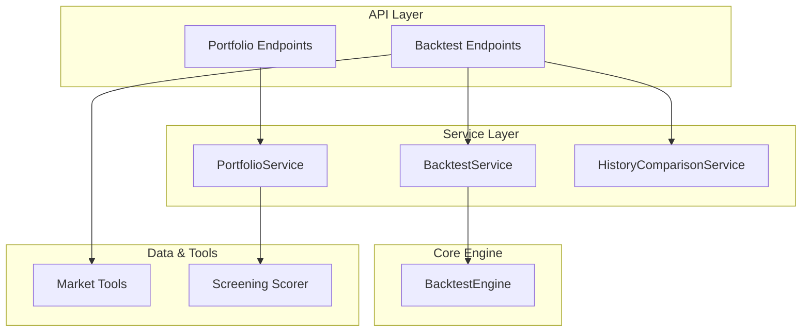
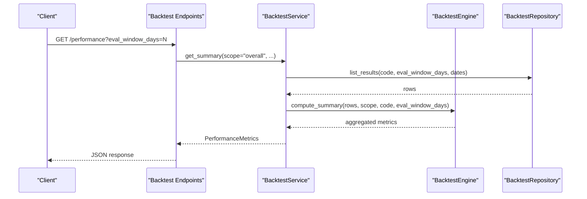
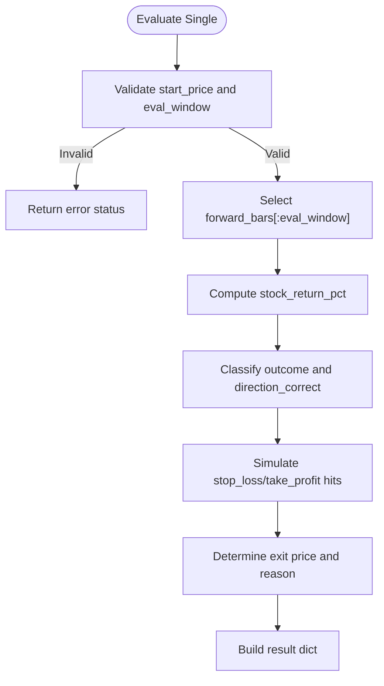
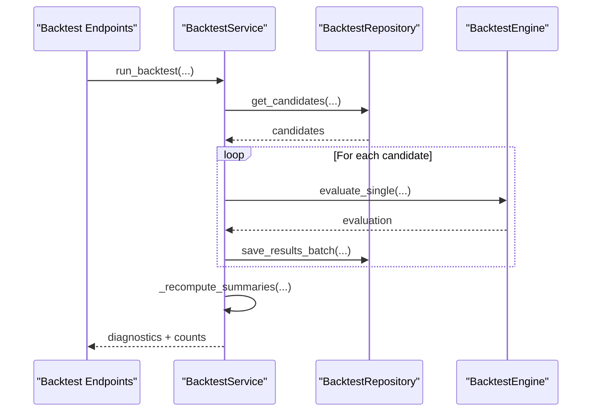
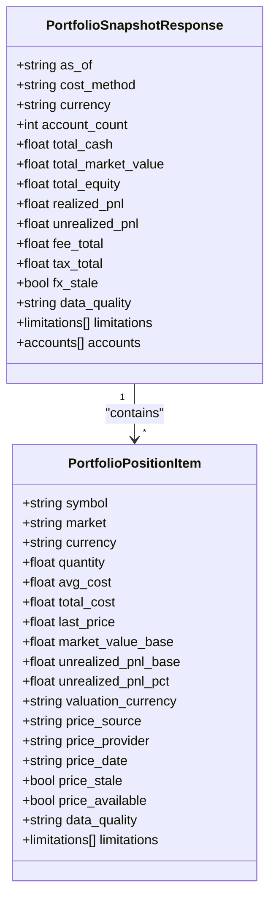
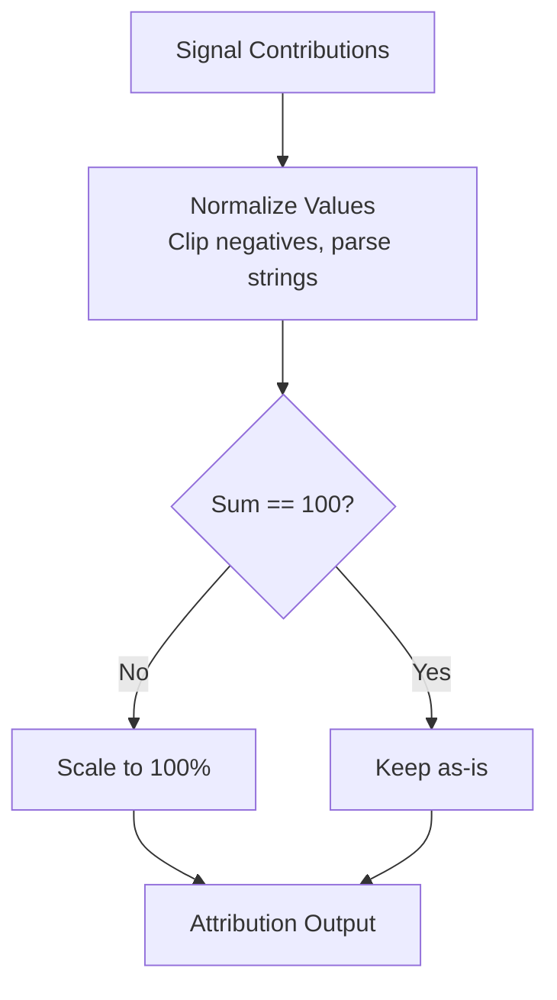
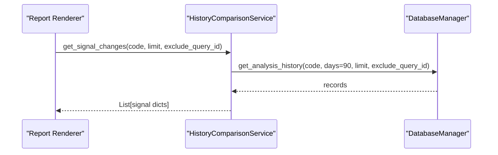
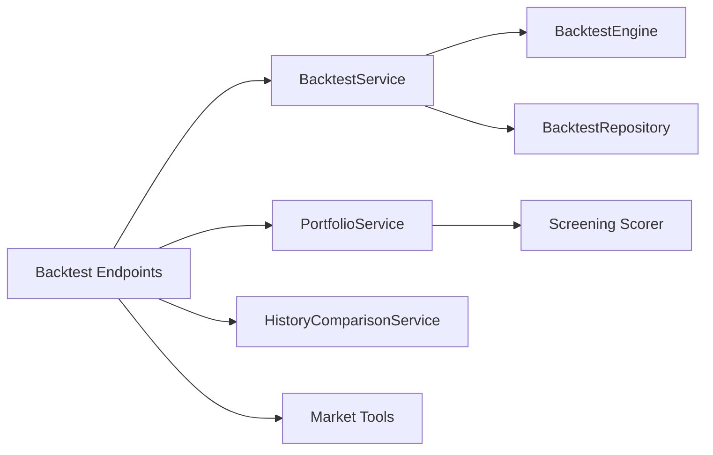

# Performance Analytics

<cite>
**Referenced Files in This Document**
- [backtest_engine.py](file://src/core/backtest_engine.py)
- [backtest_service.py](file://src/services/backtest_service.py)
- [backtest.py (API endpoints)](file://api/v1/endpoints/backtest.py)
- [backtest.py (API schemas)](file://api/v1/schemas/backtest.py)
- [portfolio_service.py](file://src/services/portfolio_service.py)
- [portfolio.py (API schemas)](file://api/v1/schemas/portfolio.py)
- [history_comparison_service.py](file://src/services/history_comparison_service.py)
- [market_tools.py](file://src/agent/tools/market_tools.py)
- [scorer.py](file://src/services/screening/scorer.py)
</cite>

## Table of Contents
1. Introduction
2. Project Structure
3. Core Components
4. Architecture Overview
5. Detailed Component Analysis
6. Dependency Analysis
7. Performance Considerations
8. Troubleshooting Guide
9. Conclusion
10. Appendices

## Introduction
This document explains the Performance Analytics system that measures and reports portfolio and strategy performance, compares outcomes against benchmarks, and provides attribution insights. It covers how key metrics are computed, how benchmarking works, how attribution is derived, and how to build reports and visualizations. It also outlines statistical foundations, data quality requirements, and limitations of historical performance as a predictor of future results.

## Project Structure
The performance analytics capability spans several layers:
- Backtesting engine computes per-evaluation outcomes and aggregates summaries.
- Service layer orchestrates runs, queries results, and builds dynamic summaries.
- API exposes performance metrics and recent evaluations.
- Portfolio service snapshots positions, PnL, FX, and risk-related fields for reporting.
- History comparison supports signal change timelines used in reports.
- Market tools provide sector rankings and index context for benchmarking.
- Screening scorer integrates volatility and drawdown features into stability scoring.

**Diagram sources**
- [backtest.py (API endpoints):164-201](file://api/v1/endpoints/backtest.py#L164-L201)
- [backtest_service.py:45-309](file://src/services/backtest_service.py#L45-L309)
- [backtest_engine.py:158-273](file://src/core/backtest_engine.py#L158-L273)
- [portfolio_service.py:471-613](file://src/services/portfolio_service.py#L471-L613)
- [history_comparison_service.py:66-96](file://src/services/history_comparison_service.py#L66-L96)
- [market_tools.py:94-110](file://src/agent/tools/market_tools.py#L94-L110)
- [scorer.py:314-367](file://src/services/screening/scorer.py#L314-L367)

**Section sources**
- [backtest.py (API endpoints):164-201](file://api/v1/endpoints/backtest.py#L164-L201)
- [backtest_service.py:45-309](file://src/services/backtest_service.py#L45-L309)
- [backtest_engine.py:158-273](file://src/core/backtest_engine.py#L158-L273)
- [portfolio_service.py:471-613](file://src/services/portfolio_service.py#L471-L613)
- [history_comparison_service.py:66-96](file://src/services/history_comparison_service.py#L66-L96)
- [market_tools.py:94-110](file://src/agent/tools/market_tools.py#L94-L110)
- [scorer.py:314-367](file://src/services/screening/scorer.py#L314-L367)

## Core Components
- BacktestEngine: Evaluates single analyses over forward daily bars, classifies outcomes, tracks stop-loss/take-profit hits, and aggregates summary metrics across many evaluations.
- BacktestService: Orchestrates backtest runs, resolves evaluation windows, persists results, and builds dynamic or cached summaries with phase filtering and diagnostics.
- PortfolioService: Replays trades, cash ledger, and corporate actions to produce snapshots of equity, realized/unrealized PnL, fees, taxes, FX staleness, and position-level details.
- HistoryComparisonService: Retrieves recent signal changes per stock for report rendering.
- Market Tools: Provides sector rankings and index context useful for benchmarking and attribution.
- Screening Scorer: Uses volatility and drawdown features to compute stability scores, informing risk-aware analytics.

Key metric computations implemented:
- Total return: Computed from start price to end close over the evaluation window.
- Direction accuracy and win rate: Derived from expected direction and neutral band thresholds.
- Stop-loss and take-profit trigger rates: Based on simulated entry and intraday high/low checks.
- Average days to first hit: Aggregated across applicable simulations.
- Position recommendation inference: Long vs cash based on operation advice text.

**Section sources**
- [backtest_engine.py:158-273](file://src/core/backtest_engine.py#L158-L273)
- [backtest_engine.py:367-479](file://src/core/backtest_engine.py#L367-L479)
- [backtest_service.py:45-309](file://src/services/backtest_service.py#L45-L309)
- [portfolio_service.py:471-613](file://src/services/portfolio_service.py#L471-L613)
- [history_comparison_service.py:66-96](file://src/services/history_comparison_service.py#L66-L96)
- [market_tools.py:94-110](file://src/agent/tools/market_tools.py#L94-L110)
- [scorer.py:314-367](file://src/services/screening/scorer.py#L314-L367)

## Architecture Overview
The performance analytics pipeline processes historical analysis signals, simulates outcomes using forward market data, and aggregates results into actionable metrics.

**Diagram sources**
- [backtest.py (API endpoints):164-201](file://api/v1/endpoints/backtest.py#L164-L201)
- [backtest_service.py:562-655](file://src/services/backtest_service.py#L562-L655)
- [backtest_engine.py:367-479](file://src/core/backtest_engine.py#L367-L479)

## Detailed Component Analysis

### BacktestEngine: Evaluation and Aggregation
- Single evaluation:
  - Infers expected direction and position recommendation from operation advice.
  - Computes stock return over the evaluation window.
  - Classifies outcome using a neutral band threshold.
  - Simulates entry/exit with stop-loss and take-profit checks; records first hit date and trading days.
- Summary aggregation:
  - Counts completed, insufficient, long/cash, win/loss/neutral.
  - Computes direction accuracy, win rate, neutral rate.
  - Averages stock and simulated returns.
  - Calculates stop-loss/take-profit trigger rates, ambiguous hit rate, and average days to first hit.
  - Produces an advice breakdown grouping by raw advice text.

**Diagram sources**
- [backtest_engine.py:158-273](file://src/core/backtest_engine.py#L158-L273)

**Section sources**
- [backtest_engine.py:158-273](file://src/core/backtest_engine.py#L158-L273)
- [backtest_engine.py:367-479](file://src/core/backtest_engine.py#L367-L479)

### BacktestService: Orchestration and Summaries
- Run backtests:
  - Resolves candidates, evaluation windows, and daily data availability.
  - Invokes BacktestEngine.evaluate_single for each candidate.
  - Persists results and recomputes summaries when needed.
- Query summaries:
  - Supports overall and per-stock scopes.
  - Dynamic summaries with phase filtering and row limits to avoid heavy computation.
  - Normalizes percentages to ratios for downstream consumers.

**Diagram sources**
- [backtest_service.py:45-309](file://src/services/backtest_service.py#L45-L309)
- [backtest_service.py:562-655](file://src/services/backtest_service.py#L562-L655)

**Section sources**
- [backtest_service.py:45-309](file://src/services/backtest_service.py#L45-L309)
- [backtest_service.py:562-655](file://src/services/backtest_service.py#L562-L655)

### Portfolio Snapshot and Risk Fields
- Replays events (trades, cash ledger, corporate actions) deterministically to compute:
  - Total cash, market value, equity, realized/unrealized PnL, fees, taxes.
  - FX staleness flags and data quality indicators.
  - Position-level attributes including last price source and staleness.
- Risk-related fields exposed via schema include concentration, drawdown, stop-loss, and decision-signal risk blocks.

**Diagram sources**
- [portfolio.py (API schemas):179-216](file://api/v1/schemas/portfolio.py#L179-L216)
- [portfolio.py (API schemas):152-171](file://api/v1/schemas/portfolio.py#L152-L171)

**Section sources**
- [portfolio_service.py:471-613](file://src/services/portfolio_service.py#L471-L613)
- [portfolio.py (API schemas):179-216](file://api/v1/schemas/portfolio.py#L179-L216)
- [portfolio.py (API schemas):152-171](file://api/v1/schemas/portfolio.py#L152-L171)

### Benchmarking and Attribution
- Benchmarking:
  - Sector rankings tool provides top/bottom sectors by daily change percentage, enabling rotation-based benchmark comparisons.
  - Index context can be used to compare portfolio returns against broad market indices.
- Attribution:
  - Signal attribution normalization ensures contribution weights sum to 100%, handling invalid values and string percentages.
  - Dashboard-level normalization applies clipping and scaling to maintain consistent attribution inputs.

**Diagram sources**
- [market_tools.py:94-110](file://src/agent/tools/market_tools.py#L94-L110)
- [scorer.py:314-367](file://src/services/screening/scorer.py#L314-L367)

**Section sources**
- [market_tools.py:94-110](file://src/agent/tools/market_tools.py#L94-L110)
- [scorer.py:314-367](file://src/services/screening/scorer.py#L314-L367)

### Historical Signal Changes for Reports
- HistoryComparisonService retrieves recent signal changes per stock, excluding current query IDs, and formats them for report rendering.

**Diagram sources**
- [history_comparison_service.py:66-96](file://src/services/history_comparison_service.py#L66-L96)

**Section sources**
- [history_comparison_service.py:66-96](file://src/services/history_comparison_service.py#L66-L96)

## Dependency Analysis
- API endpoints depend on services for business logic and validation.
- Services depend on repositories for persistence and on core engines for calculations.
- Market tools and screening scorers feed contextual and risk features into analytics.

**Diagram sources**
- [backtest.py (API endpoints):164-201](file://api/v1/endpoints/backtest.py#L164-L201)
- [backtest_service.py:45-309](file://src/services/backtest_service.py#L45-L309)
- [backtest_engine.py:158-273](file://src/core/backtest_engine.py#L158-L273)
- [portfolio_service.py:471-613](file://src/services/portfolio_service.py#L471-L613)
- [history_comparison_service.py:66-96](file://src/services/history_comparison_service.py#L66-L96)
- [market_tools.py:94-110](file://src/agent/tools/market_tools.py#L94-L110)
- [scorer.py:314-367](file://src/services/screening/scorer.py#L314-L367)

**Section sources**
- [backtest.py (API endpoints):164-201](file://api/v1/endpoints/backtest.py#L164-L201)
- [backtest_service.py:45-309](file://src/services/backtest_service.py#L45-L309)
- [backtest_engine.py:158-273](file://src/core/backtest_engine.py#L158-L273)
- [portfolio_service.py:471-613](file://src/services/portfolio_service.py#L471-L613)
- [history_comparison_service.py:66-96](file://src/services/history_comparison_service.py#L66-L96)
- [market_tools.py:94-110](file://src/agent/tools/market_tools.py#L94-L110)
- [scorer.py:314-367](file://src/services/screening/scorer.py#L314-L367)

## Performance Considerations
- Evaluation window sizing:
  - Ensure sufficient forward bars to avoid “insufficient_data” statuses.
  - Use config-driven evaluation windows and enforce minimum age constraints.
- Summary computation limits:
  - Dynamic summaries cap at a maximum number of rows to prevent heavy queries.
  - Phase-filtered summaries require narrower filters to stay within limits.
- Data freshness:
  - FX staleness flags indicate outdated conversion rates affecting portfolio valuations.
  - Price staleness per position affects reliability of market value and PnL.

[No sources needed since this section provides general guidance]

## Troubleshooting Guide
Common issues and resolutions:
- No matching analysis records:
  - Verify stock code format, analysis date range, minimum age, and whether historical analyses exist.
- Insufficient daily data:
  - Expand date ranges or ensure daily history coverage for the evaluation window.
- Evaluation errors:
  - Check logs for exceptions during evaluation; adjust filters or re-run with force if necessary.
- Empty results after run:
  - If no new results saved, enable force to overwrite existing results.

**Section sources**
- [backtest_service.py:450-497](file://src/services/backtest_service.py#L450-L497)
- [backtest.py (API endpoints):164-201](file://api/v1/endpoints/backtest.py#L164-L201)

## Conclusion
The Performance Analytics system delivers robust evaluation and reporting capabilities:
- Accurate per-evaluation metrics through deterministic backtesting.
- Aggregated summaries with actionable diagnostics and phase-aware filtering.
- Portfolio snapshots with clear data quality and FX staleness indicators.
- Benchmarking via sector rankings and index context.
- Attribution normalization ensuring consistent contribution weights.

Historical performance is a useful diagnostic but not a guarantee of future results; always consider regime shifts, data quality, and model drift when interpreting metrics.

[No sources needed since this section summarizes without analyzing specific files]

## Appendices

### Key Metrics and Calculation Methods
- Total return: Percentage change from start price to end close over the evaluation window.
- Annualized return: Not directly computed here; derive from multi-period returns using standard annualization formulas if needed.
- Sharpe ratio: Not directly computed here; requires risk-free rate and return series; can be added by extending aggregation.
- Maximum drawdown: Not directly computed here; can be derived from cumulative return series; screening scorer references drawdown features for stability scoring.
- Volatility: Not directly computed here; screening scorer uses volatility features for stability scoring.

Note: The system focuses on directional accuracy, win/loss classification, stop-loss/take-profit triggers, and average days to first hit. Extend aggregation to add Sharpe, max drawdown, and volatility if required.

**Section sources**
- [backtest_engine.py:367-479](file://src/core/backtest_engine.py#L367-L479)
- [scorer.py:314-367](file://src/services/screening/scorer.py#L314-L367)

### Benchmarking Capabilities
- Compare portfolio or strategy returns against sector rotations and market indices using sector ranking tools and index context.
- Use phase-filtered summaries to assess performance under different market conditions.

**Section sources**
- [market_tools.py:94-110](file://src/agent/tools/market_tools.py#L94-L110)
- [backtest_service.py:562-655](file://src/services/backtest_service.py#L562-L655)

### Attribution Analysis
- Normalize signal attribution contributions to ensure they sum to 100%, handling invalid inputs and string percentages.
- Use dashboard-level normalization to clip and scale contributions consistently.

**Section sources**
- [scorer.py:314-367](file://src/services/screening/scorer.py#L314-L367)

### Examples of Performance Reports and Visualizations
- Recent signal changes:
  - Retrieve per-stock signal histories for timeline visualization in reports.
- Portfolio snapshots:
  - Display equity, PnL, FX staleness, and position-level details for dashboards.
- Backtest summaries:
  - Show win rate, direction accuracy, stop-loss/take-profit trigger rates, and advice breakdowns.

**Section sources**
- [history_comparison_service.py:66-96](file://src/services/history_comparison_service.py#L66-L96)
- [portfolio.py (API schemas):179-216](file://api/v1/schemas/portfolio.py#L179-L216)
- [backtest.py (API schemas):85-113](file://api/v1/schemas/backtest.py#L85-L113)

### Statistical Foundations and Limitations
- Neutral band classification:
  - Outcomes are classified relative to a configurable neutral band to reduce noise around flat movements.
- Direction inference:
  - Text-based intent detection handles negation and mixed-language cues to infer expected direction.
- Limitations:
  - Daily bar granularity cannot resolve intraday ordering; ambiguous hits may occur when both targets touch in one bar.
  - Historical performance does not guarantee future results; consider regime changes, data quality, and model stability.

**Section sources**
- [backtest_engine.py:112-132](file://src/core/backtest_engine.py#L112-L132)
- [backtest_engine.py:603-640](file://src/core/backtest_engine.py#L603-L640)
- [backtest_engine.py:687-778](file://src/core/backtest_engine.py#L687-L778)