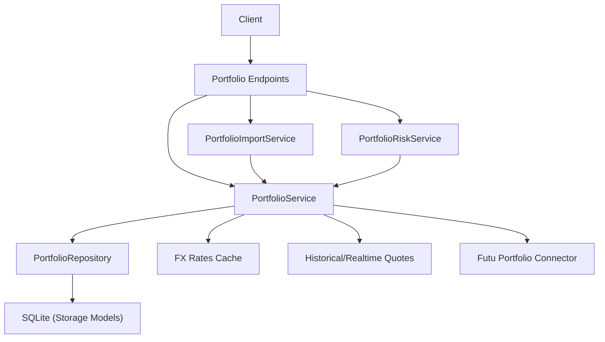
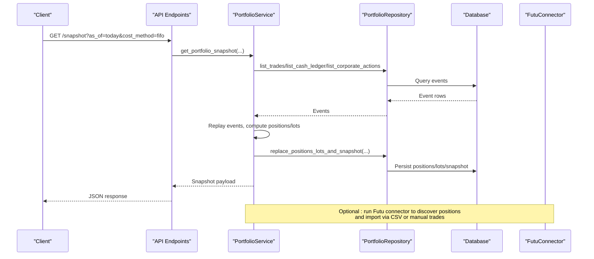
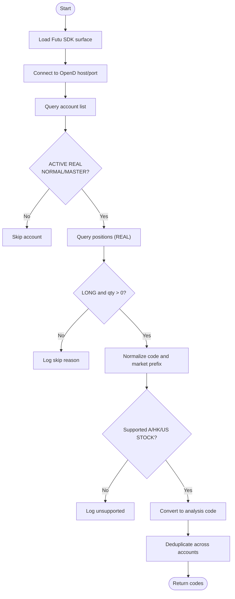
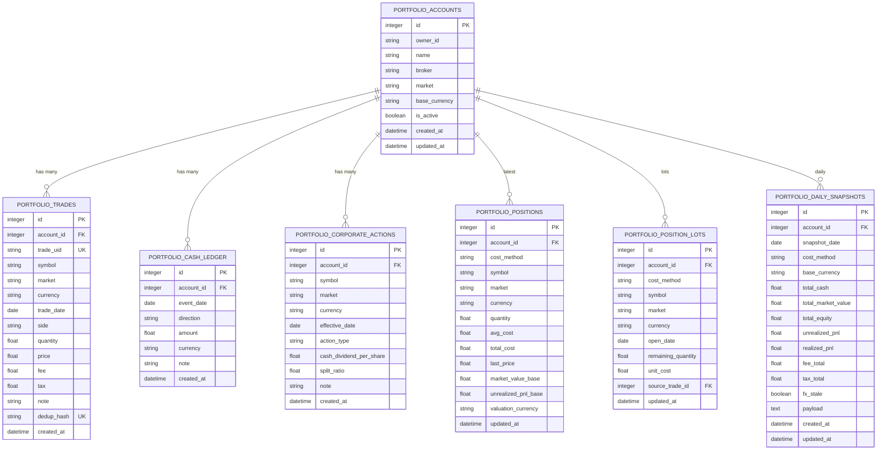
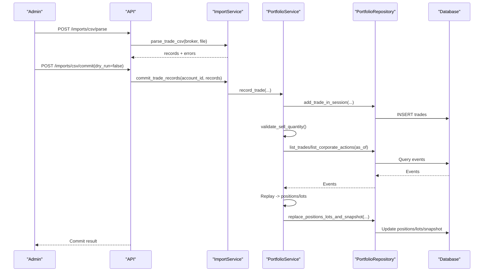
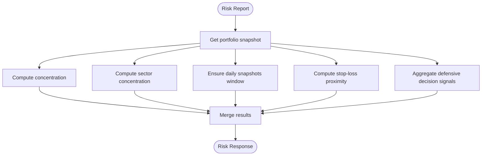
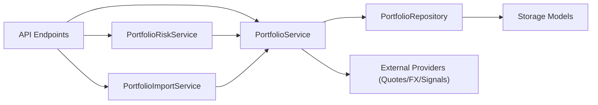

# Portfolio Management

<cite>
**Referenced Files in This Document**
- [portfolio.py](file://src/brokers/futu/portfolio.py)
- [portfolio.py](file://api/v1/endpoints/portfolio.py)
- [portfolio.py](file://api/v1/schemas/portfolio.py)
- [portfolio_service.py](file://src/services/portfolio_service.py)
- [portfolio_repo.py](file://src/repositories/portfolio_repo.py)
- [storage.py](file://src/storage.py)
- [portfolio_risk_service.py](file://src/services/portfolio_risk_service.py)
- [portfolio_import_service.py](file://src/services/portfolio_import_service.py)
</cite>

## Table of Contents
1. [Introduction](#introduction)
2. [Project Structure](#project-structure)
3. [Core Components](#core-components)
4. [Architecture Overview](#architecture-overview)
5. [Detailed Component Analysis](#detailed-component-analysis)
6. [Dependency Analysis](#dependency-analysis)
7. [Performance Considerations](#performance-considerations)
8. [Troubleshooting Guide](#troubleshooting-guide)
9. [Conclusion](#conclusion)
10. [Appendices](#appendices)

## Introduction
This document explains the Portfolio Management system with a focus on broker integration and portfolio synchronization. It covers:
- Futu Securities integration for automatic discovery of real accounts and positions, symbol normalization, and read-only synchronization into local storage.
- The portfolio data model including accounts, trades, cash ledger, corporate actions, positions, lots, snapshots, and FX rates.
- Synchronization workflows that keep local portfolio data consistent with broker accounts, including conflict resolution and validation.
- Import/export capabilities via CSV importers and snapshot-based export endpoints.
- Manual position adjustments through trade events and corporate actions.
- Performance analytics derived from replayed event history and stored snapshots.
- Risk assessment tools for concentration, sector exposure, drawdown, stop-loss proximity, and decision signal risk.
- Security considerations for broker API credentials and data privacy.

## Project Structure
The portfolio management feature spans several layers:
- API layer: FastAPI endpoints expose account CRUD, trade/cash/corporate action recording, snapshot retrieval, CSV import, FX refresh, and risk reporting.
- Service layer: Business logic for validation, replay, cost basis computation, FX conversion, and risk analysis.
- Repository layer: Data access to SQLite tables for accounts, events, positions, lots, snapshots, and FX rates.
- Broker integration: Read-only Futu OpenD connector discovers active REAL accounts and LONG stock positions, normalizes symbols, and filters supported markets.
- Storage models: ORM definitions for all portfolio entities.

**Diagram sources**
- [portfolio.py](file://api/v1/endpoints/portfolio.py)
- [portfolio_service.py](file://src/services/portfolio_service.py)
- [portfolio_repo.py](file://src/repositories/portfolio_repo.py)
- [storage.py](file://src/storage.py)
- [portfolio.py](file://src/brokers/futu/portfolio.py)

**Section sources**
- [portfolio.py](file://api/v1/endpoints/portfolio.py)
- [portfolio_service.py](file://src/services/portfolio_service.py)
- [portfolio_repo.py](file://src/repositories/portfolio_repo.py)
- [storage.py](file://src/storage.py)
- [portfolio.py](file://src/brokers/futu/portfolio.py)

## Core Components
- Futures broker connector: Discovers active REAL accounts, queries positions, filters to supported A/HK/US stocks, and returns normalized analysis codes.
- Portfolio service: Validates inputs, records trades/cash/corporate actions, replays events to compute positions, cost basis, PnL, and snapshots; manages FX conversion and realtime quote fallbacks.
- Portfolio repository: Encapsulates database operations, write sessions, deduplication constraints, and snapshot persistence.
- Import service: Parses broker CSVs, normalizes rows, computes dedup hashes, and commits normalized trades with dry-run support.
- Risk service: Computes concentration, sector concentration, drawdown, stop-loss proximity, and decision signal risk using snapshots and signals.

**Section sources**
- [portfolio.py](file://src/brokers/futu/portfolio.py)
- [portfolio_service.py](file://src/services/portfolio_service.py)
- [portfolio_repo.py](file://src/repositories/portfolio_repo.py)
- [portfolio_import_service.py](file://src/services/portfolio_import_service.py)
- [portfolio_risk_service.py](file://src/services/portfolio_risk_service.py)

## Architecture Overview
The system uses an event-sourced replay approach:
- Trades, cash ledger entries, and corporate actions are persisted as immutable events.
- Snapshots and positions are computed by replaying events up to a given date, applying FIFO or average cost methods, FX conversions, and price lookups.
- Futu integration provides initial holdings and supports periodic sync by re-running the connector and updating local state via imports or manual adjustments.

**Diagram sources**
- [portfolio.py](file://api/v1/endpoints/portfolio.py)
- [portfolio_service.py](file://src/services/portfolio_service.py)
- [portfolio_repo.py](file://src/repositories/portfolio_repo.py)
- [storage.py](file://src/storage.py)
- [portfolio.py](file://src/brokers/futu/portfolio.py)

## Detailed Component Analysis

### Futu Securities Integration
Responsibilities:
- Discover active REAL NORMAL or MASTER accounts via OpenD.
- Query non-zero LONG positions per account, skip SHORT or unknown sides.
- Validate and filter to supported markets (A/HK/US), excluding B-shares.
- Convert Futu codes to internal analysis codes and return deduplicated symbol lists.

Key behaviors:
- Environment-driven connection settings and optional account ID selection.
- Strict validation of SDK responses and safe context closing.
- Logging of skipped unsupported holdings and conversion failures.

**Diagram sources**
- [portfolio.py](file://src/brokers/futu/portfolio.py)

**Section sources**
- [portfolio.py](file://src/brokers/futu/portfolio.py)

### Portfolio Data Model
Entities and relationships:
- Accounts: owner_id, name, broker, market, base_currency, is_active.
- Trades: symbol, market, currency, trade_date, side, quantity, price, fee, tax, trade_uid, dedup_hash.
- Cash Ledger: event_date, direction (in/out), amount, currency.
- Corporate Actions: symbol, market, currency, effective_date, action_type (cash_dividend, split_adjustment), dividend/split fields.
- Positions: latest replayed quantities, avg_cost, total_cost, last_price, market_value_base, unrealized_pnl_base, valuation_currency.
- Lots: lot-level remaining_quantity, unit_cost, open_date, source_trade_id for FIFO.
- Daily Snapshots: aggregated totals per day, cost_method, base_currency, fx_stale flag, payload.
- FX Rates: from/to currency pairs, rate_date, source, is_stale.

Constraints and indexes ensure uniqueness and efficient queries for replay and risk calculations.

**Diagram sources**
- [storage.py](file://src/storage.py)

**Section sources**
- [storage.py](file://src/storage.py)

### Synchronization Process
End-to-end flow:
- Discovery: Futu connector enumerates active REAL accounts and pulls non-zero LONG positions.
- Normalization: Codes are validated and converted to analysis format; unsupported markets are logged and skipped.
- Import: Use CSV import endpoints to parse broker statements into normalized records with dedup hashing; commit with dry-run option.
- Replay: Portfolio service replays trades, cash ledger, and corporate actions to compute positions, lots, and daily snapshots.
- Persistence: Positions, lots, and snapshots are stored for fast reads and risk analysis.
- Conflict Resolution: Duplicate trade_uid and dedup_hash are rejected; oversell checks prevent invalid sells; busy locks raise retryable errors.

**Diagram sources**
- [portfolio.py](file://api/v1/endpoints/portfolio.py)
- [portfolio_import_service.py](file://src/services/portfolio_import_service.py)
- [portfolio_service.py](file://src/services/portfolio_service.py)
- [portfolio_repo.py](file://src/repositories/portfolio_repo.py)
- [storage.py](file://src/storage.py)

**Section sources**
- [portfolio.py](file://api/v1/endpoints/portfolio.py)
- [portfolio_import_service.py](file://src/services/portfolio_import_service.py)
- [portfolio_service.py](file://src/services/portfolio_service.py)
- [portfolio_repo.py](file://src/repositories/portfolio_repo.py)

### Portfolio Import/Export
- Import:
  - Parse CSV with broker-specific column mapping and encoding handling.
  - Normalize fields (date, symbol, side, quantity, price, fees, taxes).
  - Compute stable dedup hash per row; reject duplicates by trade_uid or dedup_hash.
  - Dry-run mode validates without writing.
- Export:
  - Snapshot endpoint returns consolidated portfolio view with positions, costs, PnL, FX staleness flags, and limitations.
  - Daily snapshots can be used for historical export and backtesting.

**Section sources**
- [portfolio_import_service.py](file://src/services/portfolio_import_service.py)
- [portfolio.py](file://api/v1/endpoints/portfolio.py)
- [portfolio_service.py](file://src/services/portfolio_service.py)

### Manual Position Adjustments
- Record trades: buy/sell with validation for positive quantity/price, non-negative fees/taxes, and oversell protection.
- Record cash ledger: in/out flows to adjust cash balances.
- Record corporate actions: cash dividends and split adjustments affecting shares and cost basis.
- Delete events: remove trades, cash entries, or corporate actions with cache invalidation.

**Section sources**
- [portfolio_service.py](file://src/services/portfolio_service.py)
- [portfolio_repo.py](file://src/repositories/portfolio_repo.py)

### Performance Analytics
- Cost basis: FIFO or average cost method applied during replay to compute avg_cost and total_cost per position.
- Realized/unrealized PnL: Derived from event replay and current/historical prices.
- FX conversion: Converts account-level metrics to aggregate currency with staleness flags.
- Realtime quotes: Optional realtime fallback before historical close when generating snapshots.

**Section sources**
- [portfolio_service.py](file://src/services/portfolio_service.py)

### Risk Assessment Tools
- Concentration: Top positions by market value weight with alert thresholds.
- Sector concentration: Classifies Chinese A-shares into sectors via board lookup; aggregates exposure and alerts.
- Drawdown: Builds equity series from daily snapshots to compute max and current drawdown.
- Stop-loss proximity: Flags positions near or triggered beyond configured thresholds.
- Decision signal risk: Aggregates defensive signals (sell/reduce/alert) for held positions.

**Diagram sources**
- [portfolio_risk_service.py](file://src/services/portfolio_risk_service.py)
- [portfolio_service.py](file://src/services/portfolio_service.py)

**Section sources**
- [portfolio_risk_service.py](file://src/services/portfolio_risk_service.py)

## Dependency Analysis
- API depends on services for business logic and schemas for request/response contracts.
- Services depend on repositories for data access and may call external providers (quotes, FX, decision signals).
- Repositories depend on storage models and database manager.
- Futu connector is optional and invoked separately to populate initial positions; it does not execute trades.

**Diagram sources**
- [portfolio.py](file://api/v1/endpoints/portfolio.py)
- [portfolio_service.py](file://src/services/portfolio_service.py)
- [portfolio_repo.py](file://src/repositories/portfolio_repo.py)
- [storage.py](file://src/storage.py)
- [portfolio_risk_service.py](file://src/services/portfolio_risk_service.py)
- [portfolio_import_service.py](file://src/services/portfolio_import_service.py)

**Section sources**
- [portfolio.py](file://api/v1/endpoints/portfolio.py)
- [portfolio_service.py](file://src/services/portfolio_service.py)
- [portfolio_repo.py](file://src/repositories/portfolio_repo.py)
- [storage.py](file://src/storage.py)
- [portfolio_risk_service.py](file://src/services/portfolio_risk_service.py)
- [portfolio_import_service.py](file://src/services/portfolio_import_service.py)

## Performance Considerations
- Write serialization: SQLite immediate transactions protect against concurrent writes; busy errors indicate retries are needed.
- Batch processing: Futu connector batches security info queries to reduce API calls.
- Realtime quote workers: Snapshot generation uses limited concurrency for realtime quotes to avoid overload.
- Caching: FX rates and daily snapshots reduce repeated computations.
- Deduplication: Stable dedup hashes prevent duplicate imports and ensure idempotency.

[No sources needed since this section provides general guidance]

## Troubleshooting Guide
Common issues and resolutions:
- Missing Futu SDK: Install the pinned version and ensure OpenD is running; check environment variables for host/port/account.
- Unsupported markets or symbols: Only A/HK/US stocks are supported; B-shares and other markets are skipped with logs.
- Duplicate trades: Rejects duplicate trade_uid or dedup_hash; use unique identifiers or adjust CSV content.
- Oversell errors: Selling more than available quantity; verify prior buys and corporate actions.
- Busy errors: Retry after brief delay due to SQLite lock contention.
- Stale FX: Refresh FX rates; if disabled, reports include stale flags and limitations.

**Section sources**
- [portfolio.py](file://src/brokers/futu/portfolio.py)
- [portfolio_service.py](file://src/services/portfolio_service.py)
- [portfolio_repo.py](file://src/repositories/portfolio_repo.py)

## Conclusion
The Portfolio Management system provides robust broker integration via Futu for read-only synchronization, comprehensive event-sourced replay for accurate positions and performance metrics, and powerful risk analytics. It supports CSV imports for multi-broker histories, manual adjustments, and detailed reporting with FX-aware aggregation. Proper configuration, validation, and deduplication ensure data integrity and reliability.

[No sources needed since this section summarizes without analyzing specific files]

## Appendices

### API Reference Highlights
- Accounts: create, list, update, deactivate.
- Trades: create, list, delete with validation and dedup.
- Cash Ledger: create, list, delete.
- Corporate Actions: create, list, delete.
- Snapshot: retrieve portfolio snapshot with cost method and realtime options.
- CSV Import: parse and commit with dry-run support.
- FX Refresh: refresh FX cache with stale fallback.
- Risk Report: concentration, sector concentration, drawdown, stop-loss, decision signal risk.

**Section sources**
- [portfolio.py](file://api/v1/endpoints/portfolio.py)
- [portfolio.py](file://api/v1/schemas/portfolio.py)

### Configuration and Security Notes
- Futu environment variables: FUTU_OPEND_HOST, FUTU_OPEND_PORT, FUTU_ACC_ID, FUTU_SECURITY_FIRM. Treat account IDs as sensitive.
- FX update toggle: portfolio_fx_update_enabled controls online refresh behavior.
- Data privacy: Avoid committing sensitive identifiers; sanitize notes and minimize PII in trade notes.

**Section sources**
- [portfolio.py](file://src/brokers/futu/portfolio.py)
- [portfolio_service.py](file://src/services/portfolio_service.py)