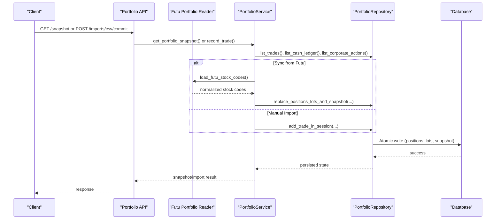
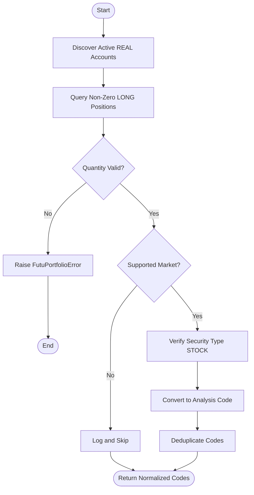
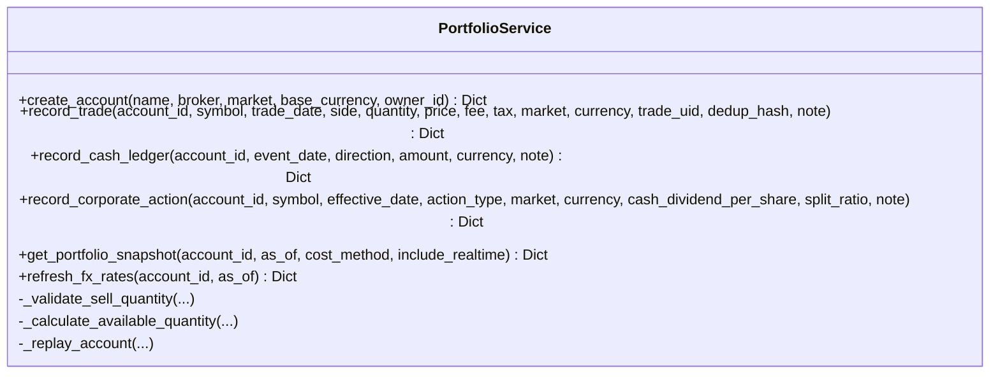
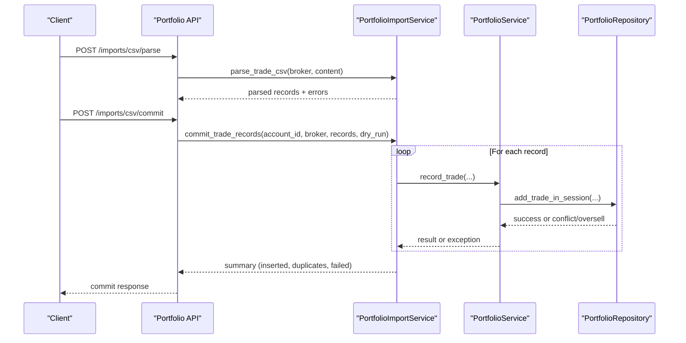
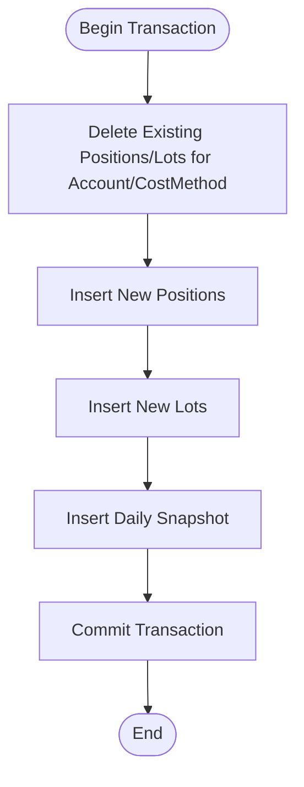
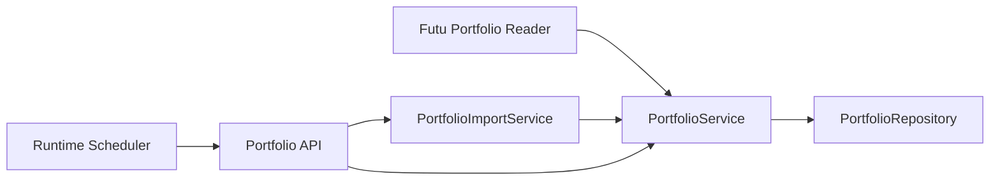

# Portfolio Synchronization

<cite>
**Referenced Files in This Document**
- [portfolio.py](file://src/brokers/futu/portfolio.py)
- [portfolio_service.py](file://src/services/portfolio_service.py)
- [portfolio_import_service.py](file://src/services/portfolio_import_service.py)
- [portfolio_repo.py](file://src/repositories/portfolio_repo.py)
- [stock_code_utils.py](file://src/services/stock_code_utils.py)
- [portfolio_api.py](file://api/v1/endpoints/portfolio.py)
- [runtime_scheduler.py](file://src/services/runtime_scheduler.py)
- [test_futu_portfolio_service.py](file://tests/test_futu_portfolio_service.py)
</cite>

## Table of Contents
1. [Introduction](#introduction)
2. [Project Structure](#project-structure)
3. [Core Components](#core-components)
4. [Architecture Overview](#architecture-overview)
5. [Detailed Component Analysis](#detailed-component-analysis)
6. [Dependency Analysis](#dependency-analysis)
7. [Performance Considerations](#performance-considerations)
8. [Troubleshooting Guide](#troubleshooting-guide)
9. [Conclusion](#conclusion)
10. [Appendices](#appendices)

## Introduction
This document explains the Portfolio Synchronization system that keeps local portfolio data consistent with broker accounts, primarily Futu OpenD. It covers how real positions are fetched from Futu, how stock codes are converted across A-shares (SH/SZ), HK, and US markets, and how local database records are updated. It also documents conflict resolution strategies when local and broker data differ, including timestamp-based reconciliation and manual override options, as well as data validation rules for position quantities and stock code normalization. Finally, it provides examples for manual import/export, batch updates, and scheduling considerations, along with performance guidance and error handling for partial sync failures.

## Project Structure
The synchronization pipeline spans several layers:
- Broker integration layer reads live positions from Futu and normalizes them into analysis-ready codes.
- Service layer orchestrates reconciliation, validation, and persistence to the local database.
- Repository layer performs atomic writes and snapshot caching.
- API endpoints expose import/export and refresh operations.
- Scheduler service supports background tasks and runtime orchestration.

```mermaid
graph TB
subgraph "Broker Integration"
FUTU["Futu Portfolio Reader"]
end
subgraph "Services"
PSVC["PortfolioService"]
IMPORTSVC["PortfolioImportService"]
end
subgraph "Persistence"
REPO["PortfolioRepository"]
DB[("Local Database")]
end
subgraph "API"
API["Portfolio Endpoints"]
end
subgraph "Scheduler"
SCHED["Runtime Scheduler"]
end
FUTU --> PSVC
PSVC --> REPO
IMPORTSVC --> PSVC
API --> PSVC
API --> IMPORTSVC
SCHED --> API
REPO --> DB
```

**Diagram sources**
- [portfolio.py:460-484](file://src/brokers/futu/portfolio.py#L460-L484)
- [portfolio_service.py:471-613](file://src/services/portfolio_service.py#L471-L613)
- [portfolio_import_service.py:143-270](file://src/services/portfolio_import_service.py#L143-L270)
- [portfolio_repo.py:866-1088](file://src/repositories/portfolio_repo.py#L866-L1088)
- [portfolio_api.py:414-446](file://api/v1/endpoints/portfolio.py#L414-L446)
- [runtime_scheduler.py:1-200](file://src/services/runtime_scheduler.py#L1-L200)

**Section sources**
- [portfolio.py:460-484](file://src/brokers/futu/portfolio.py#L460-L484)
- [portfolio_service.py:471-613](file://src/services/portfolio_service.py#L471-L613)
- [portfolio_import_service.py:143-270](file://src/services/portfolio_import_service.py#L143-L270)
- [portfolio_repo.py:866-1088](file://src/repositories/portfolio_repo.py#L866-L1088)
- [portfolio_api.py:414-446](file://api/v1/endpoints/portfolio.py#L414-L446)
- [runtime_scheduler.py:1-200](file://src/services/runtime_scheduler.py#L1-L200)

## Core Components
- Futu Portfolio Reader: Connects to Futu OpenD, discovers active REAL accounts, queries non-zero LONG positions, filters to supported stocks, and converts codes to analysis format.
- PortfolioService: Orchestrates account management, event recording, snapshot replay, FX refresh, and write-back of positions and snapshots.
- PortfolioImportService: Parses broker CSV files, normalizes rows, deduplicates, and commits normalized trades via PortfolioService.
- PortfolioRepository: Provides transactional DB access, trade/cash/corporate action writes, and atomic replacement of positions, lots, and daily snapshots.
- Stock Code Utilities: Normalize and validate stock codes across A-shares, HK, US, JP/KR/TW, ensuring consistent identities.
- API Endpoints: Expose CRUD for accounts/events, snapshot retrieval, CSV import parse/commit, FX refresh, and risk reporting.
- Runtime Scheduler: Manages long-lived processes, background task execution, and lifecycle control for scheduled jobs.

**Section sources**
- [portfolio.py:52-83](file://src/brokers/futu/portfolio.py#L52-L83)
- [portfolio_service.py:109-255](file://src/services/portfolio_service.py#L109-L255)
- [portfolio_import_service.py:79-141](file://src/services/portfolio_import_service.py#L79-L141)
- [portfolio_repo.py:45-159](file://src/repositories/portfolio_repo.py#L45-L159)
- [stock_code_utils.py:213-247](file://src/services/stock_code_utils.py#L213-L247)
- [portfolio_api.py:163-196](file://api/v1/endpoints/portfolio.py#L163-L196)
- [runtime_scheduler.py:44-79](file://src/services/runtime_scheduler.py#L44-L79)

## Architecture Overview
The synchronization flow begins with fetching real positions from Futu, converting codes, validating data, and updating local records atomically. The system supports both automated snapshot replay and manual CSV imports. Conflict detection prevents overselling and duplicate entries, while FX refresh ensures valuation accuracy.



**Diagram sources**
- [portfolio_api.py:414-446](file://api/v1/endpoints/portfolio.py#L414-L446)
- [portfolio_api.py:600-626](file://api/v1/endpoints/portfolio.py#L600-L626)
- [portfolio_service.py:471-613](file://src/services/portfolio_service.py#L471-L613)
- [portfolio_service.py:186-255](file://src/services/portfolio_service.py#L186-L255)
- [portfolio_repo.py:1039-1088](file://src/repositories/portfolio_repo.py#L1039-L1088)
- [portfolio.py:460-484](file://src/brokers/futu/portfolio.py#L460-L484)

## Detailed Component Analysis

### Futu Portfolio Reader
- Discovers active NORMAL/MASTER REAL accounts and validates environment settings (host/port, security firm).
- Queries non-zero LONG positions, skipping shorts and unknown sides; enforces quantity and code validity.
- Filters to supported markets (US, HK, SH, SZ), rejects B-shares and unsupported holdings, and verifies stock type via basic info calls.
- Converts Futu codes to analysis codes: US tickers remain as-is if valid; HK codes become HK-prefixed five-digit forms; A-share codes normalize to exchange-specific digits.



**Diagram sources**
- [portfolio.py:165-230](file://src/brokers/futu/portfolio.py#L165-L230)
- [portfolio.py:233-316](file://src/brokers/futu/portfolio.py#L233-L316)
- [portfolio.py:358-457](file://src/brokers/futu/portfolio.py#L358-L457)

**Section sources**
- [portfolio.py:52-83](file://src/brokers/futu/portfolio.py#L52-L83)
- [portfolio.py:115-162](file://src/brokers/futu/portfolio.py#L115-L162)
- [portfolio.py:165-230](file://src/brokers/futu/portfolio.py#L165-L230)
- [portfolio.py:233-316](file://src/brokers/futu/portfolio.py#L233-L316)
- [portfolio.py:358-457](file://src/brokers/futu/portfolio.py#L358-L457)
- [portfolio.py:460-484](file://src/brokers/futu/portfolio.py#L460-L484)
- [test_futu_portfolio_service.py:200-310](file://tests/test_futu_portfolio_service.py#L200-L310)

### PortfolioService
- Validates inputs for trades, cash ledger, and corporate actions; enforces positive quantities/prices and non-negative fees/taxes.
- Prevents oversells by calculating available quantity based on historical events up to the trade date.
- Replays account history to compute totals, market values, PnL, and caches positions/lots; persists snapshots atomically.
- Refreshes FX rates with stale fallback when online fetch fails.



**Diagram sources**
- [portfolio_service.py:118-327](file://src/services/portfolio_service.py#L118-L327)
- [portfolio_service.py:471-613](file://src/services/portfolio_service.py#L471-L613)
- [portfolio_service.py:668-775](file://src/services/portfolio_service.py#L668-L775)

**Section sources**
- [portfolio_service.py:186-255](file://src/services/portfolio_service.py#L186-L255)
- [portfolio_service.py:256-327](file://src/services/portfolio_service.py#L256-L327)
- [portfolio_service.py:471-613](file://src/services/portfolio_service.py#L471-L613)
- [portfolio_service.py:668-775](file://src/services/portfolio_service.py#L668-L775)

### PortfolioImportService
- Parses broker CSVs using configurable parser specs; maps various column names to normalized fields.
- Builds stable dedup hashes per row to ensure idempotent imports; supports dry-run mode.
- Commits normalized trades via PortfolioService, handling conflicts and oversell errors gracefully.



**Diagram sources**
- [portfolio_api.py:558-626](file://api/v1/endpoints/portfolio.py#L558-L626)
- [portfolio_import_service.py:143-270](file://src/services/portfolio_import_service.py#L143-L270)
- [portfolio_service.py:186-255](file://src/services/portfolio_service.py#L186-L255)

**Section sources**
- [portfolio_import_service.py:79-141](file://src/services/portfolio_import_service.py#L79-L141)
- [portfolio_import_service.py:143-270](file://src/services/portfolio_import_service.py#L143-L270)
- [portfolio_import_service.py:294-449](file://src/services/portfolio_import_service.py#L294-L449)

### PortfolioRepository
- Provides transactional sessions with immediate locking for SQLite to avoid concurrent write conflicts.
- Atomically replaces positions, lots, and daily snapshots in a single transaction to maintain consistency.
- Enforces unique constraints on trade_uid and dedup_hash per account to prevent duplicates.



**Diagram sources**
- [portfolio_repo.py:136-159](file://src/repositories/portfolio_repo.py#L136-L159)
- [portfolio_repo.py:866-1088](file://src/repositories/portfolio_repo.py#L866-L1088)

**Section sources**
- [portfolio_repo.py:45-159](file://src/repositories/portfolio_repo.py#L45-L159)
- [portfolio_repo.py:866-1088](file://src/repositories/portfolio_repo.py#L866-L1088)

### Stock Code Normalization
- Supports multiple formats: plain digits, suffix (.SH/.SZ/.HK), prefix (SH/SZ/HK), and US tickers.
- Normalizes HK codes to five-digit prefixed form; validates A-share exchange correctness; preserves JP/KR/TW suffixes where applicable.
- Used throughout the pipeline to ensure consistent identity mapping between broker codes and internal analysis codes.

**Section sources**
- [stock_code_utils.py:213-247](file://src/services/stock_code_utils.py#L213-L247)
- [stock_code_utils.py:339-468](file://src/services/stock_code_utils.py#L339-L468)
- [portfolio.py:336-355](file://src/brokers/futu/portfolio.py#L336-L355)

## Dependency Analysis
- Futu Portfolio Reader depends on environment configuration and SDK availability; raises actionable errors if missing or misconfigured.
- PortfolioService depends on PortfolioRepository for persistence and uses stock code utilities for normalization.
- PortfolioImportService depends on PortfolioService for committing trades and uses pandas for CSV parsing.
- API endpoints depend on services and repositories to expose functionality; they map exceptions to HTTP status codes.
- Runtime Scheduler coordinates background tasks and can trigger portfolio-related operations through the API.



**Diagram sources**
- [portfolio.py:460-484](file://src/brokers/futu/portfolio.py#L460-L484)
- [portfolio_service.py:109-255](file://src/services/portfolio_service.py#L109-L255)
- [portfolio_import_service.py:79-141](file://src/services/portfolio_import_service.py#L79-L141)
- [portfolio_api.py:163-196](file://api/v1/endpoints/portfolio.py#L163-L196)
- [runtime_scheduler.py:44-79](file://src/services/runtime_scheduler.py#L44-L79)

**Section sources**
- [portfolio.py:52-83](file://src/brokers/futu/portfolio.py#L52-L83)
- [portfolio_service.py:109-255](file://src/services/portfolio_service.py#L109-L255)
- [portfolio_import_service.py:79-141](file://src/services/portfolio_import_service.py#L79-L141)
- [portfolio_api.py:163-196](file://api/v1/endpoints/portfolio.py#L163-L196)
- [runtime_scheduler.py:44-79](file://src/services/runtime_scheduler.py#L44-L79)

## Performance Considerations
- Batch processing: Futu basic info queries use batches of 100 to reduce network calls.
- Concurrency: PortfolioService uses thread pools for realtime quote resolution; limit workers to avoid overload.
- Atomic writes: Repository uses immediate transactions to minimize lock contention and ensure consistency.
- Stale data handling: FX refresh includes stale fallback to keep valuations usable during outages.
- Large portfolios: Snapshot replay aggregates across accounts; consider pagination and selective account queries for large datasets.

[No sources needed since this section provides general guidance]

## Troubleshooting Guide
Common issues and resolutions:
- Missing Futu SDK: Install the pinned version and verify environment variables for host/port/security firm/account ID.
- Invalid account or position data: Ensure accounts are ACTIVE REAL roles; reject shorts and unknown sides; validate quantities and codes.
- Duplicate trades: Use trade_uid or dedup_hash to prevent re-imports; handle conflicts via API responses.
- Oversell errors: Check available quantity before selling; review corporate actions like splits that affect holdings.
- Partial sync failures: Inspect error counts and messages from import commit and FX refresh; retry failed items individually.

**Section sources**
- [portfolio.py:52-83](file://src/brokers/futu/portfolio.py#L52-L83)
- [portfolio.py:233-316](file://src/brokers/futu/portfolio.py#L233-L316)
- [portfolio_import_service.py:199-270](file://src/services/portfolio_import_service.py#L199-L270)
- [portfolio_service.py:668-775](file://src/services/portfolio_service.py#L668-L775)
- [portfolio_api.py:163-196](file://api/v1/endpoints/portfolio.py#L163-L196)

## Conclusion
The Portfolio Synchronization system provides robust mechanisms to reconcile local portfolio data with broker accounts, particularly Futu. It enforces strict validation, supports multi-market code normalization, and offers flexible import/export workflows. Conflict resolution and error handling ensure data integrity even under partial failures. With atomic writes and staged reconciliation, the system maintains consistency across accounts and supports scalable operations for large portfolios.

[No sources needed since this section summarizes without analyzing specific files]

## Appendices

### Examples

- Manual Portfolio Import:
  - Parse CSV: POST /api/v1/portfolio/imports/csv/parse with broker and file.
  - Commit Import: POST /api/v1/portfolio/imports/csv/commit with account_id, broker, dry_run flag, and file.
  - Review results: inserted_count, duplicate_count, failed_count, and errors.

- Batch Position Updates:
  - Use CSV import with multiple rows; dedup hash ensures idempotency.
  - Dry run mode allows previewing changes before committing.

- Sync Scheduling:
  - Integrate with Runtime Scheduler to periodically trigger snapshot refresh or FX updates.
  - Configure environment variables to enable/disable scheduler and set timeouts.

**Section sources**
- [portfolio_api.py:558-626](file://api/v1/endpoints/portfolio.py#L558-L626)
- [portfolio_import_service.py:143-270](file://src/services/portfolio_import_service.py#L143-L270)
- [runtime_scheduler.py:1-200](file://src/services/runtime_scheduler.py#L1-L200)