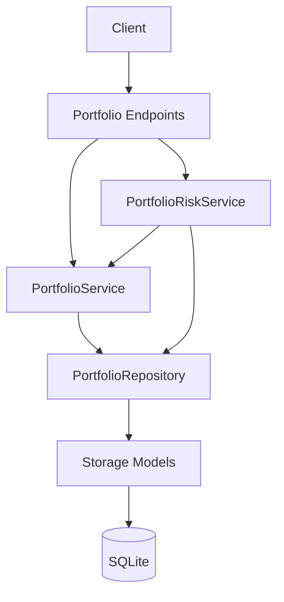
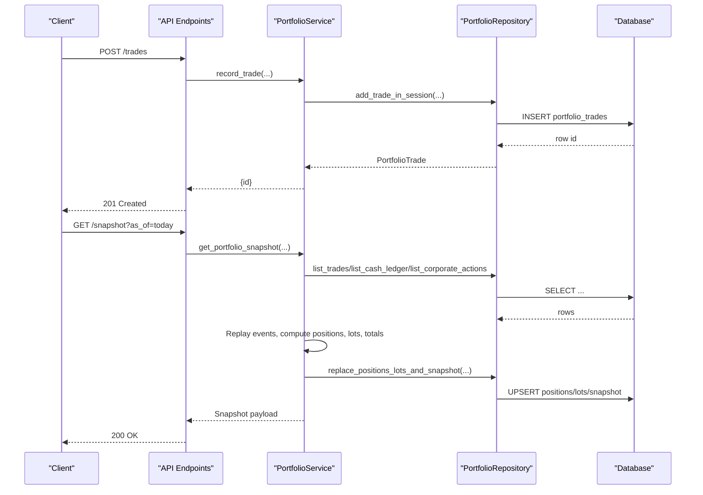
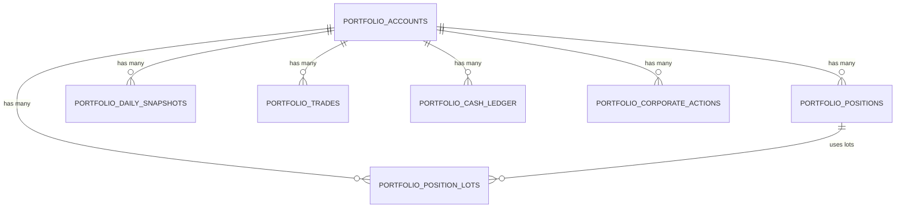
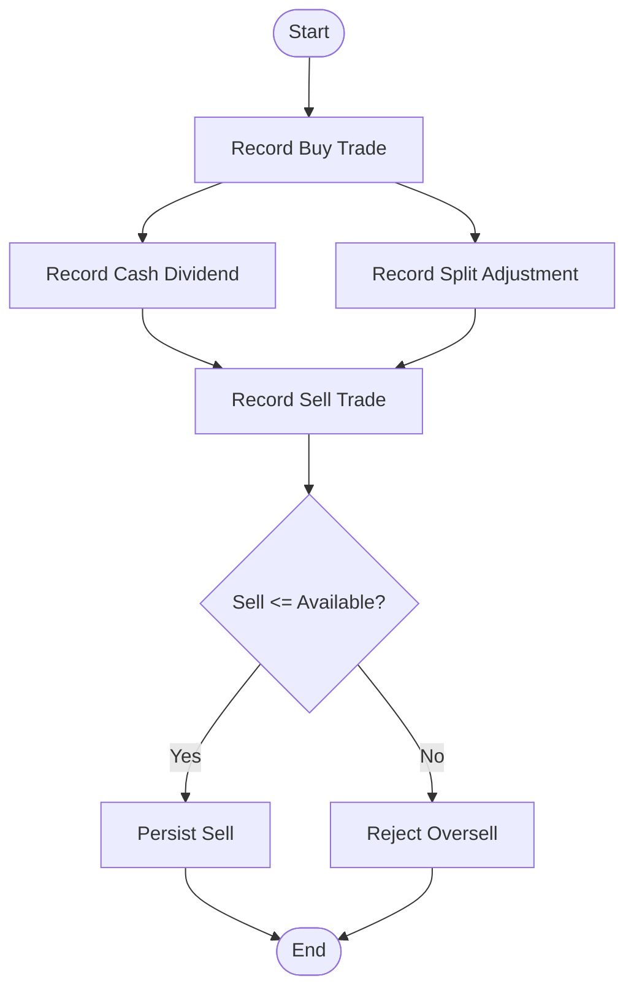
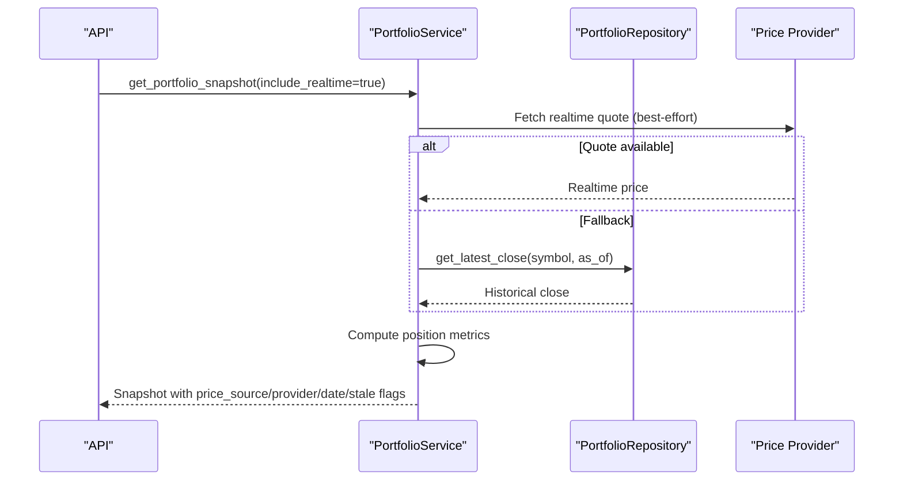
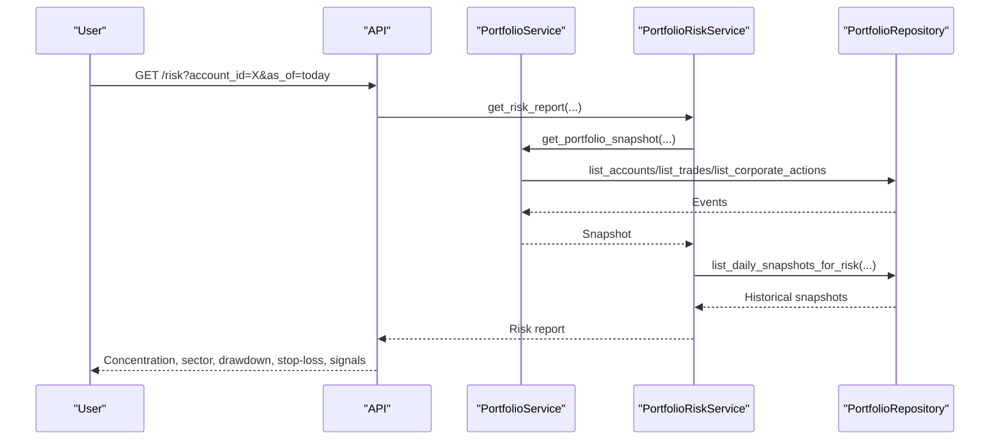
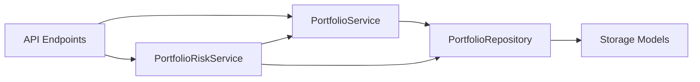

# Position Tracking

<cite>
**Referenced Files in This Document**
- [portfolio_service.py](file://src/services/portfolio_service.py)
- [portfolio_repo.py](file://src/repositories/portfolio_repo.py)
- [storage.py](file://src/storage.py)
- [portfolio.py (endpoints)](file://api/v1/endpoints/portfolio.py)
- [portfolio.py (schemas)](file://api/v1/schemas/portfolio.py)
- [portfolio_risk_service.py](file://src/services/portfolio_risk_service.py)
</cite>

## Table of Contents
1. [Introduction](#introduction)
2. [Project Structure](#project-structure)
3. [Core Components](#core-components)
4. [Architecture Overview](#architecture-overview)
5. [Detailed Component Analysis](#detailed-component-analysis)
6. [Dependency Analysis](#dependency-analysis)
7. [Performance Considerations](#performance-considerations)
8. [Troubleshooting Guide](#troubleshooting-guide)
9. [Conclusion](#conclusion)
10. [Appendices](#appendices)

## Introduction
This document explains the Position Tracking system that monitors and manages individual stock holdings within portfolios. It covers the position data model (holdings, cost basis, current value, unrealized P&L, and sizing metrics), the position lifecycle from acquisition through adjustments to liquidation, corporate action handling (dividends and stock splits), query and historical analysis capabilities, export-oriented endpoints, real-time update behavior, caching strategies, data retention policies, and integration with portfolio analytics such as concentration risk and sector exposure.

## Project Structure
The Position Tracking system is implemented across a service layer, repository layer, storage models, API endpoints, schemas, and a risk analytics service:
- Service layer orchestrates replay logic, validations, FX conversion, and snapshot generation.
- Repository layer provides database access for accounts, trades, cash ledger, corporate actions, positions, lots, snapshots, and FX rates.
- Storage defines ORM models for all persistence entities.
- API endpoints expose CRUD for accounts, trades, cash ledger, corporate actions, snapshots, risk reports, CSV import, and FX refresh.
- Schemas define request/response contracts for the API.
- Risk service computes concentration, sector exposure, drawdown, stop-loss proximity, and decision-signal-based risk on top of snapshots.

**Diagram sources**
- [portfolio.py (endpoints):163-441](file://api/v1/endpoints/portfolio.py#L163-L441)
- [portfolio_service.py:186-613](file://src/services/portfolio_service.py#L186-L613)
- [portfolio_repo.py:161-705](file://src/repositories/portfolio_repo.py#L161-L705)
- [storage.py:525-721](file://src/storage.py#L525-L721)
- [portfolio_risk_service.py:39-101](file://src/services/portfolio_risk_service.py#L39-L101)

**Section sources**
- [portfolio.py (endpoints):163-441](file://api/v1/endpoints/portfolio.py#L163-L441)
- [portfolio_service.py:186-613](file://src/services/portfolio_service.py#L186-L613)
- [portfolio_repo.py:161-705](file://src/repositories/portfolio_repo.py#L161-L705)
- [storage.py:525-721](file://src/storage.py#L525-L721)
- [portfolio_risk_service.py:39-101](file://src/services/portfolio_risk_service.py#L39-L101)

## Core Components
- PortfolioService: Implements business logic for account management, trade/cash/corporate-action recording, event replay, snapshot generation, FX refresh, and position validation.
- PortfolioRepository: Encapsulates database operations for accounts, events, positions, lots, snapshots, and FX rates; enforces write sessions and conflict handling.
- Storage Models: Define persistent tables for accounts, trades, cash ledger, corporate actions, positions, lots, daily snapshots, and FX rates.
- API Endpoints: Provide HTTP interfaces for creating/updating accounts, recording events, listing events, generating snapshots, importing CSVs, refreshing FX, and retrieving risk reports.
- PortfolioRiskService: Computes concentration, sector exposure, drawdown, stop-loss proximity, and decision signal risk using snapshots and additional services.

Key responsibilities:
- Event-driven replay ensures deterministic position state at any point in time.
- Cost accounting supports FIFO and average cost methods.
- Corporate actions adjust share quantities and values consistently.
- Real-time quotes are attempted for today’s snapshots with fallback to historical closes.
- Daily snapshots persist computed aggregates for performance and historical analysis.

**Section sources**
- [portfolio_service.py:109-613](file://src/services/portfolio_service.py#L109-L613)
- [portfolio_repo.py:45-705](file://src/repositories/portfolio_repo.py#L45-L705)
- [storage.py:525-721](file://src/storage.py#L525-L721)
- [portfolio.py (endpoints):163-441](file://api/v1/endpoints/portfolio.py#L163-L441)
- [portfolio_risk_service.py:21-101](file://src/services/portfolio_risk_service.py#L21-L101)

## Architecture Overview
Position tracking uses an append-only event log (trades, cash ledger, corporate actions) and replays these events to compute current and historical positions. Snapshots are persisted to support fast reads and risk analytics.

**Diagram sources**
- [portfolio.py (endpoints):163-441](file://api/v1/endpoints/portfolio.py#L163-L441)
- [portfolio_service.py:186-613](file://src/services/portfolio_service.py#L186-L613)
- [portfolio_repo.py:161-705](file://src/repositories/portfolio_repo.py#L161-L705)
- [storage.py:525-721](file://src/storage.py#L525-L721)

## Detailed Component Analysis

### Position Data Model
The position model captures per-symbol holdings and valuation details:
- Symbol, market, currency
- Quantity held
- Average cost and total cost
- Last price and market value in base currency
- Unrealized P&L in base currency
- Valuation currency and data quality flags

Lot-level detail supports FIFO cost accounting:
- Open date, remaining quantity, unit cost, source trade reference

Daily snapshots store aggregated account metrics:
- Total cash, market value, equity, realized/unrealized P&L, fees/taxes, FX staleness flag, and full payload

FX rates are cached per pair and date with staleness metadata.

**Diagram sources**
- [storage.py:525-721](file://src/storage.py#L525-L721)

**Section sources**
- [storage.py:525-721](file://src/storage.py#L525-L721)
- [portfolio.py (schemas):152-216](file://api/v1/schemas/portfolio.py#L152-L216)

### Position Lifecycle: Acquisition, Adjustments, Liquidation
- Acquisition: Record a buy trade with symbol, quantity, price, fee, tax, and optional identifiers. The system validates inputs and persists the event.
- Adjustments:
  - Cash ledger entries track deposits/withdrawals affecting available cash but not share counts.
  - Corporate actions adjust shares or value:
    - Cash dividends affect cash and may influence realized/unrealized P&L depending on implementation.
    - Split adjustments scale share quantities consistently during replay.
- Liquidation: Record sell trades; the system validates against available quantity considering prior corporate actions and trades.

Replay order ensures deterministic outcomes when multiple events occur on the same day:
- Cash -> Corporate Action -> Trade

**Diagram sources**
- [portfolio_service.py:186-327](file://src/services/portfolio_service.py#L186-L327)
- [portfolio_service.py:668-775](file://src/services/portfolio_service.py#L668-L775)
- [portfolio_repo.py:304-417](file://src/repositories/portfolio_repo.py#L304-L417)

**Section sources**
- [portfolio_service.py:186-327](file://src/services/portfolio_service.py#L186-L327)
- [portfolio_service.py:668-775](file://src/services/portfolio_service.py#L668-L775)
- [portfolio_repo.py:304-417](file://src/repositories/portfolio_repo.py#L304-L417)

### Corporate Actions: Dividends and Stock Splits
- Cash dividends: Recorded with per-share amount; affects cash flows and can be used to derive realized gains depending on context.
- Split adjustments: Recorded with ratio; scales share quantities consistently during replay.

Corporate actions are integrated into the event stream and ordered deterministically relative to other events on the same date.

**Section sources**
- [portfolio_service.py:285-327](file://src/services/portfolio_service.py#L285-L327)
- [portfolio_repo.py:384-417](file://src/repositories/portfolio_repo.py#L384-L417)
- [storage.py:592-611](file://src/storage.py#L592-L611)

### Real-Time Updates and Fallbacks
- Snapshot generation can attempt real-time quotes for today’s valuation before falling back to the latest historical close.
- Market-specific limitations may apply (e.g., partial valuation semantics for certain markets).
- FX rates are refreshed online with stale fallback when fetches fail.

**Diagram sources**
- [portfolio_service.py:471-613](file://src/services/portfolio_service.py#L471-L613)
- [portfolio_repo.py:710-729](file://src/repositories/portfolio_repo.py#L710-L729)

**Section sources**
- [portfolio_service.py:471-613](file://src/services/portfolio_service.py#L471-L613)
- [portfolio_repo.py:710-729](file://src/repositories/portfolio_repo.py#L710-L729)

### Position Queries and Historical Analysis
- List trades, cash ledger, and corporate actions with filters by date range, symbol, side, direction, and pagination.
- Generate snapshots for any date (as_of) to reconstruct historical positions and aggregates.
- Risk report endpoint computes concentration, sector exposure, drawdown, stop-loss proximity, and decision signal risk over a configurable lookback window.

**Diagram sources**
- [portfolio.py (endpoints):649-677](file://api/v1/endpoints/portfolio.py#L649-L677)
- [portfolio_risk_service.py:39-101](file://src/services/portfolio_risk_service.py#L39-L101)
- [portfolio_repo.py:791-800](file://src/repositories/portfolio_repo.py#L791-L800)

**Section sources**
- [portfolio.py (endpoints):199-441](file://api/v1/endpoints/portfolio.py#L199-L441)
- [portfolio_risk_service.py:39-101](file://src/services/portfolio_risk_service.py#L39-L101)

### Export Functionality
- CSV import endpoints allow parsing broker CSV files into normalized trade records and committing them with deduplication.
- Dry-run mode enables previewing imports before committing.
- Supported brokers can be listed via an endpoint.

**Section sources**
- [portfolio.py (endpoints):558-627](file://api/v1/endpoints/portfolio.py#L558-L627)

### Relationship to Portfolio Analytics
- Concentration risk: Aggregates market value exposure by symbol and alerts when thresholds are exceeded.
- Sector exposure: Classifies symbols into sectors (where available) and computes sector-level weights.
- Drawdown: Uses daily snapshots to compute max and current drawdown over a lookback window.
- Stop-loss proximity: Flags positions near or below configured stop-loss thresholds.
- Decision signal risk: Correlates held positions with active defensive signals (sell/reduce/alert).

**Section sources**
- [portfolio_risk_service.py:282-387](file://src/services/portfolio_risk_service.py#L282-L387)
- [portfolio_risk_service.py:466-559](file://src/services/portfolio_risk_service.py#L466-L559)

## Dependency Analysis
The system exhibits clear separation of concerns:
- API endpoints depend on services for orchestration and error mapping.
- Services depend on repositories for data access and on configuration for thresholds and feature flags.
- Repositories depend on storage models for schema and queries.
- Risk service depends on both portfolio service and repository for snapshot and historical data.

**Diagram sources**
- [portfolio.py (endpoints):163-441](file://api/v1/endpoints/portfolio.py#L163-L441)
- [portfolio_service.py:109-613](file://src/services/portfolio_service.py#L109-L613)
- [portfolio_repo.py:45-705](file://src/repositories/portfolio_repo.py#L45-L705)
- [portfolio_risk_service.py:21-101](file://src/services/portfolio_risk_service.py#L21-L101)

**Section sources**
- [portfolio.py (endpoints):163-441](file://api/v1/endpoints/portfolio.py#L163-L441)
- [portfolio_service.py:109-613](file://src/services/portfolio_service.py#L109-L613)
- [portfolio_repo.py:45-705](file://src/repositories/portfolio_repo.py#L45-L705)
- [portfolio_risk_service.py:21-101](file://src/services/portfolio_risk_service.py#L21-L101)

## Performance Considerations
- Event replay is deterministic and efficient due to indexed queries on dates and account IDs.
- Daily snapshots reduce repeated computation for risk and reporting workloads.
- Real-time quote fetching is best-effort and falls back to historical closes to ensure availability.
- Write sessions use immediate transactions to serialize writes and avoid SQLite lock contention; busy conditions raise explicit errors for retry.
- FX rate refresh supports stale fallback to maintain snapshot accuracy when online fetches fail.

Optimization opportunities:
- Batch snapshot generation for multi-account scenarios to minimize redundant computations.
- Cache board/sector classification results per session to reduce external calls.
- Tune lookback windows for drawdown calculations based on data volume and latency requirements.

[No sources needed since this section provides general guidance]

## Troubleshooting Guide
Common issues and resolutions:
- Duplicate trade UID or dedup hash: Ensure unique identifiers per account; use dedup hashes for idempotent imports.
- Oversell attempts: Validate available quantity considering corporate actions and prior trades; adjust sell requests accordingly.
- Portfolio busy: Retry after brief delay when SQLite lock contention occurs.
- Stale FX rates: Refresh FX cache; check configuration flags controlling refresh behavior.
- Partial valuation limitations: Some markets may have limited real-time quote coverage; rely on historical fallback and review data quality flags.

**Section sources**
- [portfolio_service.py:66-90](file://src/services/portfolio_service.py#L66-L90)
- [portfolio_service.py:655-667](file://src/services/portfolio_service.py#L655-L667)
- [portfolio_repo.py:136-159](file://src/repositories/portfolio_repo.py#L136-L159)
- [portfolio.py (endpoints):187-196](file://api/v1/endpoints/portfolio.py#L187-L196)

## Conclusion
The Position Tracking system provides a robust, event-driven approach to managing stock holdings with strong guarantees around consistency, history, and analytics. By combining append-only event logs, deterministic replay, cost accounting, corporate action handling, real-time updates with fallbacks, and comprehensive risk analytics, it supports accurate position monitoring and informed portfolio decisions.

[No sources needed since this section summarizes without analyzing specific files]

## Appendices

### API Reference Highlights
- Accounts: Create, list, update, deactivate
- Trades: Create, list, delete
- Cash Ledger: Create, list, delete
- Corporate Actions: Create, list, delete
- Snapshot: Retrieve portfolio snapshot with cost method and real-time options
- Risk: Retrieve risk report including concentration, sector exposure, drawdown, stop-loss, and decision signal risk
- Imports: Parse and commit broker CSVs; list supported brokers
- FX Refresh: Refresh FX cache with stale fallback

**Section sources**
- [portfolio.py (endpoints):76-441](file://api/v1/endpoints/portfolio.py#L76-L441)
- [portfolio.py (schemas):12-297](file://api/v1/schemas/portfolio.py#L12-L297)