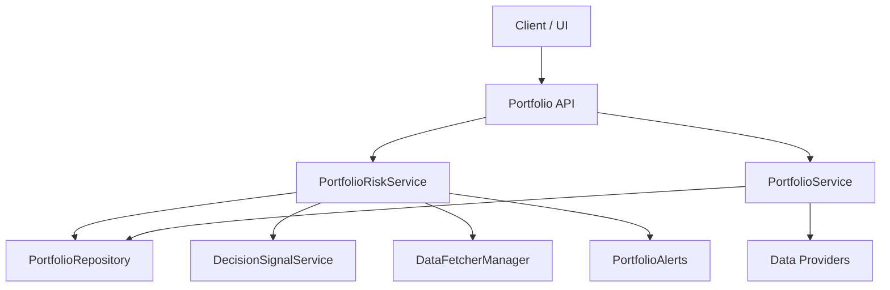
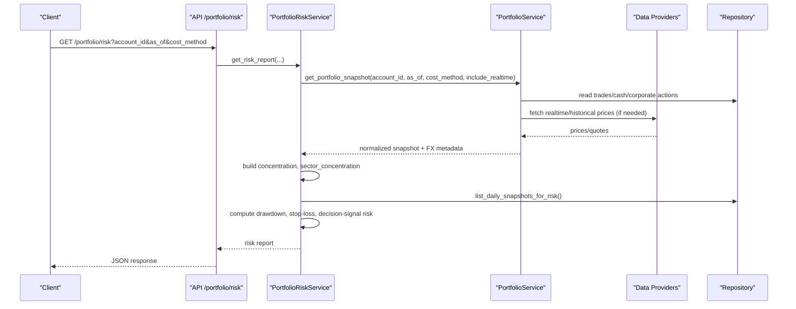
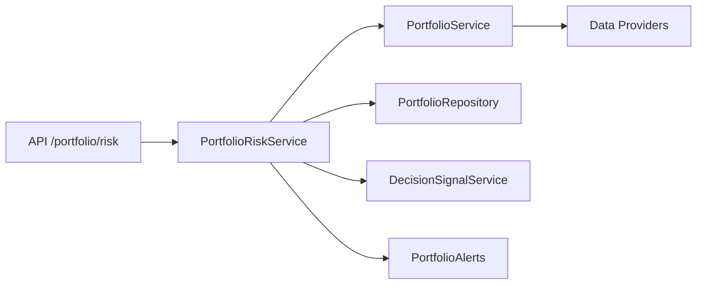

# Risk Assessment

<cite>
**Referenced Files in This Document**
- [portfolio_risk_service.py](file://src/services/portfolio_risk_service.py)
- [portfolio_service.py](file://src/services/portfolio_service.py)
- [portfolio.py](file://api/v1/endpoints/portfolio.py)
- [risk_agent.py](file://src/agent/agents/risk_agent.py)
- [scorer.py](file://src/services/screening/scorer.py)
- [risk.py](file://src/services/screening/risk.py)
- [portfolio_alerts.py](file://src/services/portfolio_alerts.py)
- [test_portfolio_pr2.py](file://tests/test_portfolio_pr2.py)
- [test_portfolio_alerts.py](file://tests/test_portfolio_alerts.py)
- [base.py](file://data_provider/base.py)
- [alphavantage_fetcher.py](file://data_provider/alphavantage_fetcher.py)
- [full-guide_EN.md](file://docs/full-guide_EN.md)
</cite>

## Table of Contents
1. Introduction
2. Project Structure
3. Core Components
4. Architecture Overview
5. Detailed Component Analysis
6. Dependency Analysis
7. Performance Considerations
8. Troubleshooting Guide
9. Conclusion
10. Appendices

## Introduction
This document explains the Risk Assessment system that evaluates portfolio risk exposure and concentration risks. It covers how risk metrics are calculated, how multiple risk factors are aggregated into actionable ratings, how stress testing is performed via drawdown analysis, and how alerts and recommendations are produced. It also documents integration with market data sources for real-time and historical calculations, and how risk tolerance settings influence thresholds and recommendations.

## Project Structure
The Risk Assessment system is built around a portfolio snapshot pipeline and a dedicated risk service:
- Portfolio Service computes normalized snapshots across accounts, currencies, and cost methods.
- Portfolio Risk Service consumes snapshots to compute concentration, sector concentration, drawdown, stop-loss proximity, and decision-signal-based risk.
- API endpoints expose snapshot and risk report retrieval and FX refresh capabilities.
- Screening components contribute portfolio-level penalties for sector concentration during candidate selection.
- Alerting evaluates risk reports against configured thresholds to trigger notifications.
- Data providers supply prices and quotes used by snapshot and risk calculations.

**Diagram sources**
- [portfolio.py:649-676](file://api/v1/endpoints/portfolio.py#L649-L676)
- [portfolio_risk_service.py:39-101](file://src/services/portfolio_risk_service.py#L39-L101)
- [portfolio_service.py:471-613](file://src/services/portfolio_service.py#L471-L613)
- [base.py:1713-1735](file://data_provider/base.py#L1713-L1735)

**Section sources**
- [portfolio.py:649-676](file://api/v1/endpoints/portfolio.py#L649-L676)
- [portfolio_risk_service.py:39-101](file://src/services/portfolio_risk_service.py#L39-L101)
- [portfolio_service.py:471-613](file://src/services/portfolio_service.py#L471-L613)

## Core Components
- PortfolioSnapshot computation: normalizes positions, cash, PnL, and FX across accounts; persists daily snapshots for historical analysis.
- Concentration analysis: aggregates per-symbol exposure across accounts, converts to a common currency, and flags top weights above thresholds.
- Sector concentration: maps symbols to sectors (with non-CN fallback), aggregates exposures, and reports coverage and errors.
- Drawdown analysis: builds an equity curve from daily snapshots, computes peak-to-trough drawdowns, and flags breaches.
- Stop-loss proximity: compares average cost to last price to detect near or breached stops.
- Decision signal risk: identifies defensive signals (sell/reduce/alert) for held positions.
- Screening portfolio penalties: penalizes candidate picks when they increase sector concentration beyond configured buckets.
- Alerts: evaluate risk report fields against thresholds to produce triggered/not-triggered results with diagnostics.

**Section sources**
- [portfolio_risk_service.py:282-387](file://src/services/portfolio_risk_service.py#L282-L387)
- [portfolio_risk_service.py:466-522](file://src/services/portfolio_risk_service.py#L466-L522)
- [portfolio_risk_service.py:524-558](file://src/services/portfolio_risk_service.py#L524-L558)
- [risk.py:104-134](file://src/services/screening/risk.py#L104-L134)
- [portfolio_alerts.py:436-454](file://src/services/portfolio_alerts.py#L436-L454)

## Architecture Overview
The risk reporting flow integrates portfolio snapshots, FX conversion, and optional realtime quotes to produce consistent, comparable metrics across markets and currencies.

**Diagram sources**
- [portfolio.py:649-676](file://api/v1/endpoints/portfolio.py#L649-L676)
- [portfolio_risk_service.py:39-101](file://src/services/portfolio_risk_service.py#L39-L101)
- [portfolio_service.py:471-613](file://src/services/portfolio_service.py#L471-L613)
- [base.py:1713-1735](file://data_provider/base.py#L1713-L1735)

## Detailed Component Analysis

### Portfolio Snapshot and FX Conversion
- The snapshot engine replays events per account, applies cost method (FIFO or average), and aggregates totals across accounts in a common currency (CNY).
- Realtime quotes are attempted for today’s snapshot unless disabled; otherwise, historical close is used. Missing prices are excluded from market value totals and flagged.
- FX refresh can be invoked manually; if online refresh fails, stale rates or fallback behavior is indicated.

Key behaviors:
- Aggregation uses convert_amount to translate cash, market values, and equity into a single base currency.
- Limitations are surfaced for partial valuation markets (e.g., JP/KR/TW), including limited sector and risk metrics.

**Section sources**
- [portfolio_service.py:471-613](file://src/services/portfolio_service.py#L471-L613)
- [portfolio_service.py:1455-1481](file://src/services/portfolio_service.py#L1455-L1481)
- [full-guide_EN.md:1612-1618](file://docs/full-guide_EN.md#L1612-L1618)

### Concentration Analysis
- Exposure is aggregated per symbol across all accounts, converted to a common currency, and expressed as a percentage of total market value.
- Top positions are returned with weight and alert flags based on configured thresholds.

Algorithm highlights:
- Converts each position’s market value to base currency using snapshot date FX.
- Computes weight = exposure / total_market_value * 100%.
- Flags top_weight_pct >= threshold as alert.

**Section sources**
- [portfolio_risk_service.py:282-319](file://src/services/portfolio_risk_service.py#L282-L319)
- [test_portfolio_pr2.py:415-471](file://tests/test_portfolio_pr2.py#L415-L471)

### Sector Concentration
- For CN markets, primary sector is resolved via board mapping; non-CN markets are labeled UNCLASSIFIED.
- Exposure is aggregated per sector, with counts of classified/unclassified/failed attempts and error summaries.

Coverage notes:
- Non-CN symbols default to UNCLASSIFIED to avoid misclassification.
- Errors are captured up to a limit for diagnostics.

**Section sources**
- [portfolio_risk_service.py:321-420](file://src/services/portfolio_risk_service.py#L321-L420)
- [test_portfolio_pr2.py:473-523](file://tests/test_portfolio_pr2.py#L473-L523)

### Drawdown Stress Testing
- Daily equity series are assembled from persisted snapshots, converted to base currency, and sorted chronologically.
- Peak-to-trough drawdown is computed; current drawdown equals the latest drawdown relative to the running peak.
- Alerts trigger when max_drawdown_pct exceeds configured threshold; fx_stale indicates stale FX usage.

Stress scenario interpretation:
- Max drawdown represents worst-case historical loss over the lookback window.
- Current drawdown shows ongoing stress at the report date.

**Section sources**
- [portfolio_risk_service.py:203-280](file://src/services/portfolio_risk_service.py#L203-L280)
- [portfolio_risk_service.py:466-522](file://src/services/portfolio_risk_service.py#L466-L522)
- [test_portfolio_pr2.py:389-413](file://tests/test_portfolio_pr2.py#L389-L413)

### Stop-Loss Proximity
- Compares average cost to last price per position to compute loss percentage.
- Two modes: near (approaching threshold) and breach (exceeding threshold), controlled by configuration.
- Returns items with loss details and counts of triggered vs near alerts.

**Section sources**
- [portfolio_risk_service.py:524-558](file://src/services/portfolio_risk_service.py#L524-L558)
- [test_portfolio_alerts.py:86-116](file://tests/test_portfolio_alerts.py#L86-L116)

### Decision Signal Risk Integration
- Identifies defensive actions (sell/reduce/alert) for held positions by querying active decision signals.
- Aggregates counts and returns items with summarized signal context for risk awareness.

**Section sources**
- [portfolio_risk_service.py:103-182](file://src/services/portfolio_risk_service.py#L103-L182)

### Screening Portfolio Penalties
- During screening, candidates are penalized if they increase sector concentration beyond allowed buckets.
- Penalties reduce final scores and add risk flags to highlight concentration concerns.

**Section sources**
- [risk.py:104-134](file://src/services/screening/risk.py#L104-L134)

### Risk Agent (Stock-Level Risk Screening)
- Scans news and fundamentals to identify insider activity, earnings warnings, regulatory issues, policy headwinds, lock-up expirations, valuation extremes, and technical warnings.
- Produces structured risk flags with severity and reasoning, which can adjust or veto signals.

**Section sources**
- [risk_agent.py:29-128](file://src/agent/agents/risk_agent.py#L29-L128)

### Market Data Integration
- Realtime and historical prices are fetched through a provider chain with market-specific routing and fallbacks.
- US indices prefer YFinance; US equities may prefer Longbridge or Finnhub with AlphaVantage/YFinance fallbacks.
- Realtime quote availability affects snapshot freshness and risk metric accuracy.

**Section sources**
- [base.py:1713-1735](file://data_provider/base.py#L1713-L1735)
- [alphavantage_fetcher.py:27-44](file://data_provider/alphavantage_fetcher.py#L27-L44)
- [full-guide_EN.md:1612-1618](file://docs/full-guide_EN.md#L1612-L1618)

### Risk Tolerance Settings and Thresholds
- Thresholds for concentration, drawdown, and stop-loss are loaded from configuration and included in the risk report.
- These thresholds drive alert flags and alert evaluation logic.

Configuration keys used:
- concentration_alert_pct
- drawdown_alert_pct
- stop_loss_alert_pct
- stop_loss_near_ratio
- lookback_days

**Section sources**
- [portfolio_risk_service.py:55-61](file://src/services/portfolio_risk_service.py#L55-L61)
- [test_portfolio_alerts.py:50-83](file://tests/test_portfolio_alerts.py#L50-L83)

## Dependency Analysis

**Diagram sources**
- [portfolio.py:649-676](file://api/v1/endpoints/portfolio.py#L649-L676)
- [portfolio_risk_service.py:39-101](file://src/services/portfolio_risk_service.py#L39-L101)
- [portfolio_service.py:471-613](file://src/services/portfolio_service.py#L471-L613)

**Section sources**
- [portfolio.py:649-676](file://api/v1/endpoints/portfolio.py#L649-L676)
- [portfolio_risk_service.py:39-101](file://src/services/portfolio_risk_service.py#L39-L101)

## Performance Considerations
- Snapshot aggregation converts amounts per position and per day; ensure FX cache is refreshed to minimize repeated conversions.
- Lookback window for drawdown can be large; consider tuning lookback_days to balance accuracy and performance.
- Realtime quote requests are best-effort; disabling include_realtime improves latency for initial renders.
- Sector mapping for CN markets uses board lookups; caching mitigates repeated calls.

[No sources needed since this section provides general guidance]

## Troubleshooting Guide
Common issues and resolutions:
- Stale FX rates: Use manual FX refresh endpoint; check fx_stale flags in risk reports and snapshots.
- Missing prices: Positions without available prices are excluded from totals; verify price_source and price_available fields.
- Partial valuation markets: Expect limitations such as limited sector and risk metrics for JP/KR/TW.
- Sector classification gaps: Non-CN symbols default to UNCLASSIFIED; review coverage metrics in sector concentration output.
- Drawdown not computed: Ensure daily snapshots exist for the lookback window; backfill may be triggered automatically.

**Section sources**
- [portfolio_service.py:43-53](file://src/services/portfolio_service.py#L43-L53)
- [portfolio_risk_service.py:203-280](file://src/services/portfolio_risk_service.py#L203-L280)
- [full-guide_EN.md:1612-1618](file://docs/full-guide_EN.md#L1612-L1618)

## Conclusion
The Risk Assessment system delivers robust portfolio risk insights by combining normalized snapshots, FX-aware aggregation, and configurable thresholds. It quantifies concentration, sector exposure, drawdown stress, and stop-loss proximity, while integrating decision signals and screening penalties to inform mitigation actions. With flexible data sourcing and alerting, it supports both real-time monitoring and historical analysis.

[No sources needed since this section summarizes without analyzing specific files]

## Appendices

### Risk Metrics Summary
- Concentration: top position weight and alert flag based on threshold.
- Sector concentration: top sectors with coverage stats and errors.
- Drawdown: max and current drawdown over lookback window with FX staleness flag.
- Stop-loss: near and breach counts with detailed items.
- Decision signal risk: defensive action counts and items for held positions.

**Section sources**
- [portfolio_risk_service.py:282-387](file://src/services/portfolio_risk_service.py#L282-L387)
- [portfolio_risk_service.py:466-522](file://src/services/portfolio_risk_service.py#L466-L522)
- [portfolio_risk_service.py:524-558](file://src/services/portfolio_risk_service.py#L524-L558)
- [portfolio_risk_service.py:103-182](file://src/services/portfolio_risk_service.py#L103-L182)

### Example Risk Report Fields
- as_of, account_id, cost_method, currency, thresholds
- concentration: total_market_value, top_weight_pct, alert, top_positions
- sector_concentration: total_market_value, top_weight_pct, alert, top_sectors, coverage, errors
- drawdown: series_points, max_drawdown_pct, current_drawdown_pct, alert, fx_stale
- stop_loss: near_alert, triggered_count, near_count, items
- decision_signal_risk: available, total, actions, items

**Section sources**
- [portfolio_risk_service.py:90-101](file://src/services/portfolio_risk_service.py#L90-L101)
- [test_portfolio_alerts.py:50-83](file://tests/test_portfolio_alerts.py#L50-L83)

### Alert Evaluation Examples
- Concentration alert: triggers when top_weight_pct meets or exceeds threshold; includes diagnostics with top positions.
- Stop-loss alert: supports near and breach modes; counts affected symbols and observed loss percentages.
- Drawdown alert: triggers when max_drawdown_pct meets or exceeds threshold; includes FX staleness indicator.

**Section sources**
- [portfolio_alerts.py:436-454](file://src/services/portfolio_alerts.py#L436-L454)
- [test_portfolio_alerts.py:86-116](file://tests/test_portfolio_alerts.py#L86-L116)

### Data Sources and Routing
- US indices: YFinance preferred.
- US equities: Longbridge or Finnhub preferred with AlphaVantage/YFinance fallbacks.
- Realtime quotes: Best-effort; missing or stale quotes affect snapshot quality and risk metrics.

**Section sources**
- [base.py:1713-1735](file://data_provider/base.py#L1713-L1735)
- [alphavantage_fetcher.py:27-44](file://data_provider/alphavantage_fetcher.py#L27-L44)
- [full-guide_EN.md:1612-1618](file://docs/full-guide_EN.md#L1612-L1618)