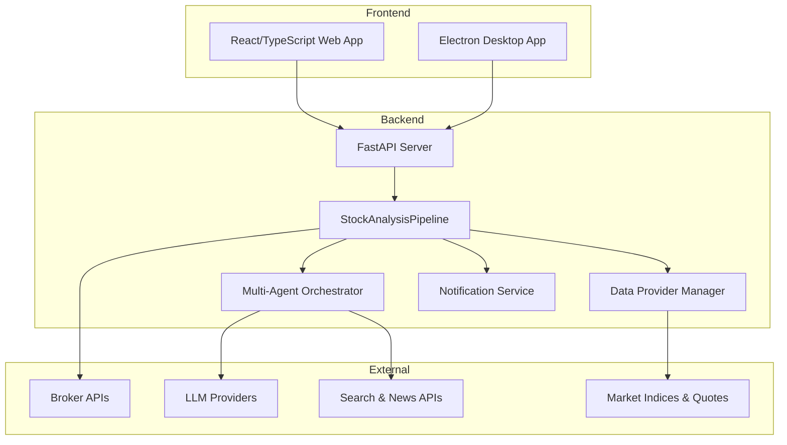
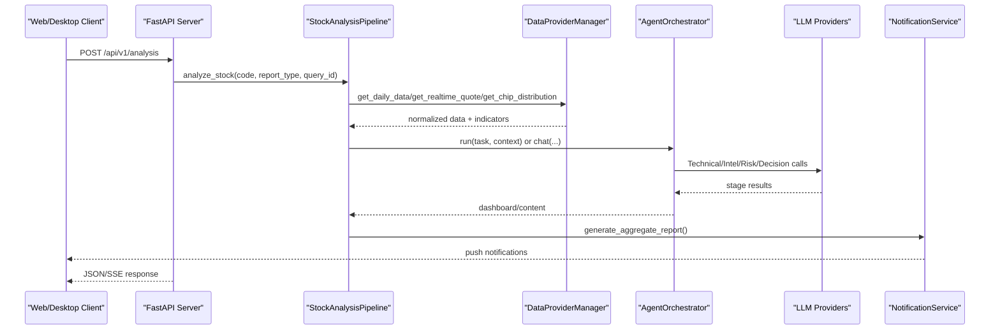
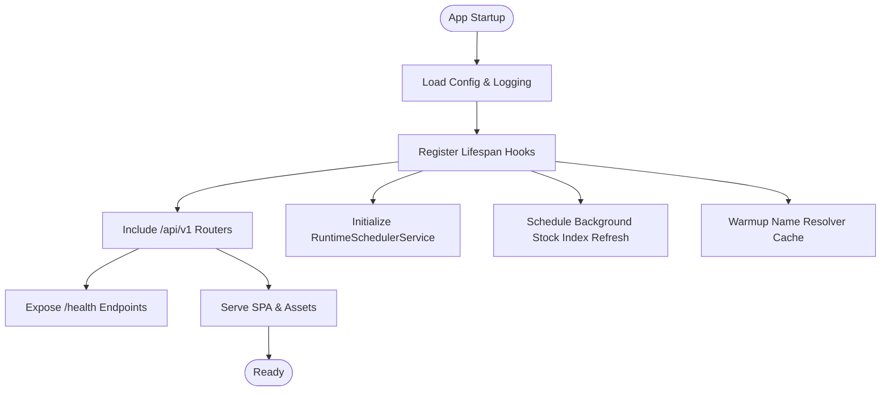
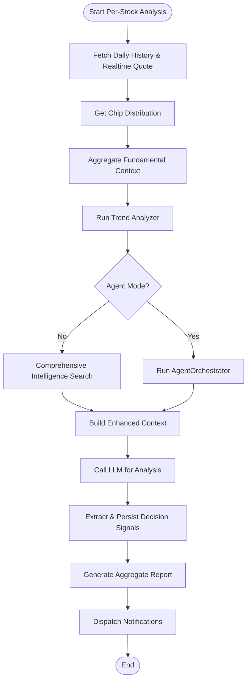
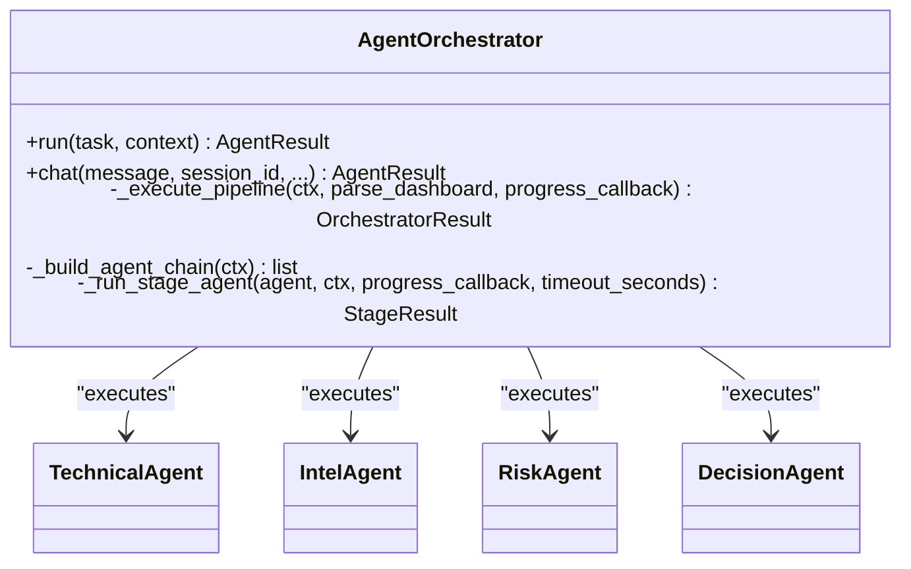
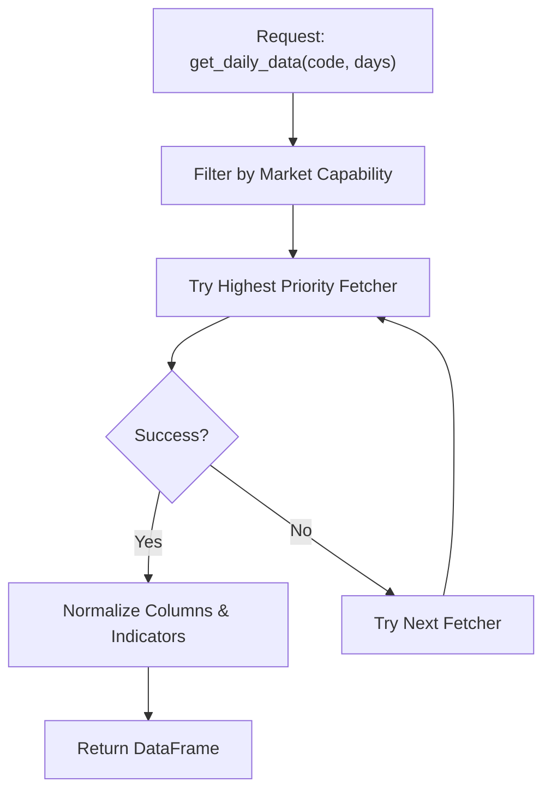
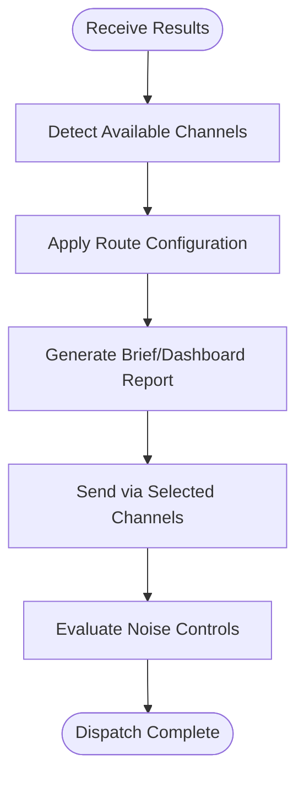
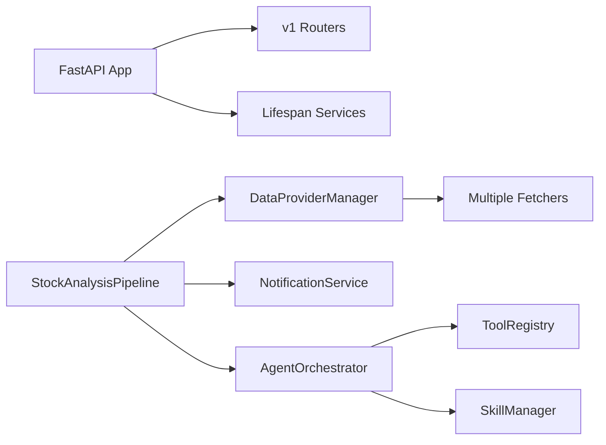

# Architecture Overview

<cite>
**Referenced Files in This Document**
- [main.py](file://main.py)
- [server.py](file://server.py)
- [api/app.py](file://api/app.py)
- [src/core/pipeline.py](file://src/core/pipeline.py)
- [src/agent/orchestrator.py](file://src/agent/orchestrator.py)
- [src/agent/factory.py](file://src/agent/factory.py)
- [data_provider/base.py](file://data_provider/base.py)
- [src/notification.py](file://src/notification.py)
- [docker/docker-compose.yml](file://docker/docker-compose.yml)
</cite>

## Table of Contents
1. Introduction
2. Project Structure
3. Core Components
4. Architecture Overview
5. Detailed Component Analysis
6. Dependency Analysis
7. Performance Considerations
8. Troubleshooting Guide
9. Conclusion

## Introduction
DailyStockAnalysis is a multi-layered system that ingests market data, performs technical and AI-driven analysis, and delivers actionable insights through web and desktop interfaces plus notification channels. It combines:
- A FastAPI backend service layer exposing REST APIs and hosting the web UI
- A React/TypeScript web frontend for interactive dashboards and configuration
- An Electron desktop application that bundles the backend and serves the UI locally
- A Python-based AI agent system with a multi-agent orchestration pipeline for specialized analysis stages

The system emphasizes resilience (failover across data providers), extensibility (plugin-style skills and tools), and operational clarity (logging, health checks, scheduling).

## Project Structure
At a high level:
- API and Web: FastAPI app under api/, server entrypoint under server.py, static SPA serving and CORS configured in api/app.py
- Desktop: Electron main process under apps/dsa-desktop/main.js packaging and launching the backend and UI
- Data ingestion: Pluggable fetchers under data_provider/base.py with strategy pattern and automatic failover
- Analysis core: StockAnalysisPipeline orchestrating data fetching, trend analysis, search/intelligence, LLM calls, and notifications
- Agent system: Multi-agent orchestrator coordinating Technical, Intelligence, Risk, Specialist, and Decision agents
- Notifications: Unified NotificationService dispatching to multiple channels
- Deployment: Docker Compose defines analyzer and server services with shared volumes and environment

**Diagram sources**
- [server.py:1-55](file://server.py#L1-L55)
- [api/app.py:313-384](file://api/app.py#L313-L384)
- [src/core/pipeline.py:209-319](file://src/core/pipeline.py#L209-L319)
- [src/agent/orchestrator.py:107-136](file://src/agent/orchestrator.py#L107-L136)
- [data_provider/base.py:604-683](file://data_provider/base.py#L604-L683)
- [src/notification.py:257-343](file://src/notification.py#L257-L343)

**Section sources**
- [server.py:1-55](file://server.py#L1-L55)
- [api/app.py:313-384](file://api/app.py#L313-L384)
- [docker/docker-compose.yml:59-73](file://docker/docker-compose.yml#L59-L73)

## Core Components
- FastAPI Backend: Creates the app, registers routes, configures CORS, serves SPA assets, exposes health endpoints, and integrates runtime scheduler and stock index refresh.
- StockAnalysisPipeline: Central orchestrator for per-stock analysis; manages data fetching, trend analysis, intelligence gathering, LLM calls, decision extraction, and notifications.
- Multi-Agent Orchestrator: Coordinates specialized agents (Technical, Intel, Risk, Specialist, Decision) with modes (quick, standard, full, specialist), timeouts, and budget guards.
- Data Provider Manager: Strategy-managed collection of fetchers with automatic failover, circuit breakers, and capability filtering by market.
- Notification Service: Aggregates results into reports and dispatches via multiple channels with routing and noise control.
- Desktop App: Launches backend, hosts UI, handles updates, and manages runtime state.

**Section sources**
- [api/app.py:313-384](file://api/app.py#L313-L384)
- [src/core/pipeline.py:209-319](file://src/core/pipeline.py#L209-L319)
- [src/agent/orchestrator.py:107-136](file://src/agent/orchestrator.py#L107-L136)
- [data_provider/base.py:604-683](file://data_provider/base.py#L604-L683)
- [src/notification.py:257-343](file://src/notification.py#L257-L343)
- [apps/dsa-desktop/main.js:1-120](file://apps/dsa-desktop/main.js#L1-L120)

## Architecture Overview
The system follows a layered architecture with clear boundaries:
- Presentation Layer: Web UI and Desktop UI consume REST APIs and SSE events.
- Application Layer: FastAPI endpoints coordinate requests, trigger pipelines, and manage sessions.
- Domain Layer: Pipeline and Agent Orchestrator implement business logic for analysis and decision-making.
- Infrastructure Layer: Data providers, LLM adapters, notification senders, and storage.

**Diagram sources**
- [api/app.py:383-454](file://api/app.py#L383-L454)
- [src/core/pipeline.py:414-800](file://src/core/pipeline.py#L414-L800)
- [src/agent/orchestrator.py:352-473](file://src/agent/orchestrator.py#L352-L473)
- [src/notification.py:424-434](file://src/notification.py#L424-L434)

## Detailed Component Analysis

### FastAPI Backend Service Layer
- Responsibilities:
  - Create and configure FastAPI app with lifespan hooks
  - Register v1 routers and error handlers
  - Serve SPA assets and handle missing asset diagnostics
  - Expose health endpoints and stock index file endpoint
  - Integrate runtime scheduler and background tasks (stock index refresh, name resolver warmup)
- Integration points:
  - Reads configuration and sets logging
  - Uses auth middleware and CORS settings
  - Hosts static assets from built frontend directory

**Diagram sources**
- [api/app.py:237-310](file://api/app.py#L237-L310)
- [api/app.py:313-384](file://api/app.py#L313-L384)
- [api/app.py:398-454](file://api/app.py#L398-L454)
- [api/app.py:476-496](file://api/app.py#L476-L496)

**Section sources**
- [server.py:21-55](file://server.py#L21-L55)
- [api/app.py:313-384](file://api/app.py#L313-L384)
- [api/app.py:398-454](file://api/app.py#L398-L454)
- [api/app.py:476-496](file://api/app.py#L476-L496)

### StockAnalysisPipeline (Core Pipeline Pattern)
- Responsibilities:
  - Manage end-to-end analysis flow per stock
  - Coordinate data fetching, trend analysis, intelligence search, LLM calls, decision extraction, and notifications
  - Provide progress callbacks and streaming hints for long-running LLM generation
- Key stages:
  - Fetch daily history and realtime quotes
  - Compute chip distribution and fundamental context
  - Build market phase and daily market context
  - Execute traditional analysis or switch to agent mode based on configuration/skills
  - Persist snapshots and extract decision signals
  - Generate aggregate reports and dispatch notifications

**Diagram sources**
- [src/core/pipeline.py:414-800](file://src/core/pipeline.py#L414-L800)

**Section sources**
- [src/core/pipeline.py:209-319](file://src/core/pipeline.py#L209-L319)
- [src/core/pipeline.py:414-800](file://src/core/pipeline.py#L414-L800)

### Multi-Agent Orchestration System
- Modes:
  - quick: Technical → Decision
  - standard: Technical → Intel → Decision
  - full: Technical → Intel → Risk → Decision
  - specialist: inserts specialist skill evaluations before Decision
- Features:
  - Budget and timeout management per pipeline and per stage
  - Non-critical stage degradation (intel/risk failures do not abort pipeline)
  - Strategy engine integration at Decision stage
  - Tool registry and skill manager caching for performance

**Diagram sources**
- [src/agent/orchestrator.py:107-136](file://src/agent/orchestrator.py#L107-L136)
- [src/agent/orchestrator.py:772-800](file://src/agent/orchestrator.py#L772-L800)

**Section sources**
- [src/agent/orchestrator.py:352-473](file://src/agent/orchestrator.py#L352-L473)
- [src/agent/orchestrator.py:479-766](file://src/agent/orchestrator.py#L479-L766)
- [src/agent/orchestrator.py:772-800](file://src/agent/orchestrator.py#L772-L800)

### Data Provider Manager (Strategy Pattern)
- Responsibilities:
  - Maintain ordered list of fetchers with priority
  - Route requests by market capability and availability
  - Implement circuit breaker and exponential backoff behavior
  - Normalize stock codes and compute basic indicators
- Extensibility:
  - New fetchers implement BaseFetcher interface
  - Capability filters skip unsupported markets
  - Health probes allow dynamic availability checks

**Diagram sources**
- [data_provider/base.py:604-683](file://data_provider/base.py#L604-L683)
- [data_provider/base.py:452-529](file://data_provider/base.py#L452-L529)

**Section sources**
- [data_provider/base.py:604-683](file://data_provider/base.py#L604-L683)
- [data_provider/base.py:452-529](file://data_provider/base.py#L452-L529)

### Notification Service
- Responsibilities:
  - Detect configured channels and context channels
  - Generate brief or dashboard reports
  - Dispatch messages concurrently with routing and noise control
  - Support Markdown-to-image conversion and channel-specific limits
- Channels include WeChat, Feishu, DingTalk, Telegram, Email, Pushover, Ntfy, Gotify, Pushplus, ServerChan3, Custom Webhook, Discord, Slack, Astrbot.

**Diagram sources**
- [src/notification.py:257-343](file://src/notification.py#L257-L343)
- [src/notification.py:424-434](file://src/notification.py#L424-L434)
- [src/notification.py:480-551](file://src/notification.py#L480-L551)

**Section sources**
- [src/notification.py:257-343](file://src/notification.py#L257-L343)
- [src/notification.py:424-434](file://src/notification.py#L424-L434)
- [src/notification.py:480-551](file://src/notification.py#L480-L551)

### Desktop Application (Electron)
- Responsibilities:
  - Launch backend process and serve UI
  - Handle update checks and runtime state backup/restore
  - Manage environment variables and path resolution across platforms
- Integration points:
  - Resolves backend executable path and binds host/port
  - Backs up runtime files during updates and restores after failures

**Section sources**
- [apps/dsa-desktop/main.js:1-120](file://apps/dsa-desktop/main.js#L1-L120)
- [apps/dsa-desktop/main.js:657-718](file://apps/dsa-desktop/main.js#L657-L718)

## Dependency Analysis
Key dependencies and interactions:
- FastAPI depends on api/v1 routers, middlewares, and lifecycle services
- Pipeline depends on DataProviderManager, Analyzer, NotificationService, and optional search/social sentiment services
- Agent Orchestrator depends on ToolRegistry, SkillManager, and LLM adapters
- DataProviderManager depends on multiple fetcher implementations and market routing utilities
- NotificationService composes multiple sender classes and uses routing/noise modules

**Diagram sources**
- [api/app.py:313-384](file://api/app.py#L313-L384)
- [src/core/pipeline.py:209-319](file://src/core/pipeline.py#L209-L319)
- [src/agent/factory.py:377-449](file://src/agent/factory.py#L377-L449)
- [data_provider/base.py:604-683](file://data_provider/base.py#L604-L683)

**Section sources**
- [api/app.py:313-384](file://api/app.py#L313-L384)
- [src/core/pipeline.py:209-319](file://src/core/pipeline.py#L209-L319)
- [src/agent/factory.py:377-449](file://src/agent/factory.py#L377-L449)
- [data_provider/base.py:604-683](file://data_provider/base.py#L604-L683)

## Performance Considerations
- Concurrency and Limits:
  - Pipeline uses thread pools and configurable max workers
  - Agent orchestrator enforces global and per-stage timeouts and minimum stage budgets to avoid wasted LLM cycles
- Caching:
  - ToolRegistry and SkillManager are cached to reduce startup and per-request overhead
  - Data provider manager caches stock names and concept rankings with TTL
- Failover and Resilience:
  - Data provider manager implements circuit breakers and capability filtering
  - Optional services (search, social sentiment) degrade gracefully without blocking analysis
- Resource Usage:
  - Docker Compose sets memory limits and reservations; analyzer and server can be scaled independently
  - Background tasks (stock index refresh, name resolver warmup) run asynchronously to minimize cold start latency

[No sources needed since this section provides general guidance]

## Troubleshooting Guide
Common issues and diagnostics:
- Frontend bundle inconsistency:
  - The app checks index.html references and logs missing assets to help diagnose blank pages
- Notification failures:
  - Use channel detection and route configuration to verify enabled channels; check noise controls and retryable flags
- Data provider errors:
  - Review logs for fetcher failures and circuit breaker states; ensure market capability matches code format
- Agent timeouts:
  - Adjust orchestrator timeout and per-agent timeouts; monitor stage durations and model usage

**Section sources**
- [api/app.py:76-113](file://api/app.py#L76-L113)
- [src/notification.py:480-551](file://src/notification.py#L480-L551)
- [data_provider/base.py:604-683](file://data_provider/base.py#L604-L683)
- [src/agent/orchestrator.py:479-766](file://src/agent/orchestrator.py#L479-L766)

## Conclusion
DailyStockAnalysis provides a robust, extensible architecture for automated stock analysis and reporting. Its layered design separates concerns across presentation, application, domain, and infrastructure layers. The multi-agent orchestration enables flexible analysis depth while maintaining cost and time budgets. Data provider strategies ensure resilience across diverse markets and sources. Notifications deliver insights through multiple channels with routing and noise control. Deployment via Docker supports scalable topologies for both scheduled analysis and on-demand API access.

[No sources needed since this section summarizes without analyzing specific files]