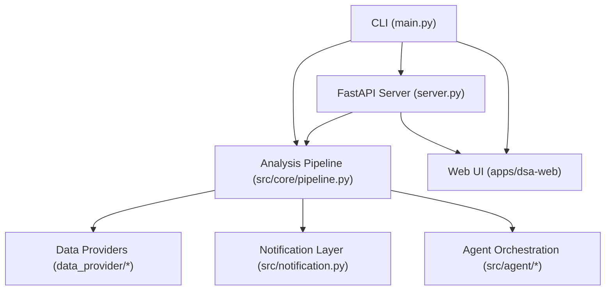
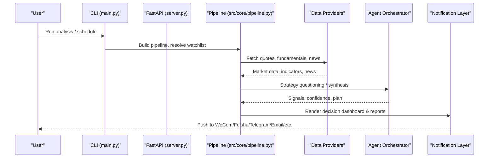
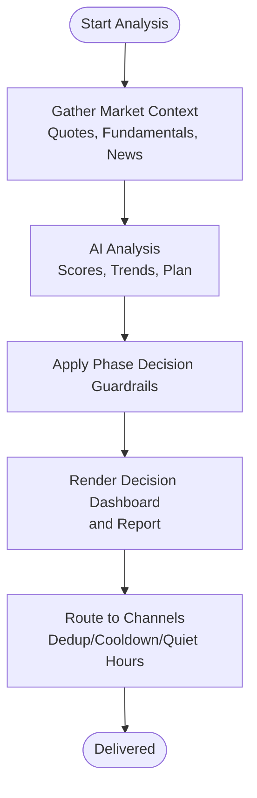
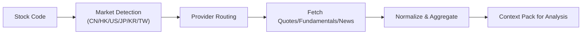
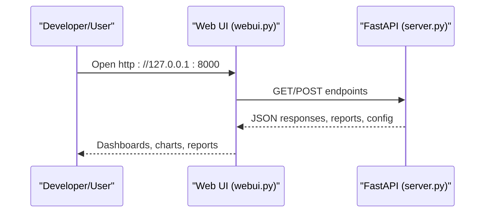
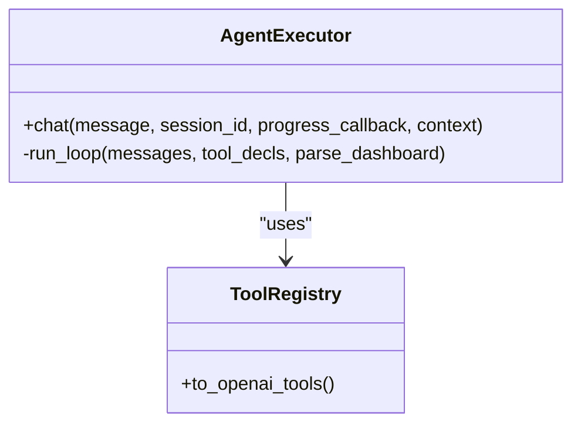
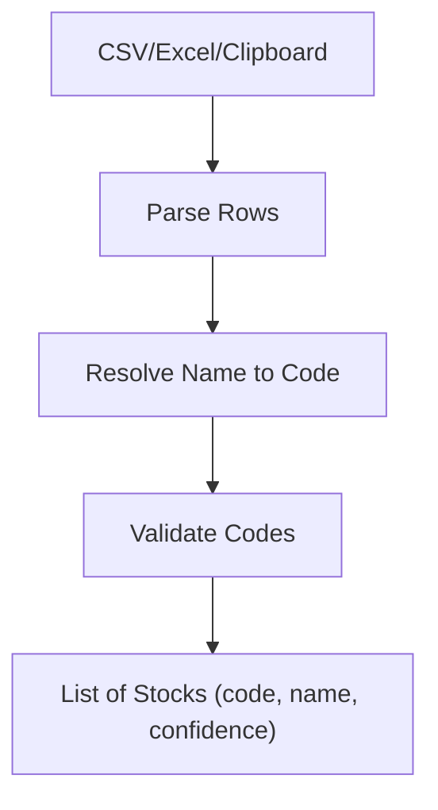
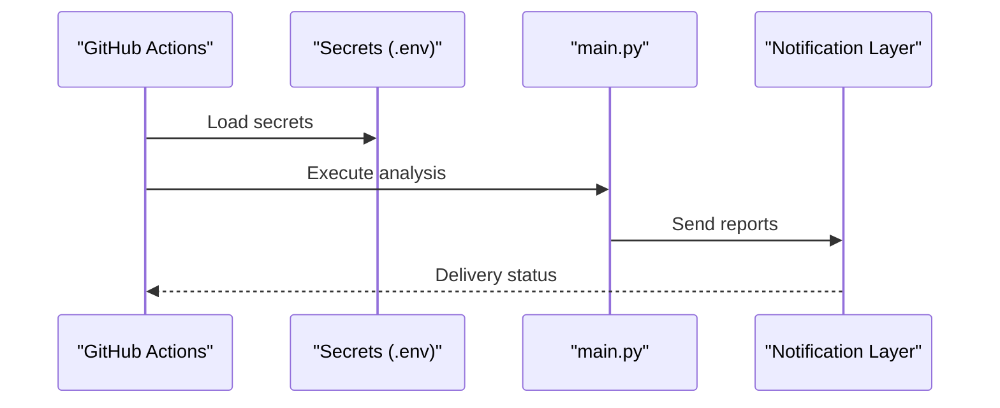
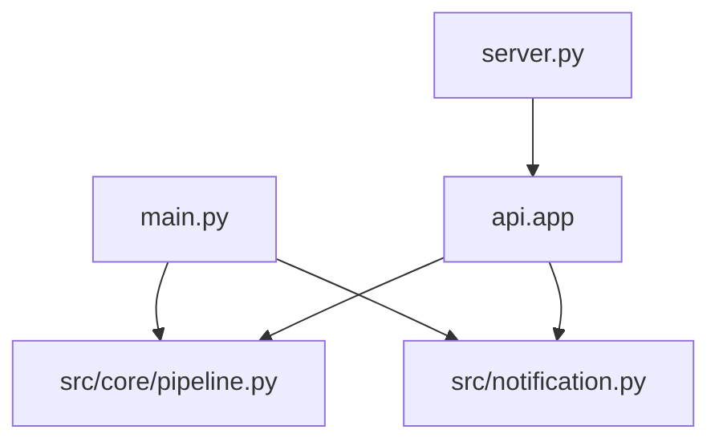

# Introduction and Key Features

<cite>
**Referenced Files in This Document**
- [README.md](file://README.md)
- [main.py](file://main.py)
- [server.py](file://server.py)
- [webui.py](file://webui.py)
- [pipeline.py](file://src/core/pipeline.py)
- [notification.py](file://src/notification.py)
- [import_parser.py](file://src/services/import_parser.py)
- [full-guide_EN.md](file://docs/full-guide_EN.md)
- [full-guide.md](file://docs/full-guide.md)
</cite>

## Table of Contents
1. [Introduction](#introduction)
2. [Project Structure](#project-structure)
3. [Core Components](#core-components)
4. [Architecture Overview](#architecture-overview)
5. [Detailed Component Analysis](#detailed-component-analysis)
6. [Dependency Analysis](#dependency-analysis)
7. [Performance Considerations](#performance-considerations)
8. [Troubleshooting Guide](#troubleshooting-guide)
9. [Conclusion](#conclusion)
10. [Appendices](#appendices)

## Introduction
DailyStockAnalysis is an AI-powered stock analysis system that automates daily analysis of watchlist stocks across multiple markets, including A-shares, Hong Kong, US, Japanese, Korean, and Taiwan markets. It aggregates market data, news, fundamentals, and sentiment to produce decision reports with scoring, trend predictions, buy/sell points, risk alerts, catalysts, and action checklists. The system delivers these outputs via a decision dashboard and pushes them to your preferred channels (WeCom, Feishu, Telegram, Discord, Slack, email, and more). It also provides web and desktop workspaces for manual analysis, monitoring, backtesting, portfolio management, and agent-based strategy questioning with 15 built-in strategies. Deployment is automated through GitHub Actions or Docker, enabling zero-cost or containerized runs on any platform.

Key value propositions:
- For individual investors: simple setup, automated daily reports, and easy-to-read dashboards to support disciplined decisions.
- For professional traders: multi-market coverage, robust data pipelines, agent-driven strategy exploration, and portfolio management tools.
- For teams: centralized notifications, consistent reporting formats, and scalable deployment options.

Typical outcomes include:
- Daily decision dashboard summarizing actions (buy/hold/sell), scores, and rationale.
- Market phase detection and guardrails to contextualize signals by intraday/postmarket phases.
- Portfolio-aware insights when integrated with broker accounts.

**Section sources**
- [README.md:39-61](file://README.md#L39-L61)
- [full-guide_EN.md:70-141](file://docs/full-guide_EN.md#L70-L141)
- [full-guide.md:113-145](file://docs/full-guide.md#L113-L145)

## Project Structure
At a high level, the project exposes:
- A CLI entry point for scheduled or one-off analysis runs.
- A FastAPI backend serving REST endpoints and static assets.
- A Web UI for interactive analysis, configuration, and monitoring.
- A notification layer supporting many channels.
- Data providers for multiple markets and data types.
- Agent orchestration for strategy questioning and multi-step reasoning.

**Diagram sources**
- [main.py:272-443](file://main.py#L272-L443)
- [server.py:1-55](file://server.py#L1-L55)
- [webui.py:26-59](file://webui.py#L26-L59)
- [pipeline.py:1-110](file://src/core/pipeline.py#L1-L110)
- [notification.py:185-200](file://src/notification.py#L185-L200)

**Section sources**
- [main.py:272-443](file://main.py#L272-L443)
- [server.py:1-55](file://server.py#L1-L55)
- [webui.py:26-59](file://webui.py#L26-L59)

## Core Components
- Decision Dashboard and Reports: Produces structured summaries with scores, trends, and actionable recommendations; supports report language localization and integrity checks.
- Multi-Market Data Aggregation: Routes requests to appropriate providers per market (A-shares, HK, US, JP, KR, TW) and normalizes codes and capabilities.
- Web and Desktop Workspaces: Interactive interfaces for manual analysis, history review, backtesting, portfolio management, and settings.
- Agent-Based Strategy Questioning: 15 built-in strategies (e.g., moving average crossovers, Chan theory, wave theory, momentum, event-driven) accessible via chat, bot, and API.
- Intelligent Import and Completion: Parse CSV/Excel/clipboard text; auto-resolve names to codes; support aliases and pinyin-like inputs.
- Automated Deployment: GitHub Actions workflows and Docker images enable scheduled runs without servers; local scheduling supported.

Practical examples:
- Setting up a watchlist: Provide STOCK_LIST with comma-separated codes like “600519,hk00700,AAPL,7203.T,005930.KS,2330.TW”.
- Configuring notifications: Set channel secrets such as WECHAT_WEBHOOK_URL, FEISHU_WEBHOOK_URL, TELEGRAM_BOT_TOKEN + TELEGRAM_CHAT_ID, DISCORD_WEBHOOK_URL, SLACK_BOT_TOKEN + SLACK_CHANNEL_ID, EMAIL_SENDER + EMAIL_PASSWORD.
- Receiving automated reports: Configure REPORT_TYPE (simple/full/brief), REPORT_LANGUAGE (zh/en/ko), and optional dedup/cooldown/quiet hours; run via GitHub Actions or locally.

**Section sources**
- [README.md:106-126](file://README.md#L106-L126)
- [full-guide_EN.md:70-141](file://docs/full-guide_EN.md#L70-L141)
- [full-guide.md:113-145](file://docs/full-guide.md#L113-L145)
- [import_parser.py:1-46](file://src/services/import_parser.py#L1-L46)

## Architecture Overview
The system orchestrates data acquisition, analysis, and delivery through a pipeline that integrates market context, AI analysis, and guardrails. Notifications are routed to configured channels with deduplication, cooldowns, and quiet hours.

**Diagram sources**
- [main.py:719-800](file://main.py#L719-L800)
- [pipeline.py:1-110](file://src/core/pipeline.py#L1-L110)
- [notification.py:185-200](file://src/notification.py#L185-L200)

## Detailed Component Analysis

### Decision Dashboard and AI Reports
- Generates concise and full reports with core conclusions, scores, trend predictions, buy/sell points, risk alerts, catalysts, and action checklists.
- Applies market phase detection and guardrails to adjust confidence and action windows based on intraday/postmarket context.
- Supports localized output languages and integrity checks to ensure required fields exist.

**Diagram sources**
- [pipeline.py:1596-1621](file://src/core/pipeline.py#L1596-L1621)
- [notification.py:185-200](file://src/notification.py#L185-L200)

**Section sources**
- [pipeline.py:1596-1621](file://src/core/pipeline.py#L1596-L1621)
- [full-guide_EN.md:1298-1298](file://docs/full-guide_EN.md#L1298-L1298)

### Multi-Market Data Aggregation
- Detects market from stock code suffixes and routes to appropriate providers (AkShare, Tushare, YFinance, Longbridge, etc.).
- Normalizes codes across markets (CN, HK, US, JP, KR, TW) and adapts capability sets per market (e.g., institutional data availability differs by region).
- Provides fail-open behavior so missing capabilities degrade gracefully without breaking the main flow.

**Diagram sources**
- [tests/test_jp_kr_market_support.py:46-68](file://tests/test_jp_kr_market_support.py#L46-L68)
- [tests/test_tw_market_support.py:51-64](file://tests/test_tw_market_support.py#L51-L64)
- [full-guide.md:445-452](file://docs/full-guide.md#L445-L452)

**Section sources**
- [full-guide.md:445-452](file://docs/full-guide.md#L445-L452)

### Web and Desktop Workspaces
- Web UI offers configuration management, task monitoring, manual analysis, history reports, Markdown export, agent chat, backtesting, portfolio management, and theme switching.
- Desktop app packages the same experience for offline or local use.
- Launch via CLI flags or dedicated scripts.

**Diagram sources**
- [webui.py:26-59](file://webui.py#L26-L59)
- [server.py:1-55](file://server.py#L1-L55)

**Section sources**
- [README.md:234-243](file://README.md#L234-L243)
- [webui.py:26-59](file://webui.py#L26-L59)

### Agent-Based Strategy Questioning
- 15 built-in strategies cover technical patterns, event-driven catalysts, growth quality, and regime-aware tactics.
- Accessible via Web chat, bot commands, and API; supports multi-turn follow-ups, session export, and background execution.
- Integrates with tool surfaces for real-time quotes, K-lines, indicators, news, and risk data.

**Diagram sources**
- [src/agent/executor.py:686-716](file://src/agent/executor.py#L686-L716)

**Section sources**
- [README.md:245-254](file://README.md#L245-L254)

### Intelligent Import and Completion
- Parses CSV/Excel/clipboard text into stock items with code, name, and confidence.
- Resolves names to codes using built-in resolvers; handles aliases and common formats.
- Supports fast paths for single-column inputs and preserves names even if codes are dirty.

**Diagram sources**
- [import_parser.py:1-46](file://src/services/import_parser.py#L1-L46)

**Section sources**
- [import_parser.py:1-46](file://src/services/import_parser.py#L1-L46)

### Automated Deployment and Notifications
- GitHub Actions: Fork repo, configure secrets (model keys, notification channels, stock list), enable Actions, and run workflow manually or on schedule.
- Docker: Containerized environment with entrypoint script; supports local scheduling and server-only modes.
- Notifications: Multiple channels with routing, deduplication, cooldowns, quiet hours, and severity filters.

**Diagram sources**
- [README.md:65-150](file://README.md#L65-L150)
- [notification.py:185-200](file://src/notification.py#L185-L200)

**Section sources**
- [README.md:65-150](file://README.md#L65-L150)
- [full-guide_EN.md:70-141](file://docs/full-guide_EN.md#L70-L141)
- [full-guide.md:113-145](file://docs/full-guide.md#L113-L145)

## Dependency Analysis
- CLI coordinates environment bootstrap, argument parsing, trading day filtering, and pipeline execution.
- Pipeline orchestrates data fetching, analysis, guardrails, and notification dispatch.
- Notification layer abstracts channel specifics and applies routing policies.
- Web/UI depends on FastAPI endpoints for live operations and historical data.

**Diagram sources**
- [main.py:272-443](file://main.py#L272-L443)
- [server.py:1-55](file://server.py#L1-L55)
- [notification.py:185-200](file://src/notification.py#L185-L200)

**Section sources**
- [main.py:272-443](file://main.py#L272-L443)
- [server.py:1-55](file://server.py#L1-L55)

## Performance Considerations
- Use provider priorities and fallback chains to balance speed and reliability; prefer token-based providers for stable daily runs.
- Enable dedup and cooldown to avoid redundant notifications during rapid events.
- Limit concurrent workers and set analysis delays to respect upstream rate limits.
- Prefer full report mode in Docker environments for richer outputs; use brief mode for quick scans.

[No sources needed since this section provides general guidance]

## Troubleshooting Guide
- Empty watchlist: Ensure STOCK_LIST is populated or enable market review; otherwise the run may skip analysis.
- Notification failures: Use --check-notify or Web UI test to validate channel configuration; verify minimal and advanced keys per channel.
- Market-specific limitations: Some features (e.g., institutional data) are not supported in certain markets; expect graceful degradation.
- Image conversion issues: If markdown-to-image fails, adjust MD2IMG_ENGINE or reduce report length below threshold.

**Section sources**
- [main.py:767-800](file://main.py#L767-L800)
- [full-guide.md:113-145](file://docs/full-guide.md#L113-L145)

## Conclusion
DailyStockAnalysis delivers end-to-end automation for multi-market stock analysis, turning raw data into actionable decision dashboards and reports. Its agent-driven strategies, intelligent import, and flexible deployment make it suitable for both beginners and professionals. By configuring a watchlist, selecting notification channels, and choosing report preferences, users can receive timely, reliable insights aligned with their trading discipline and portfolio goals.

[No sources needed since this section summarizes without analyzing specific files]

## Appendices

### Practical Setup Examples
- Watchlist: STOCK_LIST=“600519,hk00700,AAPL,7203.T,005930.KS,2330.TW”
- Notifications:
  - WeCom: WECHAT_WEBHOOK_URL
  - Feishu: FEISHU_WEBHOOK_URL
  - Telegram: TELEGRAM_BOT_TOKEN + TELEGRAM_CHAT_ID
  - Discord: DISCORD_WEBHOOK_URL
  - Slack: SLACK_BOT_TOKEN + SLACK_CHANNEL_ID
  - Email: EMAIL_SENDER + EMAIL_PASSWORD
- Report Preferences:
  - REPORT_TYPE=“full” (recommended for Docker)
  - REPORT_LANGUAGE=“zh” or “en” or “ko”
  - Optional: NOTIFICATION_DEDUP_TTL_SECONDS, NOTIFICATION_COOLDOWN_SECONDS, NOTIFICATION_QUIET_HOURS

**Section sources**
- [README.md:106-126](file://README.md#L106-L126)
- [full-guide_EN.md:70-141](file://docs/full-guide_EN.md#L70-L141)
- [full-guide.md:113-145](file://docs/full-guide.md#L113-L145)