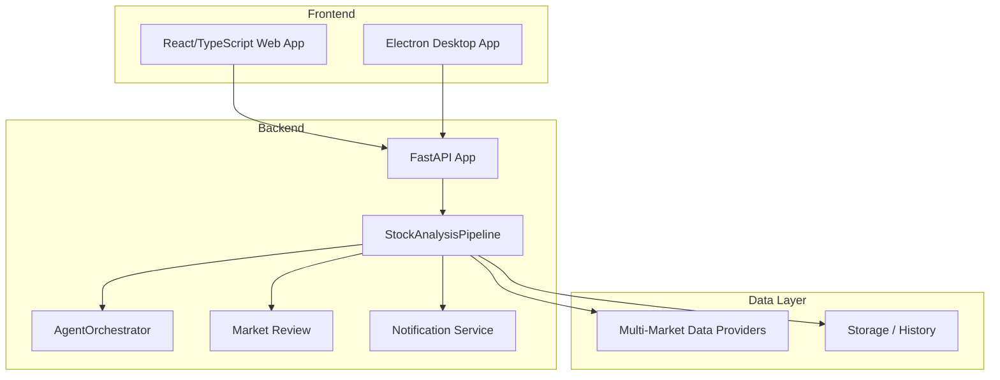
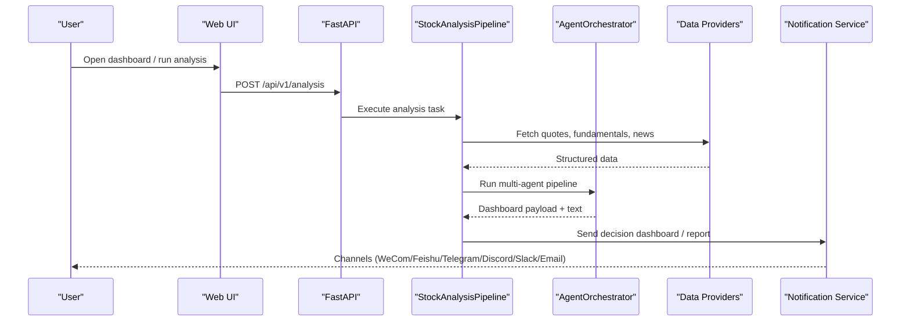
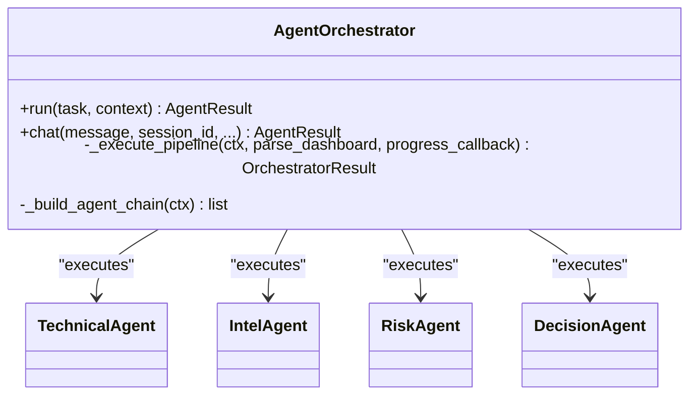
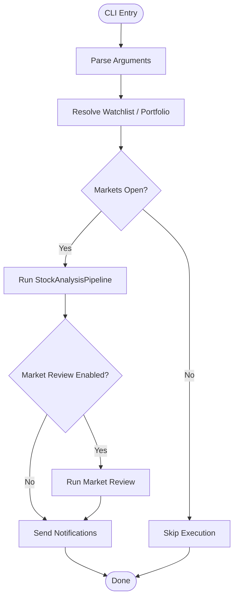
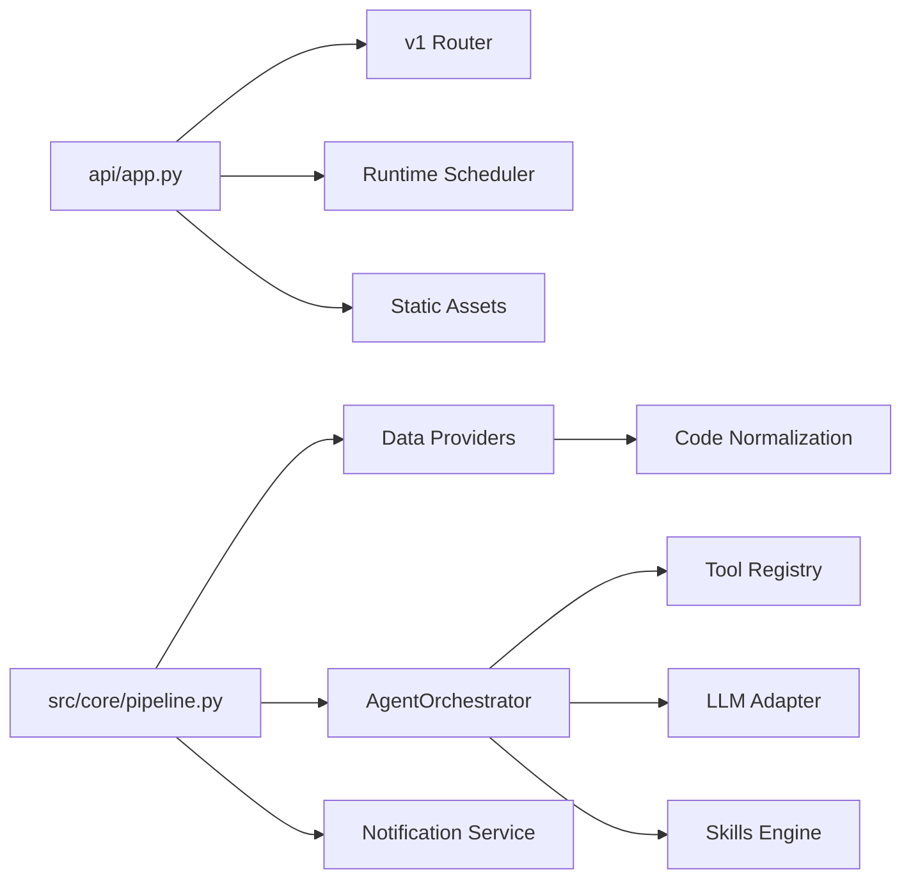

# Project Overview

<cite>
**Referenced Files in This Document**
- [README.md](file://README.md)
- [main.py](file://main.py)
- [api/app.py](file://api/app.py)
- [src/core/pipeline.py](file://src/core/pipeline.py)
- [src/agent/orchestrator.py](file://src/agent/orchestrator.py)
- [src/core/market_review.py](file://src/core/market_review.py)
- [data_provider/base.py](file://data_provider/base.py)
- [apps/dsa-web/package.json](file://apps/dsa-web/package.json)
- [src/market_context.py](file://src/market_context.py)
</cite>

## Table of Contents
1. [Introduction](#introduction)
2. [Project Structure](#project-structure)
3. [Core Components](#core-components)
4. [Architecture Overview](#architecture-overview)
5. [Detailed Component Analysis](#detailed-component-analysis)
6. [Dependency Analysis](#dependency-analysis)
7. [Performance Considerations](#performance-considerations)
8. [Troubleshooting Guide](#troubleshooting-guide)
9. [Conclusion](#conclusion)

## Introduction
DailyStockAnalysis is an AI-powered, multi-market stock analysis platform that automates daily research and delivers a decision dashboard for A-shares, Hong Kong, US, Japanese, Korean, and Taiwan markets. It combines real-time monitoring, automated daily analysis workflows, and multi-channel notifications to help investors track opportunities and risks across global markets.

At a high level:
- Purpose: Provide automated, AI-driven daily analysis and actionable insights (decision dashboard, market phase detection, portfolio management) for multiple markets.
- Users: Retail investors, traders, and teams who want consistent daily reports and alerts without manual data gathering.
- Outcomes: Daily “decision dashboard” summaries, market review reports, watchlist-based analysis, backtesting, and portfolio risk signals delivered via web UI, desktop app, or notification channels.

For beginners: Stock analysis means evaluating price trends, fundamentals, news, and market conditions to decide whether to buy, hold, or sell. This system automates that process daily and presents clear recommendations with risk notes.

For experienced developers: The system is built around a FastAPI backend, a React/TypeScript web frontend, an Electron desktop application, and a multi-agent AI pipeline that coordinates specialized agents (technical, intelligence, risk, decision) over pluggable market data providers.

**Section sources**
- [README.md:16-60](file://README.md#L16-L60)

## Project Structure
The repository is organized into clear layers:
- API layer: FastAPI application with versioned routers, authentication middleware, error handling, and static asset serving.
- Core services: Analysis pipeline, market review, scheduling, storage, and notification routing.
- Agent system: Multi-agent orchestrator coordinating technical, intelligence, risk, and decision stages.
- Data providers: Pluggable fetchers for multiple markets with normalization and fallback strategies.
- Frontend: React/TypeScript SPA served by the API; Electron wrapper for desktop distribution.
- Bot and notifications: Cross-platform messaging and webhook integrations.

**Diagram sources**
- [api/app.py:313-384](file://api/app.py#L313-L384)
- [src/core/pipeline.py:1-110](file://src/core/pipeline.py#L1-L110)
- [src/agent/orchestrator.py:107-136](file://src/agent/orchestrator.py#L107-L136)
- [src/core/market_review.py:174-222](file://src/core/market_review.py#L174-L222)
- [data_provider/base.py:1-35](file://data_provider/base.py#L1-L35)

**Section sources**
- [api/app.py:313-384](file://api/app.py#L313-L384)
- [apps/dsa-web/package.json:1-60](file://apps/dsa-web/package.json#L1-L60)

## Core Components
- StockAnalysisPipeline: Orchestrates data fetching, search, analysis, decision extraction, report rendering, and notifications for each stock and market context.
- AgentOrchestrator: Coordinates specialized agents (technical, intelligence, risk, decision) with modes (quick, standard, full, specialist), timeouts, budget guards, and fallbacks to produce a structured decision dashboard.
- Market Review: Generates multi-region market recaps (A-shares, HK, US, JP, KR), merges reports, persists history, and sends notifications.
- Data Providers: Strategy-pattern fetchers with code normalization, market detection, and automatic fallback to ensure robust data access across markets.
- Notification System: Unified service sending Markdown or structured payloads to multiple channels (WeCom, Feishu, Telegram, Discord, Slack, email).

Key capabilities:
- Decision dashboard: Aggregated recommendation, score, trend, entry/exit points, risk alerts, catalysts, and checklist.
- Market phase detection: Contextual market regime signals used to adjust decisions and guardrails.
- Portfolio management: Import portfolios, compute snapshots, risk signals, and alerts tied to holdings.

**Section sources**
- [src/core/pipeline.py:1-110](file://src/core/pipeline.py#L1-L110)
- [src/agent/orchestrator.py:107-136](file://src/agent/orchestrator.py#L107-L136)
- [src/core/market_review.py:174-222](file://src/core/market_review.py#L174-L222)
- [data_provider/base.py:1-35](file://data_provider/base.py#L1-L35)

## Architecture Overview
The system runs as a FastAPI service that serves both the API and the React/TypeScript web UI. The CLI/main entry point schedules and executes daily analysis tasks, while the API exposes endpoints for interactive use, configuration, and automation.

**Diagram sources**
- [api/app.py:313-384](file://api/app.py#L313-L384)
- [src/core/pipeline.py:1-110](file://src/core/pipeline.py#L1-L110)
- [src/agent/orchestrator.py:352-374](file://src/agent/orchestrator.py#L352-L374)
- [data_provider/base.py:1-35](file://data_provider/base.py#L1-L35)

## Detailed Component Analysis

### Multi-Agent AI System
The AgentOrchestrator manages a sequence of specialized agents to produce a decision dashboard:
- Technical agent: Price action, indicators, patterns.
- Intelligence agent: News, events, social sentiment.
- Risk agent: Volatility, drawdowns, regime signals.
- Decision agent: Synthesizes inputs into actionable recommendations.

Modes:
- quick: Technical → Decision (fastest)
- standard: Technical → Intelligence → Decision (default)
- full: Technical → Intelligence → Risk → Decision
- specialist: Inserts skill-based specialist evaluations before Decision

Controls:
- Global and per-agent timeouts
- Budget guards to skip non-critical stages when time is short
- Fallback to partial dashboard when pipeline times out or budgets are insufficient

**Diagram sources**
- [src/agent/orchestrator.py:107-136](file://src/agent/orchestrator.py#L107-L136)
- [src/agent/orchestrator.py:772-800](file://src/agent/orchestrator.py#L772-L800)

**Section sources**
- [src/agent/orchestrator.py:107-136](file://src/agent/orchestrator.py#L107-L136)
- [src/agent/orchestrator.py:352-374](file://src/agent/orchestrator.py#L352-L374)
- [src/agent/orchestrator.py:479-766](file://src/agent/orchestrator.py#L479-L766)
- [src/agent/orchestrator.py:772-800](file://src/agent/orchestrator.py#L772-L800)

### Real-Time Monitoring and Automated Daily Workflows
- CLI entry point supports schedule mode, dry-run, single-stock notify, market review only, and serve-only modes.
- Trading-day filtering ensures analysis runs only when relevant markets are open, respecting regional configurations.
- Background runtime scheduler integrates with the FastAPI lifespan to reconcile scheduled jobs at startup.

**Diagram sources**
- [main.py:272-443](file://main.py#L272-L443)
- [main.py:446-485](file://main.py#L446-L485)
- [api/app.py:237-310](file://api/app.py#L237-L310)

**Section sources**
- [main.py:272-443](file://main.py#L272-L443)
- [main.py:446-485](file://main.py#L446-L485)
- [api/app.py:237-310](file://api/app.py#L237-L310)

### Technology Stack
- Backend: Python FastAPI with modular routers, CORS, auth middleware, and static asset serving.
- Frontend: React 19 + TypeScript + Vite + Tailwind + Zustand, served by the API in production.
- Desktop: Electron wrapper packaging the web assets and providing native integration.
- Data Providers: Pluggable fetchers for A-shares, HK, US, JP, KR, TW with normalization and fallback.
- LLM Integration: Multiple providers via adapters; configurable routing and usage tracking.

**Section sources**
- [api/app.py:313-384](file://api/app.py#L313-L384)
- [apps/dsa-web/package.json:1-60](file://apps/dsa-web/package.json#L1-L60)
- [data_provider/base.py:1-35](file://data_provider/base.py#L1-L35)

### Market Coverage and Data Normalization
The system detects and normalizes codes across markets:
- A-shares: 6-digit numeric codes, exchange prefixes/suffixes handled.
- Hong Kong: HK prefix or .HK suffix, normalized to canonical form.
- US: Ticker symbols (e.g., AAPL).
- Japan/Korea/Taiwan: Yahoo-style suffixes (.T, .KS/.KQ, .TW/.TWO).

This enables unified pipelines to route requests to appropriate providers and apply market-specific rules.

**Section sources**
- [data_provider/base.py:71-150](file://data_provider/base.py#L71-L150)
- [data_provider/base.py:156-200](file://data_provider/base.py#L156-L200)
- [src/market_context.py:18-51](file://src/market_context.py#L18-L51)

### Decision Dashboard, Market Phase Detection, and Portfolio Management
- Decision dashboard: Produced by the multi-agent pipeline; includes scores, actions, risk alerts, catalysts, and checklists.
- Market phase detection: Contextual regime signals influence guardrails and decision adjustments.
- Portfolio management: Import broker holdings, snapshot positions, compute risk metrics, and generate alerts.

Practical examples:
- Set up a watchlist: Configure STOCK_LIST or import from CSV/images; the pipeline analyzes listed stocks daily.
- Configure data sources: Add provider tokens (e.g., Tushare, Longbridge) for stable quotes and fundamentals.
- Receive automated reports: Enable notification channels (WeCom, Feishu, Telegram, Discord, Slack, Email); choose merge vs. per-stock notifications.

**Section sources**
- [src/core/pipeline.py:1-110](file://src/core/pipeline.py#L1-L110)
- [src/core/market_review.py:174-222](file://src/core/market_review.py#L174-L222)
- [README.md:16-60](file://README.md#L16-L60)

## Dependency Analysis
High-level dependencies:
- api/app.py depends on v1 routers, auth/error middlewares, runtime scheduler, and static asset handlers.
- src/core/pipeline.py depends on data providers, analyzer, search service, notification service, and agent orchestration.
- src/agent/orchestrator.py depends on tool registry, LLM adapter, skills engine, and agent implementations.
- data_provider/base.py provides strategy pattern and normalization for multi-market codes.

**Diagram sources**
- [api/app.py:313-384](file://api/app.py#L313-L384)
- [src/core/pipeline.py:1-110](file://src/core/pipeline.py#L1-L110)
- [src/agent/orchestrator.py:107-136](file://src/agent/orchestrator.py#L107-L136)
- [data_provider/base.py:1-35](file://data_provider/base.py#L1-L35)

**Section sources**
- [api/app.py:313-384](file://api/app.py#L313-L384)
- [src/core/pipeline.py:1-110](file://src/core/pipeline.py#L1-L110)
- [src/agent/orchestrator.py:107-136](file://src/agent/orchestrator.py#L107-L136)
- [data_provider/base.py:1-35](file://data_provider/base.py#L1-L35)

## Performance Considerations
- Concurrency control: Pipeline uses thread pools for parallel data fetching and analysis tasks.
- Timeouts and budgets: Agent orchestrator enforces global and per-agent timeouts; budget guards skip non-critical stages when time is low.
- Provider resilience: Automatic fallback between data sources with rate limiting and retry logic.
- Caching: Stock index refresh and name resolution caches reduce cold-start latency and network calls.
- Logging and diagnostics: Structured logs and diagnostic snapshots aid performance tuning and troubleshooting.

[No sources needed since this section provides general guidance]

## Troubleshooting Guide
Common issues and resolutions:
- Empty stock list: Ensure STOCK_LIST is configured or portfolio import succeeds; otherwise analysis skips.
- Frontend not built: If the web UI shows blank, build the frontend assets or start with serve-only mode.
- Notification failures: Check channel credentials and connectivity; use check-notify mode to validate configuration.
- Market review conflicts: Use region filters and trading-day checks to avoid running when markets are closed.
- Provider errors: Inspect logs for provider-specific failures; configure token-backed providers for stability.

Operational tips:
- Use --dry-run to validate data retrieval without AI analysis.
- Use --schedule to enable background job execution.
- Use --market-review to run market recap independently.
- Use --single-notify to receive per-stock notifications immediately.

**Section sources**
- [main.py:272-443](file://main.py#L272-L443)
- [api/app.py:390-434](file://api/app.py#L390-L434)
- [src/core/market_review.py:174-222](file://src/core/market_review.py#L174-L222)

## Conclusion
DailyStockAnalysis delivers a comprehensive, automated stock analysis workflow across multiple global markets. Its multi-agent AI system produces actionable decision dashboards, while robust data provider integration and flexible notifications ensure reliable delivery. The FastAPI backend, React/TypeScript frontend, and Electron desktop app provide a cohesive user experience for both interactive exploration and automated daily operations.

[No sources needed since this section summarizes without analyzing specific files]