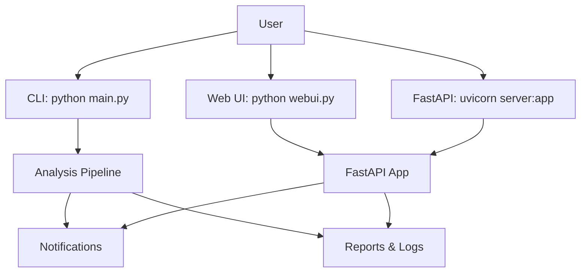
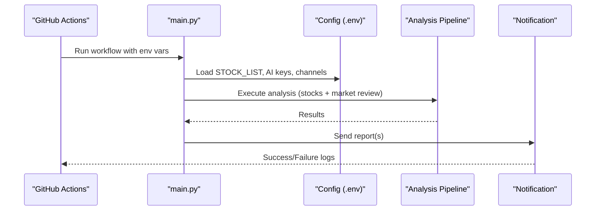

# Quick Start Guide

<cite>
**Referenced Files in This Document**
- [README.md](file://README.md)
- [main.py](file://main.py)
- [server.py](file://server.py)
- [webui.py](file://webui.py)
- [requirements.txt](file://requirements.txt)
- [pyproject.toml](file://pyproject.toml)
- [docker/Dockerfile](file://docker/Dockerfile)
- [docker/docker-compose.yml](file://docker/docker-compose.yml)
- [.github/workflows/00-daily-analysis.yml](file://.github/workflows/00-daily-analysis.yml)
- [src/config.py](file://src/config.py)
- [src/notification.py](file://src/notification.py)
</cite>

## Table of Contents
1. Introduction
2. Project Structure
3. Core Components
4. Architecture Overview
5. Detailed Component Analysis
6. Dependency Analysis
7. Performance Considerations
8. Troubleshooting Guide
9. Conclusion
10. Appendices

## Introduction
This quick start guide helps you get DailyStockAnalysis running fast with minimal setup. You will:
- Deploy via GitHub Actions (recommended, zero cost)
- Run locally with Python or Docker
- Configure an AI model provider (OpenAI-compatible, Gemini, Claude, or local models)
- Set up a notification channel to receive reports
- Configure your stock list
- Use common commands for analysis, web interface, and scheduled tasks
- Verify everything works and troubleshoot common issues

Prerequisites:
- Python 3.10+ for local runs
- Internet access to data providers and AI APIs
- At least one AI API key configured
- A notification channel configured to receive reports

## Project Structure
DailyStockAnalysis provides multiple ways to run:
- CLI-driven analysis via main.py
- FastAPI backend via server.py
- Web UI launcher via webui.py
- Docker image and compose for containerized runs
- GitHub Actions workflow for automated daily runs

**Diagram sources**
- [main.py:272-443](file://main.py#L272-L443)
- [server.py:21-55](file://server.py#L21-L55)
- [webui.py:26-59](file://webui.py#L26-L59)

**Section sources**
- [README.md:63-179](file://README.md#L63-L179)
- [main.py:272-443](file://main.py#L272-L443)
- [server.py:21-55](file://server.py#L21-L55)
- [webui.py:26-59](file://webui.py#L26-L59)

## Core Components
- CLI entrypoint: main.py orchestrates analysis, scheduling, and optional web/API modes
- FastAPI app: server.py exposes REST endpoints and serves the web UI assets
- Web UI launcher: webui.py starts the frontend-facing service
- Configuration: src/config.py loads environment variables and validates settings
- Notifications: src/notification.py composes reports and sends them to channels

Key responsibilities:
- main.py parses arguments, resolves stock lists, runs market review and stock analysis, and supports scheduling and web modes
- server.py initializes logging and exposes the FastAPI app for API and static assets
- webui.py binds to WEBUI_HOST/WEBUI_PORT and launches the API server for the UI
- src/config.py centralizes configuration loading and validation
- src/notification.py formats outputs and dispatches to supported channels

**Section sources**
- [main.py:272-443](file://main.py#L272-L443)
- [server.py:21-55](file://server.py#L21-L55)
- [webui.py:26-59](file://webui.py#L26-L59)
- [src/config.py:1-200](file://src/config.py#L1-L200)
- [src/notification.py:1-200](file://src/notification.py#L1-L200)

## Architecture Overview
The system can run as:
- Scheduled CLI job (GitHub Actions or local scheduler)
- Standalone FastAPI service (for API and Web UI)
- Containerized service using Docker

**Diagram sources**
- [.github/workflows/00-daily-analysis.yml:40-535](file://.github/workflows/00-daily-analysis.yml#L40-L535)
- [main.py:272-443](file://main.py#L272-L443)
- [src/config.py:1-200](file://src/config.py#L1-L200)
- [src/notification.py:1-200](file://src/notification.py#L1-L200)

## Detailed Component Analysis

### GitHub Actions Deployment (Recommended)
Steps:
1. Fork this repository on GitHub
2. Add required secrets:
   - AI model provider (at least one): ANSPIRE_API_KEYS, AIHUBMIX_KEY, GEMINI_API_KEY, OPENAI_API_KEY, ANTHROPIC_API_KEY, etc.
   - Notification channel: WECHAT_WEBHOOK_URL, FEISHU_WEBHOOK_URL, TELEGRAM_BOT_TOKEN + TELEGRAM_CHAT_ID, DISCORD_WEBHOOK_URL, SLACK_BOT_TOKEN + SLACK_CHANNEL_ID, EMAIL_SENDER + EMAIL_PASSWORD, etc.
   - Stock list: STOCK_LIST (comma-separated codes)
3. Enable Actions in your fork
4. Trigger manually: Actions → “Daily Stock Analysis” → “Run workflow”
5. Default schedule: weekdays at 18:00 Beijing time; configurable via workflow inputs

Notes:
- The workflow injects many LLM and notification variables from Secrets/Variables
- Reports and logs are uploaded as artifacts for inspection

**Section sources**
- [README.md:63-150](file://README.md#L63-L150)
- [.github/workflows/00-daily-analysis.yml:40-535](file://.github/workflows/00-daily-analysis.yml#L40-L535)

### Local Python Installation
Steps:
1. Install dependencies: pip install -r requirements.txt
2. Create .env from example and configure:
   - AI provider keys
   - Notification channel credentials
   - STOCK_LIST
3. Run analysis: python main.py
4. Common commands:
   - Debug mode: python main.py --debug
   - Dry-run (data only): python main.py --dry-run
   - Analyze specific stocks: python main.py --stocks 600519,hk00700,AAPL
   - Market review only: python main.py --market-review
   - Schedule mode: python main.py --schedule
   - Serve-only (API): python main.py --serve-only
   - Web UI: python main.py --webui or python main.py --webui-only

**Section sources**
- [README.md:152-179](file://README.md#L152-L179)
- [main.py:272-443](file://main.py#L272-L443)

### Docker Deployment
Use the provided Dockerfile and docker-compose to run either:
- Analyzer (scheduled analysis)
- Server (FastAPI only)
- Both together

Commands:
- Scheduled analyzer: docker-compose -f docker/docker-compose.yml up -d
- FastAPI server: docker-compose -f docker/docker-compose.yml up -d server
- Both: docker-compose -f docker/docker-compose.yml up -d analyzer server

Environment:
- Read from ../.env via env_file
- Persist data/logs/reports via volumes
- Timezone set to Asia/Shanghai by default

**Section sources**
- [docker/Dockerfile:1-106](file://docker/Dockerfile#L1-L106)
- [docker/docker-compose.yml:1-73](file://docker/docker-compose.yml#L1-L73)

### Desktop Application Setup
A desktop package is available. See the desktop packaging documentation for building and installing the desktop client.

**Section sources**
- [README.md:179-179](file://README.md#L179-L179)

### AI Model Provider Configuration
You must configure at least one AI provider. Options include:
- OpenAI-compatible: OPENAI_API_KEY, OPENAI_BASE_URL, OPENAI_MODEL
- Gemini: GEMINI_API_KEY (and optional fallback model)
- Claude: ANTHROPIC_API_KEY
- LiteLLM-based routing: LITELLM_CONFIG or LITELLM_* variables
- Local models: Ollama or other local backends via LLM_OLLAMA_* variables

In GitHub Actions, these are injected from Secrets/Variables. In local/Docker, set them in .env.

**Section sources**
- [README.md:78-91](file://README.md#L78-L91)
- [.github/workflows/00-daily-analysis.yml:64-269](file://.github/workflows/00-daily-analysis.yml#L64-L269)
- [src/config.py:100-130](file://src/config.py#L100-L130)

### Notification Channel Setup
Configure at least one channel to receive reports:
- WeChat Webhook: WECHAT_WEBHOOK_URL
- Feishu Webhook: FEISHU_WEBHOOK_URL (+ optional secret/keyword)
- Telegram: TELEGRAM_BOT_TOKEN + TELEGRAM_CHAT_ID
- Discord: DISCORD_WEBHOOK_URL
- Slack: SLACK_BOT_TOKEN + SLACK_CHANNEL_ID
- Email: EMAIL_SENDER + EMAIL_PASSWORD (+ EMAIL_RECEIVERS)
- Others: PushPlus, ntfy, Gotify, custom webhook, etc.

The notification layer composes reports and routes to configured channels.

**Section sources**
- [README.md:93-104](file://README.md#L93-L104)
- [src/notification.py:185-200](file://src/notification.py#L185-L200)

### Stock List Configuration
Set STOCK_LIST to analyze specific tickers across markets (e.g., A-shares, HK, US, JP, KR, TW). Examples:
- 600519,hk00700,AAPL,7203.T,005930.KS,2330.TW

In GitHub Actions, STOCK_LIST can be provided via Secrets or Variables. Locally, add it to .env.

**Section sources**
- [README.md:106-111](file://README.md#L106-L111)
- [.github/workflows/00-daily-analysis.yml:398-405](file://.github/workflows/00-daily-analysis.yml#L398-L405)

### Command-Line Usage Examples
Common operations:
- Run full analysis: python main.py
- Debug mode: python main.py --debug
- Dry-run (fetch data without AI analysis): python main.py --dry-run
- Analyze specific stocks: python main.py --stocks 600519,hk00700,AAPL
- Market review only: python main.py --market-review
- Schedule mode: python main.py --schedule
- Serve API only: python main.py --serve-only
- Web UI only: python main.py --webui-only

**Section sources**
- [README.md:168-177](file://README.md#L168-L177)
- [main.py:272-443](file://main.py#L272-L443)

### Starting the Web Interface
Options:
- python main.py --webui
- python main.py --webui-only
- python webui.py (equivalent to --webui-only)
- Access http://127.0.0.1:8000 (default host/port)

For production, bind to 0.0.0.0 and expose port 8000 behind a reverse proxy.

**Section sources**
- [README.md:234-243](file://README.md#L234-L243)
- [webui.py:26-59](file://webui.py#L26-L59)

### Managing Scheduled Tasks
- GitHub Actions: weekly schedule at 18:00 Beijing time; manual trigger via Actions tab
- Local scheduler: python main.py --schedule
- Docker analyzer: use compose service “analyzer” to run scheduled analysis

**Section sources**
- [README.md:140-150](file://README.md#L140-L150)
- [main.py:342-358](file://main.py#L342-L358)
- [docker/docker-compose.yml:59-73](file://docker/docker-compose.yml#L59-L73)

## Dependency Analysis
Core runtime dependencies include:
- Environment management: python-dotenv
- Scheduling: schedule
- Data sources: efinance, akshare, tushare, yfinance, longbridge, tickflow, futu-api
- AI clients: litellm, openai, tiktoken, PyYAML
- Search engines: tavily-python, google-search-results
- Web framework: fastapi, uvicorn
- Reporting: jinja2, markdown2, imgkit (requires wkhtmltopdf)

These are declared in requirements.txt and used throughout the application.

**Section sources**
- [requirements.txt:1-75](file://requirements.txt#L1-L75)

## Performance Considerations
- Concurrency: Control MAX_WORKERS and per-backend concurrency via environment variables
- Data source priority: Adjust REALTIME_SOURCE_PRIORITY to prefer stable sources
- Report size: Choose REPORT_TYPE (simple/full/brief) to balance detail and speed
- Network timeouts and retries: Tenacity and provider-specific timeouts help resilience
- Docker resources: Compose sets memory limits; adjust based on workload

[No sources needed since this section provides general guidance]

## Troubleshooting Guide
Common issues and checks:
- Missing AI keys: Ensure at least one provider is configured; workflow prints a config summary
- Empty stock list: If STOCK_LIST is empty and market review is disabled, the run will skip; provide STOCK_LIST or enable market review
- Notification failures: Use --check-notify to validate channel configs without sending; verify URLs, tokens, and permissions
- Public binding warning: Binding to 0.0.0.0 without auth enabled triggers a warning; secure your deployment
- Docker write permissions: Entry script fixes mount ownership; ensure volumes are writable by the dsa user
- Proxy usage: USE_PROXY, PROXY_HOST, PROXY_PORT apply outside GitHub Actions

Verification steps:
- Run a dry-run to confirm data fetching works
- Trigger a single-stock analysis to validate AI calls and notifications
- Check logs and artifacts after a GitHub Actions run
- Confirm Web UI health endpoint responds

**Section sources**
- [main.py:98-111](file://main.py#L98-L111)
- [main.py:719-800](file://main.py#L719-L800)
- [README.md:144-150](file://README.md#L144-L150)
- [docker/Dockerfile:68-105](file://docker/Dockerfile#L68-L105)

## Conclusion
You now have the essentials to deploy DailyStockAnalysis quickly:
- Use GitHub Actions for zero-cost automation
- Run locally or in Docker for development and production
- Configure an AI provider and a notification channel
- Manage schedules and the Web UI with simple commands
- Validate and troubleshoot using built-in options and logs

[No sources needed since this section summarizes without analyzing specific files]

## Appendices

### Appendix A: Minimal Configuration Checklist
- AI provider key (e.g., ANSPIRE_API_KEYS or GEMINI_API_KEY or OPENAI_API_KEY)
- Notification channel (e.g., WECHAT_WEBHOOK_URL or TELEGRAM_BOT_TOKEN + TELEGRAM_CHAT_ID)
- STOCK_LIST with at least one ticker
- For Docker: ensure .env exists and volumes are mounted

**Section sources**
- [README.md:78-111](file://README.md#L78-L111)
- [docker/docker-compose.yml:19-40](file://docker/docker-compose.yml#L19-L40)

### Appendix B: Environment Variables Reference (Highlights)
- AI: OPENAI_API_KEY, OPENAI_BASE_URL, OPENAI_MODEL, GEMINI_API_KEY, ANTHROPIC_API_KEY, LITELLM_*
- Notifications: WECHAT_WEBHOOK_URL, FEISHU_WEBHOOK_URL, TELEGRAM_BOT_TOKEN, TELEGRAM_CHAT_ID, EMAIL_*
- Stocks: STOCK_LIST
- Runtime: LOG_LEVEL, MAX_WORKERS, REPORT_TYPE, REPORT_LANGUAGE, MARKET_REVIEW_ENABLED

**Section sources**
- [.github/workflows/00-daily-analysis.yml:64-428](file://.github/workflows/00-daily-analysis.yml#L64-L428)
- [src/config.py:1-200](file://src/config.py#L1-L200)