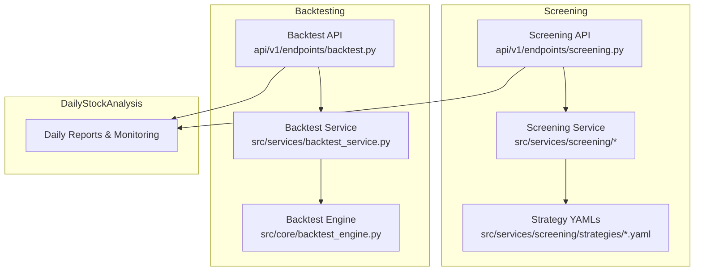
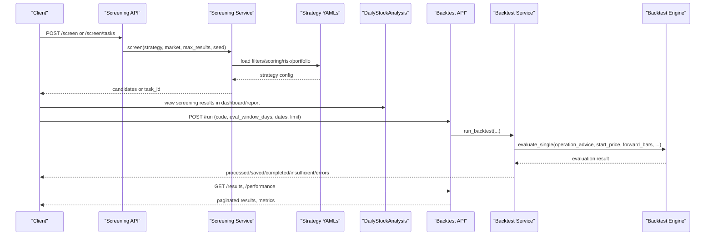
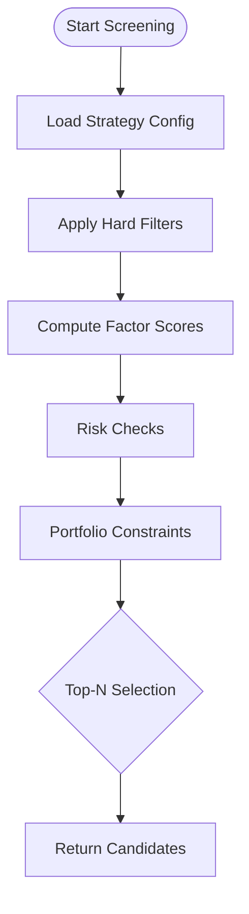
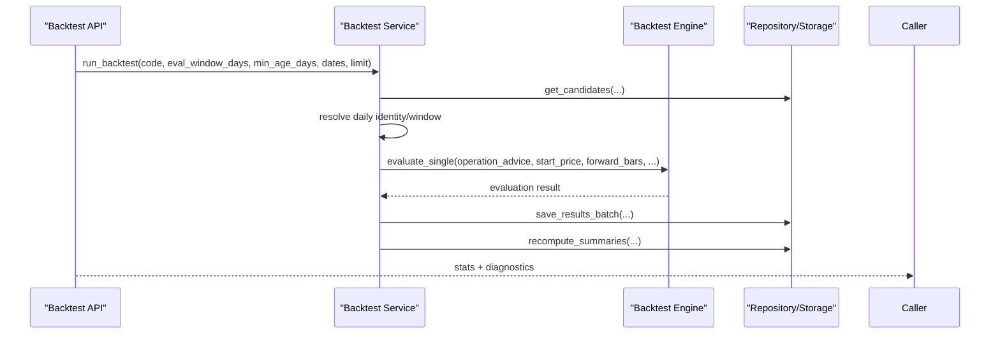
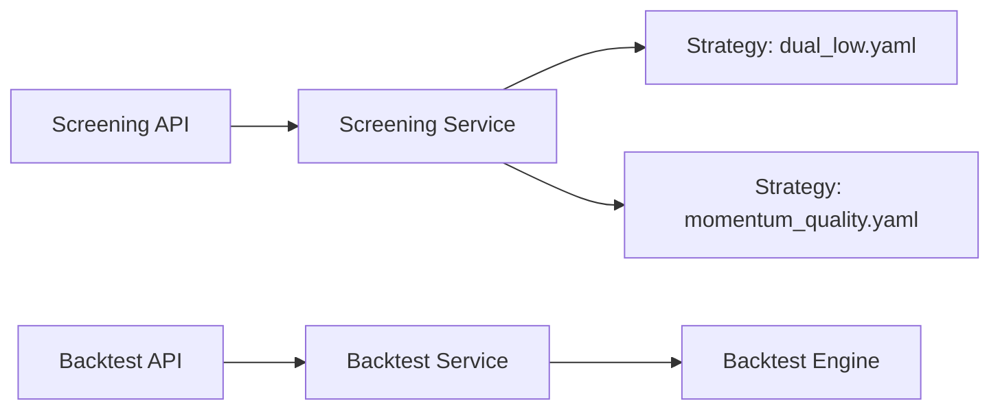

# Related Projects

<cite>
**Referenced Files in This Document**
- [README.md](file://README.md)
- [THIRD_PARTY_NOTICES.md](file://THIRD_PARTY_NOTICES.md)
- [src/services/screening/__init__.py](file://src/services/screening/__init__.py)
- [src/services/screening/strategies/dual_low.yaml](file://src/services/screening/strategies/dual_low.yaml)
- [src/services/screening/strategies/momentum_quality.yaml](file://src/services/screening/strategies/momentum_quality.yaml)
- [api/v1/endpoints/screening.py](file://api/v1/endpoints/screening.py)
- [api/v1/endpoints/backtest.py](file://api/v1/endpoints/backtest.py)
- [src/services/backtest_service.py](file://src/services/backtest_service.py)
- [src/core/backtest_engine.py](file://src/core/backtest_engine.py)
</cite>

## Table of Contents
1. [Introduction](#introduction)
2. [Project Structure](#project-structure)
3. [Core Components](#core-components)
4. [Architecture Overview](#architecture-overview)
5. [Detailed Component Analysis](#detailed-component-analysis)
6. [Dependency Analysis](#dependency-analysis)
7. [Performance Considerations](#performance-considerations)
8. [Troubleshooting Guide](#troubleshooting-guide)
9. [Conclusion](#conclusion)
10. [Appendices](#appendices)

## Introduction
This document describes the complementary projects that extend DailyStockAnalysis into a complete investment research workflow: AlphaSift and AlphaEvo.

- AlphaSift is the stock screening implementation reference project. Its logic is integrated into DailyStockAnalysis as the built-in screening engine, providing advanced stock selection algorithms and strategy validation through configurable strategies.
- AlphaEvo is the strategy backtesting and self-evolution tool used for validating trading rules through iterative parameter exploration and strategy combination optimization. In DailyStockAnalysis, this corresponds to the backtesting layer that evaluates historical analysis signals against market data and aggregates performance metrics.

Together, these tools form an end-to-end pipeline: idea generation and screening (AlphaSift-derived), signal evaluation and backtesting (AlphaEvo-inspired), and daily monitoring via DailyStockAnalysis reports and dashboards.

**Section sources**
- [README.md:256-264](file://README.md#L256-L264)

## Project Structure
The related projects integrate with DailyStockAnalysis across three layers:
- Screening layer: Strategy definitions and execution are implemented under src/services/screening, with YAML-based strategy files defining filters, scoring, risk, and portfolio constraints.
- Backtesting layer: The backtest service orchestrates evaluation of historical analysis signals using a pure backtesting engine and persists results for summary and querying.
- API layer: FastAPI endpoints expose screening and backtesting capabilities to the web UI and external clients.

**Diagram sources**
- [api/v1/endpoints/screening.py:1-251](file://api/v1/endpoints/screening.py#L1-L251)
- [src/services/screening/strategies/dual_low.yaml:1-77](file://src/services/screening/strategies/dual_low.yaml#L1-L77)
- [src/services/screening/strategies/momentum_quality.yaml:1-76](file://src/services/screening/strategies/momentum_quality.yaml#L1-L76)
- [api/v1/endpoints/backtest.py:1-242](file://api/v1/endpoints/backtest.py#L1-L242)
- [src/services/backtest_service.py:1-300](file://src/services/backtest_service.py#L1-L300)
- [src/core/backtest_engine.py:1-52](file://src/core/backtest_engine.py#L1-L52)

**Section sources**
- [api/v1/endpoints/screening.py:1-251](file://api/v1/endpoints/screening.py#L1-L251)
- [api/v1/endpoints/backtest.py:1-242](file://api/v1/endpoints/backtest.py#L1-L242)
- [src/services/backtest_service.py:1-300](file://src/services/backtest_service.py#L1-L300)
- [src/core/backtest_engine.py:1-52](file://src/core/backtest_engine.py#L1-L52)

## Core Components
- AlphaSift-derived screening engine: Provides multiple strategies (e.g., dual low valuation, momentum quality) defined in YAML. Each strategy encodes hard filters, factor weights, scoring profiles, risk checks, and portfolio constraints. It exposes both synchronous and asynchronous task-based screening via API endpoints.
- Backtesting service and engine: Evaluates historical analysis decisions against forward price bars, computes outcomes, and stores results. Supports filtering by date range, stock code, evaluation window, and market phase. Aggregates summaries for overall and per-stock performance.

These components enable:
- Idea generation: Use AlphaSift-derived strategies to discover candidate stocks.
- Validation: Run backtests on historical signals to assess direction accuracy, returns, stop-loss/take-profit behavior.
- Monitoring: Integrate results into DailyStockAnalysis dashboards and reports for ongoing review.

**Section sources**
- [src/services/screening/__init__.py:1-11](file://src/services/screening/__init__.py#L1-L11)
- [src/services/screening/strategies/dual_low.yaml:1-77](file://src/services/screening/strategies/dual_low.yaml#L1-L77)
- [src/services/screening/strategies/momentum_quality.yaml:1-76](file://src/services/screening/strategies/momentum_quality.yaml#L1-L76)
- [api/v1/endpoints/screening.py:133-217](file://api/v1/endpoints/screening.py#L133-L217)
- [src/services/backtest_service.py:45-309](file://src/services/backtest_service.py#L45-L309)
- [src/core/backtest_engine.py:17-52](file://src/core/backtest_engine.py#L17-L52)

## Architecture Overview
The ecosystem integrates AlphaSift and AlphaEvo concepts into DailyStockAnalysis as follows:

**Diagram sources**
- [api/v1/endpoints/screening.py:133-217](file://api/v1/endpoints/screening.py#L133-L217)
- [api/v1/endpoints/backtest.py:45-140](file://api/v1/endpoints/backtest.py#L45-L140)
- [src/services/backtest_service.py:45-309](file://src/services/backtest_service.py#L45-L309)
- [src/core/backtest_engine.py:17-52](file://src/core/backtest_engine.py#L17-L52)

## Detailed Component Analysis

### AlphaSift Integration: Screening Strategies
AlphaSift’s approach is embedded as a flexible, configuration-driven screening system. Strategies define:
- Hard filters: market scope, liquidity, valuation bounds, price ranges, daily change limits.
- Factor weights: momentum, value, liquidity, activity, stability, reversal, theme heat, size.
- Scoring profile: thresholds for chasing, ideal volume/turnover, stability hot-change sensitivity.
- Risk profile: chase thresholds, abnormal volume ratios, high turnover flags, LLM confidence floor.
- Portfolio profile: sector buckets, concentration penalties, max same-bucket counts.
- Ranking hints: qualitative guidance for human review.

Example strategies included:
- Dual Low: defensive value focus with dynamic activity confirmation.
- Momentum Quality: trend confirmation combined with fundamental quality.

**Diagram sources**
- [src/services/screening/strategies/dual_low.yaml:18-77](file://src/services/screening/strategies/dual_low.yaml#L18-L77)
- [src/services/screening/strategies/momentum_quality.yaml:19-76](file://src/services/screening/strategies/momentum_quality.yaml#L19-L76)

**Section sources**
- [src/services/screening/strategies/dual_low.yaml:1-77](file://src/services/screening/strategies/dual_low.yaml#L1-L77)
- [src/services/screening/strategies/momentum_quality.yaml:1-76](file://src/services/screening/strategies/momentum_quality.yaml#L1-L76)
- [api/v1/endpoints/screening.py:81-217](file://api/v1/endpoints/screening.py#L81-L217)

### AlphaEvo Integration: Backtesting and Evaluation
The backtesting layer validates historical analysis signals by simulating trades over forward price windows and computing outcomes such as direction correctness, returns, and stop-loss/take-profit hits.

Key behaviors:
- Candidate selection from historical analyses based on code, age, date range, and engine version.
- Daily bar resolution and optional refill attempts when insufficient data is detected.
- Evaluation using a pure engine that consumes operation advice, start price, forward bars, and risk parameters.
- Persistence of results and recomputation of summaries; support for phase-filtered queries and dynamic summaries.

**Diagram sources**
- [api/v1/endpoints/backtest.py:45-140](file://api/v1/endpoints/backtest.py#L45-L140)
- [src/services/backtest_service.py:45-309](file://src/services/backtest_service.py#L45-L309)
- [src/core/backtest_engine.py:17-52](file://src/core/backtest_engine.py#L17-L52)

**Section sources**
- [api/v1/endpoints/backtest.py:45-242](file://api/v1/endpoints/backtest.py#L45-L242)
- [src/services/backtest_service.py:45-309](file://src/services/backtest_service.py#L45-L309)
- [src/core/backtest_engine.py:17-52](file://src/core/backtest_engine.py#L17-L52)

### Workflow Integration Patterns
- Idea Generation: Use AlphaSift-derived strategies to produce candidate lists tailored to market regimes and risk profiles.
- Signal Validation: Run backtests on historical analysis records to measure directional accuracy and simulated returns under realistic conditions.
- Daily Monitoring: Feed screening outputs and backtest summaries into DailyStockAnalysis dashboards and reports for continuous oversight.

Usage examples and integration points:
- Screening:
  - Synchronous: POST /screen with strategy, market, max_results, variant_seed.
  - Asynchronous: POST /screen/tasks to submit background tasks and poll status via /screen/tasks/{task_id}.
- Backtesting:
  - Run: POST /run with code, eval_window_days, min_age_days, analysis_date_from/to, limit, force.
  - Results: GET /results with pagination and filters.
  - Performance: GET /performance and /performance/{code} for aggregated metrics.

**Section sources**
- [api/v1/endpoints/screening.py:133-217](file://api/v1/endpoints/screening.py#L133-L217)
- [api/v1/endpoints/backtest.py:45-242](file://api/v1/endpoints/backtest.py#L45-L242)

## Dependency Analysis
The following diagram shows how the API endpoints depend on services and engines, and how strategies feed into screening.

**Diagram sources**
- [api/v1/endpoints/screening.py:133-217](file://api/v1/endpoints/screening.py#L133-L217)
- [src/services/screening/strategies/dual_low.yaml:18-77](file://src/services/screening/strategies/dual_low.yaml#L18-L77)
- [src/services/screening/strategies/momentum_quality.yaml:19-76](file://src/services/screening/strategies/momentum_quality.yaml#L19-L76)
- [api/v1/endpoints/backtest.py:45-140](file://api/v1/endpoints/backtest.py#L45-L140)
- [src/services/backtest_service.py:45-309](file://src/services/backtest_service.py#L45-L309)
- [src/core/backtest_engine.py:17-52](file://src/core/backtest_engine.py#L17-L52)

**Section sources**
- [api/v1/endpoints/screening.py:133-217](file://api/v1/endpoints/screening.py#L133-L217)
- [api/v1/endpoints/backtest.py:45-140](file://api/v1/endpoints/backtest.py#L45-L140)
- [src/services/backtest_service.py:45-309](file://src/services/backtest_service.py#L45-L309)
- [src/core/backtest_engine.py:17-52](file://src/core/backtest_engine.py#L17-L52)

## Performance Considerations
- Screening:
  - Prefer asynchronous task submission for large markets or complex strategies to avoid blocking requests.
  - Tune strategy hard filters and factor weights to reduce candidate sets and improve throughput.
- Backtesting:
  - Limit eval_window_days and min_age_days to balance accuracy and runtime.
  - Use date-range filters to narrow candidate sets when running batch evaluations.
  - Leverage summary endpoints for quick performance insights without scanning all results.

[No sources needed since this section provides general guidance]

## Troubleshooting Guide
Common issues and resolutions:
- Screening task not found:
  - Ensure the task_id corresponds to a screening task and has not expired.
  - Check endpoint routing and task queue status.
- Backtest run returns no results:
  - Verify analysis_date_from/to ordering and existence of matching historical analyses.
  - Confirm sufficient daily data availability for the selected evaluation window.
  - Inspect diagnostics for reasons like insufficient_data or evaluation_error.
- Parameter validation errors:
  - Ensure eval_window_days is a positive integer.
  - Validate date ranges and allowed analysis_phase values.

**Section sources**
- [api/v1/endpoints/screening.py:187-202](file://api/v1/endpoints/screening.py#L187-L202)
- [api/v1/endpoints/backtest.py:31-85](file://api/v1/endpoints/backtest.py#L31-L85)
- [src/services/backtest_service.py:45-106](file://src/services/backtest_service.py#L45-L106)

## Conclusion
DailyStockAnalysis integrates AlphaSift-derived screening and AlphaEvo-inspired backtesting to deliver a cohesive research workflow:
- Use AlphaSift strategies to generate actionable candidate lists aligned with your risk and regime preferences.
- Validate those ideas with backtesting to quantify expected performance and risks.
- Monitor outcomes daily through DailyStockAnalysis reports and dashboards, iterating strategies and parameters as markets evolve.

For repository links and further reading:
- AlphaSift reference project: https://github.com/ZhuLinsen/alphasift
- AlphaEvo reference project: https://github.com/ZhuLinsen/alphaevo

**Section sources**
- [README.md:256-264](file://README.md#L256-L264)
- [THIRD_PARTY_NOTICES.md:6-18](file://THIRD_PARTY_NOTICES.md#L6-L18)

## Appendices
- Licensing and attribution:
  - The screening engine is derived from AlphaSift and includes modified files under src/services/screening with per-file headers indicating source revision and modification status.

**Section sources**
- [THIRD_PARTY_NOTICES.md:6-18](file://THIRD_PARTY_NOTICES.md#L6-L18)
- [src/services/screening/__init__.py:1-11](file://src/services/screening/__init__.py#L1-L11)