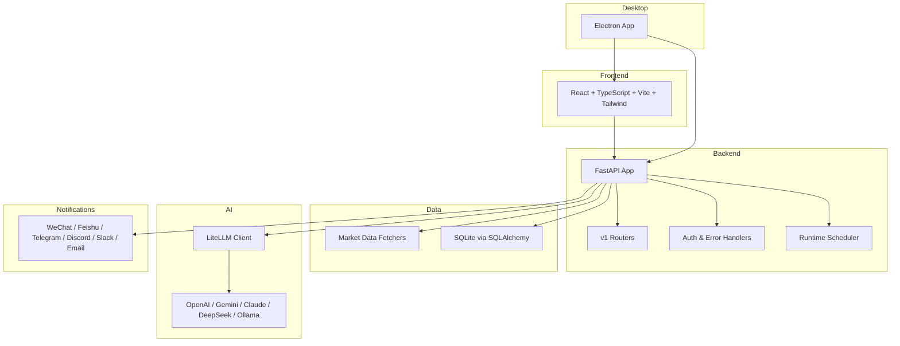
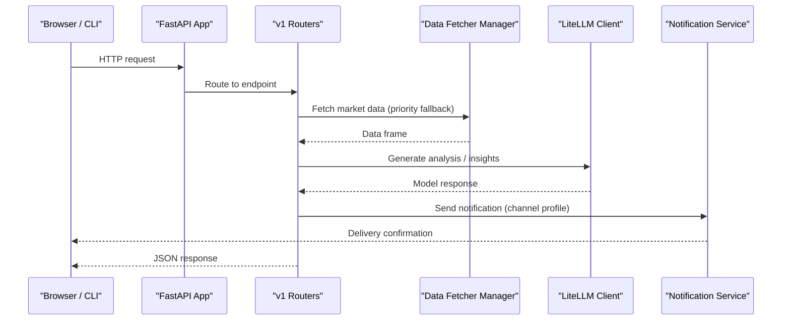
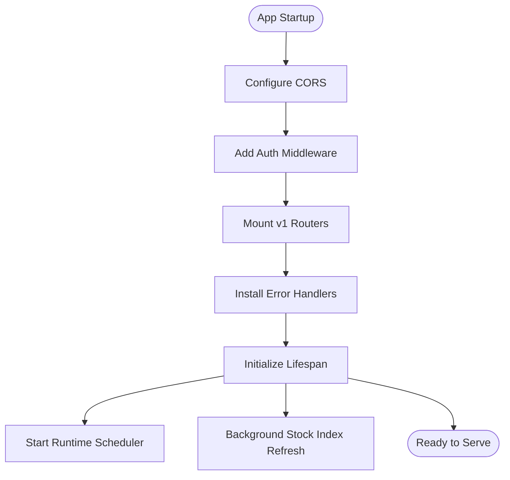
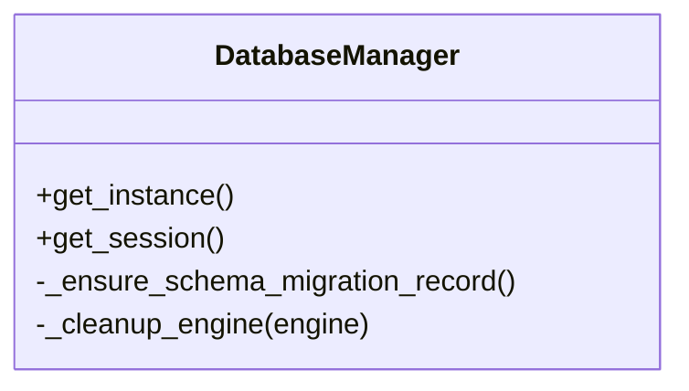
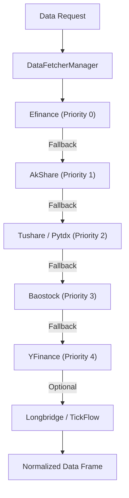
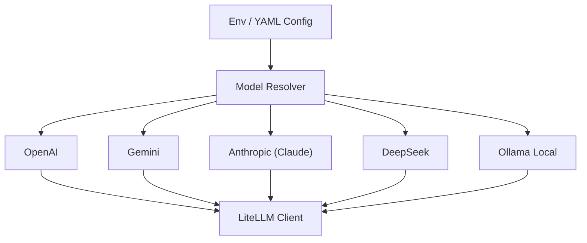
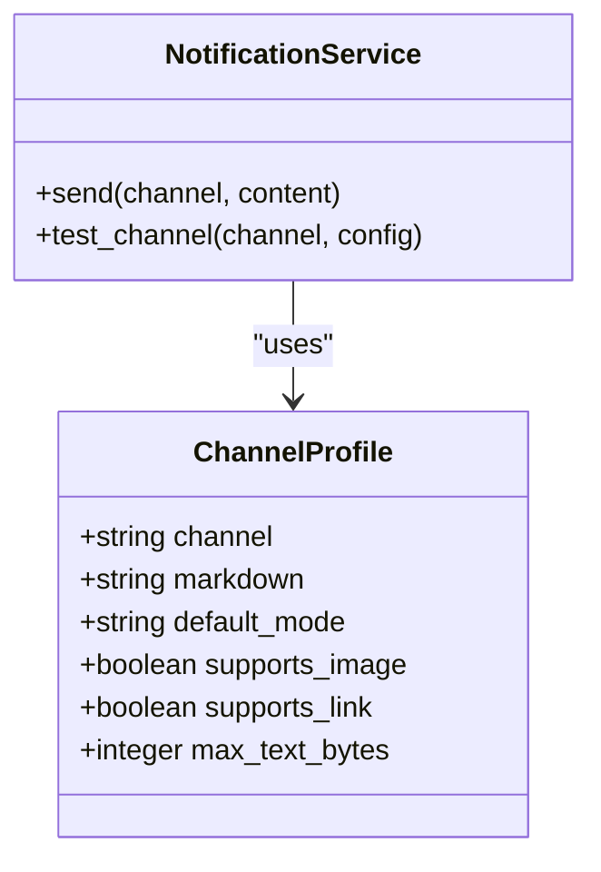
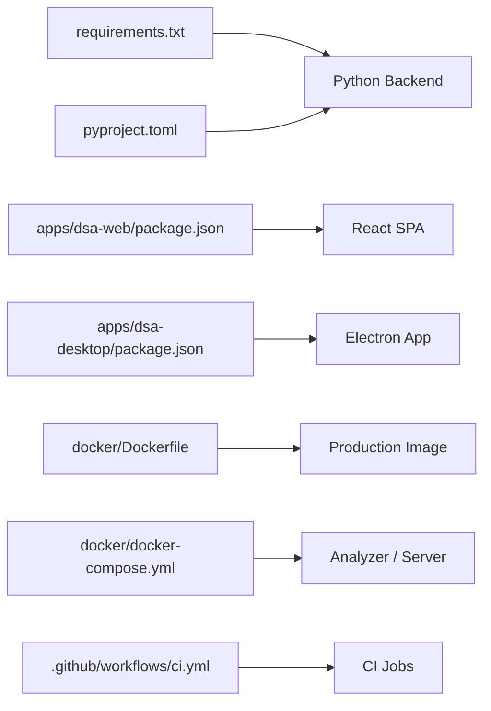

# Technology Stack

<cite>
**Referenced Files in This Document**
- [requirements.txt](file://requirements.txt)
- [pyproject.toml](file://pyproject.toml)
- [main.py](file://main.py)
- [api/app.py](file://api/app.py)
- [docker/Dockerfile](file://docker/Dockerfile)
- [docker/docker-compose.yml](file://docker/docker-compose.yml)
- [apps/dsa-web/package.json](file://apps/dsa-web/package.json)
- [apps/dsa-desktop/package.json](file://apps/dsa-desktop/package.json)
- [.github/workflows/ci.yml](file:.github/workflows/ci.yml)
- [data_provider/__init__.py](file://data_provider/__init__.py)
- [src/services/system_config_service.py](file://src/services/system_config_service.py)
- [src/services/generation_backend_status_service.py](file://src/services/generation_backend_status_service.py)
- [src/notification_capabilities.py](file://src/notification_capabilities.py)
</cite>

## Table of Contents
1. [Introduction](#introduction)
2. [Project Structure](#project-structure)
3. [Core Components](#core-components)
4. [Architecture Overview](#architecture-overview)
5. [Detailed Component Analysis](#detailed-component-analysis)
6. [Dependency Analysis](#dependency-analysis)
7. [Performance Considerations](#performance-considerations)
8. [Troubleshooting Guide](#troubleshooting-guide)
9. [Conclusion](#conclusion)
10. [Appendices](#appendices)

## Introduction
This section documents the technology stack powering DailyStockAnalysis across backend, frontend, desktop, data providers, AI model integration, notifications, testing, build tooling, containerization, and CI/CD. It focuses on what technologies are used, how they fit together, and where to find configuration or implementation details in the repository.

## Project Structure
The project is organized into clear layers:
- Backend API and orchestration: FastAPI application with modular routers, middleware, and lifecycle management.
- Frontend SPA: React + TypeScript + Vite + Tailwind CSS, served by the backend in production.
- Desktop app: Electron-based packaging that bundles the built frontend and a frozen backend for local distribution.
- Data providers: Pluggable market data fetchers with fallback priorities.
- AI integration: LiteLLM-backed unified LLM client supporting multiple providers and local models via Ollama.
- Notifications: Multiple channels (WeChat/WeCom, Feishu, Telegram, Discord, Slack, email, etc.).
- Containerization: Multi-stage Docker build producing a slim Python runtime image with prebuilt frontend assets.
- CI/CD: GitHub Actions jobs for change detection, tests, Docker builds, and desktop packaging.

**Diagram sources**
- [api/app.py:313-384](file://api/app.py#L313-L384)
- [data_provider/__init__.py:31-66](file://data_provider/__init__.py#L31-L66)
- [src/services/system_config_service.py:3526-3551](file://src/services/system_config_service.py#L3526-L3551)
- [src/notification_capabilities.py:79-177](file://src/notification_capabilities.py#L79-L177)
- [apps/dsa-web/package.json:1-60](file://apps/dsa-web/package.json#L1-L60)
- [apps/dsa-desktop/package.json:1-67](file://apps/dsa-desktop/package.json#L1-L67)

**Section sources**
- [api/app.py:313-384](file://api/app.py#L313-L384)
- [data_provider/__init__.py:31-66](file://data_provider/__init__.py#L31-L66)

## Core Components
- Backend framework: FastAPI with Uvicorn ASGI server, CORS middleware, auth middleware, error handlers, and lifespan hooks for scheduler initialization and background tasks.
- Database ORM: SQLAlchemy with SQLite as default storage; schema creation and migration tracking handled at startup.
- Scheduling: Runtime scheduler service integrated into the FastAPI lifespan to run periodic analysis tasks.
- Frontend: React 19, TypeScript, Vite, Tailwind CSS, Zustand state, Recharts for charts, Playwright for E2E tests, Vitest for unit tests.
- Desktop: Electron with electron-builder for packaging; includes updater support and platform-specific targets.
- Data providers: Pluggable fetchers with priority-based fallbacks (e.g., efinance, AkShare, Tushare, Pytdx, Baostock, YFinance, Longbridge, TickFlow).
- AI models: LiteLLM unified client configured via environment variables or YAML; supports OpenAI, Gemini, Anthropic (Claude), DeepSeek, and local models via Ollama.
- Notifications: Channel profiles and senders for WeChat/WeCom, Feishu, DingTalk, Telegram, Discord, Slack, email, and others.

**Section sources**
- [requirements.txt:6-75](file://requirements.txt#L6-L75)
- [api/app.py:313-384](file://api/app.py#L313-L384)
- [src/storage.py:1387-1417](file://src/storage.py#L1387-L1417)
- [apps/dsa-web/package.json:1-60](file://apps/dsa-web/package.json#L1-L60)
- [apps/dsa-desktop/package.json:1-67](file://apps/dsa-desktop/package.json#L1-L67)
- [data_provider/__init__.py:31-66](file://data_provider/__init__.py#L31-L66)
- [src/services/system_config_service.py:3526-3551](file://src/services/system_config_service.py#L3526-L3551)
- [src/notification_capabilities.py:79-177](file://src/notification_capabilities.py#L79-L177)

## Architecture Overview
The system exposes a FastAPI REST API that serves both programmatic access and the React SPA. On startup, it configures CORS, registers v1 routers, adds authentication and error handling, and initializes a runtime scheduler for background tasks. The frontend is built with Vite and served statically from the backend in production. Market data is fetched through a pluggable provider layer with prioritized fallbacks. AI analysis uses LiteLLM to route requests to configured providers or local models. Notifications are dispatched via channel-specific senders with capability-aware formatting.

**Diagram sources**
- [api/app.py:313-384](file://api/app.py#L313-L384)
- [data_provider/__init__.py:31-66](file://data_provider/__init__.py#L31-L66)
- [src/services/system_config_service.py:3526-3551](file://src/services/system_config_service.py#L3526-L3551)
- [src/notification_capabilities.py:79-177](file://src/notification_capabilities.py#L79-L177)

## Detailed Component Analysis

### Backend: FastAPI, Uvicorn, Middleware, and Lifecycle
- Application factory creates the FastAPI instance, sets up CORS, mounts v1 routers, and installs auth/error middleware.
- Lifespan initializes the runtime scheduler, system config service, and background stock index refresh tasks.
- Health endpoints provide readiness checks for orchestrators and load balancers.
- Static SPA serving and asset routing are handled with safe path resolution and MIME type fixes.

**Diagram sources**
- [api/app.py:313-384](file://api/app.py#L313-L384)
- [api/app.py:237-310](file://api/app.py#L237-L310)

**Section sources**
- [api/app.py:313-384](file://api/app.py#L313-L384)
- [api/app.py:237-310](file://api/app.py#L237-L310)

### Database: SQLAlchemy ORM with SQLite
- DatabaseManager initializes SQLAlchemy engine and session factory, ensures schema creation, and tracks migrations.
- SQLite is used by default; paths are configurable via environment variables.

**Diagram sources**
- [src/storage.py:1387-1417](file://src/storage.py#L1387-L1417)

**Section sources**
- [src/storage.py:1387-1417](file://src/storage.py#L1387-L1417)

### Frontend: React, TypeScript, Vite, Tailwind CSS
- Modern SPA built with React 19 and TypeScript, using Vite for development and bundling.
- Styling via Tailwind CSS; state management with Zustand; charts with Recharts.
- Testing with Vitest (unit) and Playwright (E2E); linting with ESLint.
- Node version constraints enforced via engines field.

**Section sources**
- [apps/dsa-web/package.json:1-60](file://apps/dsa-web/package.json#L1-L60)

### Desktop: Electron Packaging
- Electron app packages the built frontend and embedded backend artifacts.
- Uses electron-builder for cross-platform installers (NSIS for Windows, DMG for macOS).
- Includes auto-updater dependency and platform-specific build hooks.

**Section sources**
- [apps/dsa-desktop/package.json:1-67](file://apps/dsa-desktop/package.json#L1-L67)

### Data Provider Ecosystem
- Pluggable fetchers with explicit priority ordering and fallback behavior.
- Supports multiple markets and symbol normalization per provider.
- Optional integrations like Longbridge and TickFlow enhance coverage and fields.

**Diagram sources**
- [data_provider/__init__.py:31-66](file://data_provider/__init__.py#L31-L66)

**Section sources**
- [data_provider/__init__.py:31-66](file://data_provider/__init__.py#L31-L66)

### AI Model Integration via LiteLLM
- Unified LLM client supports OpenAI, Gemini, Anthropic (Claude), DeepSeek, and local models via Ollama.
- Configuration can be provided via environment variables or a LiteLLM YAML file.
- Primary model resolution considers explicit settings, YAML models, and channel configurations.

**Diagram sources**
- [src/services/system_config_service.py:3526-3551](file://src/services/system_config_service.py#L3526-L3551)
- [src/services/generation_backend_status_service.py:743-772](file://src/services/generation_backend_status_service.py#L743-L772)

**Section sources**
- [src/services/system_config_service.py:3526-3551](file://src/services/system_config_service.py#L3526-L3551)
- [src/services/generation_backend_status_service.py:743-772](file://src/services/generation_backend_status_service.py#L743-L772)

### Notification Channels
- Channel profiles define supported formats, size limits, and capabilities per channel.
- Implementations include WeChat/WeCom, Feishu, DingTalk, Telegram, Discord, Slack, email, and more.
- Diagnostics helpers validate required keys and report missing configuration.

**Diagram sources**
- [src/notification_capabilities.py:79-177](file://src/notification_capabilities.py#L79-L177)

**Section sources**
- [src/notification_capabilities.py:79-177](file://src/notification_capabilities.py#L79-L177)

## Dependency Analysis
- Python dependencies are declared in requirements.txt, including core frameworks, data providers, AI clients, search tools, and utilities.
- Tooling configuration (Black, isort, Bandit) is managed in pyproject.toml.
- Frontend dependencies and dev tooling are defined in apps/dsa-web/package.json.
- Desktop packaging dependencies are defined in apps/dsa-desktop/package.json.
- Docker multi-stage build compiles frontend assets and installs Python dependencies into a slim runtime image.
- CI/CD uses GitHub Actions for change detection, test sharding, Docker smoke tests, and desktop packaging.

**Diagram sources**
- [requirements.txt:6-75](file://requirements.txt#L6-L75)
- [pyproject.toml:1-29](file://pyproject.toml#L1-L29)
- [apps/dsa-web/package.json:1-60](file://apps/dsa-web/package.json#L1-L60)
- [apps/dsa-desktop/package.json:1-67](file://apps/dsa-desktop/package.json#L1-L67)
- [docker/Dockerfile:1-106](file://docker/Dockerfile#L1-L106)
- [docker/docker-compose.yml:1-73](file://docker/docker-compose.yml#L1-L73)
- [.github/workflows/ci.yml:1-268](file:.github/workflows/ci.yml#L1-L268)

**Section sources**
- [requirements.txt:6-75](file://requirements.txt#L6-L75)
- [pyproject.toml:1-29](file://pyproject.toml#L1-L29)
- [apps/dsa-web/package.json:1-60](file://apps/dsa-web/package.json#L1-L60)
- [apps/dsa-desktop/package.json:1-67](file://apps/dsa-desktop/package.json#L1-L67)
- [docker/Dockerfile:1-106](file://docker/Dockerfile#L1-L106)
- [docker/docker-compose.yml:1-73](file://docker/docker-compose.yml#L1-L73)
- [.github/workflows/ci.yml:1-268](file:.github/workflows/ci.yml#L1-L268)

## Performance Considerations
- Use provider fallbacks strategically to minimize latency and improve reliability.
- Leverage background tasks (stock index refresh, scheduler reconciliation) to avoid blocking user requests.
- Ensure adequate memory for full analysis runs; the compose file sets sensible defaults and reservations.
- Keep frontend assets consistent to prevent blank-page issues and unnecessary retries.

[No sources needed since this section provides general guidance]

## Troubleshooting Guide
- Frontend bundle mismatch: The app logs warnings when static assets referenced by index.html are missing; rebuild the frontend and ensure packaging copies the generated static directory.
- CORS misconfiguration: When allowing all origins without authentication, the app warns about potential security risks.
- Missing LLM configuration: Validation errors indicate no usable model channels; configure API keys or LiteLLM YAML accordingly.
- Notification channel failures: Diagnostics report missing required keys per channel; verify environment variables and test via the settings UI.

**Section sources**
- [api/app.py:76-113](file://api/app.py#L76-L113)
- [api/app.py:157-164](file://api/app.py#L157-L164)
- [src/services/system_config_service.py:3250-3277](file://src/services/system_config_service.py#L3250-L3277)
- [src/notification_capabilities.py:79-177](file://src/notification_capabilities.py#L79-L177)

## Conclusion
DailyStockAnalysis combines a modern Python backend (FastAPI + SQLAlchemy), a responsive React frontend (Vite + Tailwind), an Electron desktop wrapper, a flexible data provider ecosystem, and a unified AI integration layer via LiteLLM. Notifications span multiple channels, and the project is fully containerized with Docker and automated via GitHub Actions. Version compatibility and dependency management are explicitly declared in requirements files and package manifests, ensuring reproducible builds and reliable deployments.

[No sources needed since this section summarizes without analyzing specific files]

## Appendices

### Version Compatibility and Dependency Management
- Python: 3.10+ target versions configured; runtime uses 3.11 in Docker.
- Node: >=20.19.0 enforced for frontend builds.
- Dependencies: pinned ranges in requirements.txt and package.json; CI caches pip/npm artifacts for speed.
- Docker: multi-stage build separates frontend compilation from runtime; non-root user and health checks included.

**Section sources**
- [pyproject.toml:1-29](file://pyproject.toml#L1-L29)
- [apps/dsa-web/package.json:1-60](file://apps/dsa-web/package.json#L1-L60)
- [docker/Dockerfile:1-106](file://docker/Dockerfile#L1-L106)
- [.github/workflows/ci.yml:1-268](file:.github/workflows/ci.yml#L1-L268)