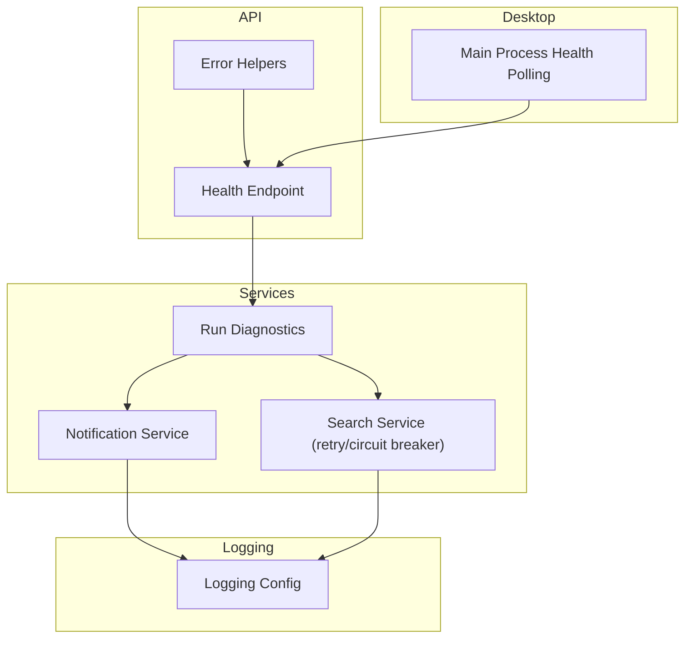
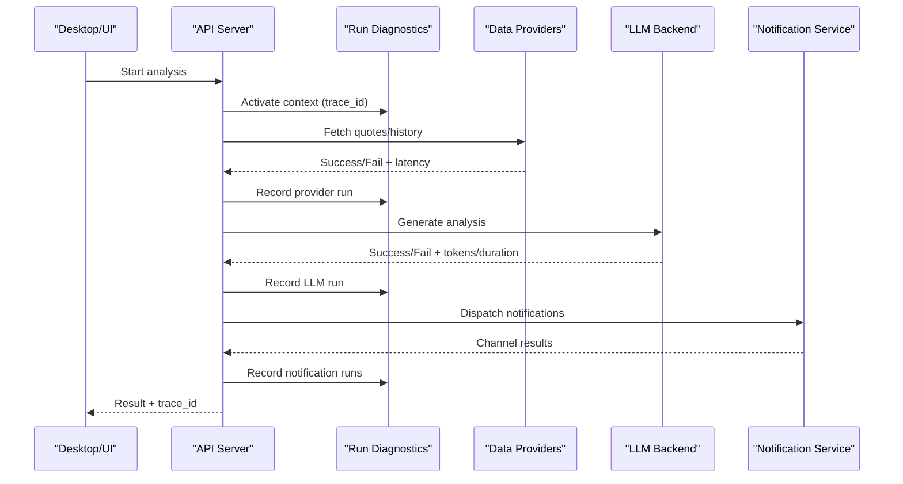
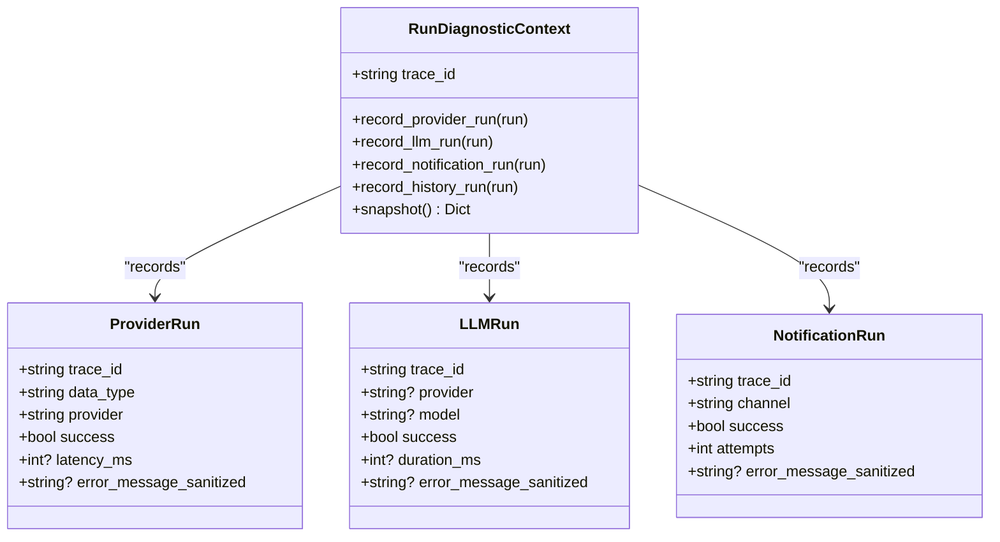
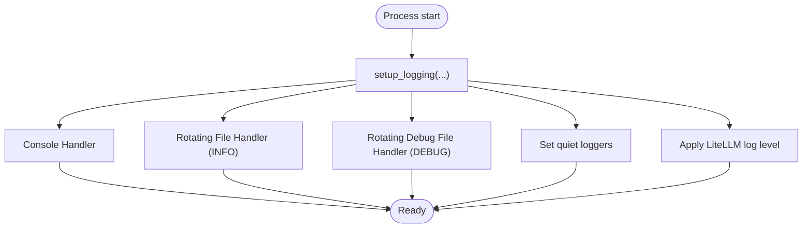
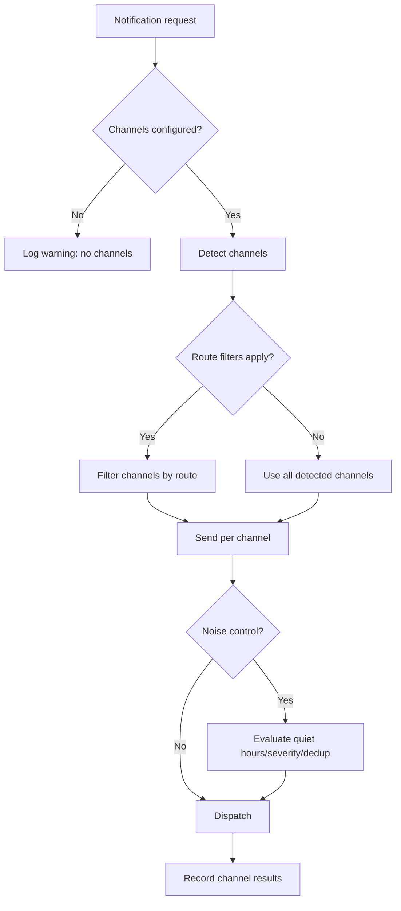
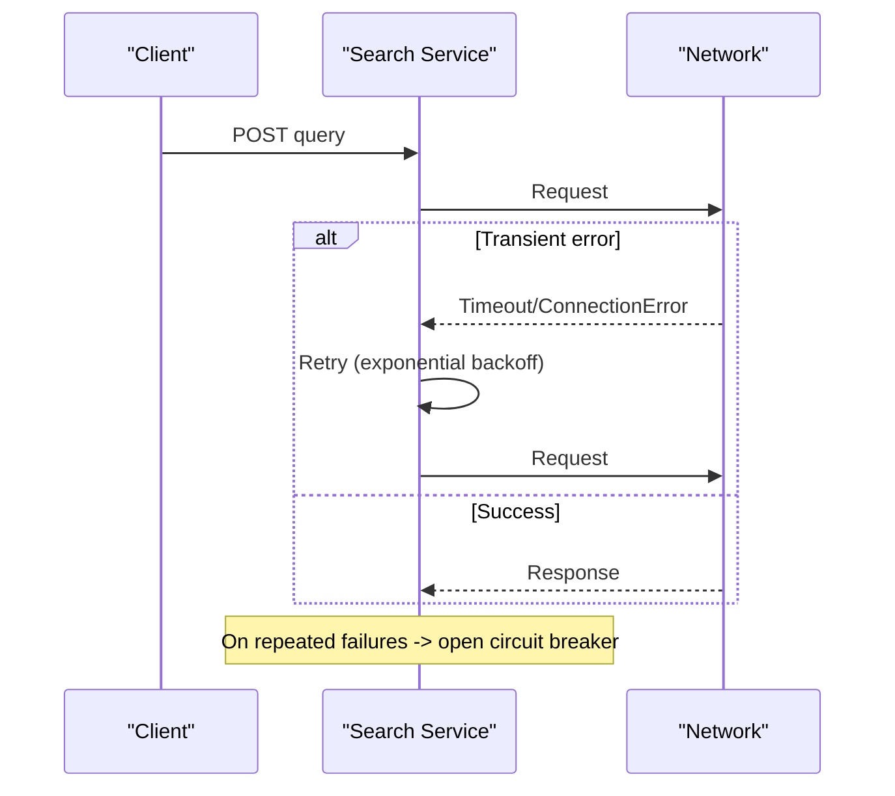
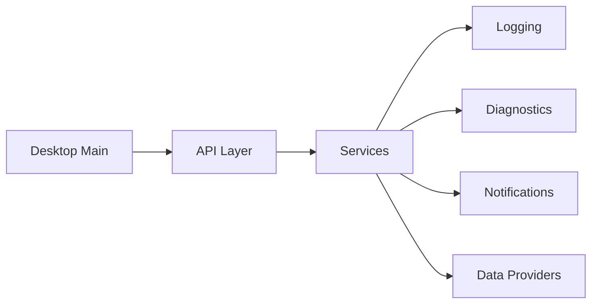

# Troubleshooting & FAQ

<cite>
**Referenced Files in This Document**
- [run_diagnostics.py](file://src/services/run_diagnostics.py)
- [logging_config.py](file://src/logging_config.py)
- [errors.py](file://api/v1/errors.py)
- [health.py](file://api/v1/endpoints/health.py)
- [notification.py](file://src/notification.py)
- [notification_diagnostics.py](file://src/services/notification_diagnostics.py)
- [check_env.py](file://scripts/check_env.py)
- [config.py](file://src/config.py)
- [search_service.py](file://src/search_service.py)
- [main.js](file://apps/dsa-desktop/main.js)
- [FAQ_EN.md](file://docs/FAQ_EN.md)
</cite>

## Table of Contents
1. Introduction
2. Project Structure
3. Core Components
4. Architecture Overview
5. Detailed Component Analysis
6. Dependency Analysis
7. Performance Considerations
8. Troubleshooting Guide
9. Conclusion
10. Appendices

## Introduction
This document provides a comprehensive troubleshooting and FAQ guide for DailyStockAnalysis. It focuses on diagnosing and resolving common issues such as API connectivity problems, data source failures, notification delivery issues, performance bottlenecks, configuration errors, permission issues, and platform-specific problems. It also explains the logging system, how to interpret logs, and how to use built-in diagnostic tools to isolate root causes quickly.

## Project Structure
DailyStockAnalysis is organized into clear layers:
- API layer (FastAPI) with health checks and error helpers
- Services layer for diagnostics, notifications, search, scheduling, and analysis workflows
- Data providers for multiple market data sources
- Notification subsystem supporting many channels
- Logging configuration with rotating files and console output
- Desktop app with health polling and startup logic
- Scripts for environment validation and CI gates

**Diagram sources**
- [health.py:21-34](file://api/v1/endpoints/health.py#L21-L34)
- [errors.py:12-33](file://api/v1/errors.py#L12-L33)
- [run_diagnostics.py:81-139](file://src/services/run_diagnostics.py#L81-L139)
- [notification.py:257-343](file://src/notification.py#L257-L343)
- [search_service.py:170-187](file://src/search_service.py#L170-L187)
- [logging_config.py:83-198](file://src/logging_config.py#L83-L198)
- [main.js:1011-1105](file://apps/dsa-desktop/main.js#L1011-L1105)

**Section sources**
- [health.py:21-34](file://api/v1/endpoints/health.py#L21-L34)
- [errors.py:12-33](file://api/v1/errors.py#L12-L33)
- [run_diagnostics.py:81-139](file://src/services/run_diagnostics.py#L81-L139)
- [notification.py:257-343](file://src/notification.py#L257-L343)
- [search_service.py:170-187](file://src/search_service.py#L170-L187)
- [logging_config.py:83-198](file://src/logging_config.py#L83-L198)
- [main.js:1011-1105](file://apps/dsa-desktop/main.js#L1011-L1105)

## Core Components
- Run Diagnostics: Captures per-run trace IDs, provider attempts, LLM calls, notifications, and history persistence outcomes with sanitized metadata for safe sharing.
- Logging System: Centralized setup producing console and rotating log files; reduces noisy third-party logs and supports LiteLLM level control via environment.
- Notification Service: Detects configured channels, routes messages, handles context-based replies, and integrates noise controls and channel-specific senders.
- Search Service: Implements retry with exponential backoff and circuit breaker patterns for transient network errors.
- Health Endpoint: Provides a lightweight /api/v1/health endpoint for load balancers and monitoring.
- Desktop Health Polling: Waits for backend health readiness with timeouts and progress events.

**Section sources**
- [run_diagnostics.py:142-337](file://src/services/run_diagnostics.py#L142-L337)
- [logging_config.py:83-198](file://src/logging_config.py#L83-L198)
- [notification.py:257-343](file://src/notification.py#L257-L343)
- [search_service.py:170-187](file://src/search_service.py#L170-L187)
- [health.py:21-34](file://api/v1/endpoints/health.py#L21-L34)
- [main.js:1011-1105](file://apps/dsa-desktop/main.js#L1011-L1105)

## Architecture Overview
The runtime flow for an analysis run includes data fetching, LLM processing, report persistence, and notification dispatch. Each step is instrumented by the diagnostics layer, which records success/failure, latency, fallbacks, and sanitized errors. The desktop client polls the health endpoint before proceeding.

**Diagram sources**
- [run_diagnostics.py:316-487](file://src/services/run_diagnostics.py#L316-L487)
- [notification.py:257-343](file://src/notification.py#L257-L343)
- [health.py:21-34](file://api/v1/endpoints/health.py#L21-L34)

## Detailed Component Analysis

### Run Diagnostics and Traceability
- Purpose: Provide a single trace_id across all steps, record provider/LLM/notification/history runs, and emit sanitized flow events for UI/SSE.
- Key behaviors:
  - Sanitizes secrets and sensitive keys from diagnostic payloads.
  - Tracks attempt indices and pending attempts for provider and LLM calls.
  - Emits structured flow events with node lanes (data_source, analysis).
  - Snapshots current context for later inspection.

**Diagram sources**
- [run_diagnostics.py:142-337](file://src/services/run_diagnostics.py#L142-L337)
- [run_diagnostics.py:455-487](file://src/services/run_diagnostics.py#L455-L487)

**Section sources**
- [run_diagnostics.py:81-139](file://src/services/run_diagnostics.py#L81-L139)
- [run_diagnostics.py:316-487](file://src/services/run_diagnostics.py#L316-L487)

### Logging System
- Outputs:
  - Console handler at INFO or DEBUG based on flags.
  - Rotating file handlers for regular and debug logs.
  - Relative path formatter to keep logs portable.
- Quiet loggers: Reduces verbosity for known noisy libraries.
- LiteLLM log level: Controlled via environment variable with fallback.

**Diagram sources**
- [logging_config.py:83-198](file://src/logging_config.py#L83-L198)

**Section sources**
- [logging_config.py:83-198](file://src/logging_config.py#L83-L198)

### Notification Delivery and Diagnostics
- Channel detection: Scans configuration to determine enabled channels.
- Routing: Applies route configs to filter channels per notification type.
- Noise control: Supports quiet hours, severity thresholds, and deduplication.
- Context replies: Supports stream-mode replies for DingTalk/Feishu/Telegram.
- Diagnostics: Read-only checks validate minimal/advanced keys, URL formats, routing entries, and noise settings.

**Diagram sources**
- [notification.py:480-604](file://src/notification.py#L480-L604)
- [notification_diagnostics.py:314-566](file://src/services/notification_diagnostics.py#L314-L566)

**Section sources**
- [notification.py:257-343](file://src/notification.py#L257-L343)
- [notification.py:480-604](file://src/notification.py#L480-L604)
- [notification_diagnostics.py:314-566](file://src/services/notification_diagnostics.py#L314-L566)

### API Connectivity and Resilience
- Retry with exponential backoff for transient network errors.
- Circuit breaker to protect against cascading failures when consecutive errors occur.
- Desktop health polling ensures the backend is ready before UI operations.

**Diagram sources**
- [search_service.py:170-187](file://src/search_service.py#L170-L187)
- [search_service.py:1421-1445](file://src/search_service.py#L1421-L1445)
- [main.js:1011-1105](file://apps/dsa-desktop/main.js#L1011-L1105)

**Section sources**
- [search_service.py:170-187](file://src/search_service.py#L170-L187)
- [search_service.py:1421-1445](file://src/search_service.py#L1421-L1445)
- [main.js:1011-1105](file://apps/dsa-desktop/main.js#L1011-L1105)

## Dependency Analysis
- API endpoints depend on services for business logic and rely on error helpers for consistent responses.
- Diagnostics are cross-cutting and capture state from providers, LLM, and notifications.
- Logging is foundational and used by all components.
- Desktop depends on API health endpoint for startup sequencing.

**Diagram sources**
- [errors.py:12-33](file://api/v1/errors.py#L12-L33)
- [run_diagnostics.py:316-487](file://src/services/run_diagnostics.py#L316-L487)
- [notification.py:257-343](file://src/notification.py#L257-L343)
- [logging_config.py:83-198](file://src/logging_config.py#L83-L198)
- [main.js:1011-1105](file://apps/dsa-desktop/main.js#L1011-L1105)

**Section sources**
- [errors.py:12-33](file://api/v1/errors.py#L12-L33)
- [run_diagnostics.py:316-487](file://src/services/run_diagnostics.py#L316-L487)
- [notification.py:257-343](file://src/notification.py#L257-L343)
- [logging_config.py:83-198](file://src/logging_config.py#L83-L198)
- [main.js:1011-1105](file://apps/dsa-desktop/main.js#L1011-L1105)

## Performance Considerations
- Use retries and circuit breakers to mitigate transient network issues and reduce overload.
- Reduce concurrent requests to external APIs to avoid rate limiting.
- Prefer brief reports or single-stock push mode to limit payload sizes.
- Monitor LLM usage and adjust concurrency or delays to stay within provider limits.
- Keep logs manageable by using rotating files and appropriate log levels.

[No sources needed since this section provides general guidance]

## Troubleshooting Guide

### Common Issues and Step-by-Step Diagnostics

#### API Connectivity Issues
- Symptom: Requests fail with timeouts or connection errors; desktop cannot connect.
- Steps:
  1. Check backend health: GET /api/v1/health and verify status ok.
  2. Inspect logs for retry and circuit breaker activity.
  3. Validate proxy settings if applicable.
  4. Confirm firewall and DNS resolution.
  5. If desktop fails to start, review health polling logs and timeout behavior.

**Section sources**
- [health.py:21-34](file://api/v1/endpoints/health.py#L21-L34)
- [search_service.py:170-187](file://src/search_service.py#L170-L187)
- [search_service.py:1421-1445](file://src/search_service.py#L1421-L1445)
- [main.js:1011-1105](file://apps/dsa-desktop/main.js#L1011-L1105)

#### Data Source Failures
- Symptom: Missing fields, empty data, or incorrect values.
- Steps:
  1. Review provider attempts in diagnostics snapshot for failed providers and fallbacks.
  2. Check logs for rate limiting or circuit breaker triggers.
  3. Adjust stock list size or request intervals to reduce pressure.
  4. Verify data source priorities and availability.

**Section sources**
- [run_diagnostics.py:316-487](file://src/services/run_diagnostics.py#L316-L487)
- [search_service.py:170-187](file://src/search_service.py#L170-L187)

#### Notification Delivery Problems
- Symptom: Notifications not received or truncated.
- Steps:
  1. Run notification diagnostics to identify missing minimal keys or invalid URLs.
  2. Ensure route configurations include enabled channels.
  3. Check noise controls (quiet hours, severity thresholds) that may suppress messages.
  4. For long messages, enable auto-chunking or switch to brief report mode.
  5. Validate channel-specific requirements (e.g., Telegram chat ID, email sender/password pairs).

**Section sources**
- [notification_diagnostics.py:314-566](file://src/services/notification_diagnostics.py#L314-L566)
- [notification.py:480-604](file://src/notification.py#L480-L604)
- [FAQ_EN.md:154-168](file://docs/FAQ_EN.md#L154-L168)

#### Performance Bottlenecks
- Symptom: Slow analysis or high resource usage.
- Steps:
  1. Reduce concurrent stocks analyzed simultaneously.
  2. Increase delays between requests to respect provider limits.
  3. Use brief reports or single-stock push mode to reduce payload sizes.
  4. Monitor LLM usage and adjust concurrency or models.
  5. Review logs for excessive retries or circuit breaker activations.

**Section sources**
- [FAQ_EN.md:209-222](file://docs/FAQ_EN.md#L209-L222)
- [search_service.py:170-187](file://src/search_service.py#L170-L187)

#### Configuration Errors
- Symptom: Features not working after .env changes or deployment.
- Steps:
  1. Validate configuration using check_env script.
  2. Ensure .env is in project root and correctly formatted.
  3. For Docker, confirm env_file injection and restart container.
  4. For GitHub Actions, place secrets under Secrets and variables under Variables.
  5. Check WebUI Settings persistence rules and hot reload behavior.

**Section sources**
- [check_env.py:88-122](file://scripts/check_env.py#L88-L122)
- [FAQ_EN.md:93-112](file://docs/FAQ_EN.md#L93-L112)

#### Permission Issues
- Symptom: Reports not saved or logs not written.
- Steps:
  1. Verify write permissions to reports/ and logs/ directories.
  2. In Docker, ensure volumes are mounted with correct permissions.
  3. Check process user and filesystem ACLs.

[No sources needed since this section provides general guidance]

#### Platform-Specific Problems
- macOS Desktop App:
  - If blocked by Gatekeeper, follow official release instructions and quarantine removal steps.
- Docker:
  - Ensure host binding and port mapping are correct.
  - Confirm image tag version and frontend asset freshness.

**Section sources**
- [FAQ_EN.md:338-353](file://docs/FAQ_EN.md#L338-L353)
- [FAQ_EN.md:305-314](file://docs/FAQ_EN.md#L305-L314)
- [FAQ_EN.md:317-332](file://docs/FAQ_EN.md#L317-L332)

### Logging System and Log Interpretation
- Logs are written to:
  - Console (INFO or DEBUG depending on flags)
  - Regular log file (INFO level, rotating)
  - Debug log file (DEBUG level, rotating)
- Third-party loggers are muted to reduce noise.
- LiteLLM log level can be tuned via environment variable.
- Use trace_id from diagnostics to correlate logs across components.

**Section sources**
- [logging_config.py:83-198](file://src/logging_config.py#L83-L198)
- [run_diagnostics.py:81-139](file://src/services/run_diagnostics.py#L81-L139)

### Built-in Diagnostic Tools
- Run diagnostics:
  - Activates a context capturing provider/LLM/notification/history runs.
  - Produces sanitized snapshots suitable for sharing.
- Notification diagnostics:
  - Validates channel configuration, URL formats, routing, and noise settings.
  - Returns structured errors/warnings/info for quick remediation.
- Environment validation:
  - Checks config loading, database connectivity, LLM access, and notifications.

**Section sources**
- [run_diagnostics.py:316-487](file://src/services/run_diagnostics.py#L316-L487)
- [notification_diagnostics.py:314-566](file://src/services/notification_diagnostics.py#L314-L566)
- [check_env.py:88-122](file://scripts/check_env.py#L88-L122)

### Escalation Procedures
- Collect:
  - trace_id from diagnostics snapshot
  - relevant log excerpts (regular and debug)
  - notification diagnostics result
  - environment validation output
- Reproduce:
  - Minimal steps to trigger the issue
  - Environment details (OS, Docker image tag, proxies)
- Report:
  - Include trace_id, logs, and diagnostics in the issue
  - Describe expected vs actual behavior
  - Attach screenshots or payloads if applicable

[No sources needed since this section summarizes without analyzing specific files]

## Conclusion
DailyStockAnalysis provides robust diagnostics, centralized logging, resilient networking, and comprehensive notification support. By leveraging traceable diagnostics, structured notification checks, and environment validation, most issues can be diagnosed and resolved efficiently. When necessary, escalate with collected artifacts to accelerate resolution.

[No sources needed since this section summarizes without analyzing specific files]

## Appendices

### FAQ Highlights
- US stock code misidentification and volume ratio fields: adjust priorities and sources.
- Tushare token errors: optional; free sources work fine.
- Rate limiting: reduce frequency and rely on built-in multi-source switching.
- GitHub Actions secrets vs variables: configure correctly.
- Proxy configuration: local only; not required in CI.
- LLM modes and compatibility: YAML routing > channels > legacy keys; fallback behavior documented.
- Push notifications: chunking, brief reports, single-stock mode.
- Docker versions and frontend assets: check image tags and build info.
- macOS desktop app quarantine handling: follow official steps.

**Section sources**
- [FAQ_EN.md:9-23](file://docs/FAQ_EN.md#L9-L23)
- [FAQ_EN.md:27-41](file://docs/FAQ_EN.md#L27-L41)
- [FAQ_EN.md:45-53](file://docs/FAQ_EN.md#L45-L53)
- [FAQ_EN.md:56-67](file://docs/FAQ_EN.md#L56-L67)
- [FAQ_EN.md:71-89](file://docs/FAQ_EN.md#L71-L89)
- [FAQ_EN.md:93-112](file://docs/FAQ_EN.md#L93-L112)
- [FAQ_EN.md:115-127](file://docs/FAQ_EN.md#L115-L127)
- [FAQ_EN.md:134-149](file://docs/FAQ_EN.md#L134-L149)
- [FAQ_EN.md:154-168](file://docs/FAQ_EN.md#L154-L168)
- [FAQ_EN.md:183-204](file://docs/FAQ_EN.md#L183-L204)
- [FAQ_EN.md:209-222](file://docs/FAQ_EN.md#L209-L222)
- [FAQ_EN.md:225-249](file://docs/FAQ_EN.md#L225-L249)
- [FAQ_EN.md:252-285](file://docs/FAQ_EN.md#L252-L285)
- [FAQ_EN.md:289-332](file://docs/FAQ_EN.md#L289-L332)
- [FAQ_EN.md:338-353](file://docs/FAQ_EN.md#L338-L353)