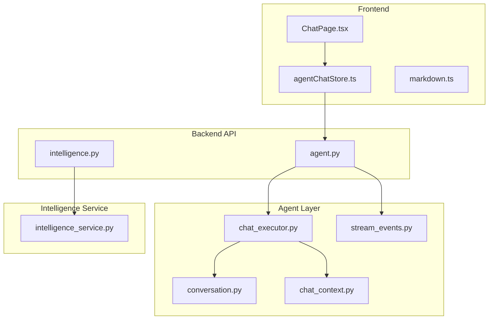
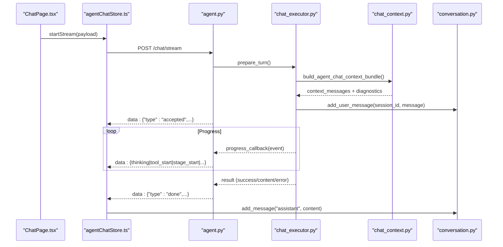
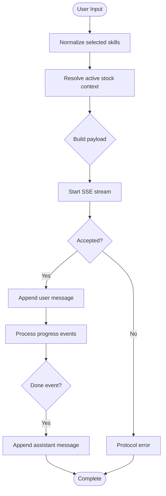
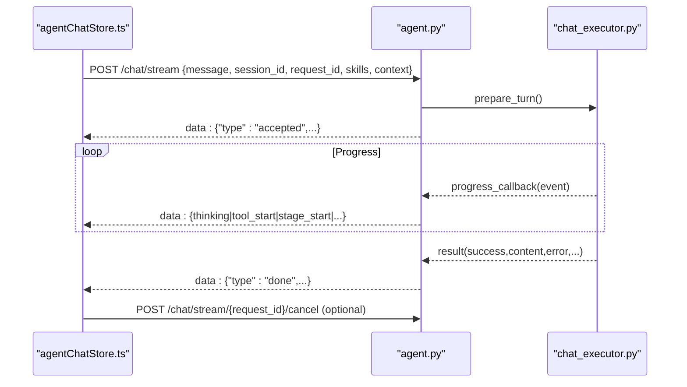
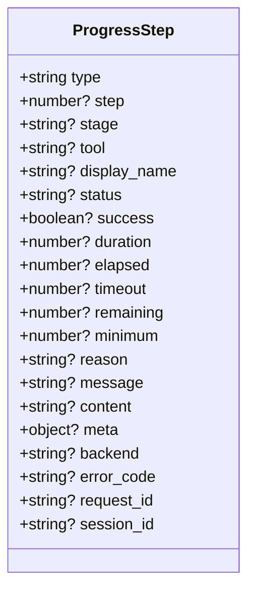
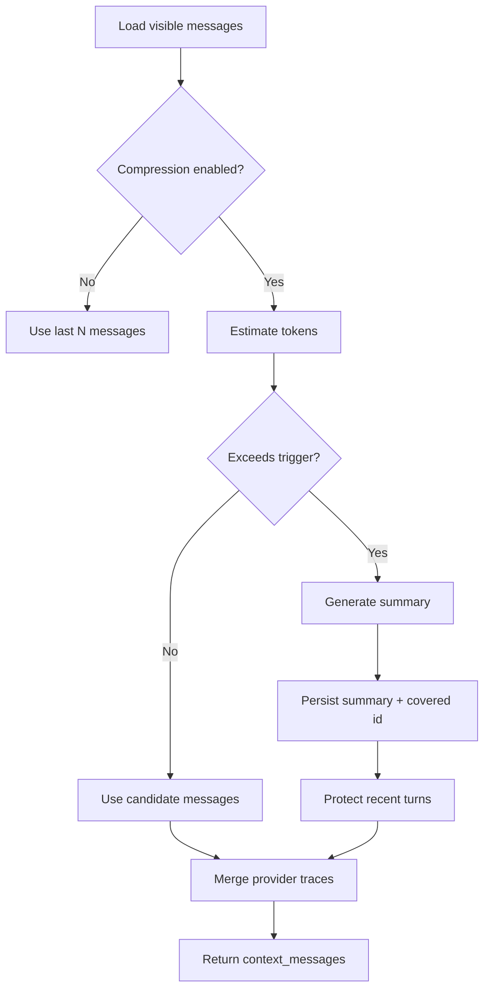
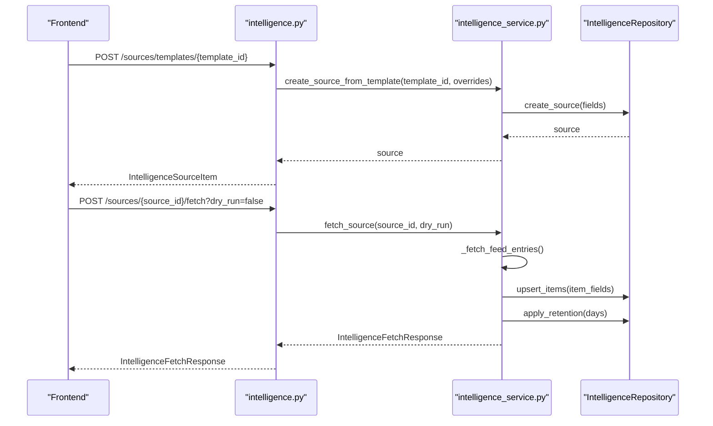
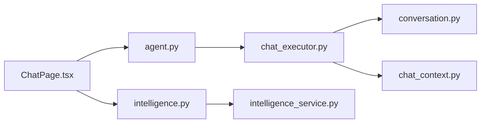

# Chat & Intelligence Interface

<cite>
**Referenced Files in This Document**
- [ChatPage.tsx](file://apps/dsa-web/src/pages/ChatPage.tsx)
- [agentChatStore.ts](file://apps/dsa-web/src/stores/agentChatStore.ts)
- [markdown.ts](file://apps/dsa-web/src/utils/markdown.ts)
- [agent.py](file://api/v1/endpoints/agent.py)
- [intelligence.py](file://api/v1/endpoints/intelligence.py)
- [intelligence_service.py](file://src/services/intelligence_service.py)
- [chat_context.py](file://src/agent/chat_context.py)
- [conversation.py](file://src/agent/conversation.py)
- [chat_executor.py](file://src/agent/chat_executor.py)
- [stream_events.py](file://src/agent/stream_events.py)
</cite>

## Table of Contents
1. [Introduction](#introduction)
2. [Project Structure](#project-structure)
3. [Core Components](#core-components)
4. [Architecture Overview](#architecture-overview)
5. [Detailed Component Analysis](#detailed-component-analysis)
6. [Dependency Analysis](#dependency-analysis)
7. [Performance Considerations](#performance-considerations)
8. [Troubleshooting Guide](#troubleshooting-guide)
9. [Conclusion](#conclusion)
10. [Appendices](#appendices)

## Introduction
This document explains the AI chat interface and intelligence gathering features for stock analysis. It covers:
- Conversational AI interface for stock analysis queries
- Real-time streaming responses with progress steps
- Task execution panels and session management
- Streaming transport via Server-Sent Events (SSE)
- Message formatting with Markdown support
- Conversation history compression and persistence
- Customizing chat prompts, integrating external knowledge bases, and extending AI capabilities through tools and skills

## Project Structure
The chat and intelligence system spans frontend UI, API endpoints, agent orchestration, and intelligence services:
- Frontend: React page and store manage user input, skill selection, streaming events, and conversation rendering.
- Backend API: FastAPI endpoints expose chat, sessions, streaming, and intelligence source management.
- Agent layer: Orchestrates LLM calls, tool usage, context building, and provider traces.
- Intelligence service: Fetches, validates, persists, and queries external news and market intelligence sources.

**Diagram sources**
- [ChatPage.tsx:1-120](file://apps/dsa-web/src/pages/ChatPage.tsx#L1-L120)
- [agentChatStore.ts:1-120](file://apps/dsa-web/src/stores/agentChatStore.ts#L1-L120)
- [agent.py:476-660](file://api/v1/endpoints/agent.py#L476-L660)
- [intelligence.py:48-171](file://api/v1/endpoints/intelligence.py#L48-L171)
- [intelligence_service.py:122-359](file://src/services/intelligence_service.py#L122-L359)
- [chat_executor.py:28-178](file://src/agent/chat_executor.py#L28-L178)
- [conversation.py:18-121](file://src/agent/conversation.py#L18-L121)
- [chat_context.py:120-364](file://src/agent/chat_context.py#L120-L364)
- [stream_events.py:13-23](file://src/agent/stream_events.py#L13-L23)

**Section sources**
- [ChatPage.tsx:1-120](file://apps/dsa-web/src/pages/ChatPage.tsx#L1-L120)
- [agent.py:476-660](file://api/v1/endpoints/agent.py#L476-L660)
- [intelligence.py:48-171](file://api/v1/endpoints/intelligence.py#L48-L171)

## Core Components
- Chat Page: User input, skill selection, follow-up context, markdown rendering, session sidebar, watchlist integration, and send flow.
- Chat Store: Manages messages, streaming lifecycle, progress steps, session switching, and error handling.
- Agent API: Non-streaming chat, streaming chat with SSE, session listing/retrieval/deletion, model/skills status, cancellation.
- Intelligence API: CRUD for intelligence sources, templates, fetch, test, list items; fail-open enabled-source fetching.
- Agent Context Builder: Builds visible chat history, compresses long conversations, injects provider traces into message history.
- Conversation Manager: Thread-safe session state, TTL cleanup, message persistence.
- Chat Executor: Prepares turns, executes backend runs, persists assistant replies, records provider traces.
- Stream Events: Helper to build stable SSE event payloads.

**Section sources**
- [ChatPage.tsx:202-744](file://apps/dsa-web/src/pages/ChatPage.tsx#L202-L744)
- [agentChatStore.ts:112-538](file://apps/dsa-web/src/stores/agentChatStore.ts#L112-L538)
- [agent.py:48-678](file://api/v1/endpoints/agent.py#L48-L678)
- [intelligence.py:48-171](file://api/v1/endpoints/intelligence.py#L48-L171)
- [chat_context.py:120-364](file://src/agent/chat_context.py#L120-L364)
- [conversation.py:18-121](file://src/agent/conversation.py#L18-L121)
- [chat_executor.py:28-178](file://src/agent/chat_executor.py#L28-L178)
- [stream_events.py:13-23](file://src/agent/stream_events.py#L13-L23)

## Architecture Overview
The chat flow uses SSE for real-time updates. The frontend initiates a stream, receives an accepted event, then streams thinking/tool/stage events, and finally a done event containing the final content. The backend orchestrates agent execution, builds conversation context, and persists messages. Intelligence sources are managed separately and can be fetched on demand or auto-refreshed.

**Diagram sources**
- [agent.py:476-660](file://api/v1/endpoints/agent.py#L476-L660)
- [chat_executor.py:73-178](file://src/agent/chat_executor.py#L73-L178)
- [chat_context.py:137-225](file://src/agent/chat_context.py#L137-L225)
- [conversation.py:26-54](file://src/agent/conversation.py#L26-L54)
- [agentChatStore.ts:309-538](file://apps/dsa-web/src/stores/agentChatStore.ts#L309-L538)

## Detailed Component Analysis

### Conversational AI Interface (ChatPage)
- Skill selection and quick questions: Users select up to three skills; quick questions map to specific skills and optional stock context.
- Stock context resolution: Detects explicit switches and comparisons from message text to update active stock context without overriding compare flows.
- Follow-up context: Supports report-to-chat follow-ups by parsing query parameters and hydrating context before sending.
- Markdown rendering: Uses react-markdown with GFM for rich output.
- Session management: Sidebar lists sessions, supports switching, deletion, and new chat creation.
- Watchlist integration: Adds/removes stocks from a configured watchlist and shows transient feedback.
- Send flow: Validates availability, normalizes skills, resolves stock context, and starts streaming with callbacks.

**Diagram sources**
- [ChatPage.tsx:675-744](file://apps/dsa-web/src/pages/ChatPage.tsx#L675-L744)
- [agentChatStore.ts:309-538](file://apps/dsa-web/src/stores/agentChatStore.ts#L309-L538)

**Section sources**
- [ChatPage.tsx:38-186](file://apps/dsa-web/src/pages/ChatPage.tsx#L38-L186)
- [ChatPage.tsx:202-744](file://apps/dsa-web/src/pages/ChatPage.tsx#L202-L744)
- [ChatPage.tsx:877-899](file://apps/dsa-web/src/pages/ChatPage.tsx#L877-L899)

### Real-Time Streaming Responses (SSE)
- Transport: Server-Sent Events via FastAPI StreamingResponse.
- Event types: accepted, thinking, stage_start, stage_done, tool_start, tool_done, generating, pipeline_timeout, pipeline_budget_skipped, done, error.
- Frontend processing: Reads ReadableStream, parses lines, validates accepted event, accumulates progress steps, handles terminal states (cancelled, timeout), and appends final content.
- Cancellation: For Codex backend, supports cancel endpoint to signal termination while keeping the original stream open.

**Diagram sources**
- [agent.py:476-678](file://api/v1/endpoints/agent.py#L476-L678)
- [agentChatStore.ts:309-538](file://apps/dsa-web/src/stores/agentChatStore.ts#L309-L538)

**Section sources**
- [agent.py:476-678](file://api/v1/endpoints/agent.py#L476-L678)
- [agentChatStore.ts:309-538](file://apps/dsa-web/src/stores/agentChatStore.ts#L309-L538)
- [stream_events.py:13-23](file://src/agent/stream_events.py#L13-L23)

### Task Execution Panels and Progress Steps
- Progress steps: Each streaming event is stored as a step with type, stage, tool, duration, success, and metadata.
- Rendering: ChatPage maps step types to human-readable labels and visual indicators (thinking, tool, success, danger).
- Task panel: Displays active tasks (pending, processing, cancel_requested) with diagnostics and trace IDs; hides completed/cancelled terminal tasks.

**Diagram sources**
- [agentChatStore.ts:15-36](file://apps/dsa-web/src/stores/agentChatStore.ts#L15-L36)
- [ChatPage.tsx:877-899](file://apps/dsa-web/src/pages/ChatPage.tsx#L877-L899)

**Section sources**
- [ChatPage.tsx:877-899](file://apps/dsa-web/src/pages/ChatPage.tsx#L877-L899)
- [agentChatStore.ts:15-36](file://apps/dsa-web/src/stores/agentChatStore.ts#L15-L36)

### WebSocket Integration Note
- Current implementation uses Server-Sent Events (SSE), not WebSockets.
- SSE provides a unidirectional server-to-client stream suitable for progress updates and final content delivery.
- If WebSockets are required later, consider replacing the SSE generator with a WebSocket handler that emits equivalent event types.

[No sources needed since this section clarifies transport choice]

### Message Formatting with Markdown Support
- Frontend renders assistant responses using react-markdown with GitHub Flavored Markdown.
- Utility converts Markdown to plain text when needed (e.g., export or search).

**Section sources**
- [ChatPage.tsx:1-10](file://apps/dsa-web/src/pages/ChatPage.tsx#L1-L10)
- [markdown.ts:1-22](file://apps/dsa-web/src/utils/markdown.ts#L1-L22)

### Conversation History Management
- Visible history builder: Loads visible messages, applies compression if enabled, protects recent turns, and generates summaries via LLM when token budget triggers.
- Provider traces: Injects provider-specific messages around assistant turns based on current model routing and budget constraints.
- Persistence: Messages are saved per session; assistant replies are appended after successful execution; failure notes are recorded for errors or cancellations.

**Diagram sources**
- [chat_context.py:120-364](file://src/agent/chat_context.py#L120-L364)
- [chat_context.py:137-225](file://src/agent/chat_context.py#L137-L225)

**Section sources**
- [chat_context.py:120-364](file://src/agent/chat_context.py#L120-L364)
- [conversation.py:18-121](file://src/agent/conversation.py#L18-L121)
- [chat_executor.py:112-178](file://src/agent/chat_executor.py#L112-L178)

### Intelligence Gathering Features
- Source management: Create, list, template-based creation, default sources enablement, test payload dry-run, fetch single source, fetch all enabled sources with fail-open semantics.
- Validation and security: URL validation, DNS guard against private/local addresses, redirect limits, size limits, proxy disabled for fetches.
- Parsing: RSS/Atom feeds and NewsNow JSON payloads normalized into standardized entries.
- Persistence: Items upserted with retention policy; source status updated on success/failure.

**Diagram sources**
- [intelligence.py:90-171](file://api/v1/endpoints/intelligence.py#L90-L171)
- [intelligence_service.py:176-359](file://src/services/intelligence_service.py#L176-L359)

**Section sources**
- [intelligence.py:48-171](file://api/v1/endpoints/intelligence.py#L48-L171)
- [intelligence_service.py:122-359](file://src/services/intelligence_service.py#L122-L359)

### Extending AI Capabilities: Tools and Skills
- Skills: Available skills are listed via API; users can select up to three per request. Default skill ID is provided for convenience.
- Tools: Tool names are mapped to Chinese display names for progress events; tools include market data, technical analysis, backtest summaries, and more.
- Customization:
  - Add new skills by implementing skill classes and registering them with the skill manager.
  - Extend tools by adding functions to the tool registry; ensure they emit progress events with stable fields.
  - Adjust prompt behavior via context configuration and skill instructions passed during turn preparation.

**Section sources**
- [agent.py:23-41](file://api/v1/endpoints/agent.py#L23-L41)
- [agent.py:153-185](file://api/v1/endpoints/agent.py#L153-L185)
- [chat_executor.py:31-50](file://src/agent/chat_executor.py#L31-L50)

## Dependency Analysis
- Frontend depends on API endpoints for skills, status, sessions, streaming, and intelligence sources.
- Agent API depends on executor, conversation manager, and context builder.
- Intelligence API depends on service for validation, fetching, parsing, and repository operations.
- Context builder depends on database for visible messages and summaries; it also integrates provider traces based on model routing.

**Diagram sources**
- [ChatPage.tsx:1-120](file://apps/dsa-web/src/pages/ChatPage.tsx#L1-L120)
- [agent.py:476-678](file://api/v1/endpoints/agent.py#L476-L678)
- [intelligence.py:48-171](file://api/v1/endpoints/intelligence.py#L48-L171)
- [chat_executor.py:28-178](file://src/agent/chat_executor.py#L28-L178)
- [conversation.py:18-121](file://src/agent/conversation.py#L18-L121)
- [chat_context.py:120-364](file://src/agent/chat_context.py#L120-L364)
- [intelligence_service.py:122-359](file://src/services/intelligence_service.py#L122-L359)

**Section sources**
- [agent.py:476-678](file://api/v1/endpoints/agent.py#L476-L678)
- [intelligence.py:48-171](file://api/v1/endpoints/intelligence.py#L48-L171)

## Performance Considerations
- Conversation compression: Reduces token usage by summarizing older visible messages and protecting recent turns; configurable trigger and target tokens.
- Streaming efficiency: SSE avoids full response waits; progress events keep UI responsive and allow cancellation.
- Intelligence fetch limits: Max feed bytes, redirect limits, and timeouts prevent resource exhaustion.
- Provider trace injection: Only included within budget; otherwise dropped to preserve context size.

[No sources needed since this section provides general guidance]

## Troubleshooting Guide
- Stream protocol errors: Ensure accepted event arrives before other events; validate backend and request/session IDs.
- Cancellation: For Codex backend, use cancel endpoint; ensure active request exists.
- Intelligence source errors: Validate URLs, check DNS resolution, avoid private hosts, and handle upstream failures gracefully.
- Context compression failures: Falls back to state-table logic; review protected turns and trigger thresholds.

**Section sources**
- [agentChatStore.ts:366-444](file://apps/dsa-web/src/stores/agentChatStore.ts#L366-L444)
- [agent.py:663-678](file://api/v1/endpoints/agent.py#L663-L678)
- [intelligence_service.py:392-440](file://src/services/intelligence_service.py#L392-L440)
- [chat_context.py:348-364](file://src/agent/chat_context.py#L348-L364)

## Conclusion
The chat and intelligence interface combines a responsive React frontend with robust backend orchestration. SSE streaming delivers real-time progress and final answers, while conversation compression ensures efficient context usage. Intelligence sources provide extensible external knowledge integration with strong validation and safety controls. Skills and tools enable customization and extension of AI capabilities for stock analysis workflows.

[No sources needed since this section summarizes without analyzing specific files]

## Appendices

### Example: Customizing Chat Prompts
- Adjust context configuration to set report language and other runtime parameters.
- Provide skill instructions and default skill policies during executor initialization.
- Use follow-up context to pre-seed stock context and record IDs for continuity.

**Section sources**
- [agent.py:68-78](file://api/v1/endpoints/agent.py#L68-L78)
- [chat_executor.py:31-50](file://src/agent/chat_executor.py#L31-L50)
- [ChatPage.tsx:633-673](file://apps/dsa-web/src/pages/ChatPage.tsx#L633-L673)

### Example: Integrating External Knowledge Bases
- Create intelligence sources via templates or direct creation; test payloads before enabling.
- Enable default sources for auto mode; fetch enabled sources with fail-open semantics.
- Query persisted items with filters for scope, market, and time range.

**Section sources**
- [intelligence.py:90-171](file://api/v1/endpoints/intelligence.py#L90-L171)
- [intelligence_service.py:176-359](file://src/services/intelligence_service.py#L176-L359)

### Example: Extending AI Capabilities Through Tools and Skills
- Register new skills and mark them user-invocable; list via API for frontend selection.
- Implement tools and emit progress events with stable fields; map tool names to display names.
- Configure max steps and timeouts to control execution depth and duration.

**Section sources**
- [agent.py:153-185](file://api/v1/endpoints/agent.py#L153-L185)
- [agent.py:23-41](file://api/v1/endpoints/agent.py#L23-L41)
- [chat_executor.py:31-50](file://src/agent/chat_executor.py#L31-L50)