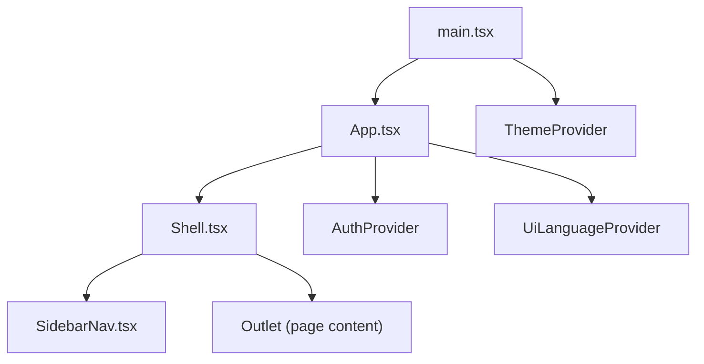
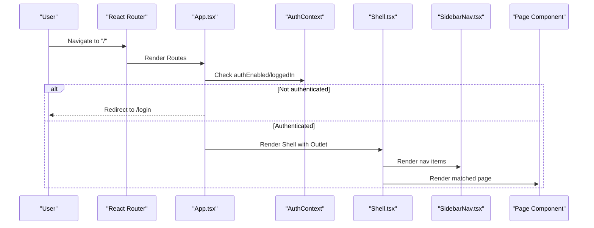
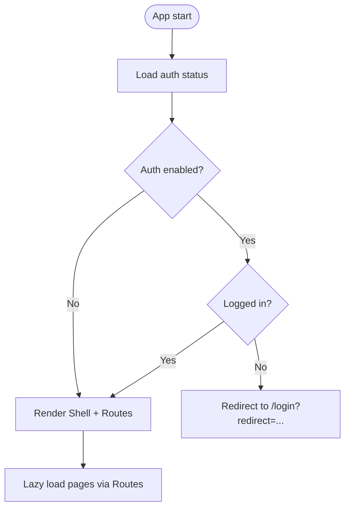
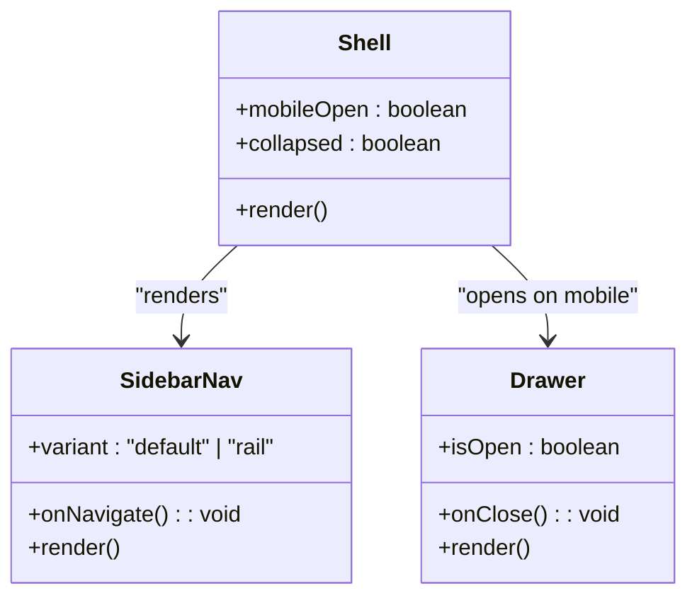
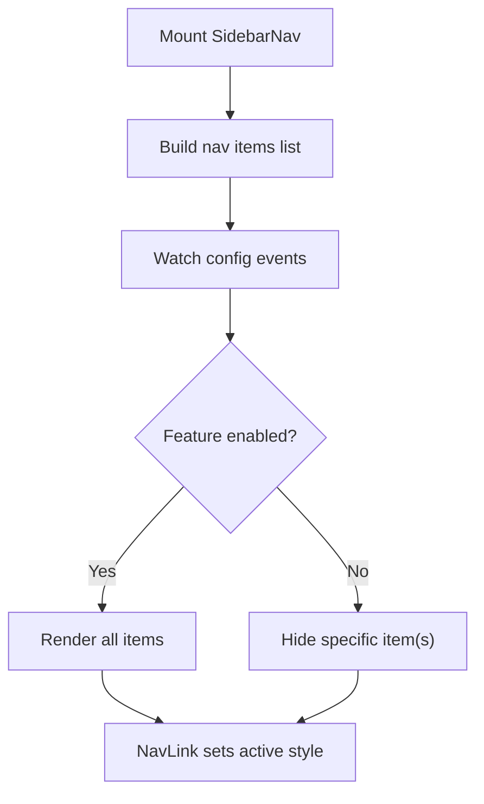
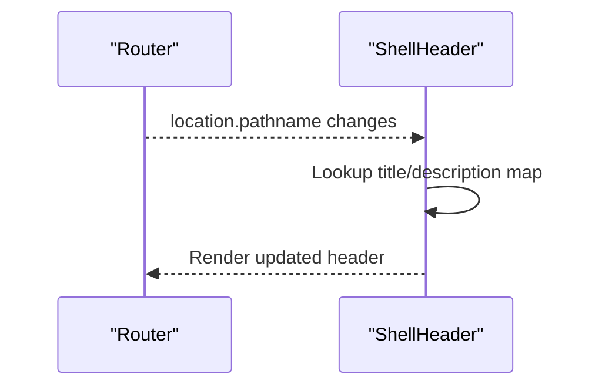
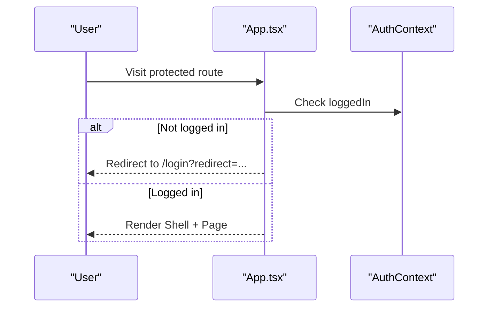
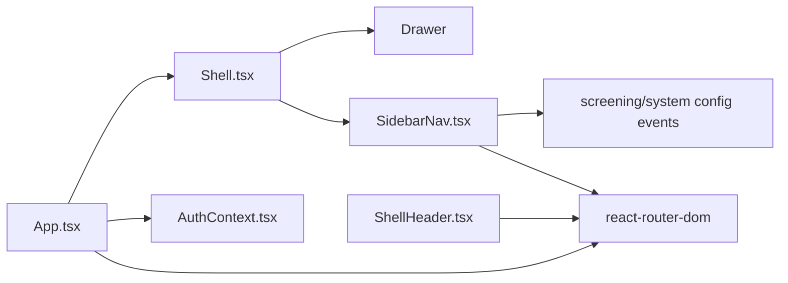

# Dashboard Overview & Navigation

<cite>
**Referenced Files in This Document**
- [main.tsx](file://apps/dsa-web/src/main.tsx)
- [App.tsx](file://apps/dsa-web/src/App.tsx)
- [Shell.tsx](file://apps/dsa-web/src/components/layout/Shell.tsx)
- [SidebarNav.tsx](file://apps/dsa-web/src/components/layout/SidebarNav.tsx)
- [ShellHeader.tsx](file://apps/dsa-web/src/components/layout/ShellHeader.tsx)
- [AuthContext.tsx](file://apps/dsa-web/src/contexts/AuthContext.tsx)
- [ThemeProvider.tsx](file://apps/dsa-web/src/components/theme/ThemeProvider.tsx)
</cite>

## Table of Contents
1. Introduction
2. Project Structure
3. Core Components
4. Architecture Overview
5. Detailed Component Analysis
6. Dependency Analysis
7. Performance Considerations
8. Troubleshooting Guide
9. Conclusion

## Introduction
This document explains the main dashboard interface and navigation system for the web application. It covers the React application structure, routing configuration, page layout components, and the shell that provides a consistent header, sidebar, and content area across all pages. It also documents the sidebar navigation with its active state management, responsive behavior, and how to add new pages, customize the sidebar, and implement role-based access control patterns.

## Project Structure
The web app is bootstrapped by a root entry that mounts the React tree under a theme provider. The application defines routes and wraps protected routes inside a Shell component that renders a persistent sidebar and a main content area. Pages are lazy-loaded and rendered via React Router.

**Diagram sources**
- [main.tsx:7-13](file://apps/dsa-web/src/main.tsx#L7-L13)
- [App.tsx:97-107](file://apps/dsa-web/src/App.tsx#L97-L107)
- [App.tsx:73-94](file://apps/dsa-web/src/App.tsx#L73-L94)
- [Shell.tsx:38-84](file://apps/dsa-web/src/components/layout/Shell.tsx#L38-L84)
- [SidebarNav.tsx:42-204](file://apps/dsa-web/src/components/layout/SidebarNav.tsx#L42-L204)
- [ThemeProvider.tsx:8-18](file://apps/dsa-web/src/components/theme/ThemeProvider.tsx#L8-L18)

**Section sources**
- [main.tsx:1-14](file://apps/dsa-web/src/main.tsx#L1-L14)
- [App.tsx:1-110](file://apps/dsa-web/src/App.tsx#L1-L110)

## Core Components
- App: Sets up providers (theme, language, auth), configures routes, and guards unauthenticated access.
- Shell: Provides the desktop sidebar rail, mobile drawer, and main content area.
- SidebarNav: Renders navigation items, manages active states, and integrates logout and UI toggles.
- ShellHeader: Displays route-specific titles and controls for sidebar and mobile navigation.
- AuthContext: Manages authentication state and actions used by routing guards and UI.

Key responsibilities:
- Routing and protection: App decides whether to show login or redirect based on auth status.
- Layout consistency: Shell ensures a fixed sidebar on desktop and a slide-out drawer on mobile.
- Navigation UX: SidebarNav highlights the current route and supports responsive layouts.
- Theming and i18n: Providers wrap the entire app to enable theme switching and language toggling.

**Section sources**
- [App.tsx:27-94](file://apps/dsa-web/src/App.tsx#L27-L94)
- [Shell.tsx:16-84](file://apps/dsa-web/src/components/layout/Shell.tsx#L16-L84)
- [SidebarNav.tsx:42-204](file://apps/dsa-web/src/components/layout/SidebarNav.tsx#L42-L204)
- [ShellHeader.tsx:26-66](file://apps/dsa-web/src/components/layout/ShellHeader.tsx#L26-L66)
- [AuthContext.tsx:41-155](file://apps/dsa-web/src/contexts/AuthContext.tsx#L41-L155)

## Architecture Overview
The application uses a layered architecture:
- Entry layer: main.tsx creates the root React tree with ThemeProvider.
- App layer: App.tsx configures routing and global providers (auth, language).
- Layout layer: Shell.tsx composes the persistent sidebar and content area.
- Navigation layer: SidebarNav.tsx renders links and handles active states.
- Page layer: Lazy-loaded pages render feature-specific content.

**Diagram sources**
- [App.tsx:27-94](file://apps/dsa-web/src/App.tsx#L27-L94)
- [AuthContext.tsx:41-155](file://apps/dsa-web/src/contexts/AuthContext.tsx#L41-L155)
- [Shell.tsx:38-84](file://apps/dsa-web/src/components/layout/Shell.tsx#L38-L84)
- [SidebarNav.tsx:116-152](file://apps/dsa-web/src/components/layout/SidebarNav.tsx#L116-L152)

## Detailed Component Analysis

### Application Root and Routing
- Root mounting: main.tsx mounts the app under StrictMode and ThemeProvider.
- App composition: App.tsx wraps everything with UiLanguageProvider, Router, and AuthProvider.
- Route definitions: Protected routes are nested under a Shell element; public routes like login are handled separately.
- Authentication guard: If auth is enabled and user is not logged in, redirects to login with a return URL.

**Diagram sources**
- [App.tsx:27-94](file://apps/dsa-web/src/App.tsx#L27-L94)
- [main.tsx:7-13](file://apps/dsa-web/src/main.tsx#L7-L13)

**Section sources**
- [main.tsx:1-14](file://apps/dsa-web/src/main.tsx#L1-L14)
- [App.tsx:1-110](file://apps/dsa-web/src/App.tsx#L1-L110)

### Shell Layout and Responsive Behavior
- Desktop: Sticky sidebar rail with brand logo, navigation, theme/language toggles, and optional collapse state.
- Mobile: Top bar with menu button opens a Drawer containing the same SidebarNav.
- Content area: Main region renders the current page via Outlet.

**Diagram sources**
- [Shell.tsx:16-84](file://apps/dsa-web/src/components/layout/Shell.tsx#L16-L84)
- [SidebarNav.tsx:42-204](file://apps/dsa-web/src/components/layout/SidebarNav.tsx#L42-L204)

**Section sources**
- [Shell.tsx:16-84](file://apps/dsa-web/src/components/layout/Shell.tsx#L16-L84)

### Sidebar Navigation and Active State
- Nav items: Defined as a typed array with keys, labels, routes, icons, and optional badges.
- Active highlighting: NavLink computes isActive based on the current route and applies styles.
- Conditional visibility: Some items can be conditionally shown based on runtime flags (e.g., screening feature).
- Actions: Includes theme toggle, language toggle, and logout confirmation.

**Diagram sources**
- [SidebarNav.tsx:30-40](file://apps/dsa-web/src/components/layout/SidebarNav.tsx#L30-L40)
- [SidebarNav.tsx:49-76](file://apps/dsa-web/src/components/layout/SidebarNav.tsx#L49-L76)
- [SidebarNav.tsx:116-152](file://apps/dsa-web/src/components/layout/SidebarNav.tsx#L116-L152)

**Section sources**
- [SidebarNav.tsx:30-204](file://apps/dsa-web/src/components/layout/SidebarNav.tsx#L30-L204)

### Header and Route Titles
- Dynamic title/description: ShellHeader maps pathname to localized title and description.
- Controls: Mobile menu trigger, sidebar toggle, and quick access to theme/language toggles.

**Diagram sources**
- [ShellHeader.tsx:15-24](file://apps/dsa-web/src/components/layout/ShellHeader.tsx#L15-L24)
- [ShellHeader.tsx:26-66](file://apps/dsa-web/src/components/layout/ShellHeader.tsx#L26-L66)

**Section sources**
- [ShellHeader.tsx:1-67](file://apps/dsa-web/src/components/layout/ShellHeader.tsx#L1-L67)

### Authentication and Access Control
- Status loading: On mount, fetches auth status and updates context.
- Guarding routes: App redirects to login when auth is enabled but user is not logged in.
- Logout flow: Sidebar triggers logout confirmation and clears session.

**Diagram sources**
- [App.tsx:27-71](file://apps/dsa-web/src/App.tsx#L27-L71)
- [AuthContext.tsx:41-155](file://apps/dsa-web/src/contexts/AuthContext.tsx#L41-L155)

**Section sources**
- [App.tsx:27-94](file://apps/dsa-web/src/App.tsx#L27-L94)
- [AuthContext.tsx:1-156](file://apps/dsa-web/src/contexts/AuthContext.tsx#L1-L156)

## Dependency Analysis
- App depends on Router, AuthProvider, UiLanguageProvider, and Shell to orchestrate navigation and layout.
- Shell depends on SidebarNav and Drawer for responsive navigation.
- SidebarNav depends on React Router NavLink for active state and on API/config events for conditional visibility.
- ShellHeader depends on Router location to display contextual titles.

**Diagram sources**
- [App.tsx:1-110](file://apps/dsa-web/src/App.tsx#L1-L110)
- [Shell.tsx:1-84](file://apps/dsa-web/src/components/layout/Shell.tsx#L1-L84)
- [SidebarNav.tsx:1-204](file://apps/dsa-web/src/components/layout/SidebarNav.tsx#L1-L204)
- [ShellHeader.tsx:1-67](file://apps/dsa-web/src/components/layout/ShellHeader.tsx#L1-L67)

**Section sources**
- [App.tsx:1-110](file://apps/dsa-web/src/App.tsx#L1-L110)
- [Shell.tsx:1-84](file://apps/dsa-web/src/components/layout/Shell.tsx#L1-L84)
- [SidebarNav.tsx:1-204](file://apps/dsa-web/src/components/layout/SidebarNav.tsx#L1-L204)
- [ShellHeader.tsx:1-67](file://apps/dsa-web/src/components/layout/ShellHeader.tsx#L1-L67)

## Performance Considerations
- Lazy loading: Pages are imported lazily to reduce initial bundle size.
- Responsive rendering: Sidebar collapses to a rail on desktop and moves into a Drawer on mobile to avoid heavy reflows.
- Event listeners: SidebarNav listens to configuration change events to update visibility without full reloads.
- Provider overhead: Keep providers minimal at the root to avoid unnecessary re-renders.

[No sources needed since this section provides general guidance]

## Troubleshooting Guide
- Login loop or redirect issues: Ensure auth status loads successfully and that the redirect URL is properly encoded.
- Sidebar not updating active state: Verify that NavLink props (to, exact) match the defined routes.
- Feature items missing: Confirm that configuration events are emitted and that the feature flag logic filters items correctly.
- Mobile drawer not closing: Check resize listener and ensure it closes when viewport width exceeds the desktop breakpoint.

**Section sources**
- [App.tsx:27-71](file://apps/dsa-web/src/App.tsx#L27-L71)
- [SidebarNav.tsx:49-76](file://apps/dsa-web/src/components/layout/SidebarNav.tsx#L49-L76)
- [Shell.tsx:21-36](file://apps/dsa-web/src/components/layout/Shell.tsx#L21-L36)

## Conclusion
The dashboard’s navigation system is built around a clear separation of concerns: App handles routing and auth guards, Shell provides a consistent layout, and SidebarNav delivers a responsive, accessible navigation experience. Adding new pages involves defining routes in App and optionally adding entries to the sidebar configuration. Role-based access can be implemented by extending the auth context and guarding routes or sidebar items accordingly.