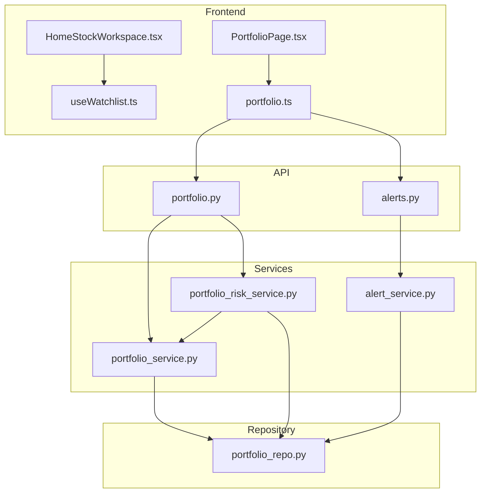
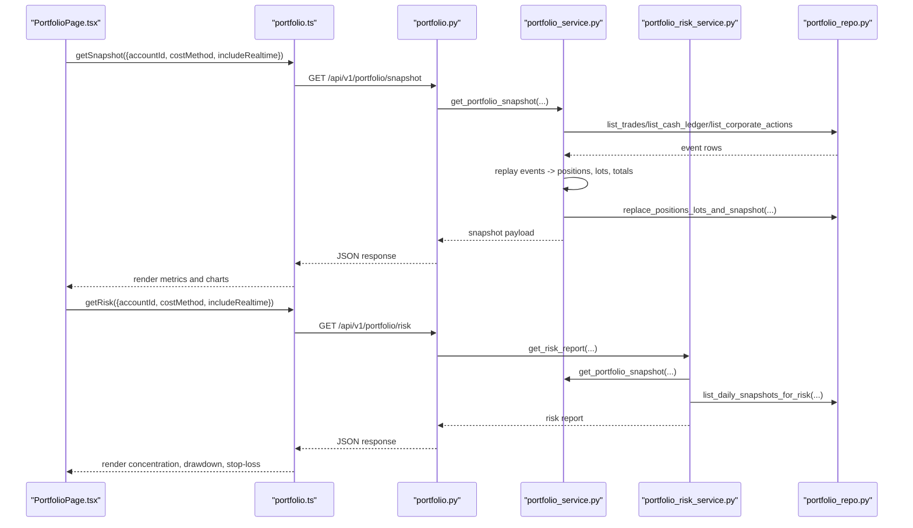
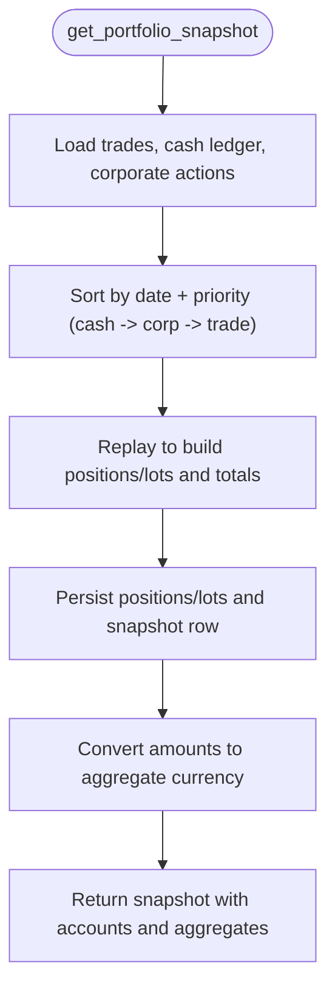
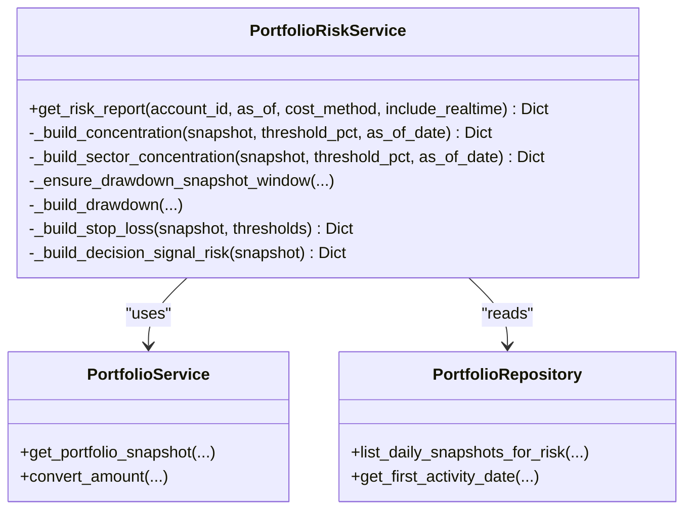
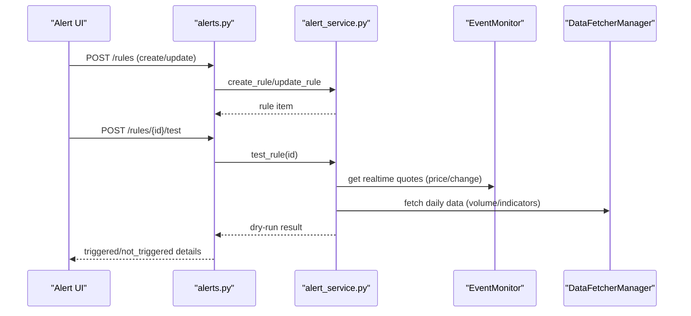
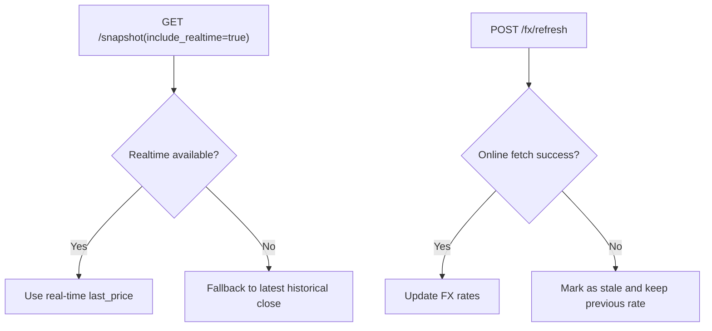
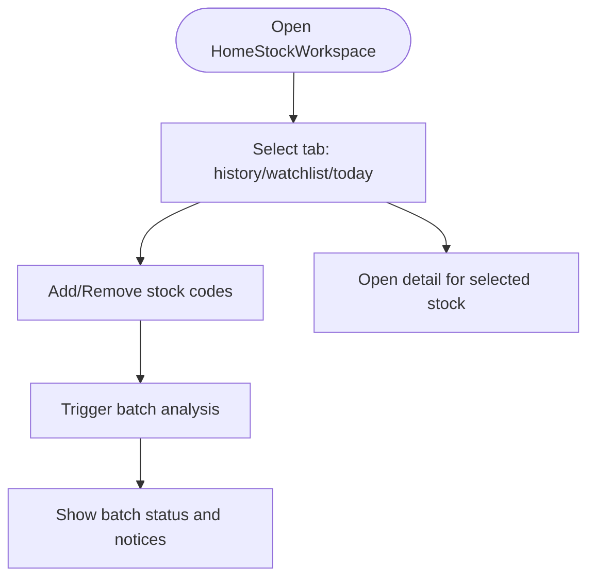
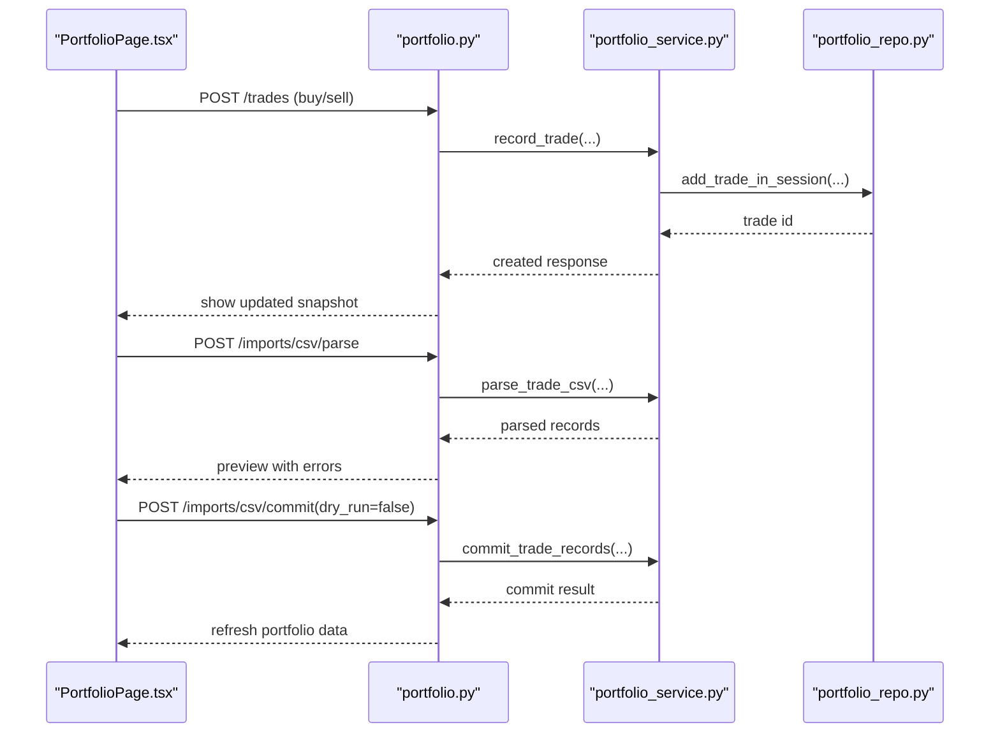
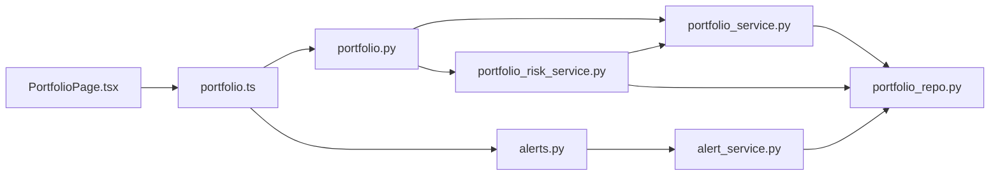

# Portfolio Management UI

<cite>
**Referenced Files in This Document**
- [portfolio.py](file://api/v1/endpoints/portfolio.py)
- [alerts.py](file://api/v1/endpoints/alerts.py)
- [portfolio_service.py](file://src/services/portfolio_service.py)
- [portfolio_risk_service.py](file://src/services/portfolio_risk_service.py)
- [alert_service.py](file://src/services/alert_service.py)
- [portfolio_repo.py](file://src/repositories/portfolio_repo.py)
- [PortfolioPage.tsx](file://apps/dsa-web/src/pages/PortfolioPage.tsx)
- [portfolio.ts](file://apps/dsa-web/src/api/portfolio.ts)
- [HomeStockWorkspace.tsx](file://apps/dsa-web/src/components/watchlist/HomeStockWorkspace.tsx)
- [useWatchlist.ts](file://apps/dsa-web/src/hooks/useWatchlist.ts)
</cite>

## Table of Contents
1. [Introduction](#introduction)
2. [Project Structure](#project-structure)
3. [Core Components](#core-components)
4. [Architecture Overview](#architecture-overview)
5. [Detailed Component Analysis](#detailed-component-analysis)
6. [Dependency Analysis](#dependency-analysis)
7. [Performance Considerations](#performance-considerations)
8. [Troubleshooting Guide](#troubleshooting-guide)
9. [Conclusion](#conclusion)
10. [Appendices](#appendices)

## Introduction
This document explains the portfolio management features implemented in the application, focusing on:
- Watchlist management and stock workspace interface for adding/removing stocks and monitoring parameters
- Position tracking via account-based trade, cash ledger, and corporate action events
- Portfolio analytics including snapshot valuation, risk metrics, concentration, drawdown, stop-loss proximity, and decision-signal-driven risk
- Real-time price updates and FX refresh behavior
- Alert configuration and dry-run evaluation
- Portfolio rebalancing workflows through CSV import from brokers and manual trade entry
- Examples for customizing watchlist layouts, implementing automated trading signals, and integrating broker APIs for live synchronization

## Project Structure
The portfolio management feature spans frontend pages, API endpoints, services, and repositories:
- Frontend: React page for portfolio operations and a watchlist workspace component
- API: FastAPI endpoints for portfolio accounts, trades, cash ledger, corporate actions, snapshots, risk, and alerts
- Services: Business logic for replaying events into positions, computing risk, and evaluating alerts
- Repository: Data access layer with SQLite-backed persistence and transaction safety

**Diagram sources**
- [PortfolioPage.tsx:182-800](file://apps/dsa-web/src/pages/PortfolioPage.tsx#L182-L800)
- [HomeStockWorkspace.tsx:241-528](file://apps/dsa-web/src/components/watchlist/HomeStockWorkspace.tsx#L241-L528)
- [useWatchlist.ts:17-38](file://apps/dsa-web/src/hooks/useWatchlist.ts#L17-L38)
- [portfolio.ts:108-289](file://apps/dsa-web/src/api/portfolio.ts#L108-L289)
- [portfolio.py:76-677](file://api/v1/endpoints/portfolio.py#L76-L677)
- [alerts.py:56-263](file://api/v1/endpoints/alerts.py#L56-L263)
- [portfolio_service.py:109-800](file://src/services/portfolio_service.py#L109-L800)
- [portfolio_risk_service.py:21-559](file://src/services/portfolio_risk_service.py#L21-L559)
- [alert_service.py:103-800](file://src/services/alert_service.py#L103-L800)
- [portfolio_repo.py:45-800](file://src/repositories/portfolio_repo.py#L45-L800)

**Section sources**
- [PortfolioPage.tsx:182-800](file://apps/dsa-web/src/pages/PortfolioPage.tsx#L182-L800)
- [portfolio.py:76-677](file://api/v1/endpoints/portfolio.py#L76-L677)
- [portfolio_service.py:109-800](file://src/services/portfolio_service.py#L109-L800)
- [portfolio_repo.py:45-800](file://src/repositories/portfolio_repo.py#L45-L800)

## Core Components
- Portfolio Page (React): Manages accounts, snapshots, risk reports, event lists, CSV imports, FX refresh, and position analysis tasks. It coordinates API calls and renders performance metrics and charts.
- Watchlist Workspace: Provides tabs for history, watchlist, and today’s status; supports adding/removing stocks and batch analysis triggers.
- Portfolio API Endpoints: Expose CRUD for accounts, trades, cash ledger, corporate actions, snapshots, risk, and CSV import endpoints.
- Portfolio Service: Implements event replay to compute positions, cost basis, market values, PnL, FX conversions, and snapshot caching.
- Risk Service: Computes concentration, sector concentration, drawdown, stop-loss proximity, and decision-signal risk overlays.
- Alert Service: Supports rule lifecycle, dry-run evaluation across symbol, watchlist, portfolio holdings, and market scopes, with technical indicators and real-time quote checks.
- Repository: Handles SQLite transactions, deduplication, pagination, and daily snapshot storage for risk backfill.

**Section sources**
- [PortfolioPage.tsx:182-800](file://apps/dsa-web/src/pages/PortfolioPage.tsx#L182-L800)
- [HomeStockWorkspace.tsx:241-528](file://apps/dsa-web/src/components/watchlist/HomeStockWorkspace.tsx#L241-L528)
- [portfolio.py:76-677](file://api/v1/endpoints/portfolio.py#L76-L677)
- [portfolio_service.py:109-800](file://src/services/portfolio_service.py#L109-L800)
- [portfolio_risk_service.py:21-559](file://src/services/portfolio_risk_service.py#L21-L559)
- [alert_service.py:103-800](file://src/services/alert_service.py#L103-L800)
- [portfolio_repo.py:45-800](file://src/repositories/portfolio_repo.py#L45-L800)

## Architecture Overview
End-to-end flow from UI to data persistence and analytics:

**Diagram sources**
- [PortfolioPage.tsx:340-371](file://apps/dsa-web/src/pages/PortfolioPage.tsx#L340-L371)
- [portfolio.ts:132-156](file://apps/dsa-web/src/api/portfolio.ts#L132-L156)
- [portfolio.py:414-442](file://api/v1/endpoints/portfolio.py#L414-L442)
- [portfolio_service.py:471-613](file://src/services/portfolio_service.py#L471-L613)
- [portfolio_repo.py:467-534](file://src/repositories/portfolio_repo.py#L467-L534)
- [portfolio_risk_service.py:39-101](file://src/services/portfolio_risk_service.py#L39-L101)

## Detailed Component Analysis

### Portfolio Snapshot and Analytics
- Snapshot computation replays trades, cash ledger entries, and corporate actions in deterministic order to derive per-account positions, lots, market value, realized/unrealized PnL, fees/taxes, and FX conversion flags.
- Snapshot results are persisted as daily snapshots for risk backfill and drawdown calculations.
- Cost method supports FIFO or average cost; markets may have partial valuation semantics flagged in limitations.

**Diagram sources**
- [portfolio_service.py:777-800](file://src/services/portfolio_service.py#L777-L800)
- [portfolio_service.py:471-613](file://src/services/portfolio_service.py#L471-L613)
- [portfolio_repo.py:467-534](file://src/repositories/portfolio_repo.py#L467-L534)

**Section sources**
- [portfolio_service.py:471-613](file://src/services/portfolio_service.py#L471-L613)
- [portfolio_service.py:777-800](file://src/services/portfolio_service.py#L777-L800)
- [portfolio_repo.py:467-534](file://src/repositories/portfolio_repo.py#L467-L534)

### Risk Metrics and Alerts Integration
- Concentration: Aggregates exposure by symbol and sector; flags top weights against thresholds.
- Drawdown: Builds equity series from daily snapshots; computes max and current drawdown.
- Stop-loss: Evaluates per-position loss vs threshold and near-threshold warnings.
- Decision-signal risk: Pulls latest defensive signals for held positions to highlight sell/reduce/alert actions.

**Diagram sources**
- [portfolio_risk_service.py:21-559](file://src/services/portfolio_risk_service.py#L21-L559)
- [portfolio_service.py:471-613](file://src/services/portfolio_service.py#L471-L613)
- [portfolio_repo.py:791-800](file://src/repositories/portfolio_repo.py#L791-L800)

**Section sources**
- [portfolio_risk_service.py:39-101](file://src/services/portfolio_risk_service.py#L39-L101)
- [portfolio_risk_service.py:282-387](file://src/services/portfolio_risk_service.py#L282-L387)
- [portfolio_risk_service.py:466-559](file://src/services/portfolio_risk_service.py#L466-L559)

### Alert Configuration and Dry-Run Evaluation
- Rule lifecycle: create, update, enable/disable, delete, list, test.
- Target scopes: single symbol, watchlist, portfolio holdings, portfolio account, market.
- Alert types: price cross/change, volume spike, technical indicators, portfolio risk, market light.
- Dry-run evaluation runs asynchronously with timeouts and aggregated results per target scope.

**Diagram sources**
- [alerts.py:56-206](file://api/v1/endpoints/alerts.py#L56-L206)
- [alert_service.py:110-205](file://src/services/alert_service.py#L110-L205)
- [alert_service.py:311-613](file://src/services/alert_service.py#L311-L613)

**Section sources**
- [alerts.py:56-206](file://api/v1/endpoints/alerts.py#L56-L206)
- [alert_service.py:103-205](file://src/services/alert_service.py#L103-L205)
- [alert_service.py:311-613](file://src/services/alert_service.py#L311-L613)

### Real-Time Price Updates and FX Refresh
- Snapshot endpoint supports include_realtime to attempt best-effort real-time quotes before falling back to historical close.
- FX refresh endpoint updates exchange rates with stale fallback when online fetch fails; portfolio service enforces configuration gating.

**Diagram sources**
- [portfolio.py:414-442](file://api/v1/endpoints/portfolio.py#L414-L442)
- [portfolio.py:629-647](file://api/v1/endpoints/portfolio.py#L629-L647)
- [portfolio_service.py:615-650](file://src/services/portfolio_service.py#L615-L650)

**Section sources**
- [portfolio.py:414-442](file://api/v1/endpoints/portfolio.py#L414-L442)
- [portfolio.py:629-647](file://api/v1/endpoints/portfolio.py#L629-L647)
- [portfolio_service.py:615-650](file://src/services/portfolio_service.py#L615-L650)

### Watchlist Management and Stock Workspace Interface
- The watchlist workspace provides tabs for history, watchlist, and today’s status. Users can add/remove stocks, trigger batch analysis, and view latest details.
- The useWatchlist hook manages local state for codes, loading, and actions, syncing with system configuration.

**Diagram sources**
- [HomeStockWorkspace.tsx:241-528](file://apps/dsa-web/src/components/watchlist/HomeStockWorkspace.tsx#L241-L528)
- [useWatchlist.ts:17-38](file://apps/dsa-web/src/hooks/useWatchlist.ts#L17-L38)

**Section sources**
- [HomeStockWorkspace.tsx:241-528](file://apps/dsa-web/src/components/watchlist/HomeStockWorkspace.tsx#L241-L528)
- [useWatchlist.ts:17-38](file://apps/dsa-web/src/hooks/useWatchlist.ts#L17-L38)

### Position Tracking and Rebalancing Tools
- Trade, cash ledger, and corporate action events are recorded via API endpoints and validated by the service (e.g., oversell protection, identity dedup).
- CSV import allows parsing and committing broker statements with dry-run support; supported brokers can be listed.
- Manual trade entry enables rebalancing by adjusting quantities/prices and recording fees/taxes.

**Diagram sources**
- [portfolio.py:163-250](file://api/v1/endpoints/portfolio.py#L163-L250)
- [portfolio.py:558-627](file://api/v1/endpoints/portfolio.py#L558-L627)
- [portfolio_service.py:186-327](file://src/services/portfolio_service.py#L186-L327)
- [portfolio_repo.py:304-417](file://src/repositories/portfolio_repo.py#L304-L417)

**Section sources**
- [portfolio.py:163-250](file://api/v1/endpoints/portfolio.py#L163-L250)
- [portfolio.py:558-627](file://api/v1/endpoints/portfolio.py#L558-L627)
- [portfolio_service.py:186-327](file://src/services/portfolio_service.py#L186-L327)
- [portfolio_repo.py:304-417](file://src/repositories/portfolio_repo.py#L304-L417)

### Customizing Watchlist Layouts and Automated Signals
- Customize layout by selecting tabs and toggling visibility of history/watchlist/today sections; use batch analysis to surface signals for multiple symbols.
- Implement automated trading signals using alert rules targeting watchlist or portfolio holdings; leverage technical indicator alerts and real-time price change alerts.
- Integrate broker APIs by importing CSV exports and committing normalized trade records; optionally sync live positions via periodic snapshot refreshes.

[No sources needed since this section synthesizes usage patterns without analyzing specific files]

## Dependency Analysis
Key dependencies and coupling:
- Frontend depends on portfolio API client methods for all portfolio operations and alert endpoints for rule management.
- API endpoints depend on services for business logic and repository for persistence.
- Services depend on repository for data access and on each other (risk service uses portfolio service for snapshots).
- Repository encapsulates database interactions and ensures transaction safety with immediate locking for writes.

**Diagram sources**
- [PortfolioPage.tsx:182-800](file://apps/dsa-web/src/pages/PortfolioPage.tsx#L182-L800)
- [portfolio.ts:108-289](file://apps/dsa-web/src/api/portfolio.ts#L108-L289)
- [portfolio.py:76-677](file://api/v1/endpoints/portfolio.py#L76-L677)
- [alerts.py:56-263](file://api/v1/endpoints/alerts.py#L56-L263)
- [portfolio_service.py:109-800](file://src/services/portfolio_service.py#L109-L800)
- [portfolio_risk_service.py:21-559](file://src/services/portfolio_risk_service.py#L21-L559)
- [alert_service.py:103-800](file://src/services/alert_service.py#L103-L800)
- [portfolio_repo.py:45-800](file://src/repositories/portfolio_repo.py#L45-L800)

**Section sources**
- [portfolio.py:76-677](file://api/v1/endpoints/portfolio.py#L76-L677)
- [alerts.py:56-263](file://api/v1/endpoints/alerts.py#L56-L263)
- [portfolio_service.py:109-800](file://src/services/portfolio_service.py#L109-L800)
- [portfolio_risk_service.py:21-559](file://src/services/portfolio_risk_service.py#L21-L559)
- [alert_service.py:103-800](file://src/services/alert_service.py#L103-L800)
- [portfolio_repo.py:45-800](file://src/repositories/portfolio_repo.py#L45-L800)

## Performance Considerations
- Snapshot computation batches event reads and persists intermediate results to reduce recomputation for risk analysis.
- Real-time quote retrieval is best-effort; consider disabling include_realtime for large portfolios during peak load.
- Alert dry-run evaluation uses concurrency limits and timeouts to prevent long-running requests.
- CSV import parsing should be used with dry-run first to validate records before committing.

[No sources needed since this section provides general guidance]

## Troubleshooting Guide
Common issues and resolutions:
- Duplicate trade UID or dedup hash: Ensure unique identifiers per account; remove conflicting entries or adjust import mapping.
- Oversell detected: Verify available quantity before submitting sell orders; review corporate actions affecting split adjustments.
- Portfolio busy: Retry write operations after brief delay due to SQLite lock contention.
- FX stale: Use FX refresh endpoint; check configuration flag if updates are disabled.
- Partial valuation limitations: Some markets provide limited sector and risk metrics; interpret dashboards accordingly.

**Section sources**
- [portfolio_service.py:66-90](file://src/services/portfolio_service.py#L66-L90)
- [portfolio_repo.py:136-159](file://src/repositories/portfolio_repo.py#L136-L159)
- [portfolio_service.py:615-650](file://src/services/portfolio_service.py#L615-L650)
- [portfolio_service.py:43-63](file://src/services/portfolio_service.py#L43-L63)

## Conclusion
The portfolio management UI integrates robust backend services for event replay, risk analytics, and alerting, enabling comprehensive portfolio oversight. Users can manage watchlists, track positions, analyze performance, configure alerts, and rebalance portfolios through manual entries and CSV imports. Real-time capabilities and FX handling ensure up-to-date valuations while maintaining resilience under load.

[No sources needed since this section summarizes without analyzing specific files]

## Appendices
- Example workflows:
  - Add a stock to watchlist and trigger batch analysis to surface signals.
  - Record a buy trade, then a sell trade to rebalance; verify updated snapshot and risk metrics.
  - Import broker CSV with dry-run, review parsed records, then commit to synchronize positions.
  - Configure an alert rule for price cross or technical indicator on a watchlist symbol; run test to validate thresholds.

[No sources needed since this section provides general guidance]