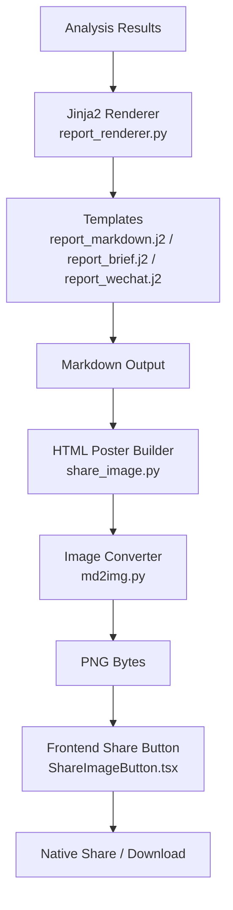
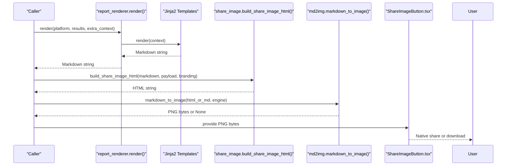
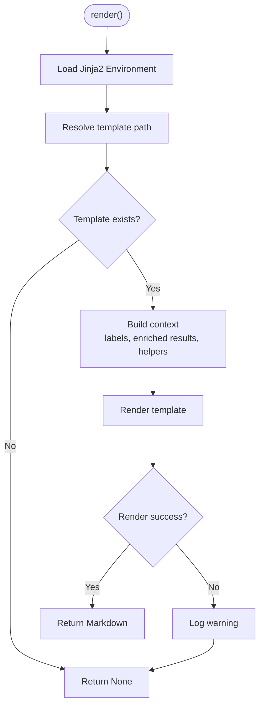
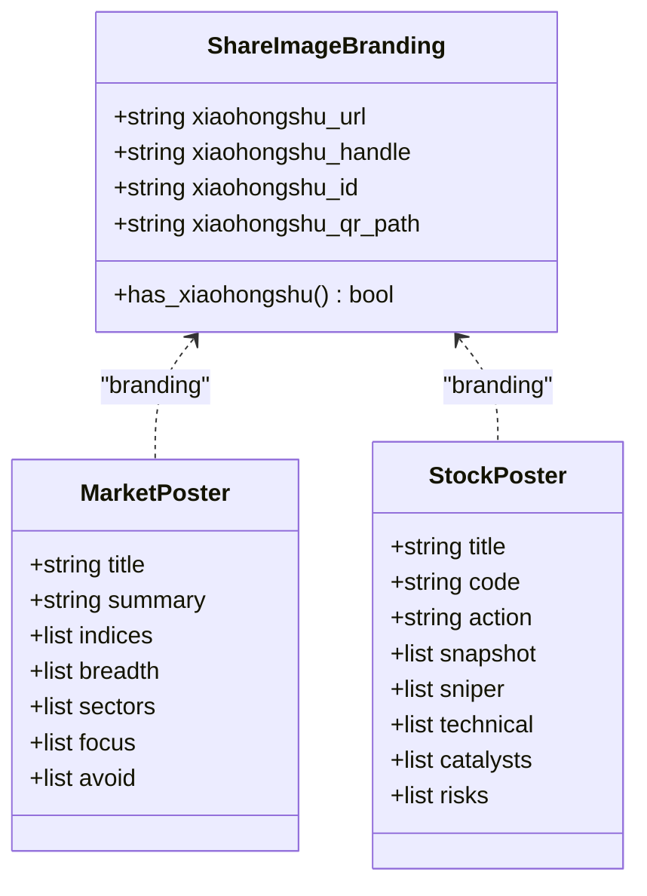
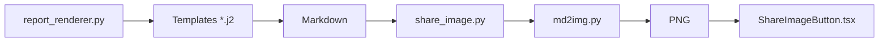

# Report Generation & Visualization

<cite>
**Referenced Files in This Document**
- [report_renderer.py](file://src/services/report_renderer.py)
- [report_markdown.j2](file://templates/report_markdown.j2)
- [report_brief.j2](file://templates/report_brief.j2)
- [report_wechat.j2](file://templates/report_wechat.j2)
- [_macros.j2](file://templates/_macros.j2)
- [md2img.py](file://src/md2img.py)
- [share_image.py](file://src/share_image.py)
- [ReportMarkdown.tsx](file://apps/dsa-web/src/components/report/ReportMarkdown.tsx)
- [ReportMarkdownPanel.tsx](file://apps/dsa-web/src/components/report/ReportMarkdownPanel.tsx)
- [ReportMarkdownBody.tsx](file://apps/dsa-web/src/components/report/ReportMarkdownBody.tsx)
- [ShareImageButton.tsx](file://apps/dsa-web/src/components/report/ShareImageButton.tsx)
- [markdown.ts](file://apps/dsa-web/src/utils/markdown.ts)
</cite>

## Table of Contents
1. Introduction
2. Project Structure
3. Core Components
4. Architecture Overview
5. Detailed Component Analysis
6. Dependency Analysis
7. Performance Considerations
8. Troubleshooting Guide
9. Conclusion
10. Appendices

## Introduction
This document explains the report generation and visualization system, including the markdown rendering engine, chart integration points, image sharing capabilities, template system, customization options, export formats (PNG images and web shares), and operational considerations such as accessibility, print optimization, and cross-browser compatibility. It also provides guidance for creating custom templates, integrating additional chart libraries, and automating report scheduling.

## Project Structure
The reporting pipeline spans backend template rendering, HTML poster generation, image conversion, and frontend display and sharing:
- Backend rendering uses Jinja2 templates to produce Markdown reports with localized labels and enriched analysis data.
- Image posters are generated from Markdown via an HTML layer that extracts structured fields and renders a compact share card.
- Image conversion supports multiple engines (wkhtmltoimage, markdown-to-file, Playwright).
- The frontend displays Markdown reports, copies plain text or source, and generates shareable PNGs via native sharing or download.

**Diagram sources**
- [report_renderer.py:93-266](file://src/services/report_renderer.py#L93-L266)
- [report_markdown.j2:1-251](file://templates/report_markdown.j2#L1-L251)
- [report_brief.j2:1-22](file://templates/report_brief.j2#L1-L22)
- [report_wechat.j2:1-105](file://templates/report_wechat.j2#L1-L105)
- [share_image.py:1-200](file://src/share_image.py#L1-L200)
- [md2img.py:211-257](file://src/md2img.py#L211-L257)
- [ShareImageButton.tsx:92-163](file://apps/dsa-web/src/components/report/ShareImageButton.tsx#L92-L163)

**Section sources**
- [report_renderer.py:93-266](file://src/services/report_renderer.py#L93-L266)
- [md2img.py:211-257](file://src/md2img.py#L211-L257)
- [share_image.py:1-200](file://src/share_image.py#L1-L200)
- [ShareImageButton.tsx:92-163](file://apps/dsa-web/src/components/report/ShareImageButton.tsx#L92-L163)

## Core Components
- Report renderer: Builds a rich context from analysis results, localizes labels, sorts signals, and renders Jinja2 templates to Markdown.
- Templates: Provide platform-specific layouts (full markdown, brief summary, WeChat-friendly).
- HTML poster builder: Parses Markdown sections and tables, merges structured overlays, and builds a share-ready HTML document with branding and QR assets.
- Image converter: Converts Markdown/HTML to PNG using configurable engines with fallbacks and timeouts.
- Frontend components: Render Markdown, copy content, and generate/share PNGs via native APIs or downloads.

**Section sources**
- [report_renderer.py:93-266](file://src/services/report_renderer.py#L93-L266)
- [report_markdown.j2:1-251](file://templates/report_markdown.j2#L1-L251)
- [report_brief.j2:1-22](file://templates/report_brief.j2#L1-L22)
- [report_wechat.j2:1-105](file://templates/report_wechat.j2#L1-L105)
- [share_image.py:1-200](file://src/share_image.py#L1-L200)
- [md2img.py:211-257](file://src/md2img.py#L211-L257)
- [ReportMarkdownPanel.tsx:19-83](file://apps/dsa-web/src/components/report/ReportMarkdownPanel.tsx#L19-L83)
- [ShareImageButton.tsx:92-163](file://apps/dsa-web/src/components/report/ShareImageButton.tsx#L92-L163)

## Architecture Overview
The system follows a clear separation of concerns:
- Data enrichment and localization occur before templating.
- Templates output deterministic Markdown contracts consumed by both human readers and automated poster builders.
- Poster building is robust against missing fields and merges structured overlays without losing Markdown fallbacks.
- Image conversion is resilient with multiple engines and safe defaults.

**Diagram sources**
- [report_renderer.py:93-266](file://src/services/report_renderer.py#L93-L266)
- [share_image.py:1-200](file://src/share_image.py#L1-L200)
- [md2img.py:211-257](file://src/md2img.py#L211-L257)
- [ShareImageButton.tsx:92-163](file://apps/dsa-web/src/components/report/ShareImageButton.tsx#L92-L163)

## Detailed Component Analysis

### Markdown Rendering Engine
- Purpose: Convert analysis results into platform-specific Markdown using Jinja2.
- Key behaviors:
  - Resolves template directory relative to project root and selects template by platform.
  - Normalizes report language and enriches each result with localized labels, signal levels, and trend predictions.
  - Aggregates counts (buy/sell/hold), models used, market status line, and helper functions for templates.
  - Uses autoescape disabled for controlled HTML injection where needed; safe helpers escape sensitive values.
- Error handling: Returns None on import errors or template not found/render exceptions; callers should fallback.

**Diagram sources**
- [report_renderer.py:93-266](file://src/services/report_renderer.py#L93-L266)

**Section sources**
- [report_renderer.py:93-266](file://src/services/report_renderer.py#L93-L266)

### Report Template System
- Templates:
  - Full markdown report with detailed sections (summary, core conclusion, data perspective, phase decision, strategy synthesis, battle plan, history comparison).
  - Brief summary optimized for quick consumption.
  - WeChat-friendly layout with concise bullets and truncated fields.
- Customization:
  - Add new platforms by adding a corresponding template file named report_<platform>.j2.
  - Use provided helpers and localized labels injected by the renderer.
  - Extend context via extra_context when calling render().
- Example usage patterns:
  - Generate a full markdown report for archival or PDF conversion.
  - Generate a brief summary for chat notifications.
  - Generate a WeChat-friendly version for messaging apps.

**Section sources**
- [report_markdown.j2:1-251](file://templates/report_markdown.j2#L1-L251)
- [report_brief.j2:1-22](file://templates/report_brief.j2#L1-L22)
- [report_wechat.j2:1-105](file://templates/report_wechat.j2#L1-L105)
- [report_renderer.py:93-266](file://src/services/report_renderer.py#L93-L266)

### Chart Integration
- Reports embed structured data (tables, metrics) rather than interactive charts. Charts are rendered in other UI pages using Recharts.
- For embedding charts in reports:
  - Include chart data as Markdown tables or structured payloads within dashboard fields so the poster builder can merge them into share cards.
  - If you need visual charts in exported images, consider generating SVG/PNG charts server-side and embedding base64 images in Markdown or HTML posters.

[No sources needed since this section provides general guidance]

### Image Sharing Capabilities
- HTML poster builder:
  - Extracts sections and tables from Markdown, normalizes labels, merges structured overlays, and produces a share-ready HTML document with branding and optional QR codes.
  - Supports multi-language chrome and locale-aware labels.
- Image conversion:
  - Configurable engine selection: wkhtmltoimage (default), markdown-to-file (m2f), or Playwright Chromium.
  - Enforces size limits to avoid huge images and includes timeouts and error logging.
- Frontend sharing:
  - Generates PNG bytes via API or desktop runtime, then uses native share if supported; otherwise falls back to download.
  - Provides user feedback states (loading, ready, success, error) and caching to reduce redundant work.

**Diagram sources**
- [share_image.py:156-250](file://src/share_image.py#L156-L250)

**Section sources**
- [share_image.py:1-200](file://src/share_image.py#L1-L200)
- [md2img.py:211-257](file://src/md2img.py#L211-L257)
- [ShareImageButton.tsx:92-163](file://apps/dsa-web/src/components/report/ShareImageButton.tsx#L92-L163)

### Frontend Markdown Display and Utilities
- Displays Markdown with GitHub Flavored Markdown support and styled prose.
- Provides utilities to convert Markdown to plain text for clipboard copying.
- Panel fetches Markdown content, handles loading/error states, and exposes copy actions.

**Section sources**
- [ReportMarkdownBody.tsx:1-41](file://apps/dsa-web/src/components/report/ReportMarkdownBody.tsx#L1-L41)
- [markdown.ts:1-22](file://apps/dsa-web/src/utils/markdown.ts#L1-L22)
- [ReportMarkdownPanel.tsx:19-83](file://apps/dsa-web/src/components/report/ReportMarkdownPanel.tsx#L19-L83)

## Dependency Analysis
- Backend dependencies:
  - Jinja2 for templating (optional; renderer returns None if unavailable).
  - markdown2 for HTML processing in poster builder.
  - Optional external tools: wkhtmltoimage, m2f CLI, Playwright CLI.
- Frontend dependencies:
  - react-markdown with remark-gfm for rendering.
  - recharts for charts in other UI areas.
- Coupling:
  - Templates depend on renderer-injected context and helpers.
  - Poster builder depends on stable Markdown contract and structured overlays.
  - Image converter depends on configured engine availability.

**Diagram sources**
- [report_renderer.py:93-266](file://src/services/report_renderer.py#L93-L266)
- [share_image.py:1-200](file://src/share_image.py#L1-L200)
- [md2img.py:211-257](file://src/md2img.py#L211-L257)
- [ShareImageButton.tsx:92-163](file://apps/dsa-web/src/components/report/ShareImageButton.tsx#L92-L163)

**Section sources**
- [report_renderer.py:93-266](file://src/services/report_renderer.py#L93-L266)
- [share_image.py:1-200](file://src/share_image.py#L1-L200)
- [md2img.py:211-257](file://src/md2img.py#L211-L257)
- [ShareImageButton.tsx:92-163](file://apps/dsa-web/src/components/report/ShareImageButton.tsx#L92-L163)

## Performance Considerations
- Avoid large images: md2img enforces max_chars to skip conversion for oversized Markdown.
- Prefer efficient engines: m2f has better emoji support; Playwright offers consistent rendering across environments.
- Cache share images in frontend to avoid repeated conversions.
- Minimize template complexity and avoid heavy computations inside templates; precompute in renderer context.

[No sources needed since this section provides general guidance]

## Troubleshooting Guide
- Jinja2 not installed: Renderer logs a warning and returns None; ensure Jinja2 is available or handle fallback in caller.
- Template missing: Renderer logs debug message and returns None; verify template naming and path resolution.
- Image conversion failures:
  - wkhtmltoimage/wkhtmltopdf not found: Ensure binaries are installed or switch engine via configuration.
  - m2f not found: Install globally or choose another engine.
  - Playwright not found: Install Web dependencies or use alternative engine.
- Frontend sharing issues:
  - Native share unsupported: Falls back to download automatically.
  - Timeouts or network errors: Check API endpoints and environment variables.

**Section sources**
- [report_renderer.py:115-129](file://src/services/report_renderer.py#L115-L129)
- [md2img.py:37-101](file://src/md2img.py#L37-L101)
- [md2img.py:109-167](file://src/md2img.py#L109-L167)
- [md2img.py:169-208](file://src/md2img.py#L169-L208)
- [ShareImageButton.tsx:125-163](file://apps/dsa-web/src/components/report/ShareImageButton.tsx#L125-L163)

## Conclusion
The reporting system combines flexible Jinja2 templates, robust HTML poster generation, and resilient image conversion to deliver high-quality Markdown reports and shareable images. It supports multiple platforms, languages, and export targets while maintaining performance and reliability. Extending the system involves adding templates, leveraging existing helpers, and configuring image engines appropriately.

[No sources needed since this section summarizes without analyzing specific files]

## Appendices

### Creating Custom Report Templates
- Add a new template file named report_<your_platform>.j2 under the templates directory.
- Use the context keys provided by the renderer (e.g., results, enriched, labels, market_status_line, helpers).
- Keep templates focused and avoid heavy logic; rely on renderer-provided helpers for localization and formatting.

**Section sources**
- [report_renderer.py:121-139](file://src/services/report_renderer.py#L121-L139)
- [report_markdown.j2:1-251](file://templates/report_markdown.j2#L1-L251)

### Integrating Additional Chart Libraries
- For static charts in reports, generate SVG or base64-encoded images and embed them in Markdown or HTML posters.
- For interactive charts in the web UI, integrate Recharts components in relevant pages and pass structured data from analysis results.

[No sources needed since this section provides general guidance]

### Automated Report Scheduling
- Schedule calls to the report renderer at desired intervals (e.g., daily) to produce Markdown and images.
- Route outputs to notification channels or storage based on platform preferences.
- Use the same template and context to ensure consistency across scheduled and on-demand reports.

[No sources needed since this section provides general guidance]

### Accessibility Compliance
- Use semantic headings and lists in templates for screen reader compatibility.
- Provide alt text for any embedded images in Markdown.
- Ensure sufficient color contrast in shared posters and UI elements.

[No sources needed since this section provides general guidance]

### Print Optimization
- Prefer Markdown output for printing workflows; convert to PDF using your preferred toolchain.
- Keep posters concise to fit standard page sizes; adjust width and quality settings in image converters if needed.

[No sources needed since this section provides general guidance]

### Cross-Browser Compatibility
- Use Playwright engine for consistent rendering across environments.
- Test native sharing behavior on mobile vs desktop; fall back to download when unsupported.
- Validate Markdown rendering across browsers using react-markdown and GFM plugins.

[No sources needed since this section provides general guidance]