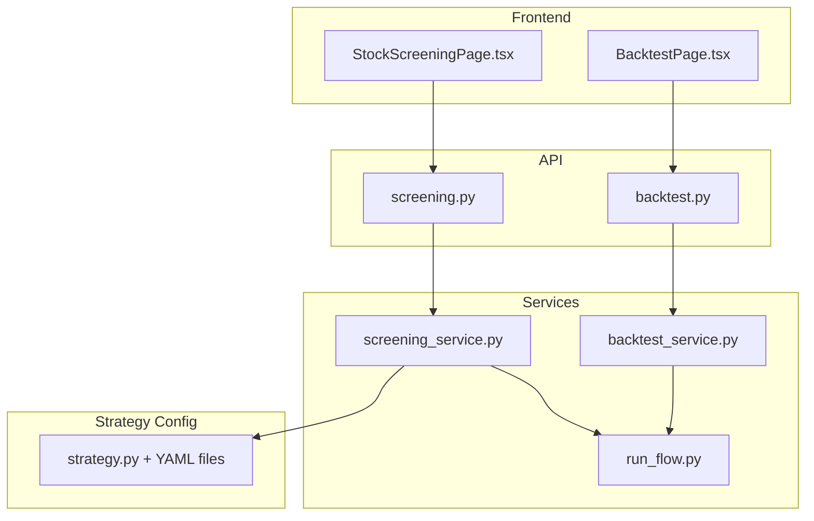
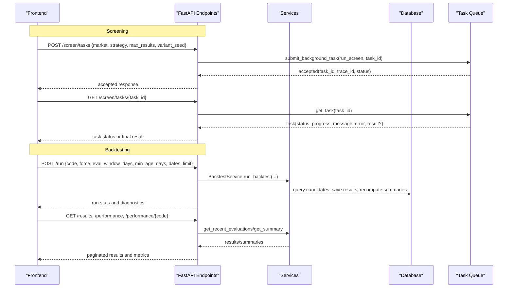
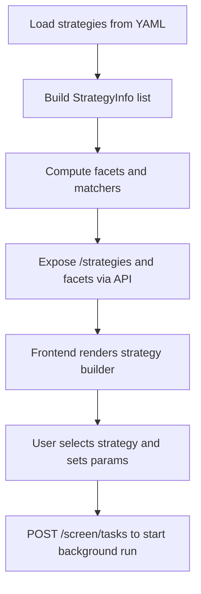
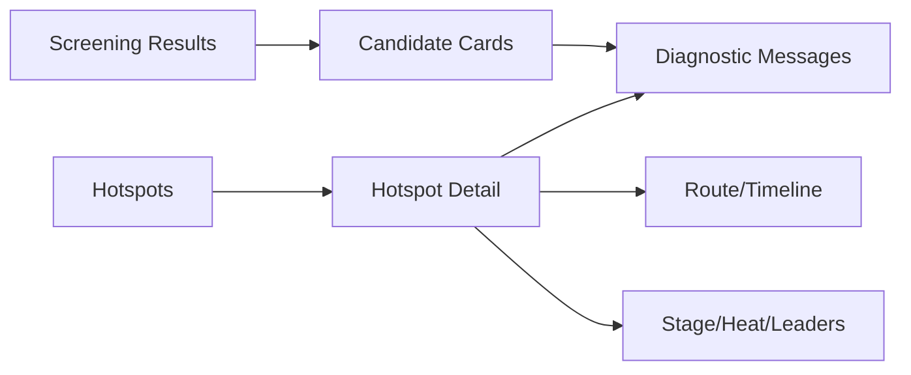
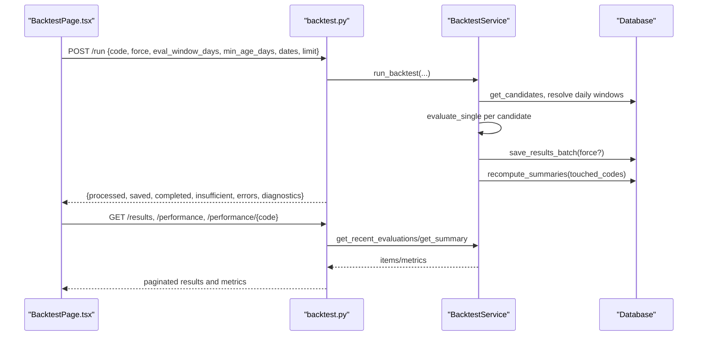
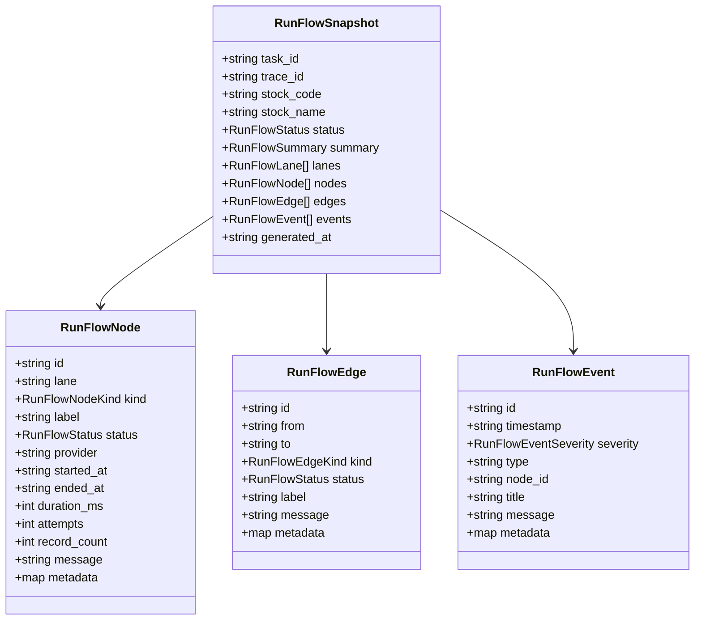
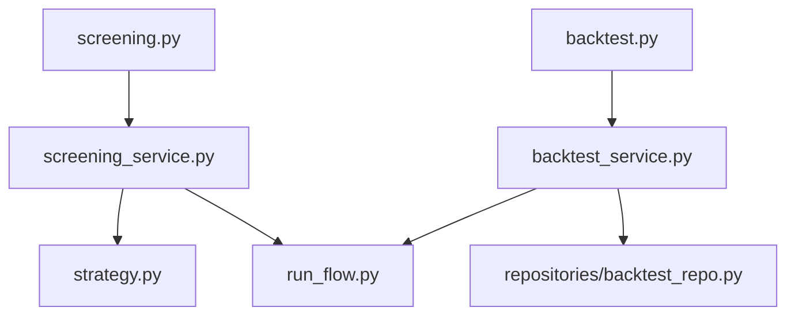

# Screening & Backtesting Interface

<cite>
**Referenced Files in This Document**
- [screening.py](file://api/v1/endpoints/screening.py)
- [backtest.py](file://api/v1/endpoints/backtest.py)
- [screening_service.py](file://src/services/screening_service.py)
- [backtest_service.py](file://src/services/backtest_service.py)
- [strategy.py](file://src/services/screening/strategy.py)
- [run_flow.py](file://src/services/run_flow.py)
- [run_flow_schema.py](file://api/v1/schemas/run_flow.py)
- [StockScreeningPage.tsx](file://apps/dsa-web/src/pages/StockScreeningPage.tsx)
- [BacktestPage.tsx](file://apps/dsa-web/src/pages/BacktestPage.tsx)
</cite>

## Table of Contents
1. [Introduction](#introduction)
2. [Project Structure](#project-structure)
3. [Core Components](#core-components)
4. [Architecture Overview](#architecture-overview)
5. [Detailed Component Analysis](#detailed-component-analysis)
6. [Dependency Analysis](#dependency-analysis)
7. [Performance Considerations](#performance-considerations)
8. [Troubleshooting Guide](#troubleshooting-guide)
9. [Conclusion](#conclusion)
10. [Appendices](#appendices)

## Introduction
This document explains the stock screening and backtesting interfaces, focusing on:
- Visual strategy builder and parameter configuration for screening
- Result visualization components for both screening and backtesting
- Run flow graph for pipeline execution, progress tracking, and debugging
- Examples for creating custom screening criteria, configuring backtesting parameters, and exporting results
- Performance considerations for complex strategies and large datasets

## Project Structure
The feature spans API endpoints, services, frontend pages, and run-flow utilities:
- API layer exposes REST endpoints for screening and backtesting
- Services implement business logic, orchestration, and data access
- Frontend pages provide interactive UIs for strategy selection, parameter tuning, result viewing, and export
- Run-flow utilities build a visual graph of task execution from tasks or history records

**Diagram sources**
- [screening.py:133-217](file://api/v1/endpoints/screening.py#L133-L217)
- [backtest.py:45-140](file://api/v1/endpoints/backtest.py#L45-L140)
- [screening_service.py:1-120](file://src/services/screening_service.py#L1-L120)
- [backtest_service.py:35-110](file://src/services/backtest_service.py#L35-L110)
- [strategy.py:189-270](file://src/services/screening/strategy.py#L189-L270)
- [run_flow.py:77-180](file://src/services/run_flow.py#L77-L180)

**Section sources**
- [screening.py:133-217](file://api/v1/endpoints/screening.py#L133-L217)
- [backtest.py:45-140](file://api/v1/endpoints/backtest.py#L45-L140)
- [StockScreeningPage.tsx:1-120](file://apps/dsa-web/src/pages/StockScreeningPage.tsx#L1-L120)
- [BacktestPage.tsx:246-368](file://apps/dsa-web/src/pages/BacktestPage.tsx#L246-L368)

## Core Components
- Screening API:
  - Start background screen task with strategy, market, max results, and variant seed
  - Poll task status and retrieve results
  - List available strategies and hotspots
- Backtesting API:
  - Run backtest over historical analysis records with filters (code, date range, evaluation window)
  - Retrieve paginated results and overall/per-stock performance summaries
- Strategy Builder:
  - Load strategies from YAML with hard filters, scoring/risk/portfolio profiles, factor weights, and metadata
  - Provide facets and matching to help users select or compare strategies
- Run Flow Graph:
  - Build a node-edge-event graph representing request, queue, data sources, analysis, artifacts, notifications
  - Support live task snapshots and historical record snapshots

**Section sources**
- [screening.py:23-61](file://api/v1/endpoints/screening.py#L23-L61)
- [backtest.py:28-86](file://api/v1/endpoints/backtest.py#L28-L86)
- [strategy.py:189-270](file://src/services/screening/strategy.py#L189-L270)
- [run_flow.py:22-38](file://src/services/run_flow.py#L22-L38)

## Architecture Overview
End-to-end flows for screening and backtesting:

**Diagram sources**
- [screening.py:133-217](file://api/v1/endpoints/screening.py#L133-L217)
- [backtest.py:45-140](file://api/v1/endpoints/backtest.py#L45-L140)
- [backtest_service.py:45-110](file://src/services/backtest_service.py#L45-L110)

## Detailed Component Analysis

### Screening: Visual Strategy Builder and Parameter Configuration
- Strategy catalog and facets:
  - Strategies are loaded from YAML with metadata, categories, tags, style, and required fields
  - Facets expose filterable dimensions like category, risk profile, holding period, execution style, capital profile, market regime, data requirements, and tags
- Parameter configuration:
  - Market scope, hard filters, factor weights, scoring/risk/portfolio profiles, event preferences, ranking hints, and output limits
- UI integration:
  - Frontend lists strategies, allows filtering by facets, and shows data requirements and active filters
  - Users can start a screen task with selected strategy, market, max results, and optional variant seed

**Diagram sources**
- [strategy.py:189-270](file://src/services/screening/strategy.py#L189-L270)
- [strategy.py:287-412](file://src/services/screening/strategy.py#L287-L412)
- [screening.py:81-86](file://api/v1/endpoints/screening.py#L81-L86)
- [screening.py:133-184](file://api/v1/endpoints/screening.py#L133-L184)

**Section sources**
- [strategy.py:189-270](file://src/services/screening/strategy.py#L189-L270)
- [strategy.py:287-412](file://src/services/screening/strategy.py#L287-L412)
- [screening.py:81-86](file://api/v1/endpoints/screening.py#L81-L86)
- [StockScreeningPage.tsx:1-120](file://apps/dsa-web/src/pages/StockScreeningPage.tsx#L1-L120)

### Screening: Result Visualization and Hotspot Details
- Results include candidate stocks with scores, factors, post-analysis tags, signals, and LLM insights when available
- Hotspot module provides topic-level heat, stage, leaders, and timeline; supports caching, fallbacks, and search augmentation
- UI displays:
  - Candidate tables with factor breakdowns and reasons
  - Hotspot cards with quality indicators, missing fields, and route/timeline details
  - Diagnostic messages for source fallbacks and transient errors

**Diagram sources**
- [screening_service.py:270-338](file://src/services/screening_service.py#L270-L338)
- [screening_service.py:747-768](file://src/services/screening_service.py#L747-L768)
- [StockScreeningPage.tsx:441-754](file://apps/dsa-web/src/pages/StockScreeningPage.tsx#L441-L754)

**Section sources**
- [screening_service.py:270-338](file://src/services/screening_service.py#L270-L338)
- [screening_service.py:747-768](file://src/services/screening_service.py#L747-L768)
- [StockScreeningPage.tsx:441-754](file://apps/dsa-web/src/pages/StockScreeningPage.tsx#L441-L754)

### Backtesting: Parameter Configuration and Execution Flow
- Parameters:
  - Code filter, evaluation window days, minimum age days, analysis date range, limit, and force rerun
- Execution:
  - Validates inputs, resolves candidates, ensures daily data windows, evaluates outcomes, saves results, recomputes summaries
- Outputs:
  - Paginated results with action labels, trend predictions, actual movement, direction accuracy, outcome, and status
  - Overall and per-stock performance metrics including win rate, direction accuracy, stop-loss/take-profit triggers, and phase breakdown

**Diagram sources**
- [backtest.py:45-140](file://api/v1/endpoints/backtest.py#L45-L140)
- [backtest_service.py:45-110](file://src/services/backtest_service.py#L45-L110)
- [backtest_service.py:499-560](file://src/services/backtest_service.py#L499-L560)
- [BacktestPage.tsx:370-405](file://apps/dsa-web/src/pages/BacktestPage.tsx#L370-L405)

**Section sources**
- [backtest.py:45-140](file://api/v1/endpoints/backtest.py#L45-L140)
- [backtest_service.py:45-110](file://src/services/backtest_service.py#L45-L110)
- [BacktestPage.tsx:370-405](file://apps/dsa-web/src/pages/BacktestPage.tsx#L370-L405)

### Run Flow Graph: Pipeline Execution, Progress Tracking, Debugging
- Live task snapshot:
  - Builds nodes for request, queue, analysis pipeline; edges show control/data transitions; events capture provider runs, LLM calls, history saves, notifications
- Historical snapshot:
  - Reconstructs context pack, provider runs, LLM runs, history saves, and notifications from persisted diagnostics and context snapshots
- Status mapping:
  - Maps internal statuses to flow statuses such as pending, running, success, failed, degraded, fallback, timeout, cancel_requested, cancelled, skipped, unknown

**Diagram sources**
- [run_flow_schema.py:40-120](file://api/v1/schemas/run_flow.py#L40-L120)
- [run_flow.py:77-180](file://src/services/run_flow.py#L77-L180)

**Section sources**
- [run_flow.py:77-180](file://src/services/run_flow.py#L77-L180)
- [run_flow_schema.py:40-120](file://api/v1/schemas/run_flow.py#L40-L120)

### Creating Custom Screening Criteria
- Add a new YAML strategy file under the strategies directory with:
  - name, display_name, description, version, category, tags, analysis_skills, style
  - screening.enabled, market_scope, hard_filters, tech_weight, factor_weights, scoring_profile, risk_profile, portfolio_profile, scorecard_profile, event_profile, ranking_hints, max_output
- The loader validates keys and builds StrategyInfo used by the strategy catalog and UI facets
- Example steps:
  - Create a YAML defining hard filters (e.g., price ranges, market cap thresholds), factor weights (e.g., momentum, value, stability), and risk profile (e.g., chase/breakdown penalties)
  - Enable the strategy and set market_scope to target markets
  - Use the strategy selector in the UI to pick your custom strategy and adjust max_results and variant_seed

**Section sources**
- [strategy.py:189-270](file://src/services/screening/strategy.py#L189-L270)
- [strategy.py:287-412](file://src/services/screening/strategy.py#L287-L412)

### Configuring Backtesting Parameters
- Use the BacktestPage controls to:
  - Filter by code, evaluation window days, analysis date range, and phase
  - Toggle force rerun to overwrite existing results
  - Run backtest and view run summary with processed/saved/completed/insufficient/errors counts
- Backend enforces validation and returns diagnostics explaining empty results or insufficient data

**Section sources**
- [BacktestPage.tsx:246-368](file://apps/dsa-web/src/pages/BacktestPage.tsx#L246-L368)
- [backtest.py:45-86](file://api/v1/endpoints/backtest.py#L45-L86)
- [backtest_service.py:45-110](file://src/services/backtest_service.py#L45-L110)

### Exporting Results
- Screening:
  - Results include candidate objects with scores, factors, tags, signals, and LLM insights; UI supports displaying and inspecting these fields for export
- Backtesting:
  - Paginated results and performance summaries are returned via API; UI presents them in tables and metric cards suitable for export
- Run flow:
  - Snapshots contain structured nodes, edges, and events that can be exported for debugging and reporting

[No sources needed since this section provides general guidance]

## Dependency Analysis
Key dependencies and coupling:
- API endpoints depend on services for business logic and persistence
- Screening service depends on strategy loader, pipeline, and hotspot utilities
- Backtest service depends on repository layer and backtest engine
- Run flow utilities depend on diagnostics and context packs to construct graphs

**Diagram sources**
- [screening.py:133-217](file://api/v1/endpoints/screening.py#L133-L217)
- [backtest.py:45-140](file://api/v1/endpoints/backtest.py#L45-L140)
- [screening_service.py:1-120](file://src/services/screening_service.py#L1-L120)
- [backtest_service.py:35-110](file://src/services/backtest_service.py#L35-L110)
- [run_flow.py:77-180](file://src/services/run_flow.py#L77-L180)

**Section sources**
- [screening.py:133-217](file://api/v1/endpoints/screening.py#L133-L217)
- [backtest.py:45-140](file://api/v1/endpoints/backtest.py#L45-L140)
- [screening_service.py:1-120](file://src/services/screening_service.py#L1-L120)
- [backtest_service.py:35-110](file://src/services/backtest_service.py#L35-L110)
- [run_flow.py:77-180](file://src/services/run_flow.py#L77-L180)

## Performance Considerations
- Screening:
  - Background task submission avoids blocking requests; polling interval balances responsiveness and load
  - Hotspot caching reduces repeated external calls; stale cache fallback improves resilience
  - Source priority and retries mitigate slow or failing providers
- Backtesting:
  - Evaluation window and date range filters reduce candidate sets
  - Batch saving and summary recomputation minimize database writes
  - Phase-filtered queries enforce row limits to avoid heavy computations
- Run flow:
  - Sanitized metadata and bounded durations keep graphs lightweight
  - Event-driven updates enable efficient debugging without full reprocessing

[No sources needed since this section provides general guidance]

## Troubleshooting Guide
Common issues and resolutions:
- Screening task not found or expired:
  - Ensure task_id is valid and within retention; check backend logs for upstream timeouts or network failures
- Insufficient daily data for backtesting:
  - Adjust evaluation window or ensure daily K-line coverage; use force rerun if necessary
- Empty results due to no matching analysis:
  - Verify code, date range, and minimum age days; confirm historical analysis exists
- Hotspot data unavailable:
  - Check connectivity markers and cached availability; refresh to fetch live data

**Section sources**
- [screening.py:68-73](file://api/v1/endpoints/screening.py#L68-L73)
- [backtest_service.py:450-497](file://src/services/backtest_service.py#L450-L497)
- [screening_service.py:794-800](file://src/services/screening_service.py#L794-L800)

## Conclusion
The screening and backtesting interfaces provide a comprehensive workflow:
- A flexible strategy builder powered by YAML configurations enables custom criteria and rich metadata
- Robust APIs support background screening tasks and iterative backtesting with clear diagnostics
- Run flow graphs offer deep visibility into pipeline execution, aiding debugging and performance tuning
- Frontend components present actionable insights and facilitate result export for further analysis

[No sources needed since this section summarizes without analyzing specific files]

## Appendices
- Example strategy YAML structure references:
  - Hard filters, factor weights, scoring/risk/portfolio profiles, event preferences
- API contracts:
  - Screening task acceptance and status models
  - Backtest run request/response and result pagination models
  - Run flow snapshot schema for nodes, edges, and events

[No sources needed since this section provides general guidance]