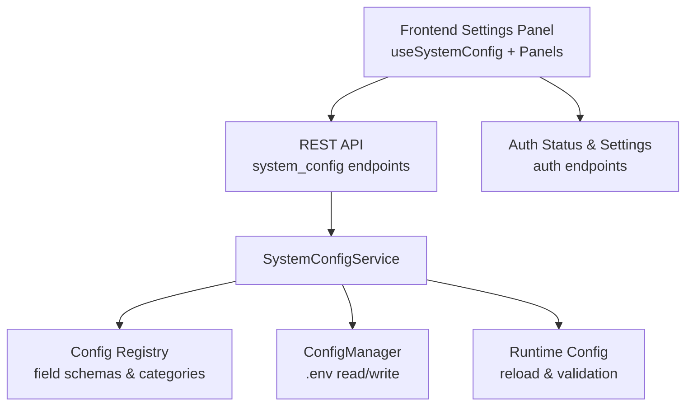
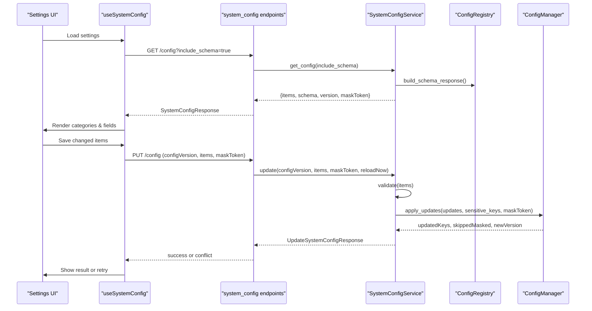
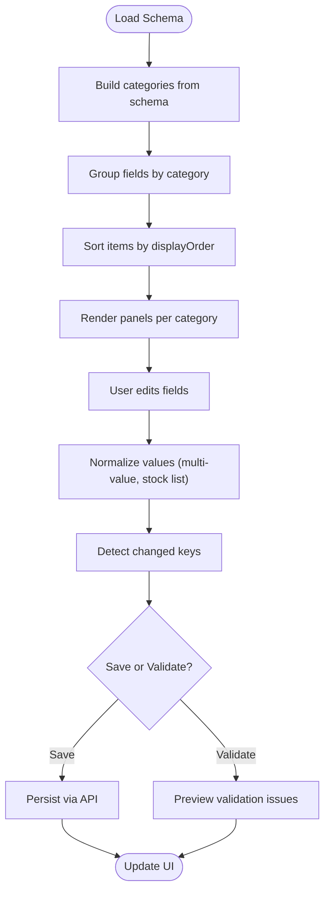
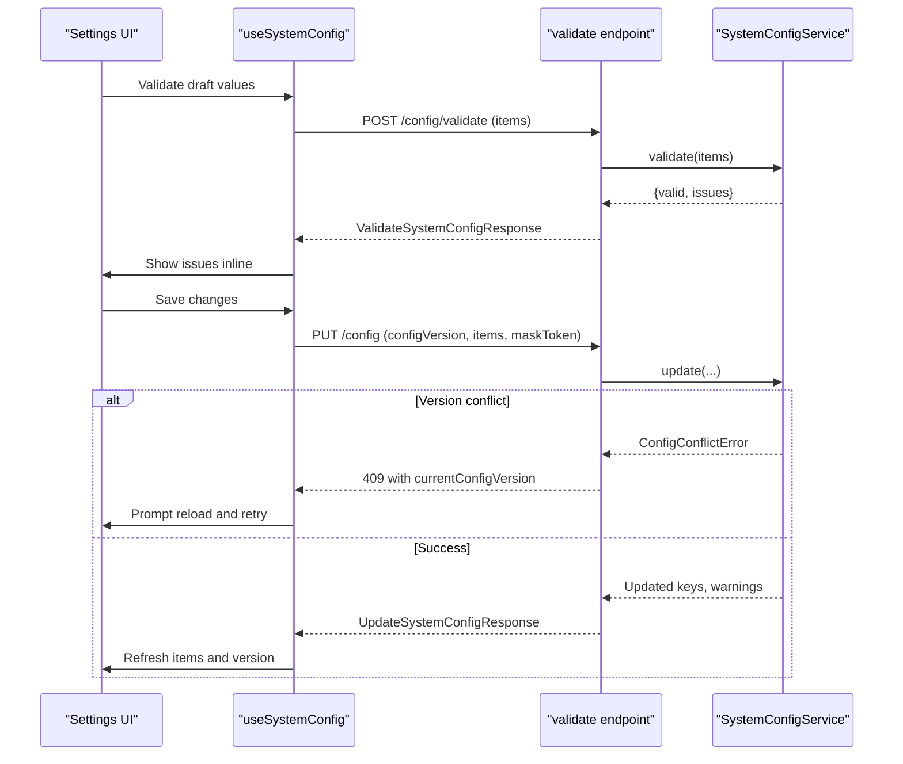
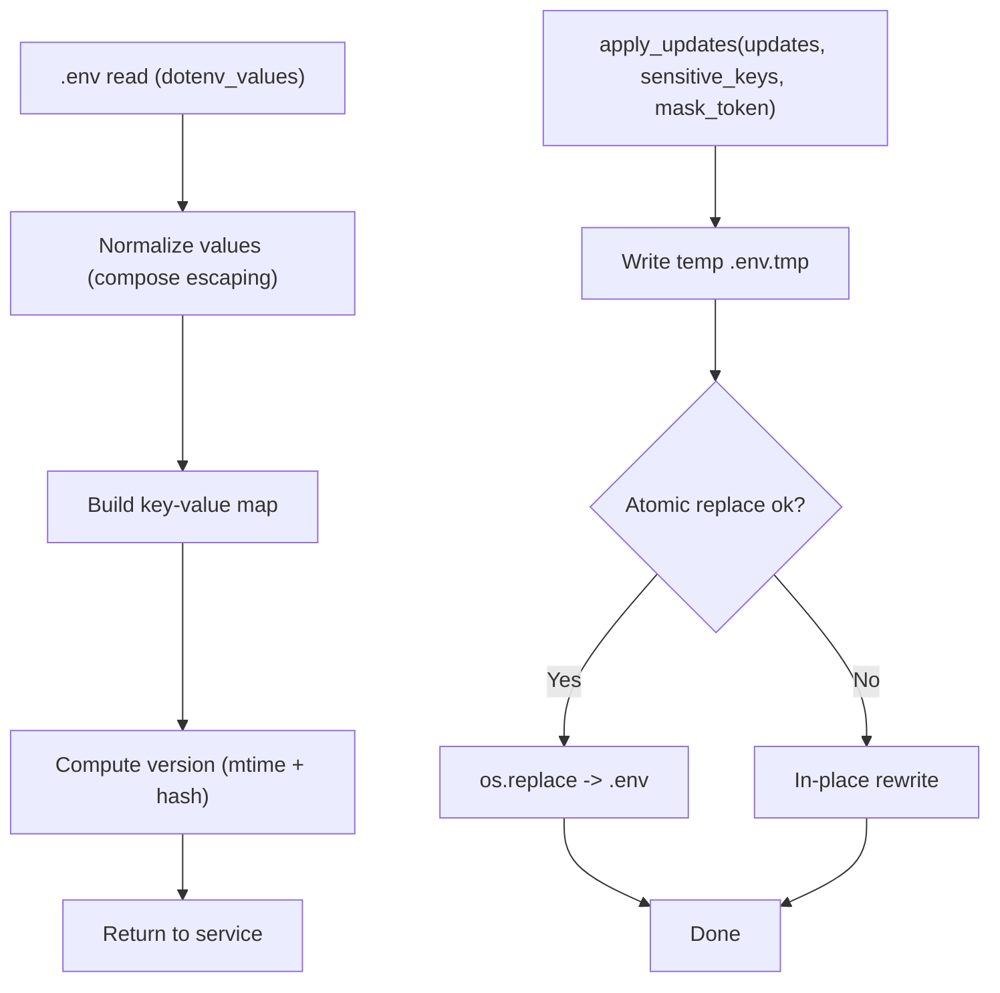
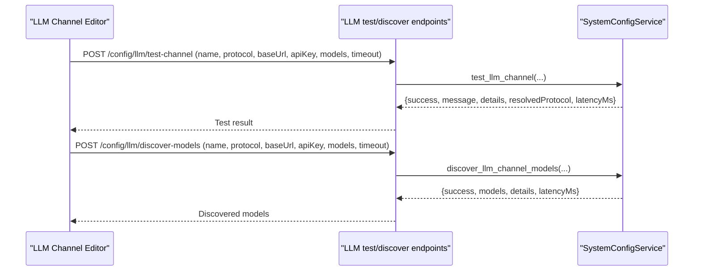
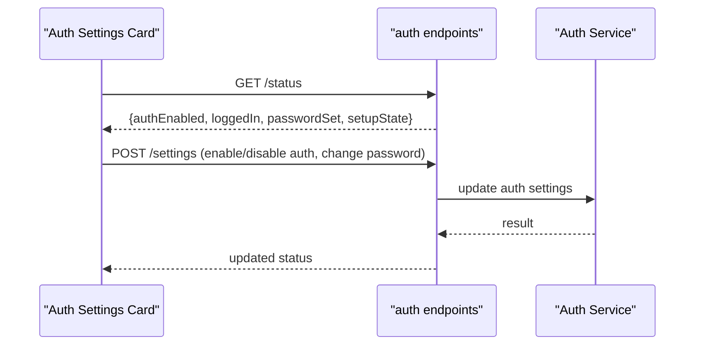
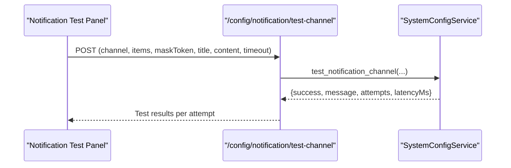
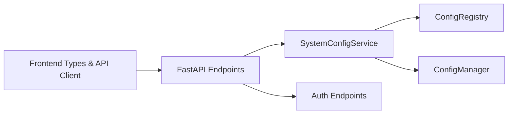

# Settings & Configuration Interface

<cite>
**Referenced Files in This Document**
- [config_manager.py](file://src/core/config_manager.py)
- [config_registry.py](file://src/core/config_registry.py)
- [system_config_service.py](file://src/services/system_config_service.py)
- [system_config.py](file://api/v1/endpoints/system_config.py)
- [useSystemConfig.ts](file://apps\dsa-web\src\hooks\useSystemConfig.ts)
- [systemConfig.ts](file://apps\dsa-web\src\types\systemConfig.ts)
- [systemConfig.ts](file://apps\dsa-web\src\api\systemConfig.ts)
- [SettingsField.tsx](file://apps\dsa-web\src\components\settings\SettingsField.tsx)
- [LLMChannelEditor.tsx](file://apps\dsa-web\src\components\settings\LLMChannelEditor.tsx)
- [NotificationTestPanel.tsx](file://apps\dsa-web\src\components\settings\NotificationTestPanel.tsx)
- [AuthSettingsCard.tsx](file://apps\dsa-web\src\components\settings\AuthSettingsCard.tsx)
- [auth.py](file://api/v1/endpoints/auth.py)
</cite>

## Table of Contents
1. [Introduction](#introduction)
2. [Project Structure](#project-structure)
3. [Core Components](#core-components)
4. [Architecture Overview](#architecture-overview)
5. [Detailed Component Analysis](#detailed-component-analysis)
6. [Dependency Analysis](#dependency-analysis)
7. [Performance Considerations](#performance-considerations)
8. [Troubleshooting Guide](#troubleshooting-guide)
9. [Conclusion](#conclusion)
10. [Appendices](#appendices)

## Introduction
This document explains the settings and configuration interface for the application. It covers the modular settings panel system, form validation, configuration persistence, LLM provider configuration, authentication setup, notification channel configuration, and system preferences. It also provides guidance on adding new settings categories, implementing custom validators, handling configuration migrations, securing sensitive data, and improving user experience.

## Project Structure
The settings system spans backend services, API endpoints, a configuration registry, and a dynamic frontend panel:

- Backend configuration storage and persistence: `src/core/config_manager.py`
- Field metadata, categories, and UI hints: `src/core/config_registry.py`
- Service layer for reading, validating, updating, testing channels, and exporting/importing config: `src/services/system_config_service.py`
- REST API surface for configuration operations: `api/v1/endpoints/system_config.py`
- Frontend types, API client, and hook for stateful settings management: `apps/dsa-web/src/types/systemConfig.ts`, `apps/dsa-web/src/api/systemConfig.ts`, `apps/dsa-web/src/hooks/useSystemConfig.ts`
- Dynamic settings panels for LLM channels, notifications, and auth: `apps/dsa-web/src/components/settings/LLMChannelEditor.tsx`, `NotificationTestPanel.tsx`, `AuthSettingsCard.tsx`
- Authentication status and settings endpoints: `api/v1/endpoints/auth.py`

**Diagram sources**
- [system_config.py:130-161](file://api/v1/endpoints/system_config.py#L130-L161)
- [system_config_service.py:130-200](file://src/services/system_config_service.py#L130-L200)
- [config_manager.py:112-176](file://src/core/config_manager.py#L112-L176)
- [config_registry.py:22-71](file://src/core/config_registry.py#L22-L71)
- [useSystemConfig.ts:71-161](file://apps\dsa-web\src\hooks\useSystemConfig.ts#L71-L161)

**Section sources**
- [system_config.py:130-161](file://api/v1/endpoints/system_config.py#L130-L161)
- [system_config_service.py:130-200](file://src/services/system_config_service.py#L130-L200)
- [config_manager.py:112-176](file://src/core/config_manager.py#L112-L176)
- [config_registry.py:22-71](file://src/core/config_registry.py#L22-L71)
- [useSystemConfig.ts:71-161](file://apps\dsa-web\src\hooks\useSystemConfig.ts#L71-L161)

## Core Components
- Configuration persistence: Atomic `.env` updates with versioning and masking of sensitive values.
- Schema-driven UI: Categories, field metadata, validation rules, and display hints drive dynamic rendering.
- Service layer: Validates, updates, imports, exports, tests LLM and notification channels, and previews backend status without persisting changes.
- Frontend state: Tracks draft values, dirty keys, masked tokens, categories, and validation issues; persists via optimistic save and conflict resolution.

Key responsibilities:
- `ConfigManager`: Reads/writes `.env`, computes version, handles atomic writes, and masks sensitive fields.
- `SystemConfigService`: Orchestrates validation, updates, import/export, channel tests, and runtime reloads.
- `ConfigRegistry`: Declares categories, field definitions, options, validation hints, help links, and examples.
- Frontend `useSystemConfig`: Manages UI state, normalizes multi-value fields, detects changes, saves, and handles conflicts.

**Section sources**
- [config_manager.py:112-290](file://src/core/config_manager.py#L112-L290)
- [system_config_service.py:130-200](file://src/services/system_config_service.py#L130-L200)
- [config_registry.py:22-71](file://src/core/config_registry.py#L22-L71)
- [useSystemConfig.ts:71-161](file://apps\dsa-web\src\hooks\useSystemConfig.ts#L71-L161)

## Architecture Overview
The settings flow is schema-driven and service-backed:

**Diagram sources**
- [system_config.py:130-161](file://api/v1/endpoints/system_config.py#L130-L161)
- [system_config.py:364-416](file://api/v1/endpoints/system_config.py#L364-L416)
- [system_config_service.py:2059-2091](file://src/services/system_config_service.py#L2059-L2091)
- [config_manager.py:177-216](file://src/core/config_manager.py#L177-L216)
- [useSystemConfig.ts:282-311](file://apps\dsa-web\src\hooks\useSystemConfig.ts#L282-L311)

## Detailed Component Analysis

### Modular Settings Panel System
- Categories are defined centrally and rendered dynamically based on schema metadata. The frontend groups fields by category and sorts them using display order.
- Fields render according to their `uiControl` type: text, password, number, select, textarea, switch, time.
- Multi-value fields (e.g., comma-separated lists) are normalized on save and displayed consistently.
- Help content and documentation links are surfaced per field via `help_key`, `examples`, and `docs`.

**Diagram sources**
- [useSystemConfig.ts:28-48](file://apps\dsa-web\src\hooks\useSystemConfig.ts#L28-L48)
- [useSystemConfig.ts:55-69](file://apps\dsa-web\src\hooks\useSystemConfig.ts#L55-L69)
- [useSystemConfig.ts:92-108](file://apps\dsa-web\src\hooks\useSystemConfig.ts#L92-L108)
- [useSystemConfig.ts:163-174](file://apps\dsa-web\src\hooks\useSystemConfig.ts#L163-L174)
- [useSystemConfig.ts:282-311](file://apps\dsa-web\src\hooks\useSystemConfig.ts#L282-L311)

**Section sources**
- [useSystemConfig.ts:28-48](file://apps\dsa-web\src\hooks\useSystemConfig.ts#L28-L48)
- [useSystemConfig.ts:55-69](file://apps\dsa-web\src\hooks\useSystemConfig.ts#L55-L69)
- [useSystemConfig.ts:92-108](file://apps\dsa-web\src\hooks\useSystemConfig.ts#L92-L108)
- [useSystemConfig.ts:163-174](file://apps\dsa-web\src\hooks\useSystemConfig.ts#L163-L174)
- [useSystemConfig.ts:282-311](file://apps\dsa-web\src\hooks\useSystemConfig.ts#L282-L311)

### Form Validation and Conflict Handling
- Pre-save validation runs server-side without writing `.env`. Issues include code, message, severity, expected/actual values.
- On save, the client sends `configVersion`; if stale, the server returns a conflict response with the current version.
- Mask token preserves existing secret values when users do not modify sensitive fields.

**Diagram sources**
- [system_config.py:537-563](file://api/v1/endpoints/system_config.py#L537-L563)
- [system_config.py:364-416](file://api/v1/endpoints/system_config.py#L364-L416)
- [system_config_service.py:2059-2091](file://src/services/system_config_service.py#L2059-L2091)
- [systemConfig.ts:180-195](file://apps\dsa-web\src\types\systemConfig.ts#L180-L195)
- [systemConfig.ts:259-265](file://apps\dsa-web\src\types\systemConfig.ts#L259-L265)

**Section sources**
- [system_config.py:537-563](file://api/v1/endpoints/system_config.py#L537-L563)
- [system_config.py:364-416](file://api/v1/endpoints/system_config.py#L364-L416)
- [system_config_service.py:2059-2091](file://src/services/system_config_service.py#L2059-L2091)
- [systemConfig.ts:180-195](file://apps\dsa-web\src\types\systemConfig.ts#L180-L195)
- [systemConfig.ts:259-265](file://apps\dsa-web\src\types\systemConfig.ts#L259-L265)

### Configuration Persistence Mechanisms
- `.env` file is read atomically and written with an atomic rename fallback to support mounted volumes.
- Sensitive keys are masked during reads/writes; mask token prevents overwriting secrets unless explicitly changed.
- Version string combines mtime and content hash to detect concurrent edits.

**Diagram sources**
- [config_manager.py:124-176](file://src/core/config_manager.py#L124-L176)
- [config_manager.py:177-216](file://src/core/config_manager.py#L177-L216)
- [config_manager.py:217-264](file://src/core/config_manager.py#L217-L264)

**Section sources**
- [config_manager.py:124-176](file://src/core/config_manager.py#L124-L176)
- [config_manager.py:177-216](file://src/core/config_manager.py#L177-L216)
- [config_manager.py:217-264](file://src/core/config_manager.py#L217-L264)

### LLM Provider Configuration
- Supports unified LiteLLM model routing, channel-based configuration, and advanced YAML routing.
- Channel editor allows configuring protocol, base URL, API keys, models, and capability checks.
- Test and discover endpoints enable pre-save validation and model discovery without persisting changes.

**Diagram sources**
- [system_config.py:566-611](file://api/v1/endpoints/system_config.py#L566-L611)
- [system_config.py:658-700](file://api/v1/endpoints/system_config.py#L658-L700)
- [system_config_service.py:130-200](file://src/services/system_config_service.py#L130-L200)

**Section sources**
- [system_config.py:566-611](file://api/v1/endpoints/system_config.py#L566-L611)
- [system_config.py:658-700](file://api/v1/endpoints/system_config.py#L658-L700)
- [system_config_service.py:130-200](file://src/services/system_config_service.py#L130-L200)

### Authentication Setup
- Auth status endpoint exposes whether authentication is enabled, logged-in state, and password setup state.
- Settings endpoints allow enabling/disabling password login and changing passwords when allowed.
- Export/import of `.env` requires explicit secure mode: desktop mode bypasses session check; otherwise admin session required.

**Diagram sources**
- [auth.py:160-199](file://api/v1/endpoints/auth.py#L160-L199)
- [system_config.py:94-127](file://api/v1/endpoints/system_config.py#L94-L127)

**Section sources**
- [auth.py:160-199](file://api/v1/endpoints/auth.py#L160-L199)
- [system_config.py:94-127](file://api/v1/endpoints/system_config.py#L94-L127)

### Notification Channel Configuration
- Dedicated test endpoint sends a short test notification using unsaved or saved configuration.
- Supports multiple channels (e.g., WeChat, Feishu, DingTalk, Telegram, Email, Pushover, Ntfy, Gotify, etc.).
- Returns attempts, stages, error codes, and latency for diagnostics.

**Diagram sources**
- [system_config.py:614-655](file://api/v1/endpoints/system_config.py#L614-L655)
- [system_config_service.py:130-200](file://src/services/system_config_service.py#L130-L200)

**Section sources**
- [system_config.py:614-655](file://api/v1/endpoints/system_config.py#L614-L655)
- [system_config_service.py:130-200](file://src/services/system_config_service.py#L130-L200)

### System Preferences
- Base settings include watchlist and foundational app settings.
- System preferences cover runtime controls like scheduling and market review regions.
- Preferences are driven by schema metadata and validated before saving.

**Section sources**
- [config_registry.py:22-71](file://src/core/config_registry.py#L22-L71)
- [config_registry.py:84-114](file://src/core/config_registry.py#L84-L114)

## Dependency Analysis
- Frontend depends on API client methods that serialize requests and parse responses.
- API endpoints depend on `SystemConfigService` for business logic and validation.
- Service depends on `ConfigRegistry` for schema and categories, and `ConfigManager` for persistence.
- Authentication endpoints gate sensitive operations and expose setup state.

**Diagram sources**
- [systemConfig.ts:180-372](file://apps\dsa-web\src\types\systemConfig.ts#L180-L372)
- [systemConfig.ts:180-372](file://apps\dsa-web\src\api\systemConfig.ts#L180-L372)
- [system_config.py:130-161](file://api/v1/endpoints/system_config.py#L130-L161)
- [system_config_service.py:130-200](file://src/services/system_config_service.py#L130-L200)
- [config_registry.py:22-71](file://src/core/config_registry.py#L22-L71)
- [config_manager.py:112-176](file://src/core/config_manager.py#L112-L176)
- [auth.py:160-199](file://api/v1/endpoints/auth.py#L160-L199)

**Section sources**
- [systemConfig.ts:180-372](file://apps\dsa-web\src\types\systemConfig.ts#L180-L372)
- [systemConfig.ts:180-372](file://apps\dsa-web\src\api\systemConfig.ts#L180-L372)
- [system_config.py:130-161](file://api/v1/endpoints/system_config.py#L130-L161)
- [system_config_service.py:130-200](file://src/services/system_config_service.py#L130-L200)
- [config_registry.py:22-71](file://src/core/config_registry.py#L22-L71)
- [config_manager.py:112-176](file://src/core/config_manager.py#L112-L176)
- [auth.py:160-199](file://api/v1/endpoints/auth.py#L160-L199)

## Performance Considerations
- Use preview endpoints for expensive checks (generation backend status, agent backend status) without persisting changes.
- Normalize multi-value fields on the client to reduce server-side parsing overhead.
- Avoid unnecessary saves by detecting dirty keys and only sending changed items.
- Prefer batch updates where possible; the service applies updates atomically.

[No sources needed since this section provides general guidance]

## Troubleshooting Guide
Common issues and resolutions:
- Validation failures: Review returned issues with codes and messages; adjust values accordingly.
- Version conflicts: Reload configuration when receiving 409 conflict; re-fetch schema and items before retrying.
- Sensitive fields not updating: Ensure you provide a new value; mask token preserves existing secrets unless changed.
- LLM channel test failures: Check protocol, base URL, API key, models, and capability checks; use discovered models to validate connectivity.
- Notification test failures: Inspect attempts, stages, and error codes; verify channel-specific credentials and endpoints.

**Section sources**
- [system_config.py:537-563](file://api/v1/endpoints/system_config.py#L537-L563)
- [system_config.py:364-416](file://api/v1/endpoints/system_config.py#L364-L416)
- [system_config.py:566-611](file://api/v1/endpoints/system_config.py#L566-L611)
- [system_config.py:614-655](file://api/v1/endpoints/system_config.py#L614-L655)

## Conclusion
The settings and configuration interface is built around a schema-driven, service-backed architecture that ensures safe, atomic persistence, robust validation, and rich user experience. LLM providers and notification channels can be configured and tested without persisting changes, while authentication safeguards sensitive operations. Extending the system involves registering new fields and categories in the registry and leveraging existing APIs and panels.

[No sources needed since this section summarizes without analyzing specific files]

## Appendices

### Adding a New Settings Category
Steps:
- Define a new category in the registry with title, description, and display order.
- Add field definitions under the new category with appropriate metadata (data type, UI control, validation, help links).
- Ensure frontend categories are recognized; the UI infers tabs from loaded schema metadata.

**Section sources**
- [config_registry.py:22-71](file://src/core/config_registry.py#L22-L71)
- [useSystemConfig.ts:110-156](file://apps\dsa-web\src\hooks\useSystemConfig.ts#L110-L156)

### Implementing Custom Configuration Validators
Approach:
- Add validation rules in field definitions (e.g., enum, min/max, pattern, format).
- Extend service validation logic to enforce cross-field constraints and domain-specific rules.
- Return structured issues with codes and messages for clear user feedback.

**Section sources**
- [config_registry.py:84-114](file://src/core/config_registry.py#L84-L114)
- [system_config_service.py:2059-2091](file://src/services/system_config_service.py#L2059-L2091)

### Handling Configuration Migrations
Guidance:
- Use schema version to track changes; migrate legacy keys or formats when necessary.
- Provide backward-compatible normalization in the service layer.
- Warn users about deprecated fields and guide migration steps.

**Section sources**
- [config_registry.py:20-21](file://src/core/config_registry.py#L20-L21)
- [system_config_service.py:130-200](file://src/services/system_config_service.py#L130-L200)

### Security Considerations for Sensitive Data
- Mark sensitive fields in the registry; they will be masked in responses and preserved on save unless explicitly changed.
- Restrict export/import of `.env` to authenticated sessions outside desktop mode.
- Use high-entropy secrets for HMAC and API keys; avoid committing secrets to version control.

**Section sources**
- [config_manager.py:177-216](file://src/core/config_manager.py#L177-L216)
- [system_config.py:94-127](file://api/v1/endpoints/system_config.py#L94-L127)

### User Experience Best Practices
- Provide clear titles, descriptions, and help links for each field.
- Normalize inputs (e.g., multi-value lists) to reduce confusion.
- Offer pre-save validation and immediate feedback on errors.
- Support discovery and testing of external integrations (LLM channels, notifications) without side effects.

**Section sources**
- [config_registry.py:84-114](file://src/core/config_registry.py#L84-L114)
- [useSystemConfig.ts:55-69](file://apps\dsa-web\src\hooks\useSystemConfig.ts#L55-L69)
- [system_config.py:566-611](file://api/v1/endpoints/system_config.py#L566-L611)
- [system_config.py:614-655](file://api/v1/endpoints/system_config.py#L614-L655)