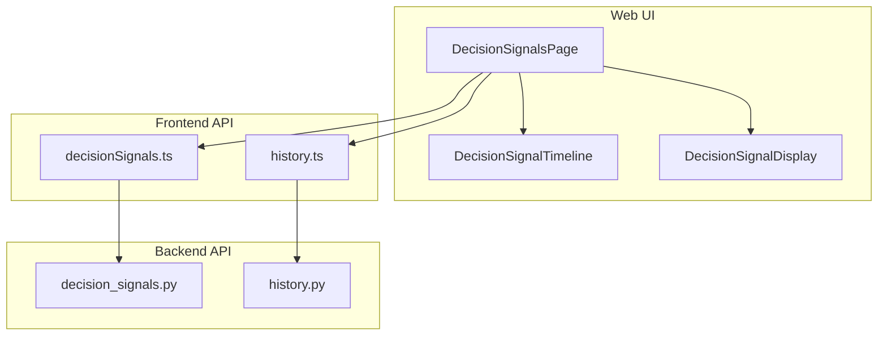
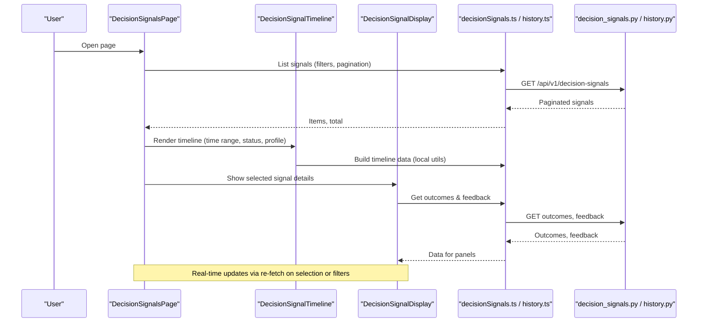
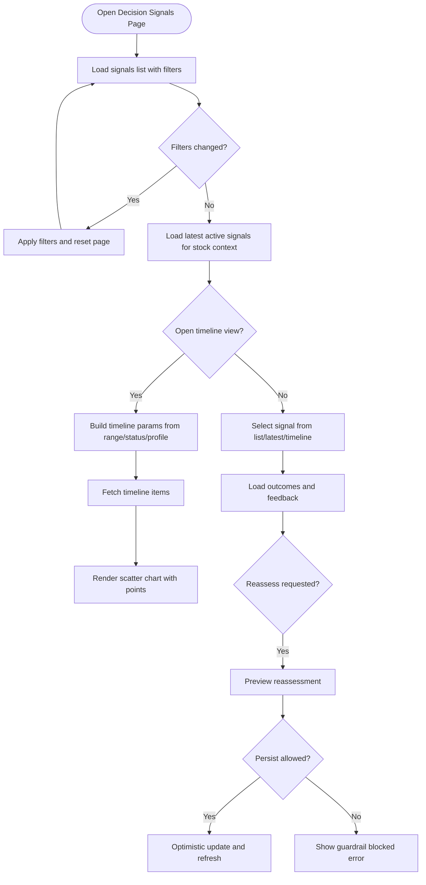
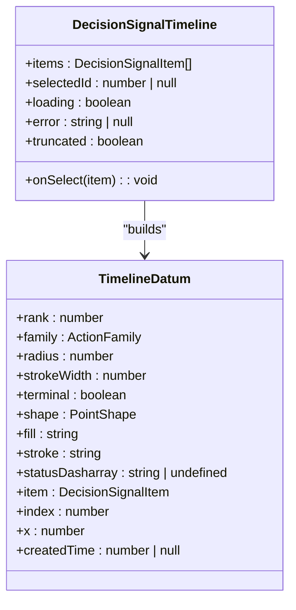
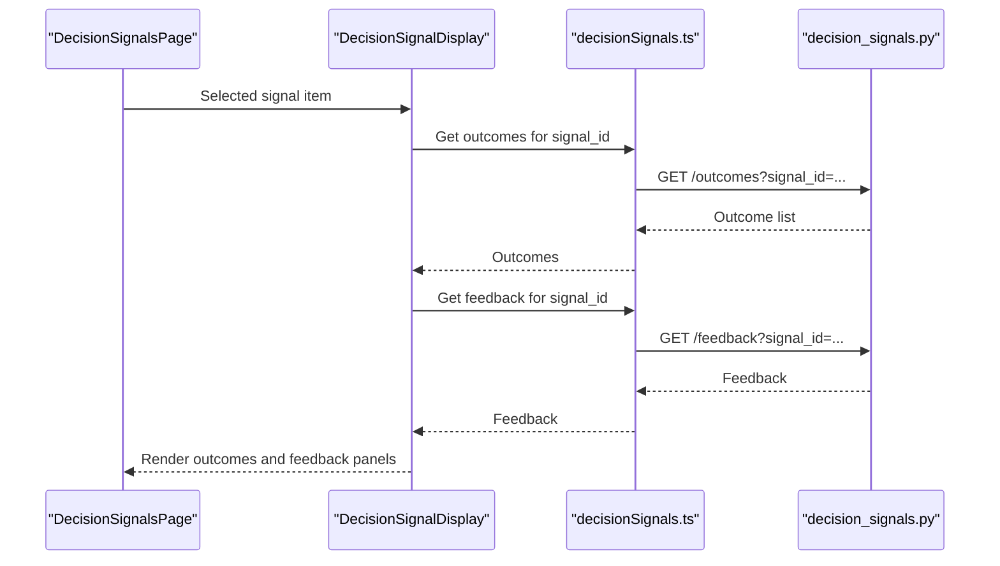
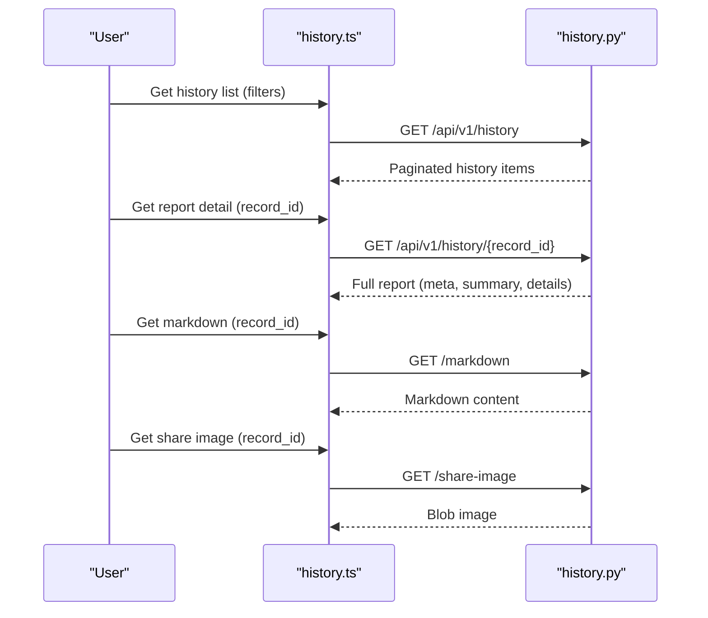
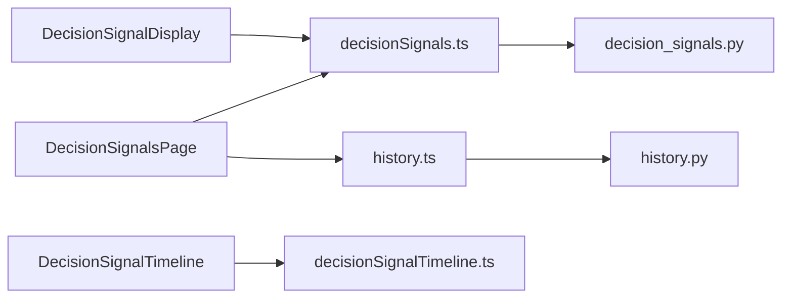

# Stock Analysis Interface

<cite>
**Referenced Files in This Document**
- [DecisionSignalsPage.tsx](file://apps/dsa-web/src/pages/DecisionSignalsPage.tsx)
- [DecisionSignalTimeline.tsx](file://apps/dsa-web/src/components/decision-signals/DecisionSignalTimeline.tsx)
- [DecisionSignalDisplay.tsx](file://apps/dsa-web/src/components/decision-signals/DecisionSignalDisplay.tsx)
- [decisionSignals.ts](file://apps/dsa-web/src/api/decisionSignals.ts)
- [history.ts](file://apps/dsa-web/src/api/history.ts)
- [decision_signals.py](file://api/v1/endpoints/decision_signals.py)
- [history.py](file://api/v1/endpoints/history.py)
- [decisionSignalTimeline.ts](file://apps/dsa-web/src/utils/decisionSignalTimeline.ts)
- [decisionSignals.ts](file://apps/dsa-web/src/types/decisionSignals.ts)
- [analysis.ts](file://apps/dsa-web/src/types/analysis.ts)
</cite>

## Table of Contents
1. [Introduction](#introduction)
2. [Project Structure](#project-structure)
3. [Core Components](#core-components)
4. [Architecture Overview](#architecture-overview)
5. [Detailed Component Analysis](#detailed-component-analysis)
6. [Dependency Analysis](#dependency-analysis)
7. [Performance Considerations](#performance-considerations)
8. [Troubleshooting Guide](#troubleshooting-guide)
9. [Conclusion](#conclusion)
10. [Appendices](#appendices)

## Introduction
This document explains the stock analysis interface components that power decision signal visualization, timeline charts, and historical analysis display. It covers how users view technical indicators, fundamental metrics, and AI-generated insights through interactive charts and tables. It also documents real-time data updates, filtering capabilities, export functionality, customization options for adding new indicator displays, integration with external charting libraries, performance optimization for large datasets, and mobile responsiveness considerations.

## Project Structure
The stock analysis interface is implemented as a React web application with a FastAPI backend:
- Frontend pages and components render decision signals, timelines, and history views.
- API clients call backend endpoints to list, filter, and fetch detailed reports and signals.
- Backend endpoints provide paginated lists, latest active signals, outcomes, feedback, and historical report details.

**Diagram sources**
- [DecisionSignalsPage.tsx:388-800](file://apps/dsa-web/src/pages/DecisionSignalsPage.tsx#L388-L800)
- [DecisionSignalTimeline.tsx:187-277](file://apps/dsa-web/src/components/decision-signals/DecisionSignalTimeline.tsx#L187-L277)
- [DecisionSignalDisplay.tsx:210-509](file://apps/dsa-web/src/components/decision-signals/DecisionSignalDisplay.tsx#L210-L509)
- [decisionSignals.ts:316-419](file://apps/dsa-web/src/api/decisionSignals.ts#L316-L419)
- [history.ts:26-167](file://apps/dsa-web/src/api/history.ts#L26-L167)
- [decision_signals.py:133-542](file://api/v1/endpoints/decision_signals.py#L133-L542)
- [history.py:206-800](file://api/v1/endpoints/history.py#L206-L800)

**Section sources**
- [DecisionSignalsPage.tsx:388-800](file://apps/dsa-web/src/pages/DecisionSignalsPage.tsx#L388-L800)
- [decision_signals.py:133-542](file://api/v1/endpoints/decision_signals.py#L133-L542)
- [history.py:206-800](file://api/v1/endpoints/history.py#L206-L800)

## Core Components
- Decision Signals Page: Central hub for listing, filtering, selecting, and viewing decision signals; supports timeline view and latest signals per stock.
- Decision Signal Timeline: Interactive scatter chart visualizing decisions over time with action rank, confidence, and status.
- Decision Signal Display: Cards and detail panels showing scores, confidence, horizons, price plans, reasons, catalysts, risks, invalidation, outcomes, feedback, evidence, quality, and metadata.
- History APIs: Endpoints to list history, get details, news, diagnostics, flow snapshots, and share images; also provides distinct stock bar for recent stocks.

Key user workflows:
- View decision signals with filters (market, stock code, action, phase, source type, status).
- Explore timeline of decisions for a stock within a date range and status profile.
- Inspect outcomes and feedback for each signal.
- Access historical reports with fundamentals, market structure, and AI insights.

**Section sources**
- [DecisionSignalsPage.tsx:388-800](file://apps/dsa-web/src/pages/DecisionSignalsPage.tsx#L388-L800)
- [DecisionSignalTimeline.tsx:187-277](file://apps/dsa-web/src/components/decision-signals/DecisionSignalTimeline.tsx#L187-L277)
- [DecisionSignalDisplay.tsx:210-509](file://apps/dsa-web/src/components/decision-signals/DecisionSignalDisplay.tsx#L210-L509)
- [history.py:206-800](file://api/v1/endpoints/history.py#L206-L800)

## Architecture Overview
The interface follows a layered architecture:
- Presentation layer: React components render interactive charts and tables.
- Client API layer: TypeScript modules encapsulate HTTP calls and response transformations.
- Server API layer: FastAPI endpoints handle business logic via services and repositories.

**Diagram sources**
- [DecisionSignalsPage.tsx:488-758](file://apps/dsa-web/src/pages/DecisionSignalsPage.tsx#L488-L758)
- [DecisionSignalTimeline.tsx:187-277](file://apps/dsa-web/src/components/decision-signals/DecisionSignalTimeline.tsx#L187-L277)
- [DecisionSignalDisplay.tsx:331-482](file://apps/dsa-web/src/components/decision-signals/DecisionSignalDisplay.tsx#L331-L482)
- [decisionSignals.ts:316-419](file://apps/dsa-web/src/api/decisionSignals.ts#L316-L419)
- [decision_signals.py:133-542](file://api/v1/endpoints/decision_signals.py#L133-L542)

## Detailed Component Analysis

### Decision Signals Page
Responsibilities:
- Manage filters and pagination for decision signals.
- Load latest active signals per stock context.
- Build timeline parameters based on range, status, and decision profile.
- Handle reassess preview and persistence with guardrail checks.
- Maintain selection state across list, latest, and timeline views.

Filtering and pagination:
- Supports market, stock code, action, market phase, source type, status, and date ranges.
- Converts frontend filters to backend query parameters with safe normalization.

Timeline controls:
- Range presets (30d, 90d, 180d), status filter (all/active), decision profile filter.
- Tracks applied timeline context and truncation when total exceeds items returned.

Latest signals:
- Fetches up to N latest active signals for a given stock and optional market.

Reassess workflow:
- Preview reassessment without persisting; if guardrails pass, persist changes with optimistic UI updates.

Error handling:
- Uses parsed API errors and request ID refs to avoid race conditions and stale updates.

**Diagram sources**
- [DecisionSignalsPage.tsx:180-303](file://apps/dsa-web/src/pages/DecisionSignalsPage.tsx#L180-L303)
- [DecisionSignalsPage.tsx:488-758](file://apps/dsa-web/src/pages/DecisionSignalsPage.tsx#L488-L758)
- [DecisionSignalsPage.tsx:639-800](file://apps/dsa-web/src/pages/DecisionSignalsPage.tsx#L639-L800)

**Section sources**
- [DecisionSignalsPage.tsx:180-303](file://apps/dsa-web/src/pages/DecisionSignalsPage.tsx#L180-L303)
- [DecisionSignalsPage.tsx:488-758](file://apps/dsa-web/src/pages/DecisionSignalsPage.tsx#L488-L758)
- [DecisionSignalsPage.tsx:639-800](file://apps/dsa-web/src/pages/DecisionSignalsPage.tsx#L639-L800)

### Decision Signal Timeline
Visualization:
- Scatter chart plotting decision actions over time with Y-axis representing action rank (-3 to 3).
- Point size encodes score; stroke width encodes confidence; terminal states use dashed rings.
- Tooltip shows stock name, creation time, action, score, confidence, horizon, status, source report, and profile.

Data preparation:
- Builds timeline data by sorting items by creation time and computing x positions; handles invalid dates with fallback offsets.
- Maps actions to families (bullish, defensive, neutral) and assigns colors.

Interactions:
- Clicking a point selects the corresponding signal item for detail view.
- Legend indicates family colors and alert shape.

**Diagram sources**
- [DecisionSignalTimeline.tsx:187-277](file://apps/dsa-web/src/components/decision-signals/DecisionSignalTimeline.tsx#L187-L277)
- [decisionSignalTimeline.ts:14-131](file://apps/dsa-web/src/utils/decisionSignalTimeline.ts#L14-L131)

**Section sources**
- [DecisionSignalTimeline.tsx:187-277](file://apps/dsa-web/src/components/decision-signals/DecisionSignalTimeline.tsx#L187-L277)
- [decisionSignalTimeline.ts:14-131](file://apps/dsa-web/src/utils/decisionSignalTimeline.ts#L14-L131)

### Decision Signal Display
Components:
- Card: Shows action badge, status, profile, stock info, score, confidence, horizon, entry range, stop loss, target price, reason, catalyst summary, watch conditions, risk summary, invalidation, plan quality, market phase, expiration, source report.
- Details panel: Expanded view with outcomes, feedback, evidence, data quality, and metadata JSON viewers.

Outcomes and feedback:
- Displays horizon-specific outcomes with hit/miss/neutral badges and return percentages.
- Allows submitting useful/not_useful feedback with loading and error states.

JSON viewers:
- Evidence, data quality, and metadata are rendered as structured JSON for inspection.

**Diagram sources**
- [DecisionSignalDisplay.tsx:331-482](file://apps/dsa-web/src/components/decision-signals/DecisionSignalDisplay.tsx#L331-L482)
- [decisionSignals.ts:394-419](file://apps/dsa-web/src/api/decisionSignals.ts#L394-L419)
- [decision_signals.py:425-542](file://api/v1/endpoints/decision_signals.py#L425-L542)

**Section sources**
- [DecisionSignalDisplay.tsx:210-509](file://apps/dsa-web/src/components/decision-signals/DecisionSignalDisplay.tsx#L210-L509)

### Historical Analysis Display
Capabilities:
- List history with filters (stock code, report type, date range) and pagination.
- Retrieve full report details including meta, summary, strategy, and details (news, context snapshot, financial report, dividend metrics, boards, sector/concept rankings, market structure).
- Access news associated with a report, diagnostics, run flow snapshots, and share image generation.
- Distinct stock bar returns recent unique stocks with last analysis summaries and counts.

Export and sharing:
- Markdown content retrieval for reports.
- Share image generation endpoint returns a blob for download or embedding.

**Diagram sources**
- [history.ts:26-167](file://apps/dsa-web/src/api/history.ts#L26-L167)
- [history.py:206-800](file://api/v1/endpoints/history.py#L206-L800)

**Section sources**
- [history.py:206-800](file://api/v1/endpoints/history.py#L206-L800)
- [history.ts:26-167](file://apps/dsa-web/src/api/history.ts#L26-L167)

## Dependency Analysis
Component relationships:
- DecisionSignalsPage depends on decisionSignalsApi and historyApi for data fetching.
- DecisionSignalTimeline uses local utilities to build timeline data and renders via Recharts.
- DecisionSignalDisplay consumes outcomes and feedback from decisionSignalsApi.
- Backend endpoints delegate to services for business logic and storage.

External dependencies:
- Recharts for timeline scatter chart rendering.
- FastAPI for backend routing and schema validation.
- DatabaseManager for history queries and deletions.

**Diagram sources**
- [DecisionSignalsPage.tsx:388-800](file://apps/dsa-web/src/pages/DecisionSignalsPage.tsx#L388-L800)
- [DecisionSignalTimeline.tsx:187-277](file://apps/dsa-web/src/components/decision-signals/DecisionSignalTimeline.tsx#L187-L277)
- [DecisionSignalDisplay.tsx:331-482](file://apps/dsa-web/src/components/decision-signals/DecisionSignalDisplay.tsx#L331-L482)
- [decisionSignals.ts:316-419](file://apps/dsa-web/src/api/decisionSignals.ts#L316-L419)
- [history.ts:26-167](file://apps/dsa-web/src/api/history.ts#L26-L167)
- [decision_signals.py:133-542](file://api/v1/endpoints/decision_signals.py#L133-L542)
- [history.py:206-800](file://api/v1/endpoints/history.py#L206-L800)

**Section sources**
- [decision_signals.py:133-542](file://api/v1/endpoints/decision_signals.py#L133-L542)
- [history.py:206-800](file://api/v1/endpoints/history.py#L206-L800)

## Performance Considerations
- Pagination: Both decision signals and history endpoints support page and page_size parameters to limit payload sizes.
- Truncation: Timeline view tracks truncated results and warns users when total exceeds returned items.
- Request deduplication: Request ID references prevent race conditions during rapid filter changes or selections.
- Local data transformation: Timeline data building is performed client-side to reduce server load and enable responsive interactions.
- Mobile responsiveness: Responsive containers and grid layouts adapt to smaller screens; consider reducing chart height and simplifying tooltips on mobile devices.
- Large datasets: Use server-side filtering (market, stock code, date ranges) and client-side caching where appropriate to minimize network requests.

[No sources needed since this section provides general guidance]

## Troubleshooting Guide
Common issues and resolutions:
- Guardrail blocked reassessment: When persisting reassessed signals fails due to guardrails, show blocked reason and warnings; do not persist changes.
- Not found errors: Ensure valid signal IDs and record IDs; handle 404 responses gracefully in UI.
- Validation errors: Check query parameters and payloads for required fields and correct types; log and display user-friendly messages.
- Network errors: Parse API errors and display inline alerts; retry logic can be added for transient failures.

**Section sources**
- [decision_signals.py:91-99](file://api/v1/endpoints/decision_signals.py#L91-L99)
- [decision_signals.py:413-542](file://api/v1/endpoints/decision_signals.py#L413-L542)
- [history.py:206-800](file://api/v1/endpoints/history.py#L206-L800)

## Conclusion
The stock analysis interface provides a comprehensive set of tools for visualizing decision signals, exploring timelines, and reviewing historical analyses. Users can interactively filter, select, and inspect signals while accessing rich details including outcomes, feedback, fundamentals, and AI insights. The architecture separates concerns between presentation, client API, and server endpoints, enabling scalability and maintainability. Performance optimizations like pagination, truncation, and local data transformation ensure responsive experiences even with large datasets.

[No sources needed since this section summarizes without analyzing specific files]

## Appendices

### Customizing Analysis Views
- Add new indicator displays: Extend the timeline data builder to include additional metrics (e.g., volatility bands) and map them to visual attributes (size, color).
- Integrate external charting libraries: Replace Recharts with another library by adapting data formats and event handlers; ensure responsive sizing and accessibility.
- Customize filters: Add new filter dimensions (e.g., sector, industry) by extending frontend state and backend query parameters.

[No sources needed since this section provides general guidance]