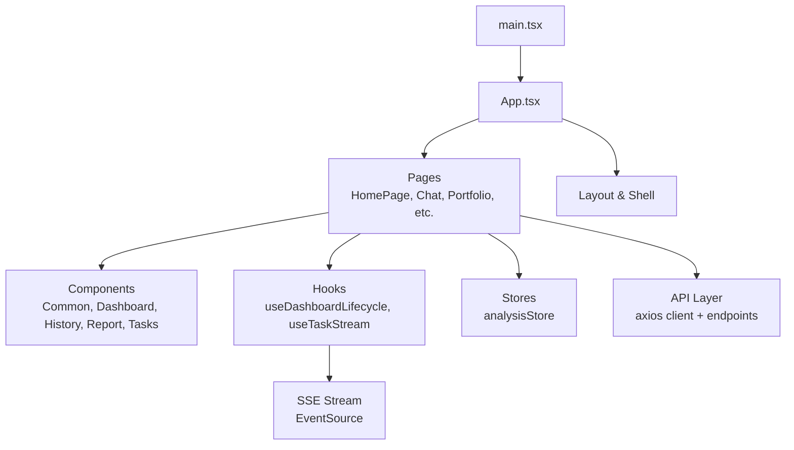
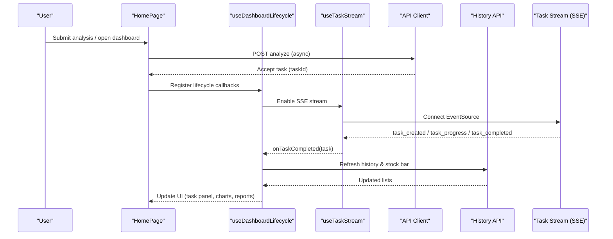
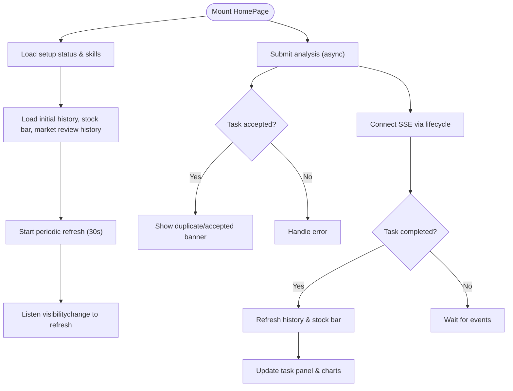
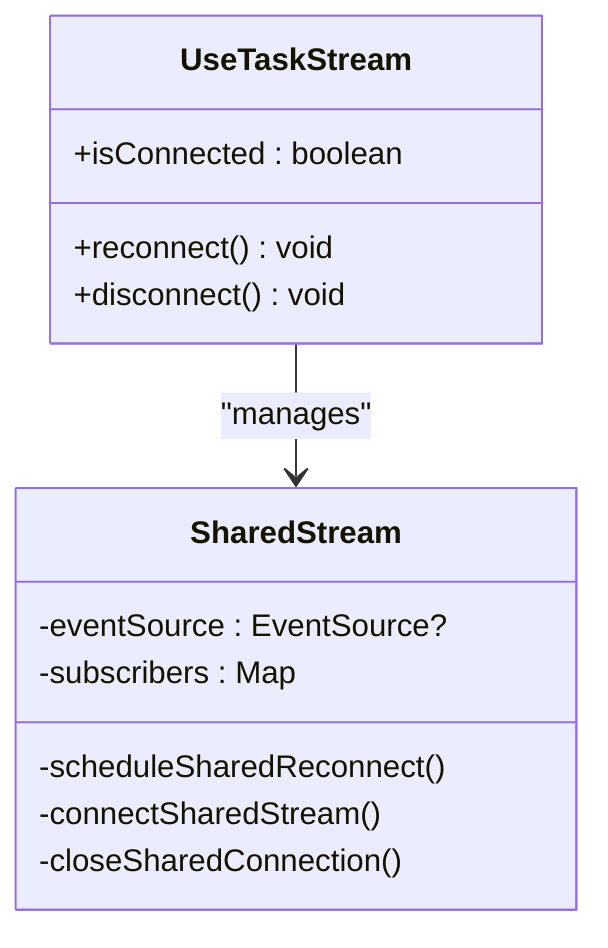
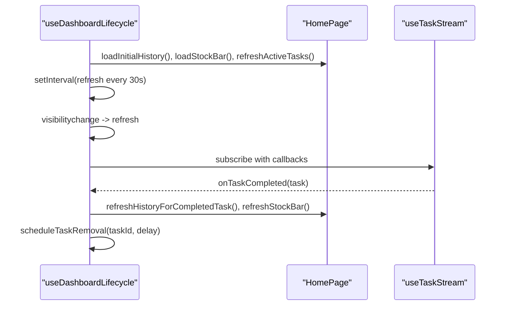
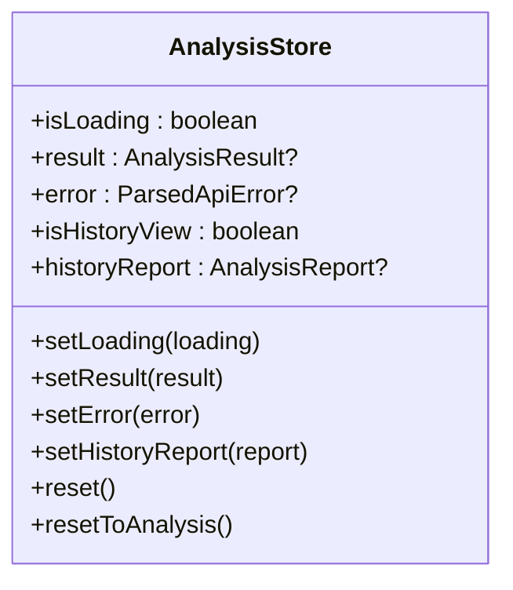
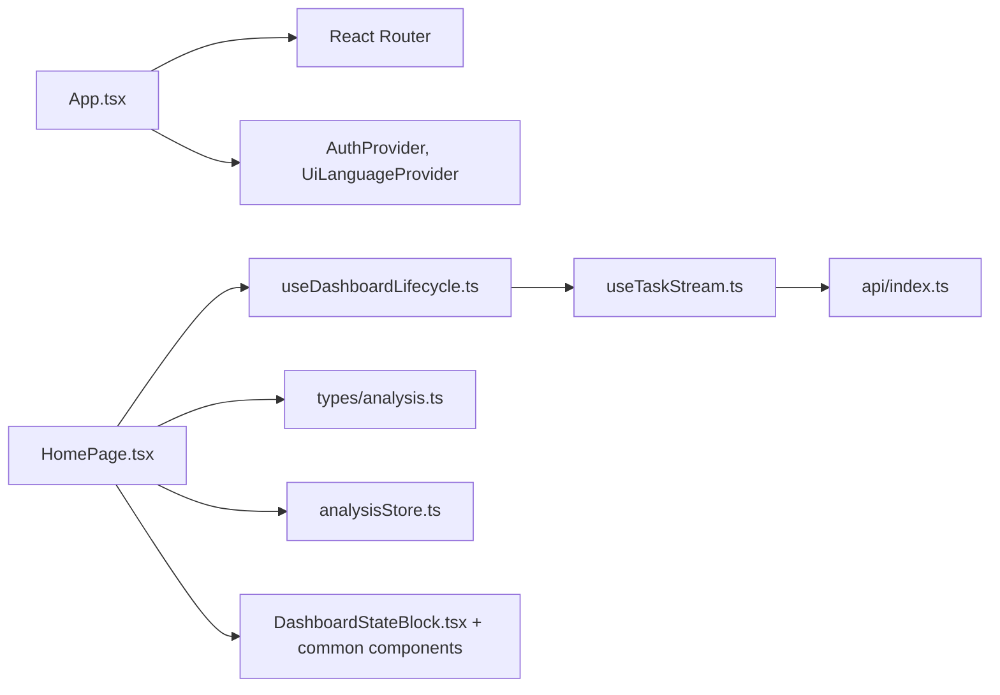

# Web Dashboard

<cite>
**Referenced Files in This Document**
- [main.tsx](file://apps/dsa-web/src/main.tsx)
- [App.tsx](file://apps/dsa-web/src/App.tsx)
- [HomePage.tsx](file://apps/dsa-web/src/pages/HomePage.tsx)
- [useDashboardLifecycle.ts](file://apps/dsa-web/src/hooks/useDashboardLifecycle.ts)
- [useTaskStream.ts](file://apps/dsa-web/src/hooks/useTaskStream.ts)
- [analysisStore.ts](file://apps/dsa-web/src/stores/analysisStore.ts)
- [ThemeProvider.tsx](file://apps/dsa-web/src/components/theme/ThemeProvider.tsx)
- [api/index.ts](file://apps/dsa-web/src/api/index.ts)
- [types/analysis.ts](file://apps/dsa-web/src/types/analysis.ts)
- [DashboardStateBlock.tsx](file://apps/dsa-web/src/components/dashboard/DashboardStateBlock.tsx)
</cite>

## Table of Contents
1. Introduction
2. Project Structure
3. Core Components
4. Architecture Overview
5. Detailed Component Analysis
6. Dependency Analysis
7. Performance Considerations
8. Troubleshooting Guide
9. Conclusion

## Introduction
This document describes the Web Dashboard, a React/TypeScript user interface for interactive stock analysis and management. It explains how the dashboard renders real-time charts, displays analysis results, monitors task progress, and views historical reports. It also documents the component architecture, state management patterns, API integration layers, responsive design approach, theme customization (light/dark modes), accessibility considerations, and extensibility through reusable components and hooks. Real-time updates are delivered via Server-Sent Events (SSE), with robust error handling and performance optimizations for large datasets.

## Project Structure
The web application is built with React 19, TypeScript, Vite, Tailwind CSS, Recharts for charting, Zustand for global state, and next-themes for theme management. The entry point bootstraps the app with strict mode and a theme provider. Routing is handled by react-router-dom, with lazy-loaded pages for performance. Feature areas include:
- Pages: Home, Chat, Portfolio, Decision Signals, Screening, Backtest, Alerts, Settings, Token Usage
- Components: Common UI primitives, dashboard-specific blocks, history viewers, report drawers, run-flow panels, tasks panel, watchlist workspace
- Hooks: Lifecycle orchestration, SSE streaming, system config, watchlist, autocomplete
- Stores: Global stores for analysis state and chat
- API layer: Axios client with interceptors, typed endpoints, and error normalization

**Diagram sources**
- [main.tsx:1-14](file://apps/dsa-web/src/main.tsx#L1-L14)
- [App.tsx:1-110](file://apps/dsa-web/src/App.tsx#L1-L110)
- [HomePage.tsx:1-800](file://apps/dsa-web/src/pages/HomePage.tsx#L1-L800)
- [useDashboardLifecycle.ts:1-138](file://apps/dsa-web/src/hooks/useDashboardLifecycle.ts#L1-L138)
- [useTaskStream.ts:1-378](file://apps/dsa-web/src/hooks/useTaskStream.ts#L1-L378)
- [analysisStore.ts:1-69](file://apps/dsa-web/src/stores/analysisStore.ts#L1-L69)
- [api/index.ts:1-30](file://apps/dsa-web/src/api/index.ts#L1-L30)

**Section sources**
- [main.tsx:1-14](file://apps/dsa-web/src/main.tsx#L1-L14)
- [App.tsx:1-110](file://apps/dsa-web/src/App.tsx#L1-L110)
- [package.json:1-60](file://apps/dsa-web/package.json#L1-L60)

## Core Components
- App shell and routing: Wraps the app with providers (language, auth, router) and defines routes to feature pages. Handles authentication redirects and loading/error states.
- HomePage: Central dashboard orchestrating analysis submission, history viewing, market review, stock bar, task panel, and strategy selection. Integrates lifecycle hooks and SSE streaming for live updates.
- Dashboard state block: Reusable component for displaying status, icons, descriptions, and actions with compact and loading variants.
- Theme provider: Provides light/dark themes using next-themes with system preference support.
- API client: Centralized axios instance with base URL, timeout, credentials, and response interceptor for 401 redirection and error enrichment.
- Types: Strongly-typed models for analysis requests/responses, history items, task info, and report structures.

Key responsibilities:
- Real-time chart visualization: Rendered via Recharts within report/history components; data sourced from history APIs and updated on task completion or periodic refresh.
- Analysis results display: Markdown and structured sections rendered in report drawers; summary and details mapped from typed report models.
- Task progress monitoring: Live updates via SSE; tasks appear in the task panel and auto-refresh history and stock bar upon completion.
- Historical report viewing: Paginated history list with filters and range selection; drill-down into full reports.

**Section sources**
- [App.tsx:27-95](file://apps/dsa-web/src/App.tsx#L27-L95)
- [HomePage.tsx:247-800](file://apps/dsa-web/src/pages/HomePage.tsx#L247-L800)
- [DashboardStateBlock.tsx:1-60](file://apps/dsa-web/src/components/dashboard/DashboardStateBlock.tsx#L1-L60)
- [ThemeProvider.tsx:1-20](file://apps/dsa-web/src/components/theme/ThemeProvider.tsx#L1-L20)
- [api/index.ts:1-30](file://apps/dsa-web/src/api/index.ts#L1-L30)
- [types/analysis.ts:1-643](file://apps/dsa-web/src/types/analysis.ts#L1-L643)

## Architecture Overview
The dashboard follows a layered architecture:
- Presentation layer: Pages and components render UI using Tailwind classes and Recharts.
- State layer: Local component state plus global Zustand store for cross-cutting concerns like analysis result and history view toggles.
- Integration layer: API client abstracts HTTP calls; SSE hook manages real-time event stream for tasks.
- Data layer: Backend APIs provide analysis, history, screening, alerts, and system configuration.

**Diagram sources**
- [HomePage.tsx:644-660](file://apps/dsa-web/src/pages/HomePage.tsx#L644-L660)
- [useDashboardLifecycle.ts:24-138](file://apps/dsa-web/src/hooks/useDashboardLifecycle.ts#L24-L138)
- [useTaskStream.ts:185-257](file://apps/dsa-web/src/hooks/useTaskStream.ts#L185-L257)
- [api/index.ts:1-30](file://apps/dsa-web/src/api/index.ts#L1-L30)

## Detailed Component Analysis

### HomePage Orchestration
Responsibilities:
- Manage query input, strategy selection, and analysis submission
- Load and paginate history, filter by date ranges and model
- Display stock bar summarizing recent analyses
- Integrate market review workflow and region selector
- Coordinate task panel and SSE-driven updates
- Handle duplicate task banners and batch analysis chunks

Key flows:
- Initial load: Fetch setup status and available skills; load initial history, stock bar, and market review history; start periodic refreshes and visibility-based refreshes.
- Submission: Trigger async analysis; handle duplicates; show banner; update task panel.
- Completion: On task completed, refresh history and stock bar; schedule task removal after delay.

**Diagram sources**
- [HomePage.tsx:415-451](file://apps/dsa-web/src/pages/HomePage.tsx#L415-L451)
- [HomePage.tsx:644-660](file://apps/dsa-web/src/pages/HomePage.tsx#L644-L660)
- [useDashboardLifecycle.ts:44-88](file://apps/dsa-web/src/hooks/useDashboardLifecycle.ts#L44-L88)

**Section sources**
- [HomePage.tsx:247-800](file://apps/dsa-web/src/pages/HomePage.tsx#L247-L800)
- [useDashboardLifecycle.ts:1-138](file://apps/dsa-web/src/hooks/useDashboardLifecycle.ts#L1-L138)

### SSE Task Streaming Hook
Responsibilities:
- Maintain a shared EventSource connection across subscribers
- Parse server payloads into typed TaskInfo and optional flow events
- Provide callbacks for created, started, progress, completed, failed, connected, and error
- Auto-reconnect with configurable delay and per-subscriber settings
- Expose reconnect/disconnect methods and connection status

**Diagram sources**
- [useTaskStream.ts:93-166](file://apps/dsa-web/src/hooks/useTaskStream.ts#L93-L166)
- [useTaskStream.ts:185-257](file://apps/dsa-web/src/hooks/useTaskStream.ts#L185-L257)
- [useTaskStream.ts:267-378](file://apps/dsa-web/src/hooks/useTaskStream.ts#L267-L378)

**Section sources**
- [useTaskStream.ts:1-378](file://apps/dsa-web/src/hooks/useTaskStream.ts#L1-L378)

### Dashboard Lifecycle Hook
Responsibilities:
- Initialize data loads on mount
- Poll refresh at intervals
- Refresh on visibility change
- Subscribe to SSE events and coordinate UI updates
- Schedule task removal after completion/failure

**Diagram sources**
- [useDashboardLifecycle.ts:24-138](file://apps/dsa-web/src/hooks/useDashboardLifecycle.ts#L24-L138)

**Section sources**
- [useDashboardLifecycle.ts:1-138](file://apps/dsa-web/src/hooks/useDashboardLifecycle.ts#L1-L138)

### Global State Store (Analysis)
Responsibilities:
- Track loading, result, error, and history view state
- Provide actions to set/reset state for analysis runs and history navigation

**Diagram sources**
- [analysisStore.ts:1-69](file://apps/dsa-web/src/stores/analysisStore.ts#L1-L69)

**Section sources**
- [analysisStore.ts:1-69](file://apps/dsa-web/src/stores/analysisStore.ts#L1-L69)

### Theme Provider
Responsibilities:
- Wrap the app with next-themes provider
- Default to dark theme, enable system theme detection, disable transition on theme change

**Section sources**
- [ThemeProvider.tsx:1-20](file://apps/dsa-web/src/components/theme/ThemeProvider.tsx#L1-L20)

### API Client
Responsibilities:
- Configure axios with base URL, timeout, credentials, and content type
- Intercept responses to redirect on 401 and attach parsed errors

**Section sources**
- [api/index.ts:1-30](file://apps/dsa-web/src/api/index.ts#L1-L30)

### Types
Responsibilities:
- Define request/response shapes for analysis, history, tasks, and reports
- Provide helpers for sentiment labels and colors

**Section sources**
- [types/analysis.ts:1-643](file://apps/dsa-web/src/types/analysis.ts#L1-L643)

## Dependency Analysis
High-level dependencies between core modules:

**Diagram sources**
- [App.tsx:1-110](file://apps/dsa-web/src/App.tsx#L1-L110)
- [HomePage.tsx:1-800](file://apps/dsa-web/src/pages/HomePage.tsx#L1-L800)
- [useDashboardLifecycle.ts:1-138](file://apps/dsa-web/src/hooks/useDashboardLifecycle.ts#L1-L138)
- [useTaskStream.ts:1-378](file://apps/dsa-web/src/hooks/useTaskStream.ts#L1-L378)
- [api/index.ts:1-30](file://apps/dsa-web/src/api/index.ts#L1-L30)
- [types/analysis.ts:1-643](file://apps/dsa-web/src/types/analysis.ts#L1-L643)
- [analysisStore.ts:1-69](file://apps/dsa-web/src/stores/analysisStore.ts#L1-L69)
- [DashboardStateBlock.tsx:1-60](file://apps/dsa-web/src/components/dashboard/DashboardStateBlock.tsx#L1-L60)

**Section sources**
- [App.tsx:1-110](file://apps/dsa-web/src/App.tsx#L1-L110)
- [HomePage.tsx:1-800](file://apps/dsa-web/src/pages/HomePage.tsx#L1-L800)
- [useDashboardLifecycle.ts:1-138](file://apps/dsa-web/src/hooks/useDashboardLifecycle.ts#L1-L138)
- [useTaskStream.ts:1-378](file://apps/dsa-web/src/hooks/useTaskStream.ts#L1-L378)
- [api/index.ts:1-30](file://apps/dsa-web/src/api/index.ts#L1-L30)
- [types/analysis.ts:1-643](file://apps/dsa-web/src/types/analysis.ts#L1-L643)
- [analysisStore.ts:1-69](file://apps/dsa-web/src/stores/analysisStore.ts#L1-L69)
- [DashboardStateBlock.tsx:1-60](file://apps/dsa-web/src/components/dashboard/DashboardStateBlock.tsx#L1-L60)

## Performance Considerations
- Lazy page loading: Pages are imported lazily to reduce initial bundle size and improve time-to-interactive.
- Pagination and chunking: History and stock bar loads use pagination; batch analysis uses chunk sizes to avoid overwhelming the backend.
- Concurrency control: Watchlist history lookup uses limited concurrency to balance throughput and network load.
- Polling interval: Dashboard refreshes at a reasonable interval to keep data fresh without excessive requests.
- SSE efficiency: Shared EventSource minimizes overhead; automatic reconnection reduces manual intervention.
- Rendering optimization: Memoization (e.g., useMemo) used for derived data such as strategy options and mappings to prevent unnecessary recalculations.
- Chart performance: Large datasets should be aggregated or sampled before rendering; consider virtualization for long lists.

[No sources needed since this section provides general guidance]

## Troubleshooting Guide
Common issues and resolutions:
- Network errors and retries:
  - API client attaches parsed errors to responses; handle them in components and surface via ApiErrorAlert.
  - SSE hook logs warnings on disconnect and attempts reconnection automatically.
- Authentication failures:
  - 401 responses trigger redirect to login with return path preserved.
- SSE connectivity:
  - Ensure withCredentials is enabled if cookies are used for auth.
  - Verify server SSE endpoint availability and CORS settings.
- Large dataset rendering:
  - Use pagination and limit visible rows; aggregate metrics where possible.
  - Debounce search inputs and throttle frequent updates.
- Task panel state:
  - Tasks are scheduled for removal after completion/failure; ensure cleanup logic runs on unmount.

**Section sources**
- [api/index.ts:14-27](file://apps/dsa-web/src/api/index.ts#L14-L27)
- [useTaskStream.ts:248-257](file://apps/dsa-web/src/hooks/useTaskStream.ts#L248-L257)
- [useDashboardLifecycle.ts:106-134](file://apps/dsa-web/src/hooks/useDashboardLifecycle.ts#L106-L134)

## Conclusion
The Web Dashboard provides a robust, real-time interface for stock analysis and management. Its modular architecture separates concerns across presentation, state, integration, and data layers. SSE streaming ensures live task updates, while thoughtful performance strategies handle large datasets. Extensible components and hooks make it straightforward to add new widgets, customize layouts, and integrate additional features. Responsive design and theme support deliver a consistent experience across devices and preferences.

[No sources needed since this section summarizes without analyzing specific files]